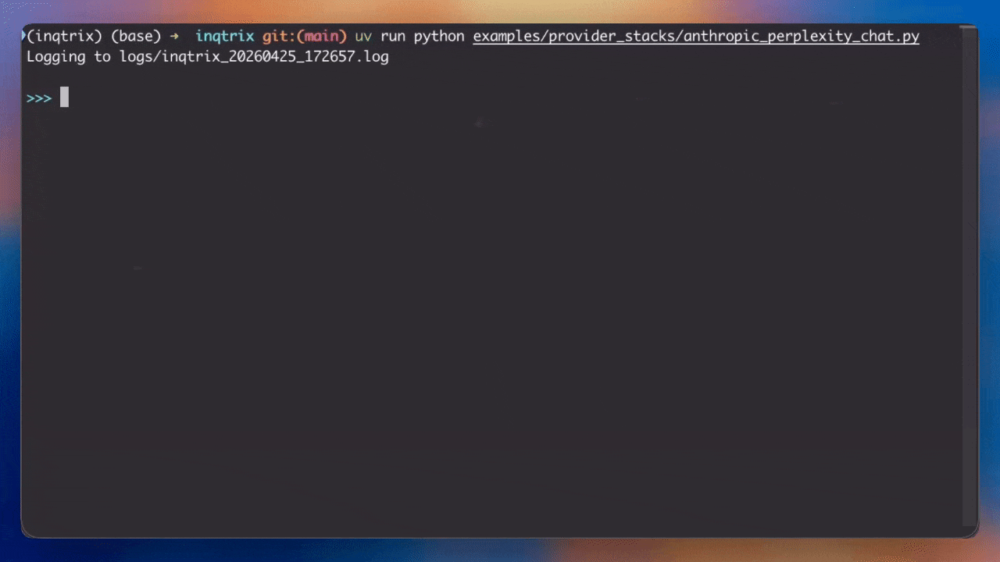
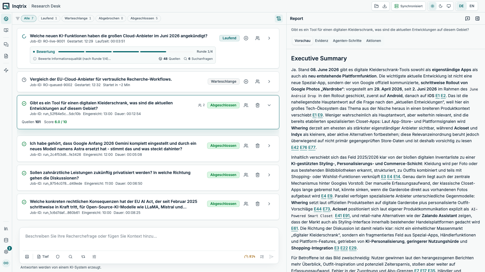
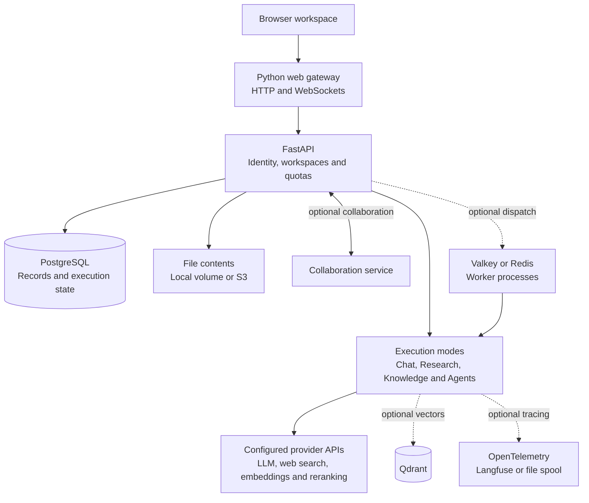

<div align="center">
  <a name="readme-top"></a>
  

  <p></p>

  <p>
    <b>Self-hosted, iterative AI research agent with a unified research workspace around it.</b><br>
    <sub>Built for analysts · academics · journalists · consultants · knowledge teams · technical researchers</sub><br><br>
    <b>From question → sources → claims → evidence → report → editor → reusable knowledge</b><br>
    Search the web <i>and</i> your own documents, assess sources and claims, and produce cited reports;<br>
    then chat, write, and refine the results in one place. Your keys, one command to deploy.<br>
  </p>

  <p>
    <a href="#what-is-inqtrix"><b>What is it</b></a> &nbsp;·&nbsp;
    <a href="#quick-start"><b>Quick start</b></a> &nbsp;·&nbsp;
    <a href="#ways-to-run-inqtrix"><b>Ways to run</b></a> &nbsp;·&nbsp;
    <a href="docs/architecture/websearch/loop.md"><b>How it works</b></a> &nbsp;·&nbsp;
    <a href="docs/README.md"><b>Documentation</b></a><br>
  </p>

  <p>
    
    <a href="LICENSE"></a>
    
    <a href="docs/getting-started/stack-quickstart.md"></a>
    
    
    
    
  </p>
</div>

<details>
<summary><b>Status &amp; disclaimer: experimental software. Read before use</b></summary>
<p></p>

> [!WARNING]
>This repository is an experimental codebase and integration foundation for self-hosted or locally operated deployments. It does **not** provide a complete production-ready security configuration, hardened deployment profile, or any assurance that it is suitable for direct use in internet-facing, multi-user, regulated, or otherwise high-risk environments.
>
>Configurations, defaults, example values, example scripts, and helper paths included here may be useful for development, testing, or integration work, but must not be assumed to be secure, complete, or appropriate for production use without independent review and adaptation.
>
>Secure configuration, hardening, deployment architecture, access control, secret handling, logging, monitoring, compliance, and day-to-day operation remain the sole responsibility of the operator. The current test suite covers substantial internal logic, interface behavior, and regression scenarios, but is **not** evidence of production readiness or fully validated live integrations. Perform your own technical and security review before using this project in integration, staging, test, or production environments. See [Security model](docs/deployment/security-model.md).

</details>

<details>
<summary><kbd>Table of contents</kbd></summary>

- [What is Inqtrix](#what-is-inqtrix)
- [Demo](#demo)
- [Workspace features](#workspace-features)
- [Quick start](#quick-start)
- [Ways to run Inqtrix](#ways-to-run-inqtrix)
  - [A. Full stack (Docker Compose)](#a-full-stack-docker-compose)
  - [B. Standalone API server](#b-standalone-api-server)
  - [C. Python library](#c-python-library)
  - [D. Developer components](#d-developer-components)
- [Capability tiers (opt-in)](#capability-tiers-opt-in)
- [The web workspace](docs/deployment/react-ui.md)
- [How the research loop works](docs/architecture/websearch/loop.md)
- [Configuration essentials](#configuration-essentials)
- [Architecture &amp; components](#architecture--components)
- [Documentation map](#documentation-map)
- [Project &amp; license](#project--license)

</details>

## What is Inqtrix

Inqtrix is an **open-source, self-hosted AI research workspace** for web research,
questions over your own documents, and agent-assisted writing. Its research
engine plans queries, searches in parallel, extracts claims, assesses their
support and source quality, and composes cited reports. The workspace keeps
reports, evidence, conversations and documents available for follow-up work.

It comes in two halves you can adopt independently.

**The backend can be embedded or served.** Use `ResearchAgent` as a Python
library, or deploy the HTTP service with OpenAI-compatible chat completions,
native runs with live progress, knowledge retrieval and agent orchestration.
The server owns authentication, workspace access, quotas, sharing and durable
state. It supports `none`, `apikey`, `local` and `oidc` authentication, Postgres
records, local or S3 file storage, Qdrant retrieval and optional worker processes.

**The web workspace connects those capabilities.** The React frontend uses the
same API and brings research, conversations and authoring together.

## Workspace features

| Area | What you can do |
|---|---|
| **Research Desk** | Run iterative web research, inspect progress and evidence, and retain the cited report for later use. Web content comes from the configured search API; Inqtrix does not fetch the cited websites separately. |
| **Agent Desk** | Give an assignment, request a named Canvas document, ask follow-up questions, and queue comments on selected passages for targeted changes. Attach a saved research report with `@` to bring its report and references into the conversation. |
| **Chat** | Converse with the selected model and work with attached reports, files and reusable prompts. |
| **Knowledge** | Index your documents and ask cited questions over permitted collections. In Agent Desk, `/wissen` enables the accessible collection scope; explicit collection chips narrow it. The web switch independently controls web access. |
| **Canvas and Editor** | Revisit agent documents in Canvas, or write in Editor with AI revisions presented as **accept/reject tracked changes**. Export to Word; optionally collaborate on shared editor documents with `view`, `suggest` and `edit` permissions. |
| **Prompt Library and Skills** | Reuse prompts and context packs; attach skills with instructions, clarification points and tool constraints. Share supported resources through explicit recipient consent. |

Agent Desk offers **Quick, Thorough and Deep** levels. They govern the
depth and available forms of research, delegation and review; the permission
mode remains a separate choice. Canvas output can be requested in every tier.
See [Agent platform](docs/architecture/agent-platform.md) for the execution and
permission contracts, and [React UI](docs/deployment/react-ui.md) for the workspace.

New Chat and Agent conversations receive a provisional title immediately. When
a Fast model is configured, a short title is generated alongside the answer;
manual names are protected from late model replies and stale saves. Optional
[tracing](docs/observability/tracing-legend.md) exposes the execution and, when
content capture is enabled, the actual provider and tool conversations.

## Demo

<div align="center">
  
  <br><br>
  
</div>

## Quick start

Docker Compose runs the complete self-hosted stack in three steps: web UI, API, and database behind one URL, with no Python toolchain on your machine.

### Step 1: What you need

Inqtrix is provider-neutral: you bring your own accounts and keys, and each
entry in the paired stack configuration has a specific job. You cannot start
it empty.

| You need (one per row) | What it's for |
|---|---|
| **An LLM provider key:** Anthropic, Azure OpenAI, AWS Bedrock, or any OpenAI-compatible gateway via LiteLLM (this reaches OpenAI, OpenRouter, vLLM, Ollama today; a native OpenAI provider is coming) | the reasoning: query planning, summarisation, claim extraction, and answer writing |
| **A web-search provider key:** Perplexity, or Azure AI Foundry Web Search | the actual web search each research round runs |
| **Docker or Podman** | runs the stack (no account needed) |
| **Three secrets:** a Postgres password, `INQTRIX_SESSION_SECRET`, `INQTRIX_PAT_PEPPER` | local random strings you generate yourself (no account needed) |

Want a knowledge base (RAG) over your own documents too? Then you also need an **embedding provider** for indexing. It usually runs through your LLM provider when that is OpenAI-compatible (the LiteLLM gateway); with Anthropic or Bedrock you point it at a separate OpenAI-compatible endpoint or Azure. A **reranker** (Cohere, or served via Azure or Bedrock; tested with Cohere) is optional but recommended for the best retrieval quality. You configure both in Step 2's optional block.

### Step 2: Clone and configure

```bash
git clone https://github.com/inqtrix/inqtrix.git && cd inqtrix
cp deploy/.env.stack.example deploy/.env.stack
cp deploy/.env.stack.secrets.example deploy/.env.stack.secrets
chmod 0600 deploy/.env.stack.secrets
```

`deploy/.env.stack` is the transparent, non-secret configuration: the complete
database URL, hosts, ports, profiles, providers, and model choices remain
visible there. `deploy/.env.stack.secrets` contains the values that must not be
committed. The visible DSN in the config references
`${INQTRIX_PG_PASSWORD}`; no helper script assembles or materializes it.

Set these independent values in `deploy/.env.stack.secrets` first:

```dotenv
INQTRIX_PG_PASSWORD=replace-with-url-safe-random-value
INQTRIX_SESSION_SECRET=replace-with-independent-random-value
INQTRIX_PAT_PEPPER=replace-with-another-independent-random-value
```

Then choose one LLM and one search provider. Put the **Configuration** block in
`deploy/.env.stack` and the **Credentials** block in
`deploy/.env.stack.secrets`; replace the existing provider assignments in the
copied config instead of appending duplicate keys. Uncomment only the selected
credential lines and leave every unused provider credential commented — the
preflight rejects duplicate keys in either file.

One combination is spelled out below so you can copy, paste and run. The
others — LiteLLM or any OpenAI-compatible gateway, Azure OpenAI, all-Azure
with Foundry web search, AWS Bedrock — and the workload-identity alternatives
are in [Provider recipes](docs/getting-started/provider-recipes.md), in the
same copy-paste shape.

<details>
<summary><b>Anthropic + Perplexity</b> <sub>(simplest cloud setup)</sub></summary>

Configuration:

```dotenv
INQTRIX_LLM_PROVIDER=anthropic
REASONING_MODEL=claude-opus-4-8
TIER_HIGH_MODEL=claude-opus-4-8
TIER_MID_MODEL=claude-sonnet-4-6
TIER_FAST_MODEL=claude-haiku-4-5
TIER_HIGH_EFFORT=medium
INQTRIX_SEARCH_PROVIDER=perplexity
INQTRIX_SELECTABLE_CHAT_MODELS=claude-opus-4-8,claude-sonnet-4-6,claude-haiku-4-5
```

Credentials:

```dotenv
ANTHROPIC_API_KEY=sk-ant-...
PERPLEXITY_API_KEY=pplx-...
```

</details>

<details>
<summary><b>Optional: add a knowledge base (RAG over your own documents)</b></summary>

Edit the matching canonical fields in `deploy/.env.stack` rather than appending
duplicate assignments, put any corresponding API keys in
`deploy/.env.stack.secrets`, then start with `--profile knowledge`. RAG is off
by default.

```dotenv
# --- Knowledge engine (RAG): persistent vector store via Qdrant ---
INQTRIX_KNOWLEDGE_ENABLED=true
INQTRIX_VECTOR_BACKEND=qdrant
# the `qdrant` compose service, started by --profile knowledge
INQTRIX_QDRANT_URL=http://qdrant:6333
# required for bundled Qdrant; belongs in deploy/.env.stack.secrets
# INQTRIX_QDRANT_API_KEY=generate-a-long-random-value

# --- Embedding model for indexing ---
# Reuses your OpenAI-compatible (LiteLLM) gateway by default. With Anthropic/Bedrock LLMs,
# set a dedicated embedding endpoint or use Azure (uncomment below).
INQTRIX_EMBEDDING_MODEL=text-embedding-3-small
# INQTRIX_EMBEDDING_PROVIDER=azure
# INQTRIX_EMBEDDING_BASE_URL=...

# --- Optional reranker for the best retrieval quality (tested with Cohere) ---
# INQTRIX_RERANKER_PROVIDER=cohere
# INQTRIX_RERANKER_BASE_URL=...    INQTRIX_RERANKER_MODEL=...
```

</details>

### Step 3: Start

```bash
# Research + chat (the default stack):
docker compose -f deploy/compose/compose.stack.yaml \
  --env-file deploy/.env.stack.secrets \
  --env-file deploy/.env.stack \
  up -d --build

# ...or with the knowledge base (RAG): add the knowledge profile
docker compose -f deploy/compose/compose.stack.yaml \
  --env-file deploy/.env.stack.secrets \
  --env-file deploy/.env.stack \
  --profile knowledge \
  up -d --build
```

> [!NOTE]
> **Using Podman?** The commands work unchanged with the Compose v2 provider:
> run `podman compose ...` in place of `docker compose ...`. The same ordered
> environment pair is used by Docker and Podman; no engine-specific secret
> materialization step exists.

The first build pulls images and installs dependencies (a few minutes); later starts are fast. Then open <http://localhost:8080>; the first visit walks you through creating the owner account. Verify with:

```bash
curl http://localhost:8080/health          # active providers + models
curl http://localhost:8080/v1/capabilities # which features are on (knowledge, files, sharing, ...)
```

The default stack is **Postgres + API + web** (research, chat, durable runs,
native login). Scaled workers (Valkey), bundled S3-compatible storage
(SeaweedFS), and the bundled SSO reference (Dex) are further
opt-in [capability tiers](#capability-tiers-opt-in) added with Compose profiles.
Managed or otherwise external S3 is selected only through configuration and
does not use the bundled `s3` profile.

<details>
<summary><b>All compose profiles (turn on more)</b></summary>

Each profile starts its bundled container(s); the matching variables in
`deploy/.env.stack` turn the feature on, so **you need both**. Profiles combine,
each with its own `--profile` flag, for example
`--profile knowledge --profile workers --profile s3` when the object store is
the bundled SeaweedFS service.

| `--profile` | Starts | Unlocks | Variables to set |
|---|---|---|---|
| *(none)* | postgres + migrate + api + web | research, chat, durable runs, login | (the default) |
| **`knowledge`** | qdrant | RAG / knowledge base over your documents | `INQTRIX_KNOWLEDGE_ENABLED=true`, `INQTRIX_VECTOR_BACKEND=qdrant`, `INQTRIX_QDRANT_URL`, required `INQTRIX_QDRANT_API_KEY` in the secrets file |
| **`workers`** | valkey + worker | scaled, restart-surviving runs | `INQTRIX_QUEUE_BACKEND=valkey`, `INQTRIX_VALKEY_*` |
| **`s3`** | seaweedfs | S3 object store instead of the local volume | `INQTRIX_OBJECT_STORE_BACKEND=s3`, `INQTRIX_S3_*` |
| **`collaboration`** | collaboration sidecar | real-time multi-user editing | `INQTRIX_COLLABORATION_ENABLED=true`, independent collaboration secret |
| **`pgbouncer`** | PgBouncer | optional transaction pooling for high database fan-in | runtime DSN explicitly changed to `pgbouncer:6432`; migrations remain direct |
| **`oidc`** | dex | enterprise SSO (Dex is the dev reference; any OIDC IdP works) | `INQTRIX_AUTH_MODE=oidc`, `INQTRIX_OIDC_*` |
| **`observability`** | clickhouse + langfuse-valkey + langfuse-init-db + langfuse-bucket-init + langfuse-worker + langfuse | self-hosted Langfuse as the OTLP trace backend for agentic runs | `INQTRIX_TRACING=otlp`, the `LANGFUSE_*` secrets, and the `LANGFUSE_INIT_*` bootstrap values whose project keys also form `OTEL_EXPORTER_OTLP_HEADERS` |

`workers` deliberately starts two containers (`valkey` and `worker`) under one profile. Every variable and its meaning is in `deploy/.env.stack.example` and [Settings and env](docs/configuration/settings-and-env.md).
PgBouncer is never inferred from workload size or enabled by the deployment
CLI: both the `pgbouncer` profile and the visible pooler DSN are required.
`observability` requires `--profile s3` alongside it (or an external
`INQTRIX_S3_*` object store), because Langfuse reuses the bucket.

</details>

<details>
<summary><b>Stop, start, update, and other lifecycle commands</b></summary>

The Compose file and both ordered environment files are required on every raw
command: secrets first, visible configuration second. With Podman it is
identical; only replace `docker compose` with `podman compose`.

Status and health of every service:

```bash
docker compose -f deploy/compose/compose.stack.yaml \
  --env-file deploy/.env.stack.secrets --env-file deploy/.env.stack ps
```

Follow the API log (startup and config errors land here):

```bash
docker compose -f deploy/compose/compose.stack.yaml \
  --env-file deploy/.env.stack.secrets --env-file deploy/.env.stack logs -f api
```

Stop and remove the containers, but keep your data (the volumes):

```bash
docker compose -f deploy/compose/compose.stack.yaml \
  --env-file deploy/.env.stack.secrets --env-file deploy/.env.stack down
```

Start it again:

```bash
docker compose -f deploy/compose/compose.stack.yaml \
  --env-file deploy/.env.stack.secrets --env-file deploy/.env.stack up -d
```

Restart without rebuilding:

```bash
docker compose -f deploy/compose/compose.stack.yaml \
  --env-file deploy/.env.stack.secrets --env-file deploy/.env.stack restart api web
```

Update after a `git pull` (rebuild and re-run migrations):

```bash
docker compose -f deploy/compose/compose.stack.yaml \
  --env-file deploy/.env.stack.secrets --env-file deploy/.env.stack up -d --build
```

Managed PostgreSQL in migration `owner` mode uses the guarded
`inqtrix-deploy ... owner-upgrade` command after the pull, not the generic
command above. Its raw-Compose maintenance sequence remains documented in
[Database migrations](docs/deployment/database-migrations.md).

Destroy everything, including the database and uploaded files (irreversible):

```bash
docker compose -f deploy/compose/compose.stack.yaml \
  --env-file deploy/.env.stack.secrets --env-file deploy/.env.stack down -v
```

Backup, restore, and reset playbooks: [Runbooks](docs/deployment/runbooks.md). To type less, run `export COMPOSE_FILE=deploy/compose/compose.stack.yaml` once per shell and drop the `-f` flag from every command above.

</details><br>

**Go deeper:**

- [Provider recipes](docs/getting-started/provider-recipes.md) gives copy-paste `.env` blocks for each LLM and search combination.
- [Settings and env](docs/configuration/settings-and-env.md) documents every variable (secrets, models, storage, auth).
- [Platform components](docs/getting-started/platform-components.md) maps each
  feature to its required service and distinguishes bundled Compose profiles
  from managed dependencies (Qdrant / Valkey / S3 / OIDC).
- [Auth modes](docs/deployment/auth-modes.md) covers login setup: native accounts or SSO.
- [Stack quickstart](docs/getting-started/stack-quickstart.md) is the full step-by-step walkthrough.
- [Kubernetes](docs/deployment/kubernetes.md) deploys the same stack on a cluster via the bundled Helm chart.

> [!TIP]
> Prefer the engine on its own, or embedded in Python? Jump to [Ways to run Inqtrix](#ways-to-run-inqtrix). There are four, and this is just the first.

<div align="right"><a href="#readme-top"><sub>back to top ↑</sub></a></div>

## Ways to run Inqtrix

Same engine, four entry points: from a one-command deployment to a single Python import. Start with the row that matches you:

| You want to… | Run mode | Jump to |
| :--- | :--- | :--- |
| Self-host the complete stack, fast | **A.** Docker Compose | [→](#a-full-stack-docker-compose) |
| Add research to your own backend / UI over HTTP | **B.** API server | [→](#b-standalone-api-server) |
| Embed research inside Python code | **C.** Library | [→](#c-python-library) |
| Extend it with custom providers, strategies, or the UI in dev | **D.** Developer components | [→](#d-developer-components) |

---

### A. Full stack (Docker Compose)

> **What it is:** the complete stack (React web app + API + Postgres) in one `docker compose up`.
> **Who it's for:** teams and self-hosters who want the whole stack from one command, with no Python toolchain and no host-side build.

This is the path the [Quick start](#quick-start) above walks through, and the
default for everything below. The browser talks to **one origin** at
`http://localhost:8080`; the gateway reverse-proxies `/api`, `/v1`, `/health`
and `/collaboration` to the API internally, so there is no CORS and no
build-time API-URL coupling. Optional profiles add Qdrant, workers, an object
store, SSO and the collaboration sidecar — see
[Stack quickstart](docs/getting-started/stack-quickstart.md) for the full
walkthrough and [Platform components](docs/getting-started/platform-components.md)
to decide which of them you actually need.


### B. Standalone API server

> **What it is:** just the engine over HTTP, exposing an OpenAI-compatible endpoint plus a richer native run API.
> **Who it's for:** integrators building a frontend, an SDK client, or any HTTP integration without embedding Python.

```bash
# uv
uv sync --extra dev
uv run python -m inqtrix

# or standard Python/pip
python -m venv .venv
source .venv/bin/activate
python -m pip install -e ".[dev]"
python -m inqtrix
```

Copy `.env.example` to `.env` and configure one LLM plus one search provider
before either start command. The API listens on <http://localhost:5100>.

Override the bind with `INQTRIX_SERVER_HOST` (default `0.0.0.0`) and `INQTRIX_SERVER_PORT` (default `5100`). Each request runs a fresh state; the server is stateless for research data unless you add durable backends.

```bash
curl -N http://localhost:5100/v1/chat/completions \
  -H "Content-Type: application/json" \
  -d '{"model":"research-agent","stream":true,
       "messages":[{"role":"user","content":"Was ist der Stand der GKV-Reform?"}]}'
```

Every endpoint accepts a top-level `mode`: `research` (the full loop), `direct_llm` (straight to the LLM), or `knowledge` (RAG over your collections, when enabled).

<details>
<summary><b>All endpoints &amp; the native run lifecycle</b></summary>

<p></p>

| Route | Method | Purpose |
|---|---|---|
| `/health` | GET | Liveness, active providers/models, `auth_mode`. *(open)* |
| `/v1/models` | GET | OpenAI-style model discovery. *(open)* |
| `/v1/capabilities` | GET | Feature manifest, which features are configured. *(open)* |
| `/v1/stacks` | GET | Multi-stack deployments: per-stack provider/model discovery. *(open)* |
| `/v1/chat/completions` | POST | OpenAI-compatible, streaming and non-streaming. *(gated)* |
| `/v1/runs` | POST | Submit a native run; returns immediately into a FIFO queue. *(gated)* |
| `/v1/runs/{id}/events` | GET | Buffered + live SSE event stream, the UI contract. |
| `/v1/runs/{id}/result` | GET | Final result export after completion. |
| `/v1/runs/{id}/cancel` | POST | Cancel a queued run immediately; a running run stops at the next node boundary. |
| `/v1/runs/{id}` | DELETE | Permanently delete a terminal run (owner-only); 409 while the run is still active. *(gated)* |

The SSE stream emits named lifecycle events (`inqtrix.run.queued/started/snapshot/completed/failed/cancelled`) plus progress (`inqtrix.node.started`, `inqtrix.progress.message`, `inqtrix.output_text.delta`).

**Auth gate.** `/health`, `/v1/models`, `/v1/capabilities`, `/v1/stacks` stay open; everything else is gated. With `INQTRIX_AUTH_MODE` unset (`infer`), a non-empty `INQTRIX_SERVER_API_KEY` enables a static Bearer gate; empty means open. A missing/wrong Bearer returns `401`.

**Multi-stack.** `examples/webserver_stacks/multi_stack.py` mounts every provider combination in one process; clients discover the active list via `GET /v1/stacks` and pick one per request with a top-level `"stack"` field.

</details>

**Deeper:** [Web server mode](docs/deployment/webserver-mode.md) (full endpoint surface, SSE schemas, concurrency, cancel) · [Auth modes](docs/deployment/auth-modes.md) · [Build a UI on Inqtrix](docs/extending/ui.md) (consume the native run API from your own frontend).

---

### C. Python library

> **What it is:** the agent in-process; import `ResearchAgent`, call `.research(...)` or `.stream(...)`, get a typed result back.
> **Who it's for:** scripts, CLIs, notebooks, or embedding research inside a larger Python application.

```bash
# uv
uv sync --extra dev

# or standard Python/pip
python -m venv .venv
source .venv/bin/activate
python -m pip install -e ".[dev]"

cp .env.example .env
```

**Option A: auto-create providers from env** (both models reachable through one OpenAI-compatible endpoint):

```python
from inqtrix import ResearchAgent

agent = ResearchAgent()
result = agent.research("Was ist der aktuelle Stand der GKV-Reform?")

print(result.answer)
print(f"Confidence: {result.metrics.confidence}/10  "
      f"Sources: {result.metrics.total_citations}  "
      f"Rounds: {result.metrics.rounds}")
```

**Option B: explicit Baukasten constructors.** Providers are constructor-first (they never read env themselves); model names live on the *provider*, so swapping the whole stack means changing only the imports:

```python
from inqtrix import AgentConfig, AnthropicLLM, PerplexitySearch, ResearchAgent

llm = AnthropicLLM(api_key=..., default_model="claude-sonnet-4-6",
                   claim_extract_model="claude-haiku-4-5")
search = PerplexitySearch(api_key=...)

agent = ResearchAgent(AgentConfig(llm=llm, search=search))
result = agent.research("Was ist der aktuelle Stand der GKV-Reform?")
```

LLM providers: `LiteLLM`, `AnthropicLLM`, `AzureOpenAILLM`, `BedrockLLM`. Search providers: `PerplexitySearch`, `AzureFoundryWebSearch`. `AgentConfig` carries *behaviour* (`max_rounds`, `confidence_stop`, `report_profile`, ...); `.stream(...)` yields live progress then answer chunks. The returned `ResearchResult` exposes `answer`, `metrics` (`confidence`, `total_citations`, `rounds`, ...), `top_sources`, `references`, and `top_claims`.

**Deeper:** [Library mode](docs/deployment/library-mode.md) (Option A vs B, model tiers, streaming) · [Agent config](docs/configuration/agent-config.md) (every field) · [Public API](docs/architecture/library-api.md).

---

### D. Developer components

> **What it is:** the building blocks, runnable example stacks, custom providers/strategies, and the React UI in dev mode.
> **Who it's for:** developers extending Inqtrix or hacking on one part in isolation.

- **Runnable examples:** `examples/provider_stacks/` (library) and `examples/webserver_stacks/` (HTTP) are 1:1 pairs; provider construction is byte-for-byte identical, only the run block differs. Standouts: `multi_stack.py` (all stacks, auto-discovered via `/v1/stacks`), `anthropic_perplexity_chat.py` (an interactive terminal REPL), `azure_knowledge_quickstart.py` (the RAG engine end-to-end). See [examples/](examples/README.md).
- **Custom providers &amp; strategies:** implement the `LLMProvider` / `SearchProvider` ABCs, or swap one of five strategy seams (source tiering, claim extraction, claim consolidation, risk scoring, stop criteria). See [Writing a custom provider](docs/extending/provider.md).
- **Run the Research Desk in dev:** start a backend (`uv run python examples/webserver_stacks/multi_stack.py`, or plain `python` after a pip install), then `npm run ui:dev` for the Vite dev server on `http://localhost:5173`, proxying `/v1` + `/health` to `:5100`. Node ≥ 22.12 and npm ≥ 10.9. See [React UI](docs/deployment/react-ui.md).

**Deeper:** [Examples index](examples/README.md) · [Providers overview](docs/configuration/providers.md) · [Contributing](docs/development/contributing.md).

<div align="right"><a href="#readme-top"><sub>back to top ↑</sub></a></div>

## Capability tiers (opt-in)

Inqtrix runs with **zero infrastructure** by default: in-memory storage,
in-memory queue, knowledge engine off. Each component below is opt-in, adds a
specific capability, and is reported live at `GET /v1/capabilities` so the UI
degrades *visibly* rather than failing silently. In Compose, bundled optional
components use a profile plus matching configuration; managed/external
services use configuration only and do not start the bundled profile.

| Add this | You unlock | What you lose without it | Turn it on |
|---|---|---|---|
| **Nothing** (default) | Research, chat, cited reports, OpenAI-compatible API | persistence, login, sharing | in-memory, zero infra |
| **Postgres** | Durable runs, login, multi-user, sharing, file uploads, prompt templates | memory-mode server records do not survive restart | required by the full Compose stack |
| **Collaboration service** | Live editor co-authoring, carets, suggestions, and durable acknowledgements | shared editor documents remain read-only projections | `--profile collaboration` plus Postgres and cookie auth |
| **Qdrant** | Knowledge / RAG over your documents; hybrid dense + BM25 retrieval | in-memory, dense-only, lost on restart | `--profile knowledge` |
| **Valkey + worker** | Scaled, queued, restart-surviving runs | in-process queue only | `--profile workers` |
| **Object store (S3)** | Shared file storage across replicas | local volume only | managed/native S3: configuration only; bundled SeaweedFS: additionally `--profile s3` |
| **OIDC** | Enterprise SSO | single-operator auth only | external IdP: configuration only; bundled Dex development reference: additionally `--profile oidc` |

Each component, and the role it plays:

- **Postgres:** durable run rows, identity, knowledge metadata, prompt templates. The Compose deployment defaults to it; the `migrate` service applies the schema once before the API starts.
- **Collaboration service:** a private, single-replica Node/Hocuspocus coordinator for Yjs synchronization. FastAPI remains the identity and persistence authority, and the sidecar has neither a public port nor database credentials.
- **Qdrant:** the persistent vector + document store; the only backend with hybrid dense+BM25 retrieval (BM25 runs inside the Qdrant server itself, no client-side model). Without it the knowledge engine uses an in-memory, dense-only store.
- **Valkey + worker:** dispatches native runs to separate worker processes for horizontal scaling and restart survival. The worker refuses to start without both Postgres and Valkey.
- **Object store:** storage for uploaded file blobs; a local volume by default, or any S3 endpoint (SeaweedFS is the bundled reference).
- **OIDC IdP:** browser SSO. An external enterprise provider is configured
  without a Compose profile; the `oidc` profile starts only the bundled Dex
  development reference.

> [!NOTE]
> The simplest setups (`none`/`apikey` auth, in-memory storage) are perfectly usable for a single operator, but have no durable history, login, or sharing. Multi-user, invitations, and sharing require a cookie-session mode (`local` or `oidc`) plus Postgres. That trade-off is by design.

**Deeper:** [Platform components](docs/getting-started/platform-components.md) (the full feature → component → auth-mode decision tree) · [Settings and env](docs/configuration/settings-and-env.md) (every variable).

<div align="right"><a href="#readme-top"><sub>back to top ↑</sub></a></div>


## Configuration essentials

Going from a quick try to the full self-hosted stack is an environment change,
not a code change. The pair has one clear responsibility per file:

- **Visible configuration in `deploy/.env.stack`:** the complete
  `INQTRIX_DATABASE_URL` expression, provider selection, model names, topology,
  and optional feature switches. The DSN references
  `${INQTRIX_PG_PASSWORD}` instead of repeating its value.
- **Credentials in `deploy/.env.stack.secrets`:** the PostgreSQL password,
  independent session and PAT secrets, and only the credentials for the chosen
  LLM/search and optional components.
- **Optional profiles:** `knowledge`, `workers`, `collaboration`, bundled
  `s3`, `oidc`, and `pgbouncer` each start only their corresponding
  local component. External S3 does not use the bundled `s3` profile.

Copy-paste blocks for every provider combination: [Provider recipes](docs/getting-started/provider-recipes.md). Every variable, grouped by purpose: [Settings and env](docs/configuration/settings-and-env.md).

## Architecture &amp; components



The full Compose stack uses **web gateway, API and PostgreSQL**, with a migration
job completing before the API starts. The gateway serves the React bundle and
forwards API and collaboration traffic through one browser origin. FastAPI
routes requests through services to the registered execution modes. Agents can
delegate to the existing research and knowledge engines and revisit stored
evidence; configured providers perform the external model and search calls.

Qdrant, worker dispatch, collaboration, tracing and an OIDC identity provider are
optional additions. Local files use the API's persistent volume; S3 can replace
that storage. The collaboration service communicates privately with FastAPI for
its authorization and persistence contract. Library and standalone memory mode
are separate ways to run the engine, described above; they do not make Postgres
optional in the full Compose stack. See [Architecture overview](docs/architecture/overview.md),
[Agent platform](docs/architecture/agent-platform.md) and the
[Research loop](docs/architecture/websearch/loop.md).

## Documentation map

The full navigation lives in the [documentation hub](docs/README.md). The pages you'll reach for most:

| I want to… | Start here |
|---|---|
| Run the full self-hosted stack in 5 minutes | [Stack quickstart](docs/getting-started/stack-quickstart.md) |
| Decide which components I need | [Platform components](docs/getting-started/platform-components.md) |
| Do my first run with zero infra | [First research run](docs/getting-started/first-research-run.md) |
| Embed the engine in Python | [Library mode](docs/deployment/library-mode.md), [Agent config](docs/configuration/agent-config.md) |
| Serve the HTTP API / web UI | [Web server mode](docs/deployment/webserver-mode.md), [React UI](docs/deployment/react-ui.md) |
| Set up users &amp; login | [Auth modes](docs/deployment/auth-modes.md), [Create &amp; manage users](docs/deployment/create-and-manage-users.md) |
| Use RAG over my documents | [Knowledge engine](docs/architecture/knowledge-engine.md), [Retrieval profiles](docs/configuration/knowledge-profiles.md) |
| Choose / write providers | [Providers overview](docs/configuration/providers.md), [Custom provider](docs/extending/provider.md) |
| Operate &amp; harden in production | [Runbooks](docs/deployment/runbooks.md), [Security model](docs/deployment/security-model.md) |
| Understand the scoring &amp; stopping | [Stopping](docs/architecture/websearch/stopping.md) |
| Debug a run | [Forensic cookbook](docs/observability/forensic-cookbook.md) |
| Contribute | [Contributing](docs/development/contributing.md), [Coding standards](docs/development/coding-standards.md) |

<div align="right"><a href="#readme-top"><sub>back to top ↑</sub></a></div>

## Project &amp; license

Licensed under the [Apache License, Version 2.0](LICENSE) (`Apache-2.0`); see [LICENSE](LICENSE) for the full text, warranty disclaimer, and limitation of liability. See [NOTICE](NOTICE) for the attribution and source notice.

Copyright (c) 2026 Babak Zandi.

**AI disclosure.** Parts of this project's code and documentation were drafted with generative AI assistance ([Claude Code](https://www.anthropic.com/), [GitHub Copilot](https://github.com/features/copilot), [ChatGPT](https://openai.com/chatgpt)). This notice states how the project is written; it creates no guarantee, warranty, or additional liability, and the terms of the Apache-2.0 license apply unchanged. Inqtrix also marks its own generated output, and operators running it carry transparency duties of their own; see [AI transparency](docs/deployment/ai-transparency.md).

Contributions are welcome. Start with [Contributing](docs/development/contributing.md) and [Coding standards](docs/development/coding-standards.md).

<details>
<summary><b>Acknowledgments &amp; third-party notices</b></summary>

<p></p>

Built on open-source Python and React libraries. The complete generated dependency inventory is in [`THIRD_PARTY_NOTICES.md`](THIRD_PARTY_NOTICES.md), with a machine-readable view in [`THIRD_PARTY_NOTICES.json`](THIRD_PARTY_NOTICES.json). Major direct runtime libraries include FastAPI (MIT), Uvicorn (BSD-3-Clause), the OpenAI Python SDK (Apache-2.0), LangGraph (MIT), Pydantic (MIT), and cachetools (MIT).

**Third-party services &amp; output notice.** When configured to use external model, search, or API providers, this project may transmit prompts, context, and search queries to those services, governed by their respective terms and privacy policies. Operators are solely responsible for legal, security, and data-protection compliance. Generated outputs are informational only and do not constitute professional advice; independent verification remains the user's responsibility.

</details>

<div align="right"><a href="#readme-top"><sub>back to top ↑</sub></a></div>
