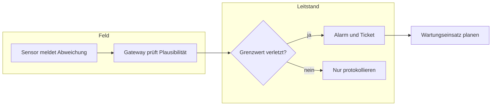
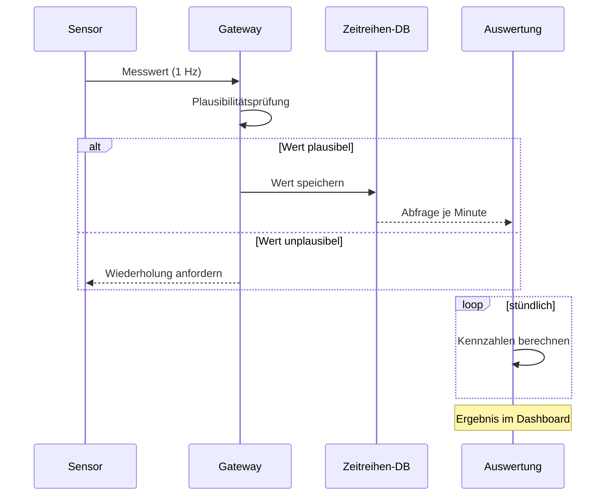
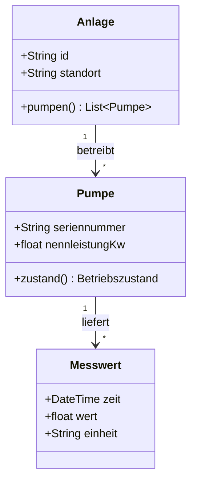
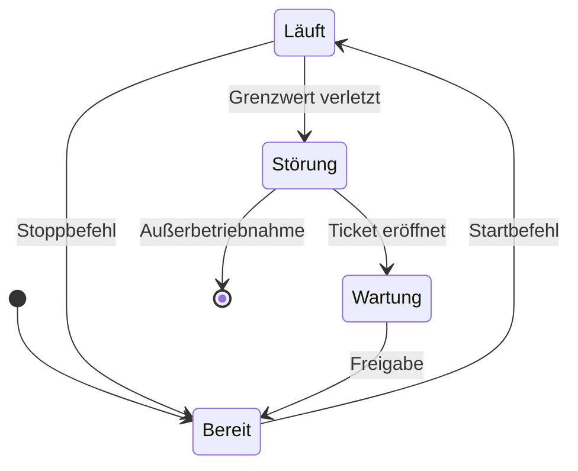
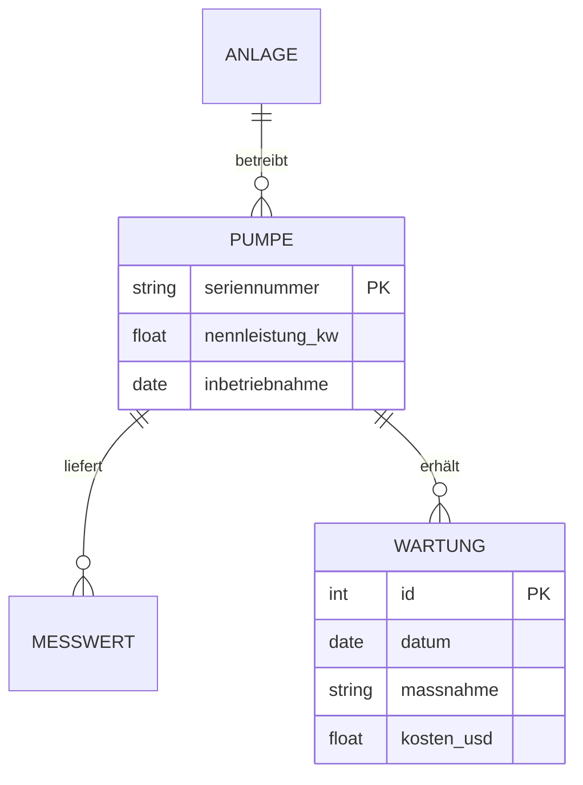
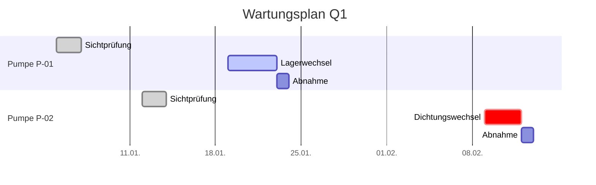
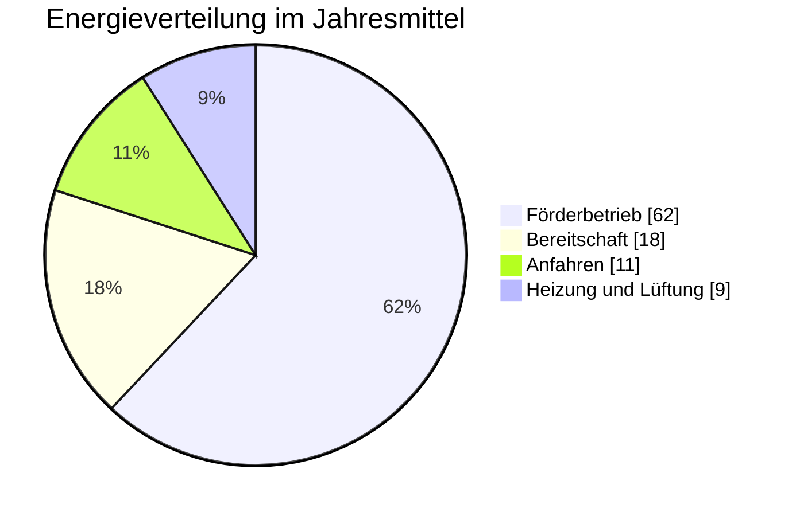
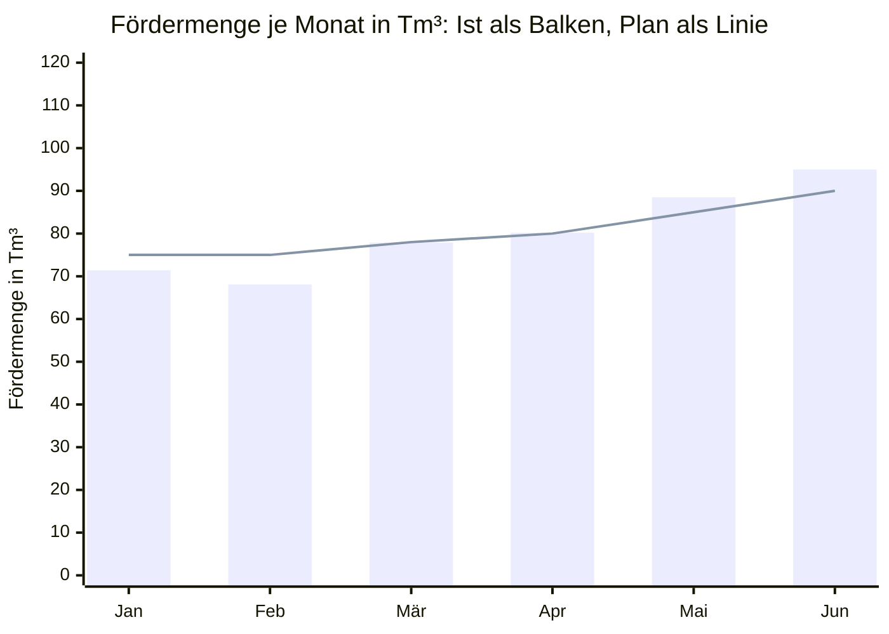
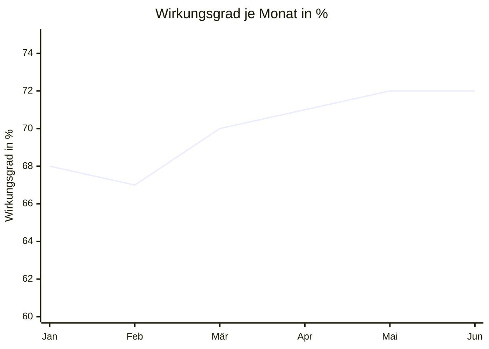
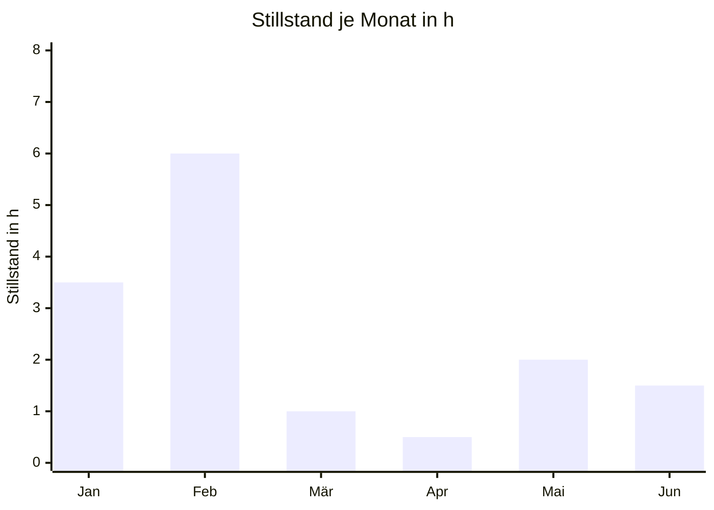

<!-- inqtrix:message id="msg-1779116400000-rs01" role="user" created_at="2026-01-01T13:45:00.000Z" -->
Zeig mir an einem durchgehenden Beispiel alle Darstellungsformen, die du beherrschst: Tabellen, Formeln, Code, Diagramme und Datenplots. Nimm einen technischen Fall, an dem jede Form einen echten Zweck hat.
<!-- /inqtrix:message -->

<!-- inqtrix:message id="msg-1779116410000-rs02" role="assistant" created_at="2026-01-01T13:50:00.000Z" model="claude-opus-4-8" model_tier="high" model_effort="high" model_requested_tier="high" model_source="demo" model_effort_source="demo" -->
# Darstellungsstandard am Beispiel einer Pumpstation

Dieses Beispiel zeigt an einem durchgehenden Fall, wie Tabellen, Formeln, Code, Diagramme und Datenplots in einer Antwort zusammenspielen. Als Gegenstand dient eine kleine Pumpstation mit zwei baugleichen Kreiselpumpen, die Kühlwasser in einen Hochbehälter fördert.

> **Hinweis:** Alle Zahlen sind Demoannahmen für eine fiktive Anlage. Sie stammen weder aus einem Datenblatt noch aus einer Messung und eignen sich nicht als Auslegungsgrundlage.

## 1. Tabellen

Eine kleine Tabelle nennt die Eckdaten der Anlage:

| Größe | Wert |
|---|---:|
| Nennförderleistung | 120 m³/h |
| Elektrische Nennleistung | 15 kW |

Eine breite Tabelle bleibt in der Spalte und wird bei Bedarf horizontal gescrollt. Kostenangaben stehen als Text mit Währungskürzel, zum Beispiel USD 5 für einen Ersatzfilter oder USD 1.240 für die Wartung im Januar:

| Monat | Betriebsstunden | Fördermenge | Energie | Wirkungsgrad | Stillstand | Störungen | Wartungskosten | Bewertung |
|---|---:|---:|---:|---:|---:|---:|---:|---|
| Januar | 612 | 71,4 Tm³ | 8,9 MWh | 68 % | 3,5 h | 1 | USD 1.240 | unauffällig |
| Februar | 588 | 68,1 Tm³ | 8,6 MWh | 67 % | 6,0 h | 2 | USD 2.310 | Lagerwechsel |
| März | 640 | 77,9 Tm³ | 9,4 MWh | 70 % | 1,0 h | 0 | USD 380 | unauffällig |
| April | 655 | 80,2 Tm³ | 9,6 MWh | 71 % | 0,5 h | 0 | USD 380 | unauffällig |

Formeln dürfen auch in Tabellenzellen stehen, wenn sie die Spalte erklären:

| Kennzahl | Definition | Zielwert |
|---|---|---:|
| Hydraulischer Wirkungsgrad | $\eta_{\mathrm{hyd}} = \dfrac{P_{\mathrm{hyd}}}{P_{\mathrm{el}}}$ | ≥ 0,68 |
| Spezifischer Energiebedarf | $e = \dfrac{E_{\mathrm{el}}}{V_{\mathrm{gef}}}$ | ≤ 0,125 kWh/m³ |
| Verfügbarkeit | $A = \dfrac{t_{\mathrm{Betrieb}}}{t_{\mathrm{Betrieb}} + t_{\mathrm{Stillstand}}}$ | ≥ 0,99 |

## 2. Formeln

Die hydraulische Leistung folgt aus Dichte $\rho$, Erdbeschleunigung $g$, Volumenstrom $Q$ und Förderhöhe $H$: $P_{\mathrm{hyd}} = \rho\, g\, Q\, H$. Für die elektrische Leistungsaufnahme kommen die Wirkungsgrade von Pumpe und Motor hinzu:

$$
P_{\mathrm{el}} = \frac{\rho\, g\, Q\, H}{\eta_{\mathrm{Pumpe}}\; \eta_{\mathrm{Motor}}}
$$

Der Tagesenergiebedarf ergibt sich aus dem Integral der Leistung über die Zeit; in der Praxis wird er aus Stundenmittelwerten summiert:

$$
\begin{aligned}
E_{\mathrm{Tag}} &= \int_{0}^{24\,\mathrm{h}} P_{\mathrm{el}}(t)\,\mathrm{d}t \\
&\approx \sum_{k=1}^{24} P_{\mathrm{el},k} \cdot 1\,\mathrm{h}
\end{aligned}
$$

Mit $\rho = 998\,\mathrm{kg/m^3}$, $Q = 120\,\mathrm{m^3/h}$ und $H = 32\,\mathrm{m}$ ergibt sich eine hydraulische Leistung von rund 10,4 kW; bei einem Gesamtwirkungsgrad von 0,70 nimmt der Antrieb etwa 14,9 kW auf.

## 3. Code

Die Kennzahlen lassen sich in wenigen Zeilen berechnen:

```python
RHO = 998.0      # kg/m³
G = 9.81         # m/s²


def hydraulic_power_kw(flow_m3_h: float, head_m: float) -> float:
    """Hydraulische Leistung in kW aus Volumenstrom und Förderhöhe."""
    flow_m3_s = flow_m3_h / 3600.0
    return RHO * G * flow_m3_s * head_m / 1000.0


def electrical_power_kw(flow_m3_h: float, head_m: float, efficiency: float) -> float:
    if not 0.0 < efficiency <= 1.0:
        raise ValueError("efficiency must lie in (0, 1]")
    return hydraulic_power_kw(flow_m3_h, head_m) / efficiency


print(round(electrical_power_kw(120.0, 32.0, 0.70), 1))  # 14.9
```

Die Monatswerte stammen aus einer Zeitreihentabelle:

```sql
SELECT date_trunc('month', measured_at) AS monat,
       sum(volume_m3) / 1000.0        AS volume_tm3,
       sum(energy_kwh) / 1000.0       AS energie_mwh
FROM pump_measurements
WHERE pump_id = 'P-01'
GROUP BY 1
ORDER BY 1;
```

Ein Wartungsticket wird als strukturierter Datensatz übergeben; der Schlüssel `pump_state` trägt den Betriebszustand zum Zeitpunkt der Meldung:

```json
{
  "ticket_id": "WT-2026-0042",
  "pump_id": "P-02",
  "pump_state": "fault",
  "reported_at": "2026-02-09T06:12:00Z",
  "measure": "Dichtungswechsel",
  "estimated_cost_usd": 2310
}
```

## 4. Diagramme

### Ablauf einer Störungsmeldung



### Datenfluss vom Sensor bis zur Auswertung



### Datenmodell der Anlage



### Betriebszustände einer Pumpe



### Datenbankschema der Wartung



### Wartungsplan für das erste Quartal



### Energieverteilung im Jahresmittel



### Fördermenge je Monat

Ein Datenplot steht wie eine einspaltige Abbildung im Format 4:3 mitten in der Spalte; Achsen tragen Größe und Einheit, der Titel nennt die Reihen:



### Zwei Plots nebeneinander

Zwei Datenplots direkt hintereinander teilen sich eine Zeile; auf einem schmalen Bildschirm stehen sie untereinander:





## 5. Listen, Zitate und Verweise

Die Wartungsplanung folgt einer festen Reihenfolge:

1. Messwerte und Störungshistorie sichten.
2. Maßnahmen priorisieren:
   - sicherheitsrelevant zuerst,
   - danach nach erwarteter Ausfallzeit,
   - zuletzt kosmetische Punkte.
3. Termine gegen den Betriebsplan abstimmen.

Offene Punkte lassen sich als Aufgabenliste führen:

- [x] Lagerwechsel an P-01 abgenommen
- [ ] Dichtungswechsel an P-02 terminiert
- [ ] Ersatzfilter (USD 5 je Stück) nachbestellt

> Der Wirkungsgrad einer Kreiselpumpe fällt abseits des Bestpunkts deutlich ab; ein Betrieb bei 60 % des Nennvolumenstroms kostet typisch 8 bis 12 Prozentpunkte.[^1]

Weiterführend: Die Kennzahlen folgen den üblichen Definitionen der Pumpentechnik, etwa in [Wikipedia: Kreiselpumpe](https://de.wikipedia.org/wiki/Kreiselpumpe). Inline-Code wie `pump_state`, **Fettdruck** und *Kursivschrift* bleiben in derselben Zeile lesbar.

[^1]: Demoannahme; der genaue Verlauf hängt von der Pumpenkennlinie ab.
<!-- /inqtrix:message -->
