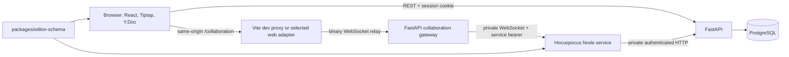
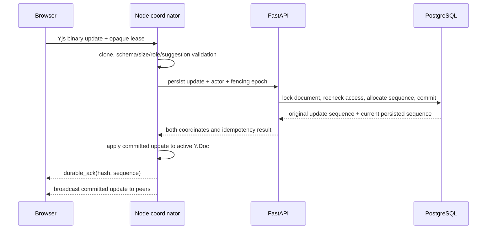

# Editor collaboration

## Scope

This page describes the optional live-collaboration architecture for editor
documents: ownership boundaries, persistence, synchronization, suggestions,
and failure semantics. It does not describe the end-user controls in detail.
The transport remains online-only and single-replica. It does not provide
offline document writes, mouse pointers, or full version restore. Account-less
guest links are a separate opt-in module that rides this transport through
`actor_kind = 'guest'` leases; they are configured in [Settings and
environment variables](../configuration/settings-and-env.md) and are not
covered here.

## Guarantees

- The Yjs binary state is the body source of truth after conversion.
- PostgreSQL stores the update journal, verified snapshots, access leases,
  attribution, decisions, and the latest Markdown projection.
- A Hocuspocus `synced` event means CRDT synchronization only. A browser shows
  an edit as saved only after Inqtrix returns a durable acknowledgement for the
  committed update hash and sequence.
- FastAPI remains the authority for identity, direct shares, permissions,
  sequencing, retention, and row-level tenant isolation. The Node service has
  no database credentials.
- Legacy Markdown documents keep their existing revision-CAS save path. The
  collaboration path never falls back to a full-body Markdown `PUT`.
- A change the service refuses ends only the sending editor's session for that
  document. The room, the other participants, the rest of the page, and the
  account session continue; the refused local state stays available as a
  backup until the writer reloads the document.

## Components and trust boundaries

The diagram answers: "Which process is allowed to decide and persist what?"

The public browser transport is always `/collaboration`. The Vite development
proxy and the production web adapter (Python; another target only
when explicitly selected) forward it to FastAPI, not to Node. FastAPI validates
the browser Origin and relays binary frames to the private Node URL. When a
browser closes its socket, the Python web adapter and FastAPI each forward the
frames the browser sent before its close and only then close their upstream
connection; frames sent toward a browser that has already left are read and
dropped, so they neither stall the sender nor cut off the browser's last
frames.
The same proxies forward the content-free `GET /collaboration/instance`
release probe to FastAPI. That probe reports an identity only when two
RLS-scoped reads of the canonical tenant's unexpired fencing lease agree around
a live Node readiness request. The Node service remains a single-writer
coordinator with no public host port in bundled deployments.

`packages/editor-schema` is the shared schema boundary. It contains the
headless Tiptap extensions, canonical Markdown parser and serializer,
suggestion marks, Yjs fragment name, relative-position helpers, room/parser
contracts, and deterministic schema fingerprint. React NodeViews and visual
decorations stay in the Research Desk.

## Stored representations

| Representation | Source of truth | Purpose |
|---|---|---|
| Yjs update journal | Yes, with a verified snapshot and remaining tail | Live body reconstruction, merge history, attribution, and idempotent replay. |
| Yjs snapshot | Checkpoint of the same truth | Bounds replay time; it never replaces uncommitted tail updates. |
| `content_markdown` | No, derived projection | Read-only outage view, search/context, source view, and export. |
| Patch and activity rows | Metadata, not body truth | Suggestion ownership, decisions, audit-oriented history, and inspector lists. |
| Shared comment threads and messages | Durable collaborative metadata | Anchored discussions, replies, mentions, resolution, tombstones, and per-user read cursors. |
| Awareness | No, ephemeral | Current participants and carets. It is not restored or backed up separately. |

Migration `0048_editor_collaboration` adds collaboration mode and sequence
metadata to `editor_documents`, then creates:

- `editor_collaboration_updates` for idempotent update hashes and ordered
  per-document sequences;
- `editor_collaboration_snapshots` for binary state, state vectors, hashes, and
  covered sequence;
- `editor_collaboration_leases` for short-lived document access;
- `editor_collaboration_instances` for the single active Node writer and its
  fencing epoch.

The tables use the existing PostgreSQL database and tenant RLS. There is no
SQLite database, second PostgreSQL server, or sidecar volume.

Migration `0051_editor_comments` adds separate thread, message, and read-cursor
tables for team discussions. Private AI notes remain in `editor_comments` and
are never migrated into shared threads. Migration `0052_editor_review` adds
bounded activity summaries and decision outcomes and advances compatible
collaboration documents to editor schema version 2. Migration
`0091_rejected_by_edit` adds `rejected_suggestion_ids` to
`editor_collaboration_updates`: the pending suggestions an edit removed, which
the history shows with that edit. Only a person's direct or suggestion row may
name any; a decision row decides through its patches instead.

## Document lifecycle

A document starts in `content_mode=markdown`. Only its owner can convert it,
and conversion checks the body revision, metadata revision, schema version,
document size, service readiness, and absence of active shares. Node parses
Markdown into a Y.Doc and returns an initial verified snapshot without writing
the database. FastAPI rechecks the preconditions and commits mode, generation,
snapshot, projection, and sequence metadata atomically.

Conversion is irreversible. To return to ordinary Markdown editing, export a
detached snapshot and import it as a new document. Deleting a collaboration
document creates a tombstone, increments its generation, revokes access, and
eventually permits physical cleanup. Version 1 has no restore UI.

The room name is
`inqtrix-editor-v1:{document_id}:g{collaboration_generation}`. A room name is
an address, never an authorization credential. Every connection and durable
write is checked against tenant, document, generation, lease, current user,
permission, and active Node fencing epoch.

## Authentication and authorization

Collaboration sessions for platform accounts require a real cookie-backed
`local` or `oidc` login. `create_session` rejects any principal whose kind is
not `oidc_session` or that carries no user and session id, so anonymous
principals, the legacy static API key, and personal access tokens cannot
obtain a collaboration lease. An opt-in second path exists for visitors
without an account: when `INQTRIX_EDITOR_GUEST_LINKS_ENABLED` is set (default
`false`), `POST /v1/editor/guest/collaboration/session` authenticates a
guest-link cookie instead of a login and issues a link- and identity-bound
lease with no `user_id`, `actor_kind="guest"`, and the guest identity and link
ids on the lease. Guests are durable writers; their attribution is stored
against the guest identity rather than a user id. A lease expires after 60 seconds
by default and is rotated while the document stays open. The browser and Node
treat its `cl1...` value as opaque; it never belongs in a URL, log, or metric.

When a guest's access ends (the link was revoked or has expired, its password
was changed, or the document was deleted), the guest page removes the document
and its comments, discards the guest's local copy of the document, and shows
one notice with a way to open the link again; it does not reconnect. Opening
the link again starts from the beginning: a link with a new password asks for
it, and a revoked link reports that it is no longer valid. Changes that were
not yet saved are named as lost; no copy of the document is offered for
download, because none may leave the service after a revocation. Hiding the
page is not the authorization: the service refuses the guest regardless.

A guest's unsent comment drafts are kept in browser storage under the guest
identity, so they survive a reload of the same session and no other guest of
the document reads them. They are deleted when the page sees access end. A
browser holds one guest session at a time, and opening a link starts a new
guest identity; once a guest session holds the browser, the drafts of every
other guest identity are deleted as well, which covers an access that ended
while no page of it was open.

A rotation revokes the previous lease at once: that lease opens no new
connection and renews nothing. An update the collaboration service sends under
it until its connection has switched to the new lease is still written, judged
by the new lease and the current access, as long as the previous lease had not
expired when the update reached the API, whichever of the two requests reached
the API first. Such an update is refused when the new lease has been
rotated again, revoked or has expired, after a sign-out, and when access was
removed or lowered below what the update needs. A lease revoked in any other
way refuses every update at once.

Editor documents extend the existing direct-share system with one additional
permission:

| Permission | Live read | Team comment | Direct edit | Suggest | Accept/reject | Metadata/share/delete |
|---|---:|---:|---:|---:|---:|---:|
| Owner | Yes | Yes | Yes | Yes | Yes | Yes |
| `edit` | Yes | Yes | Yes | Yes | Yes | No |
| `suggest` | Yes | Yes | No | Yes, enforced | No | No |
| `view` | Yes | No | No | No | No | No |

Other resource types keep their existing `view|edit` matrix. Share, session,
and account invalidations reuse `user_events`; Node polls that feed, rechecks
affected leases, and closes access that is no longer valid.

## Public API surface

The editor API remains additive and keeps Markdown compatibility:

| Route | Collaboration behavior |
|---|---|
| `GET /v1/editor/documents?scope=owned\|shared\|all` | Returns metadata plus `content_mode`, `metadata_revision`, `access`, and collaboration sequence/projection metadata. The default remains `owned`. |
| `GET /v1/editor/documents/{id}` | Returns Markdown body for legacy documents or the latest confirmed projection for collaboration documents. |
| `PUT /v1/editor/documents/{id}` | Keeps the legacy full-body contract and returns `409 content_mode_changed` for a collaboration document. |
| `PATCH /v1/editor/documents/{id}` | Owner-only title/folder/metadata update using `expected_metadata_revision`. |
| `POST /v1/editor/documents/{id}/collaboration:enable` | Owner-only, atomic Markdown-to-Yjs conversion. |
| `POST /v1/editor/documents/{id}/collaboration/session` | Issues or rotates the opaque lease and returns room, access, user, protocol/schema metadata, and the transport limits the collaboration service enforces (`update_rate_count`, `update_rate_window_seconds`, `max_queued_frames`, `max_frame_bytes`, `max_queued_bytes`). The guest session route returns the same limits. |
| `GET /v1/editor/documents/{id}/activity` | Keyset page of attributed direct, suggestion, decision, comment, and system updates. An update that changed nothing a reader sees, such as a formatting cleanup a writer sends after reconnecting, stays stored for replay but is no entry of the page. Direct edits one writer makes close together share an entry, except an edit that removed pending suggestions: it always has its own entry, which counts them in `rejected_suggestion_count` and names up to 20 of them with their authors in `rejected_suggestions`. Bounded summaries expose at most three edits, each a verbatim excerpt of at most 160 characters. The excerpt is display text, never markup: it is never sanitised and never rejected on its characters, because it is the user's own typing and the only consumer renders it as escaped text. |
| `GET/POST /v1/editor/documents/{id}/collaboration/comments` | Incrementally lists or creates durable shared threads with participant metadata. Every comment change takes the document's next comment revision under the document row lock. A new thread has no revision precondition, so two people who comment at the same moment both keep their comment; a reply, an edit, a resolve or a delete names the revision of its own thread and is refused as `comment_revision_conflict` only when that thread changed. A client moves its incremental cursor to its own change only when that change's revision directly follows the cursor; a larger one means another change committed in between, and the client loads from the cursor so that change is not skipped. |
| `POST .../comments/{thread_id}/replies` | Adds an idempotent reply with optional participant mentions. |
| `PATCH .../comments/{thread_id}` | Resolves or reopens a thread under live permission and revision checks. |
| `PATCH/DELETE .../comments/{thread_id}/messages/{message_id}` | Lets an author edit or tombstone only their own contribution. |
| `POST .../collaboration/comments/read` | Advances the caller's personal comment read cursor. |
| `POST /v1/editor/documents/{id}/patches:decide` | Idempotent accept/reject for explicit patch IDs using `expected_sequence` and a decision UUID. The decision applies to the document as it is now; only an `expected_sequence` the document has not reached is refused (`sequence_conflict`). |
| `POST /v1/editor/documents/{id}/suggestions:publish` | Publishes one private AI patch as a shared suggestion: `target_markdown` is the whole document as proposed, built on `base_markdown`, the projection at `expected_sequence`. The change is placed onto the document as it is now and refused as `base_changed` only when another writer changed that passage since the base. Without `base_markdown` the document must still be at `expected_sequence`. |
| `POST /v1/editor/documents/{id}/collaboration/projection:flush` | Waits for the room queue and returns a current confirmed Markdown projection. |
| `GET /collaboration/instance` | Unauthenticated, no-store release probe returning only contract/service/status and the stable DB-fenced instance ID/epoch; unavailable or changing state returns 503. |
| `GET /v1/capabilities` | Reports configured/available state, `/collaboration`, protocol/schema versions, and `single_replica`. |

Missing or hidden documents return 404; a visible but unauthorized action
returns 403; revision, sequence, mode, generation, or schema conflicts return
409; size limits return 413; and an unavailable optional service returns 503.
Errors use the normal Inqtrix envelope with a machine-readable `reason`.

The activity page checks access on the document's identity, ownership and
mode alone and never loads its Markdown body. The Research Desk reads it only
while the changes tab of its open inspector shows it and the browser page is
visible: once when it comes into view, then at most one request at a time and one
follow-up no sooner than three seconds after the previous one started, however
fast the document changes. A change never aborts a running read; while the
inspector is hidden, the last loaded activity stays as it is.

## Durable update flow

This sequence explains why a visible remote edit and a saved edit are separate
states.

Each room has a serial queue. The coordinator validates on a clone before
persistence. FastAPI locks the document row, rejects stale generation or
fencing epochs, and writes the update plus suggestion/decision metadata in one
transaction. Only then does Node apply and broadcast the update. Repeating an
update hash returns its original sequence instead of inserting a duplicate,
alongside the locked document's current persisted sequence so a replay after
later edits cannot regress the room watermark.

Writer fencing keeps every write with the active Node instance. Each fenced
Node transaction (an update, a hash lookup, a snapshot, a compaction, a
tombstone purge) first reads the tenant's `editor_collaboration_instances` row
`FOR KEY SHARE`, matching the instance id, its epoch and an unexpired lease; a
transaction that finds no such row is refused as fenced. The lock is shared,
so writes to different documents do not wait for each other at the fence, and
the document row orders the writes of one document. With
`restrict_to_workspace_members` enabled, the access check of a writer who is
not the owner also locks the owner's and the writer's workspace membership
rows, so such writes queue there when they share the owner or the writer.
After the fence, a write locks the document row before its lease; a
person's access check locks the writer's user row and those membership rows
first and the share right after the document. Issuing and rotating a
lease, deleting the document and revoking a guest link also lock the
document row before any lease row, so no two of them can each hold a row
the other waits for: deleting a document or revoking a link while someone
types waits for the write in flight, and the next write finds its lease
revoked. A revocation stamps a lease or a guest identity no earlier than it
was issued or created, because a lease issue or rotation or a newly opened
guest session that reached the document or the link first can carry a
later request time than the revocation.
Unlocking a guest link checks the password against the pair it
resolved before it takes any lock, and opens the guest session only if the
link row, once locked, still carries that pair. A password or token rotation
that commits before the unlock opens its session therefore refuses it, and
one that commits after the session opened revokes it, so no unlock that
checked a replaced pair keeps a session or obtains a lease.
Revoking a link or rotating its password or token locks the document row,
then the link row, and then revokes the link's guest identities and leases.
Opening a guest session takes the document row `FOR KEY SHARE`, the mode of
the new identity's foreign-key check, before the link row, and refreshing a
guest session locks the link row before the guest identity, so opening or
refreshing a guest session and a revocation or rotation never each hold a
row the other waits for: whichever arrives second waits, and the revocation
or rotation commits.
Issuing a lease to a guest takes the document row `FOR KEY SHARE`, the mode
of the new lease's foreign-key check, before it checks the guest's identity
and link and before it deletes the guest's long-expired leases. A
revocation, a password or token rotation or a document deletion that holds
the document first has committed when the issue reads the guest's access
and the document, so the issue is refused; one that arrives while the
issue holds the document waits for it and then revokes the lease it
inserted, so no guest lease outlives the change.
A guest's comment mutation (a new thread, a reply, editing or deleting a
message, resolving, reopening or deleting a thread) locks the document row
before it checks the guest's identity and link. A revocation or rotation
that holds the row first has committed when the comment reads the guest's
access, so the comment is refused; one that arrives while the comment holds
the row waits for it, so no guest comment lands after the change.
The refresh locks the identity `FOR NO KEY UPDATE`, the mode of its own
update of the identity, which changes no key column. A guest lease row
checks its foreign keys on the identity and on the link `FOR KEY SHARE`,
possibly the identity first, and that check does not wait for the refresh's
lock, so a lease issued or rotated for the same guest while a refresh holds
the link waits at the link instead of deadlocking with the refresh.
Renewing the instance lease changes no key
column and never waits for writes. A takeover, possible only after the lease
expired, locks the row `FOR UPDATE`: it waits for the old instance's writes
still in flight, those the API accepted before the lease expired, and every
later write of the old epoch finds no row. An acquire against
another instance's live lease is refused before it takes any lock, so a
standby gets its answer at once. A hash lookup locks its document row
`FOR SHARE`, so it waits for a write of that document that already holds the
row and reports its sequence instead of "not found". Persists that carry the
same command id take a transaction-scoped advisory lock on the tenant and
command id, so reusing a command id on another document is answered as a
command conflict.

The initial Yjs sync response is allowed to be a no-op when applying its
canonical V1 payload introduces no novel state. This semantic check is
deliberately not limited to the two-byte empty update: after a sidecar restart,
a fully synchronized browser can legitimately send a non-empty redundant
state update. An ordinary update frame without novel state is acknowledged:
with its original sequence when the journal holds its hash, otherwise at the
room's current durable sequence, because the room, which equals the store at
that sequence, already holds every effect of it (another writer made the same
change first, or the changes reached the store in another update). Suggestion
topology validation still runs for any update that changes Yjs structure.

Applying an update can make Yjs follow it with one transaction of its own that
deletes formatting items the merge left redundant, for example when two
writers apply the same mark from the start of a text at the same time. The
coordinator accepts that follow-up only when it inserts nothing and deletes
only formatting items. The schema, canonical, and suggestion checks judge the
state after it, and the stored bytes stay the client's, so every replay of the
store runs the same cleanup and reproduces the room.

An empty paragraph, heading or code block holds exactly one empty text node in
the shared state, from the update that creates the block on. y-tiptap writes
the first character typed into a block that has no child into a new text node,
so two people who type into the same empty line before either has seen the
other's letters would each write a text node, and the schema refuses two text
nodes side by side. With the node in place, both write into it as into a line
that already holds text, and both are accepted. Whoever creates such a block
writes the node in the same update: the editor after each of its own changes,
and the service when it builds a document from Markdown, completes a list or
quote a merge left empty, or writes a decision or a published suggestion. A
block is completed only by the writer that created it, so two writers never add
a node to the same block. It is the shape y-tiptap itself keeps when a block's
text is deleted, and the only extra child the schema check accepts: two text
nodes side by side stay refused, and the check gives every stored state the
same verdict as before, which is why the schema fingerprint does not change.
[Known limitations](#known-limitations) describes the places that still have
no shared text node.

If applying a committed update to the active in-memory Y.Doc fails, the room is
closed with `1011` and rebuilt from the latest verified snapshot plus update
tail. The committed database state remains authoritative.

A client transport that disappears does not interrupt the updates the server
already received from it. They are validated, persisted and applied in the
order they arrived; only their acknowledgements are lost, and the client
receives them as duplicate acknowledgements after it reconnects and resends
its unconfirmed updates. Whether such an update is written is decided by the
store's own lease, session and access checks inside its transaction. No other
connection of the room is closed and the room epoch does not change. A
connection that turned read-only while one of its updates was persisting (a
token sync that downgraded its access) still gets that committed update
applied to the room.

The room is rebuilt from durable state only when a persist outcome stays
unknown. A persist request that times out, fails in transport or answers with
a `5xx` is resolved by looking the update up by its hash: a found row is the
committed result, and the update is applied and acknowledged as usual. A row
that cannot be found does not prove that nothing was written, because a
request the store has not started yet can still commit later, so the room is
then closed with the retryable `1012/restarting` and rebuilt from the store.

An update whose Yjs dependencies the room does not hold (a predecessor the
client sent on an earlier transport and the server never received) is a
causal gap, not a schema violation. It is rejected before persistence, only
its own connection is closed with `4412/causal_gap`, and the client resends
its unconfirmed updates in the order it produced them. A document that
violates the schema keeps the permanent `4409/invalid_schema`.

Once the server refuses an update of a connection or starts closing its
transport, it processes no later frame of that connection: frames that
arrive while the close handshake runs are dropped, and frames Hocuspocus had
already queued behind a refused update are neither applied nor acknowledged.
Such a frame can depend on the one that was refused, and the client's own
sync answer among them would otherwise persist everything the room lacks
under a hash no unconfirmed update carries. The client resends every
unacknowledged update in order after it reconnects.

Inbound frames are bounded per physical socket before Hocuspocus processes
them (`INQTRIX_COLLABORATION_MAX_QUEUED_FRAMES` and
`INQTRIX_COLLABORATION_MAX_QUEUED_BYTES`). Frames of a document connection
that is not open yet, and frames of a view connection, close the socket with
`4429/rate_limited` beyond those limits. A document frame of an open
connection with edit or suggest access that finds the frame limit spent waits
in the service instead, in arrival order and behind every earlier waiting
frame of the same connection, whatever its access has become since; beyond
four times the frame limit, or beyond the byte limit, the socket closes with
`4429/ingress_overflow`. Waiting frames never reached the room: they are
discarded when their document connection closes, and the client resends its
unconfirmed updates after it reconnects.

A view connection never changes the document, so its sync frames do not wait in
the room's queue. A guest link with comment permission receives a view lease,
so its connection is a view connection too. A frame whose every change the room
already holds is answered, any other frame is refused with
`4403/access_revoked`, a malformed one with `4409/invalid_schema`, after the
update allowance was counted. A document connection may ask for the room state
once; the service encodes the whole document for that answer, so a repeated
request closes the document connection with `rate_limited`. The service answers
no client stateless message: a well-formed durability-reconcile request is
ignored within a budget of ten per socket and ten seconds, because resent
updates are acknowledged directly, and any other payload or a request beyond
the budget closes the socket. Every token renewal an open connection sends makes
the service introspect the lease through the API, which reads the lease, the
account or guest link and the document state. An introspection that finds the
access the lease grants gone refuses the lease and revokes it, and the
revocation commits with the refusal: an update, a rotation or an
introspection signed with that lease stays refused when the access returns,
and only a newly issued lease carries it again. A connection may renew on its own
ten times per ten seconds (the browser renews once per refresh interval); the
answer to the service's own token request after a policy change is not counted.
A renewal beyond the budget closes the socket with `4429/rate_limited`, and a
connection whose frames were refused renews nothing more. A browser sends only
sync, presence, token, presence-query, stateless and document-close messages;
a frame of any other message type, or an authentication message that carries
no token, closes the socket with `4403/invalid_request` before Hocuspocus,
which has no handler for it, would log an error for every such frame.

Awareness remains ephemeral and is never persisted. Hocuspocus 4.3 and 4.4
decode an inbound awareness frame through a scratch `Awareness` object whose
constructor inserts one leading empty local state. The sidecar removes only
that exact leading sentinel before ownership and single-sender identity
validation. Any different multi-state shape is rejected rather than guessed
at, and the normalization counter makes the compatibility adapter observable.
Once a document connection is open, awareness does not count against its
frame limit: while one awareness state of the connection waits to be
processed, the service keeps only the latest later one and counts its bytes
against the connection's byte limit. The browser sends its own presence only
after the document synchronized, so that before a room has loaded a socket
carries only its control frames and one resent update; the provider's opening
frames do not repeat the presence of an earlier socket. On every synchronized
socket the browser announces its presence with a new clock, because the room
may still hold its state from an earlier socket under the same clock and
ignores a state that is not newer. A presence change never leaves ahead of the
local updates the editor produced before it, since an observer cannot place a
cursor in text it does not hold yet: while any of them is unsent, including
the unconfirmed updates a new socket has not resent yet, the change waits and
then travels directly behind the last of them, still at most once per 75 ms. A
removal points at no text and never waits: the browser removes its own
presence at once when the page is closed.

A presence id is chosen by the browser, so the sidecar binds it to the
participant whose connection published it first in the loaded room: the
tenant and the user identity (a guest's identity is its guest id), not the
login session, so signing in again in another tab keeps the same presence. The
binding lasts as long as the room stays loaded. A state or a removal that
another participant sends for a bound id is dropped and counted, never
applied, and the sending connection stays open. A newer connection of the same
participant, by authentication order, takes the id over: the service closes
the older connection with `4401 connection_superseded` without removing the
presence it shows, drains the older connection's queued frames without
applying or acknowledging them, and the newer connection resends what was not
confirmed. An older connection that publishes the id after the newer one owns
it is superseded the same way. One connection publishes one id; a further id
is dropped. The owner's presence leaves with the owner's connection, and a
removal the owner sends itself is applied at once, which the scratch decoding
alone would drop.

## Suggestions and AI

Direct edits are immediately part of the final document and appear in activity
history; Inqtrix does not reconstruct them later as accept/reject patches.
Suggest mode records five semantic kinds: insertion, deletion, replacement,
format, and structure. Text changes use suggestion marks; reversible heading,
paragraph, list, quote, and code-block transformations use canonical structure
metadata on the original block instead of replacing it. Every suggestion
carries a secure UUID, patch UUID, author, and creation time. The creation time
is epoch milliseconds, for a typed suggestion and for a published AI suggestion
alike; suggestions a document already holds from before may carry epoch
seconds, so a reader that shows or orders them converts a value below
`10^11` (seconds) to milliseconds instead of rewriting stored data. A patch
carries the time of its suggestions, while a proposal through the patch API is
stamped in Unix seconds, the unit that API keeps. The open-changes list and
the patch list of a document therefore order patches by their time converted
the same way, so agent proposals, older and newer AI suggestions, and typed
suggestions sort by when they were made; each keeps its time as written. Server validation
requires the original projection to remain unchanged for a `suggest` user,
lets no user write a suggestion in another user's name or add text to another
user's suggestion or move it, and lets a suggestion be decided only through
the decision endpoint.

### Editing text that holds suggestions

A writer with edit access (the owner, a member with `edit` access, or a guest
of an edit link) works on text that holds pending suggestions like on any
other text, and normal work shows no message. A suggestion consists of the
characters that carry its mark, or of the block that carries a proposed block
type. The rules hold for every pending suggestion, whoever proposed it, the
writer's own included; where the writer's own suggestion behaves differently,
the table says so:

| The writer | What happens to the suggestion |
|---|---|
| deletes part of the suggested text, of a proposed insertion or of a proposed deletion | It shrinks: it keeps the rest, stays pending in its author's name, and stays in the list of open changes. |
| formats suggested text, for example bold or a link | The formatting applies and the suggestion stays pending. |
| turns the paragraph that holds suggested text into a heading or a code block, puts it into a list or a quote, or lifts it out of a list | The suggestion stays pending. |
| formats suggested text as inline code | Inline code cannot stand together with a suggestion mark: over suggested text it would take the mark off and settle the suggestion outside the decision path. The editor leaves the suggested characters out, formats the rest of the selection and shows nothing. |
| types or pastes inside another writer's suggestion | The new text is the writer's own plain text and never part of that suggestion. The suggestion continues on both sides of it as one suggestion; accepting or rejecting it later acts on both parts and leaves the typed text in place. Inside an own proposed insertion, typing extends the proposal; inside an own proposed deletion, typing is refused (`own_suggestion_edit_unsupported` below). |
| moves a block that holds another writer's suggestion, up, down or by dragging | The moved block is the writer's own content, and a suggestion never travels with it: the suggestion is removed. A copy of a block carries none, and the suggestion in the original stays pending. |
| deletes all of the suggested text, or the paragraph that holds it | The suggestion is removed. |

**What counts as removed.** An edit removes a pending suggestion when it
deletes what the suggestion proposed or leaves it in a form no pending
suggestion can take:

- a proposed insertion, when all of its characters are deleted;
- a proposed deletion, when all of the text it marks is deleted;
- a replacement or format suggestion, which is struck old text directly
  followed by the proposed new text, when text is typed inside or between its
  two parts or one part is deleted completely;
- a proposed block type, when its block is deleted or joined into the block
  before it, or when the edit makes the proposal impossible: a heading
  proposed for a block the edit puts into a list, or a code block proposed for
  a block whose text the edit formats. Another writer's proposal is also
  removed when the edit moves its block or gives the block another type.

A removal takes the suggestion out the way a rejection would: the text it
proposed to insert is gone, what is left of the text it proposed to delete
stays without the mark, and a block keeps its content without a proposed
block type. The suggestion leaves the list of open changes for everyone. The
history records the removal as the writer's edit, not as a decision by the
author or a reviewer, in one entry that everyone sees alike: "Lin removed a
suggestion by Ada", or "Lin withdrew a suggestion" when it was Lin's own. The
entry of an edit that removed several suggestions counts them and lists them
with their authors, and such an entry is never grouped with other edits.

**Undo** takes back the writer's own steps and never discards the undo
history. Characters the writer deleted from another writer's pending
suggestion come back as the writer's own plain text, and the suggestion keeps
what was left of it. A suggestion the writer removed stays removed; the other
text the same edit deleted comes back.

**Suggest mode** is stricter, because a writer there only proposes. Another
writer's pending suggestion cannot be changed at all: a change that touches it
is refused, and that suggestion is selected for review, because suggestions do
not nest. Deleting part of an own proposed insertion shrinks it; deleting all
of it is refused. Instead, undo withdraws the writer's own suggestions made in
the same editor session, the most recent first, by rejecting them through the
decision endpoint; [Known limitations](#known-limitations) describes what
this means for a writer with suggest access alone.

**Guarantees.** The collaboration service applies these rules to every update
before anything is stored, whichever client sent it; the editor applies the
same rules first only so that it never sends a change the service would
refuse. No update writes a suggestion in another person's name or changes the
author, time, kind, patch or id of one. No update adds a character to another
person's pending suggestion or moves one: text written elsewhere is new text,
which carries no one else's suggestion. No update takes the mark off text a
suggestion proposes to insert while keeping that text, which would accept the
suggestion without a decision; an edit removes a suggestion only together
with the text it proposed. Accept and reject go only through the decision
endpoint, which needs edit access. Only a writer with edit access shortens,
formats or removes another person's pending suggestion, and the store checks
that access again when it records the update, so a writer whose share or
guest link was lowered to `suggest` cannot go on changing suggestions with a
lease issued before. Every removal is named in the update's row and written to
the audit log as `editor.collaboration_suggestion.removed_by_edit`, with the
suggestion, its patch, its author and the writer, and without document
content.

### What the service accepts from a suggestion

The service judges every update against the room before it persists anything
and refuses with `4403 suggestion_policy_violation` what a suggestion cannot
express. An update is judged as a suggestion when it comes from a `suggest`
lease, or when an `edit` lease proposes with it: a suggestion of the writer's
own that is new or that the update did not keep (below). A suggestion whose
metadata is incomplete or inconsistent is refused as `4409 invalid_schema`.

- **Deletions** (`suggest` lease). Of the items inside text and attributes, an
  update may delete only three kinds: characters of the writer's own pending
  insertions (not those of a structure suggestion), formatting items, and
  attribute values it replaces. Blocks and text nodes follow the block rules
  below. Original text is never deleted, not even to be written again unmarked:
  the text would stay, but the identity that comments, relative positions and
  other pending changes refer to would be gone. The rule reads only the items
  the update itself deleted, together with the text they come from, so its cost
  follows the update and never the deletion history of the rest of the
  document.
- **Blocks** (every update judged as a suggestion). Every existing block and
  text node keeps its parent and its place among its siblings; only a text node
  that holds nothing but an insertion the update changes may go. An update may
  add a block only in the shape that Enter at the end of a block produces: the
  new block follows a block the room already holds or the same update proposes,
  that block ends with the same insertion the new block starts with, and the
  new block holds nothing but text the update proposes to insert. It may be a
  paragraph (with one of the offered text alignments at most), a list item, or
  an open task item. A heading, a code block, a checked task item, and every
  block that takes existing content along (Enter at the start or in the middle
  of a block, a paste of several paragraphs into the middle of one) are
  refused, because rejecting the suggestion could not move that content back.
- **Other writers' suggestions** (`suggest` lease). A pending suggestion of
  another writer stays exactly as it was: the same metadata, and every
  occurrence found again with the same content where its own characters lead,
  on the very characters and block it stood on. A structure suggestion follows
  its block's identity, the same Yjs element wherever it moved; a copy of the
  block elsewhere is not it.
- **Pending suggestions under an edit lease** (every author, the writer's own
  included; [Editing text that holds suggestions](#editing-text-that-holds-suggestions)
  describes the result for the writer). A suggestion is kept when it stands
  on the Yjs units the update left it: every character or block that carries
  it afterwards carried it before, with the same mark and the same mark
  attributes or structure data, and every one that carried it before still
  carries it or is deleted; a suggestion the update wrote again in place
  (below) counts as the same. Other marks, the attributes of its block and the
  text around it may change, and text typed inside it without its mark splits
  it into several runs under one id. A kept suggestion stays pending in its
  author's name and is no change of the writer's: the update is the writer's
  direct edit and changes no patch for it. Accept and reject act on the
  characters that carry it when they are decided. A suggestion the
  update takes out of the document is removed when every character it
  proposed to insert is deleted; the text it proposed to delete, and the block
  of a structure suggestion, may stay or go. The update's row names every
  removed suggestion, its patch loses it (a patch left without suggestions is
  closed as rejected in the writer's name), and the store writes one audit
  entry per removed suggestion (`editor.collaboration_suggestion.removed_by_edit`).
  A replacement or format suggestion is valid only as two adjacent halves (see
  the resolution of an edit lease's update below). Another writer's suggestion
  that the update left in any other form, with a character it did not carry
  before, changed metadata or attributes, or its mark taken off text it
  proposes to insert while the text stays, refuses the update; after a
  concurrent merge the service resolves such a state as described below. A
  suggestion of the writer's own that is new, or that changed in another way
  than losing characters or taking formatting, is the writer's proposal, and
  the update is judged as a suggestion.
- **Applicability** (every lease). No update may leave a structure suggestion
  that can no longer be applied, for example formatting inside a block proposed
  as a code block: the final projection, and with it every change summary and
  export, would fail for everyone in the room. A suggestion that already could
  not be applied before the update does not block it; [Deploy editor
  collaboration](../deployment/editor-collaboration.md#a-stored-suggestion-that-cannot-be-applied)
  describes such a stored suggestion.

A suggestion can be absorbed by a concurrent change. When another writer
deleted the block, or wrote it anew, at the same time, the room merges the
suggest update into deleted content, and it changes nothing visible. The
service accepts such an update as a suggestion that proposes nothing, because
changing nothing visible is within a suggest lease. The deletion rule is judged
first, so an update that replaces original text with an identical copy stays
refused.

An edit lease restructures text directly, and y-tiptap writes a split, a join,
a change of block type, a list wrap or a paste as the deletion of the moved
text and a new copy of it. A pending suggestion inside the moved text then
consists of new Yjs items. For an edit lease only, the service treats a text
occurrence whose characters the update deleted and wrote again as the same
suggestion when it comes back in place: between the nearest characters the
update kept on either side (block boundaries ignored), the stretch from the
first to the last suggestion-marked character reappears unit for unit with the
same text, marks and metadata, and the original text around it changed on one
side at most. Text that changed on both sides has moved the suggestion, which
a direct edit may not do. The comparison runs only for an occurrence its own
characters could not follow, and it reads each document once. A block the
editor moves (up, down, or by dragging), copies or pastes in edit mode is
content the edit inserts, and the editor sends it without another writer's
pending suggestion, neither a suggestion mark on its text nor a structure
suggestion on the block. A suggestion therefore never moves with its block:
one whose characters or block the edit deleted is removed, and a copy leaves
the original pending.

An edit lease's update is computed against the writer's own view. Merged into
the room, where another writer may have changed the same place at the same
time, it can leave a state these rules refuse although the writer did nothing
an edit lease may not do. The service then resolves the merge in the writer's
own row instead of refusing it, and the room applies the update and its
resolution as one frame, so no participant ever receives the refused state:

- a character the update wrote that took another writer's suggestion mark
  from formatting it did not write loses that mark;
- formatting the update set yields where it meets a mark it excludes;
- a suggestion that a stale view or an undo writes back after the room saw it
  decided or removed takes the outcome the room recorded for it, whoever wrote
  the update, so an undo never brings a removed suggestion back;
- a list, list item or quote the merge left empty gets the minimal content it
  needs, and formatting items that change nothing are dropped.

A pending suggestion that the merge left in a form no suggestion may take (a
replacement or format suggestion split apart or without a half, or a structure
suggestion copied onto a second block) is removed as a whole, the writer's own
as well as another writer's. So is a pending suggestion of another writer that
none of these resolves and that the merge left with characters it did not stand
on, with changed attributes, or without its mark on text it proposes. Either is
removed the way a rejection removes it, and the row names it as removed.
Nothing is ever written in another person's name: an update that does so is
refused with a warning in the service log. A `suggest` lease's update is never
resolved; the rules above refuse it or accept it as sent. The room remembers
the suggestions it saw decided or removed only while it is loaded, and at most
4,096 of them; [Known limitations](#known-limitations) describes an undo that
writes back a suggestion the room no longer remembers.

The schema applies two more rules to every writer. Text alignment accepts only
the offered alignments (`left`, `center`, `right`, `justify`, or none): the
value is rendered into a style attribute, so any other value would inject style
text into every reader's view. Attribute names are read from the Yjs attribute
map itself, so an attribute named like `__proto__` cannot travel hidden past
the canonical comparison. A structure suggestion belongs to the block it was
made on; a block split off that block by Enter starts without it.

### Refusals in the editor

The editor runs copies of these rules on its own change before anything is
sent, so that the service accepts what the editor sends. In suggest mode the
result of the suggestion transform is checked in the service's order: first the
metadata and record rules (complete metadata, one author and time per patch, no
pending suggestion disappears, another writer's suggestion stays unchanged, no
new suggestion is attributed to someone else), then the block, deletion,
reversibility and applicability rules. The reason for a refusal therefore never
depends on what else the writer has pending. The upstream transform keeps
continued typing one review item by reusing the id of the suggestion next to
it; these record and metadata rules alone decide whether such a reuse is
acceptable. In suggest mode, a change that touches another writer's pending
suggestion (a replaced or formatted range, a block's marks or attributes, or
text typed between the two halves of a replacement or format suggestion) is
refused, and that suggestion is selected for review.

In edit mode the editor follows the edit-lease rules above, with the results
[Editing text that holds suggestions](#editing-text-that-holds-suggestions)
describes, and normal work shows nothing. Steps appended to the same change
keep what the editor sends within those rules:

- content the change inserts (typed, composed, pasted, dropped, moved or
  copied) never carries another writer's suggestion mark or structure
  suggestion. The writer's own marks stay, so typing inside an own insertion
  extends it; such a change is the writer's proposal and may not change the
  original document at the same time.
- a mark that excludes suggestion marks, inline code, is kept off every
  character that carries one, the writer's own or another writer's; it would
  otherwise take the mark off and decide that suggestion. The rest of the
  selection is formatted.
- a replacement or format suggestion that the change leaves split apart or
  without a half (text typed inside or between its halves, a block split
  through it, one half deleted) is removed as a whole, the way a rejection
  removes it: the text it proposed is deleted and the text it proposed to
  delete stays without the mark.
- a structure suggestion that the change leaves impossible to apply (a
  heading proposed for a block the change puts into a list, a code block
  proposed for a block the change formats) is removed the same way: the
  block keeps its content without the proposal.

A refused change reaches neither the document nor the service. The session
stays connected and writable, and a status line above the editor names the
reason in the reader's language until the next change goes through. The reason
travels as a code; its English message only reaches logs.

| Code | Refused change |
|---|---|
| `split_moves_content` | Suggest mode: Enter at the start or in the middle of a block, or any other new block that would take existing content along. |
| `proposed_block_unsupported` | Suggest mode: a new heading, code block, or checked task item. |
| `adjacent_own_suggestion_conflict` | A change directly at one of the writer's own suggestions that cannot join it: typing at an own proposed deletion, or deleting right before an own proposed insertion or next to an own proposed join of two blocks. |
| `suggestion_would_disappear` | Suggest mode: a change that removes one of the writer's own pending suggestions completely, for example deleting the last character of an own insertion; there a pending suggestion ends by a decision. In both modes: a change that takes an own suggestion's mark off the text it proposes while the text stays. |
| `format_overlaps_own_suggestion` | Suggest mode: formatting that would take in or remove one of the writer's own pending suggestions, for example across original text and an own insertion. |
| `foreign_suggestion_changed` | A change that would alter, extend, or remove another writer's pending suggestion in a way the rules do not allow, for example typing in suggest mode directly behind another writer's proposed insertion, which would join it. |
| `own_suggestion_edit_unsupported` | Edit mode: a change to one of the writer's own pending suggestions that is neither a direct edit nor a proposal, for example typing inside an own proposed deletion, which would extend the proposal and change the original document at once, or Enter in the middle or at the start of a block that carries an own proposed block type, which would copy the proposal onto the new block. |
| `structure_suggestion_inapplicable` | A change that would leave a pending structure suggestion impossible to apply. In edit mode the change removes such a suggestion instead, and the refusal remains only where no single suggestion can be named. |
| `structure_target_unsupported` | A structure suggestion the selected block cannot carry. |
| `divider_unsupported` | Suggest mode: a divider. |
| `table_topology_unsupported` | Suggest mode: adding, removing, merging, or splitting table rows, columns, or cells. |
| `node_marks_unsupported` | A change that would need a suggestion on a whole block or an embedded element. |
| `suggestion_metadata_invalid` | A change while a suggestion of the document lacks complete metadata, or a transform result without it. |
| `unsupported_structure` | Any other change without a reversible suggestion representation, for example Backspace joining two lists, or formatting that takes in the marker of an own proposed join. |
| `foreign_collision` | Suggest mode: a change that touches another writer's pending suggestion; that suggestion is selected for review. |
| `collaborator_required` | Any change before the writer's collaborator identity is confirmed. |
| `suggestion_undo_failed` | Undo in suggest mode could not withdraw the writer's last own suggestion. |
| `unknown` | A refusal without a known reason; the editor logs it as a warning. |

Plugins can append changes to a transaction after the suggestion transform ran:
the trailing paragraph after a final list or heading, a link recognised in
typed or pasted text, paste rules, and table repair. Such a change bypasses the
transform, so the editor admits it only behind the writer's own edit in edit
mode. Opening a document or receiving a change never writes, and in suggest
mode a typed address is not turned into a link; the link can be added once the
text is accepted.

In suggest mode, Backspace (also with Shift held) and Delete remove the
character next to the caret through the editor itself, one grapheme at a time,
and skip text that already carries a suggested deletion. Next to a suggested
deletion that the final display hides, browsers otherwise move the caret past
the hidden text and remove it together with the visible character, which the
rules read as withdrawing the earlier deletion. Word and line deletions still
take the browser's own path and can be refused there.

### Decisions and AI publication

Accept and reject are idempotent server mutations with an expected sequence
and command UUID. A decision names its suggestions by id and applies to the
document as it is now, so another writer typing between the click and the
decision does not refuse it; what they typed stays theirs, because suggestion
marks do not extend to text typed next to them. Only an expected sequence the
document has not reached yet is refused. The durable store's compare-and-set
always uses the room's current sequence, so the order of persisted updates
stays fail-closed. Table topology, merge/split operations, and other structure
changes without a safe inverse are rejected with a specific editor-action
error; they do not close the collaboration transport. A proposed block break is
anchored by a zero-width space on each side of the new boundary, inside the
proposing insertion. Accepting it keeps the break and removes the anchors, and
every final projection leaves them out.

Shared comments and private AI work are separate domains. Team threads are
persisted with a Yjs-relative anchor and bounded quote fallback, delivered
through a transactional `user_events` invalidation, and incrementally reloaded
after reconnect. Replies, mentions, resolve/reopen, author-only editing, and
tombstones never mutate the Y.Doc. A thread that can no longer resolve its
anchor remains visible as orphaned. Private AI notes remain creator-only and
are sent to the assistant only through an explicit user action.

"Use with assistant" hands a team thread to the user's editor assistant as
context, never as text: a chip beside the composer shows the quoted passage and
the number of messages, and the composer stays the user's own. Send needs a
request of the user's own, typed text or attached AI notes; the chip alone is
not one, and the placeholder asks what to do with the discussion. Every
assistant request attaches each handed-over thread as one reference document,
after the composer's own references, so the `[N]` its pills write keeps
pointing at the same document. A document instruction names every handed-over
discussion after the user's text, in one sentence with the `[N]` of the
reference document it goes out as, so the request's words about "the
discussion" point at that document and not at a passage of the shared
document. The document is built from the thread when the
request goes out: the quoted passage and every message that is not deleted,
each with its author, a guest marked as one. Its label is a fixed text of the
editor ("Team discussion", numbered when there are several), so nobody else's
text stands outside the fence the server puts around reference documents, and
an `@files:` token in a message stays text inside that document, whoever wrote
it. A thread that is gone when the request goes out stops the request with a
visible error instead of sending without it. The hand-over belongs to its
document: opening another document drops it, hiding the assistant keeps it, a
request sent from the composer clears it once it succeeded, and a reload drops
it like the composer's other attachments.

The assistant's answer above the composer belongs to the document it was
asked in. The workspace keeps one assistant while documents are switched, so
the answer, the progress before it and an error in its place stay with that
document: another document never shows them, also when the answer arrives
after the switch, and reopening the document shows the answer again. The
assistant holds one answer at a time: dismissing it removes it, and the next
document instruction, asked in any document, replaces it.

The composer turns `@files:`, `@filegroups:` and `@research:` tokens into
references to the user's own library, and a request attaches what they
reference. Labels are slugs of titles that anyone can guess, so text the user
did not write must never turn into such a reference. Text pasted into the
composer, or dropped onto it from elsewhere, receives a word joiner (U+2060)
after the `@` of every token when it arrives. The text reads the same, but no
conversion of the composer turns it into a reference: neither on arrival nor
in a later one, such as a restored draft, which reads the whole composer
again. That includes a token that forms only once the composer turns the
Markdown around it into formatting and drops the markers, as in
`**@**files:label`. A reference copied inside a composer is not text and
pastes as the reference it was. An accepted text improvement is written by a
model, which may drop the word joiner or write a token of its own, so a token
in it converts only if the composer held it as a convertible token before. The
chat composer pastes and accepts improvements under the same rules.

The document instruction treats `[N]` markers and composer tokens as pointers
of one request. The numbering is assigned per request, so the model is told
never to write either into the document, and to name a source by the name in
its header instead. An edit whose text would newly write one of them, a
marker also in its escaped Markdown form and a token also with an invisible
character after its `@`, is discarded with a visible warning; what the
document already holds stays allowed, and so do citation labels such as
`[K1]`. When every edit is discarded, the request fails with that cause
instead of reporting that nothing needed to change. A request that asks for no
change, such as a question about a handed-over discussion, is answered without
edits.

AI first waits for all durable acknowledgements and a current Markdown
projection. Its result is then published through the same Node coordinator as a
shared suggestion, never as a direct collaboration edit and never through the
legacy Markdown patch path. A result that adds a block between two blocks
proposes it at the end of the preceding block, the shape a suggestion may add a
block in. A result that adds blocks (before a paragraph, a heading, a table or
a list, after the last block of the document or of a list item) proposes each
new block as a break at the end of the paragraph or heading before it, one
break per new block, the way Word, Google Docs and CKEditor record a new
paragraph and the way Enter at the end of a block and typing produce it; this
holds as well when the new text begins like the paragraph after it, where the
difference is found inside that paragraph. Every result therefore passes the
same rules as a writer's suggestion. One publication proposes at most 50 new
blocks this way; a larger result is refused before the breaks are built,
because building them costs time that grows with the square of their number.
Still refused are a new block that is not a paragraph, list item or open task
item, a block after a table, a divider, a quote or a whole list, a block after
a code block (except one new paragraph between a code block and a paragraph,
proposed at the end of the code block), a new list item between two items (it
would move the following item's text), and a new paragraph with a hard line
break.
A refusal names its rule as `suggestion_reason` in the collaboration service's
log and answer next to the fixed `reason`; the editor shows the refusal in the
reader's language.

Other writers may change the document between the projection an AI result was
built on and its publication. The browser therefore sends that projection
(`base_markdown`) with the target, and the collaboration service places the AI
change onto the document as it is now, the way an operational-transform server
moves a late change over everything since its base: the AI section is the one
range in which the target differs from the base, and the changes since are
found per block and, inside a textblock whose type, attributes and enclosing
blocks stayed the same, per character. The section is placed where those
changes moved it and must replace exactly the content it replaced in the base,
between the same neighbouring positions or the edge of the document, so that a
new paragraph placed one position off is caught as well; typing elsewhere
leaves it untouched, also on one side of it in the same paragraph. Changes on
both sides of it within that paragraph are found as one range and touch it.
Without an operation log, one current state can come from more than one
change: text typed or removed next to the same text may sit on either side of
it, and paragraphs moved past each other while both were edited read the same
as both edited in place. Such text touches the section when any position it
may sit at does, and the section's paragraph counts as moved when swapping it
with another changed paragraph of the same kind explains the current state
with as small a change; either refuses the publication instead of placing it
by one reading. A change that touches the section, including an insertion at either edge, a deleted or
restructured paragraph, a twin paragraph inserted next to it, or more than 200
block insertions and removals since the base (a changed block counts as one of
each), refuses the publication as `base_changed` (with
`suggestion_reason` `hunk_touched`, `base_ambiguous` or `base_too_far`) and
stores nothing. The editor then builds the publication once more on a fresh
projection, silently; when that fails again or the passage no longer resolves,
the change card shows the passage as changed, in the calm state a suggestion
whose anchor was lost has, without a refusal line. A publication without a base
is compared with the document as it is and keeps the exact sequence rule.

## Projection, source, and export

The final Markdown projection is generated with the shared serializer after a
durable sequence. Node stores it with each snapshot, so while writers keep
typing the stored projection can trail the durable sequence by up to a snapshot
threshold (256 updates or 1 MiB by default) or 60 seconds; a reader that needs
the current text uses the projection barrier described below. A GFM table cell is one line, so the serializer writes a line
break inside a cell, and the break between two paragraphs of one cell, as
` `. The shared reader, in the browser and in the service alike, takes
exactly ` `, ` ` and ` ` inside a table cell as a line break, so
activating a Markdown document and publishing an AI suggestion keep such a cell
intact; two paragraphs of one cell come back as one paragraph with a line
break. Without a DOM, as in the service, the reader interprets no other HTML:
it stays text. Source mode is read-only for collaboration documents. An
explicit projection barrier is required before AI context or a current export;
the system does not silently consume a stale projection. If durable writes
advance while projection is being published, the barrier reprojects at the new
watermark. It returns Markdown only when projection and persisted sequences
are equal; repeated races end in a visible `409 projection_not_current`.

Owned collaboration documents export as detached Markdown snapshots. Import
creates a new document ID in Markdown mode, so an exported project cannot
reconnect to the source room. Shared incoming documents are not copied into the
recipient's local project directories or project archive. When only an older
projection is available, the UI must label its timestamp and require an
explicit choice to export that saved state.

## Failure and compatibility model

The editor becomes read-only while connecting, reconnecting, after access
revocation, after a durability error, or when protocol/schema versions differ.
Transport and lease failures retry with jittered 1, 2, 4, 8, 15, then
30-second delays. The delays start again from the first step only once a
connection proved stable: a durable acknowledgement, or ten seconds
synchronized on the same socket, so a socket that closes right after its sync
reconnects later each time instead of once per second. After an
`ingress_overflow` close only a durable acknowledgement counts, because a
synchronized socket does not show that the service keeps up with the editor's
updates again. A manual retry is
single-flight: it disconnects the stale transport, rotates the lease,
reconnects, synchronizes authoritative Yjs state, and idempotently replays
retained local updates. Authentication, compatibility, revocation, and durable
rejection use distinct recovery actions instead of one generic retry loop.

### Reconnects

The browser owns every reconnect. Each end of a socket reaches it exactly
once, also the provider's own liveness close after thirty seconds without a
server message, which emits no close event; the provider never opens the next
socket by itself, so every socket presents a freshly rotated lease and starts
with the ordered replay. A connect attempt whose authentication the service
has not answered within 35 seconds, whether its socket opened or not, and a
session request that does not answer within 20 seconds count as failed
attempts on the same delays. Concurrent lease refreshes share one session
request, but none of them waits for a socket: a refresh ends by opening a
socket whenever none exists, whichever event started it, and a socket opened
that way cancels a reconnect that was still scheduled.

After the first synchronization the editor stays mounted across reconnects.
It becomes read-only, keeps its content, selection and undo history, and
regains focus when it becomes writable again, unless the user acted outside
the editor in the meantime (a click, a text selection or a focus change
elsewhere). A switch to read-only that arrives during
an input method composition waits until the composition ends, and the composed
text is kept: while the editor only reconnects, its own editability is the
input gate, and the review policy behind it keeps the mode the permission
allows. Undo and redo commands do nothing while the editor is read-only. The
last durable projection is shown only before the first synchronization and
after access is revoked; a new document generation starts a new editor.

### Update order and pacing

The browser owns the order of its updates. Every local update stays in an
ordered log until the server acknowledges it durably, and apart from a page
exit (below) at most one update waits for its acknowledgement at a time; what
the editor produces meanwhile is merged into the next update. A new update
starts at a change of write mode, before a structure suggestion, before the
first suggestion mark of a batch, and where a suggestion change would put
deleting and inserting changes into one update. An edit-mode change travels
alone when it carries suggestion metadata, changes text that carries a
suggestion mark or a block with a structure suggestion, or deletes a block.
The update that gives a block the editor created its empty text node always
joins the update that created the block. These rules exist so that the
service accepts a merged update whenever it accepts its parts. A merged update
also stays within an eighth of the smaller of the frame limit and the
queued-byte limit the session publishes, and within 256 KiB. The browser
spaces its updates to at most four fifths of the update allowance the session
publishes, at least one per window. When a remote change
that arrived while a batch was held deleted the block the batch writes into,
Yjs would emit the batch's structs as collected garbage, which the suggestion
rules accept nowhere. The browser then sends the batch's own items instead; the
room integrates them into the deleted block and ends in the same state.

A new socket first resends the unacknowledged updates unchanged, in the order
they were produced and one per acknowledgement, and only then passes new local
updates through; updates produced while no socket is ready wait in that log.
Which socket carried an update is recorded by the socket's identity, so a
socket that replaced another one without a reported close replays as well.
The service acknowledges a resent update it already stored, so no separate
question is needed. While an update still waits for its resend, the browser
does not answer the room's sync request: the answer would carry the waiting
updates merged and ahead of their own resends, and every change it could carry
reaches the room through those resends. A reader (view or comment access)
never answers it: the answer carries every deletion the browser's copy of the
document holds, a reader keeps the formatting cleanup Yjs runs on a merged
sync answer because it may not send it, and the service closes a view
connection whose frame holds anything the room lacks. Nothing the provider queued for a
closed socket is sent on the next one, and a disconnect the browser starts
itself finishes at once, so a slow close handshake can neither delay the next
socket nor be mistaken for its close. A second causal gap without a durable
acknowledgement in between means the replay cannot restore the order, so the
editor stops instead of reconnecting forever and treats the situation as a
refused update (below). It is not reported as an incompatible app version.

### Page exit

When the page is about to unload, hidden or closed, the browser sends the
updates it has assembled at once, in order and one per frame, as far as the
published limits allow together with the updates that still wait for their
acknowledgement:
afterwards at most four fewer updates wait than the frame limit, eight fewer
than the update allowance and at most sixty (the frames the service queues for
a connection whose room has not loaded, less the control frames), and their
bytes stay 16 KiB below the smaller of the frame limit and the queued-byte
limit. Nothing is sent this way on a socket that is not open or not yet
authenticated, and on a socket that is still resending, the remaining resends
go first. The flush runs as soon as the browser announces the unload, because
some engines close the socket before the page is hidden when the page reloads
or navigates; the browser observes that announcement only while changes are
pending, so a page without them stays eligible for the back/forward cache. A
later exit sends only what an earlier one left. The browser then asks before
leaving only while changes remain that such a flush cannot send; a user who
stays after the question keeps working with the flushed updates acknowledged
as usual. Leaving the editor inside the app sends nothing at once,
because the page and its socket stay: the updates keep going out one per
acknowledgement, and an editor the app has released reports a failure only
after a minute without any acknowledgement. When the oldest unconfirmed change
has waited more than ten seconds, the editor shows that saving is delayed; it
keeps the change and takes no other action.

### Lease expiry and access changes

An expired collaboration lease is a controller-owned recovery condition, not a
lost browser login. The session endpoint may return one `401` for the stale
lease after a sidecar epoch change; the controller then requests a fresh lease
without reloading the SPA or leaving the open editor. A second unauthenticated
response becomes the explicit sign-in recovery state. When a lease refresh
lowers the access while an unconfirmed change could not be stored under the
new access (any change under view access, a change made in edit mode under
suggest access), the editor does not send it: it stops with its local state
retained and says that the access changed before the changes were confirmed.

### A refused update

The service refuses an update of this editor when it closes the socket with the
reason `invalid_schema`, `suggestion_policy_violation`, `message_too_large` or
`document_too_large`, or with code `1009` ([close codes](#close-codes) explains
why the reason decides). The editor then sends nothing more: resending the
refused state cannot succeed, and it must not reach the room through a sync
answer either. It stays mounted and read-only and keeps showing its local state
as a backup. A bar above the editor names the refusal and offers two actions:
download that state as a Markdown file, named after the document title with the
word for backup and the local date and time, and reload the document. Reloading
discards this document's controller and its local state and starts the document
over from the service's state on a new socket. The page, the other open
documents, and the account session are not affected, and the other writers of
the room keep working. Signing out first waits until every open collaboration
document has confirmed its changes; while a document keeps a refused state,
sign-out reports that failure and leaves the session signed in until that
document is reloaded.

Every notice the controller publishes is a code with an English text for logs.
The editor surface shows the text of the reader's language for the code, and
the German table is complete by type: a code without a German text does not
compile. The status chip keeps a fixed width, wide enough for the German label
of a synchronization error; a longer label is truncated in the chip and read in
full from its accessible name and tooltip.

### Offline behavior and the kill switch

There is no offline document-write queue and no fallback to legacy autosave.
Unsaved shared-comment drafts are retained in browser storage, per workspace
for a signed-in user and per guest identity for a guest, but their
messages are not considered persisted until the API confirms them. Disabling
the feature removes the collaboration routes but leaves legacy documents
unchanged; existing collaboration documents remain available through their
last persisted Markdown projection in read-only form.

### Close codes

Protocol close codes are stable operator signals. The close reason names the
cause within a code; the browser branches on the reason, because a close the
service sends in band reaches it with its code rewritten to `1000`.

When the internal API refuses a lease (`401`) or access (`403`, `404`), the
close reason carries the API's own reason after the service's, separated by a
colon, for example `invalid_lease:session_invalid`,
`invalid_lease:permission_denied` or `access_revoked:not_found`, and the
service's log line for the refused connection names the same text. An API
reason equal to the service's is not repeated. These API reasons are lease and
access codes that contain none of the words the browser branches on. A conflict
(`409`) or any other refusal of the internal API closes with the service's
reason alone: those reasons form an open set, and a field name such as
`invalid_schema_version` would read as `invalid_schema`.

| Code | Meaning |
|---|---|
| `4401` | The lease is invalid or expired (`invalid_lease`), or a newer connection of the same participant took over the presence id (`connection_superseded`). |
| `4403` | The gateway refused the page origin (`origin_rejected`); document access was refused or revoked (`access_revoked`), which also answers any change a view connection sends; the suggestion rules refused an update (`suggestion_policy_violation`); or a client stateless or presence message was malformed (`invalid_request`). |
| `4409` | Binary protocol, room, generation, or schema incompatible (`update_required`, `invalid_room`, `generation_mismatch`, and `binary_protocol_required` from the service or `binary_frames_required` from the gateway); an update the document schema, the suggestion metadata rules, or the change summary refuses (`invalid_schema`); or another conflict the internal API reports, whose own reason travels unchanged (`sequence_conflict`, `upstream_conflict`). |
| `4412` | An update depends on earlier changes the server does not hold (`causal_gap`); the client resends its unconfirmed updates in order. |
| `4429` | A rate or queue limit (`rate_limited`): the update allowance, the sessions per user and document, a repeated request for the room state, client stateless messages beyond their budget, the inbound queue of a connection that is not open yet or has view access, or send backpressure toward a slow receiver. An inbound backlog above the limits of an open connection with edit or suggest access closes with `ingress_overflow`. Awareness above its rate is dropped, never closed. |
| `4503` | The collaboration service is not ready or lost its fencing lease (`service_unavailable`, `instance_lease_lost`): the stored lease was about to expire, or the database reported the instance fenced. The client reconnects. The gateway closes with the same code when it cannot reach the service (`collaboration_service_unavailable`). |
| `1009` | A frame exceeds the configured limit (`message_too_large`), or the document would exceed its size limit (`document_too_large`). |
| `1011` | Persistence or internal consistency failure (`internal_consistency`). |
| `1012` | Retryable room reconstruction or planned service restart (`restarting`). |

## Known limitations

**Concurrent restructuring of the same block duplicates content.** y-tiptap
writes a change of block type (a paragraph becoming a heading, a quote or a
code block, a list wrap, a switch between list types), a split, and a join as
the deletion of the affected content and a new copy of it; Yjs has no move
operation. When two writers restructure the same block, or the same list,
before either has received the other's change, both delete the original and
each inserts a copy, and the merged document keeps both copies: the content
appears twice. A change another writer makes inside that block at the same time
lands in the deleted original, so typed text or formatting disappears, a
deletion is undone, or text typed into the tail of a split shows up in its
first half. The same restructuring done one after the other is not affected,
and a structure proposal in suggest mode is an attribute on the original block
and copies nothing. The service neither detects nor repairs these outcomes;
the writers see the result in the document and correct it like any other edit.

**A concurrent merge can make the service refuse an honest update.** The
service judges each update against the room after the merge, and the room
differs from what the writer saw when another writer changed the same place at
the same time. Changes that were valid on the writer's own view can then be
refused. An edit lease's update is resolved instead where one of the rules in
[What the service accepts from a suggestion](#what-the-service-accepts-from-a-suggestion)
covers the conflict; a `suggest` lease's update, and an edit lease's update no
rule resolves, is refused. The writer gets the handling described in
[A refused update](#a-refused-update); the room and the other writers are not
affected.

**A split or join through a pending suggestion can remove it.** y-tiptap
writes the text a split or a join moves as new characters, and the service
follows a suggestion written anew only when, between the nearest characters
the edit kept, the whole stretch of suggested text reappears unit for unit.
Enter inside another writer's pending suggestion, a deletion across a
paragraph boundary that ends inside one, or one that deletes suggested text
in front of a suggestion in the paragraph it joins, therefore removes that
suggestion with the text it proposed, as a rejection would; the history names
the writer who removed it. A list over a paragraph and the list after it
rewrites both blocks, and when their texts share a first or last character,
the service cannot follow the suggestions in them either: another writer's
pending suggestion there is removed, and the change is refused when the
paragraph also holds a pending suggestion of the writer's own.

**Typing inside a replacement removes it.** A replacement or format
suggestion stays valid only as two adjacent halves, so text typed inside or
between its halves, or the deletion of one half, removes it as a whole: the
text it proposed goes, and what is left of the text it proposed to delete
stays without the mark.

**An edit can remove a proposed block type.** A heading cannot stand in a list
item, and a code block cannot hold formatting. An edit that puts a block with
a pending heading proposal into a list, or formats text in a block proposed as
a code block, therefore removes that proposal; the block keeps its content,
and the history names the writer who removed it. A quote around a block with
another writer's proposed block type removes the proposal as well: y-tiptap
writes the block anew, and the service follows a proposed block type only on
its own block, so it removes the proposal as a last resort after the change
reached it.

**Undo of a removal can be refused once the room no longer remembers it.**
Undoing an edit that removed another writer's suggestion writes the
suggestion back, and the service applies the removal to it again only while
the room remembers that removal: the room keeps that memory while it is
loaded, for at most 4,096 decided or removed suggestions. After the service
loaded the room anew, or once the room has dropped that memory, the undo is
refused like any update in another person's name, and the writer gets the
handling described in [A refused update](#a-refused-update).

**A writer with suggest access alone cannot withdraw a suggestion.** Deleting
all of an own proposed insertion is refused in suggest mode, and undo
withdraws a suggestion by rejecting it through the decision endpoint, which
needs edit access. Such a writer's undo therefore ends with
`suggestion_undo_failed`; a writer with edit access can reject the suggestion.

**Two writers typing at the same place without a shared text node are
refused.** A block gets its empty text node only from the writer that created
it (see [Durable update flow](#durable-update-flow)). An empty line stored
without that node, a line that held only a line break or a formula until it
was deleted, and the place right after a line break or a formula have no text
node to share: two writers who type their first character there at the same
moment each write one, and the service refuses the second writer's update with
`4409 invalid_schema`, handled as described in
[A refused update](#a-refused-update). One writer typing there is accepted,
and once a line holds text it keeps its text node, also when it is emptied
again.

**A line break or formula put into an empty line drops what another writer
types into that line at the same moment.** y-tiptap keeps a text node only
beside text: when a line break or a formula becomes the first content of an
empty line, it removes the line's empty text node and writes the inline node
in its place. Characters another writer typed into that text node before the
change reached them are removed with it on every replica. Both updates are
accepted and no notice appears. y-tiptap does the same in every line whose
text was deleted. Text typed after the change has arrived is kept.

**A caret in an empty paragraph can move to another writer's new empty
paragraph.** After every change another writer makes, the Yjs binding
(`@tiptap/y-tiptap`) restores the local caret, and it checks a caret at the
start of a block against a search by content: the n-th block of the same type
with the same text. Every empty paragraph has the same text. When a writer's
caret waits in an empty paragraph, right after pressing Enter for example, and
another writer presses Enter at the end of a paragraph above it, the caret
moves into the other writer's new empty paragraph, inside a list as well, and
the letters typed next land there. The editor uses the binding as published;
an upstream issue describes the same cause.

## Related docs

- [Deploy editor collaboration](../deployment/editor-collaboration.md)
- [Data architecture](data-architecture.md)
- [Authentication modes](../deployment/auth-modes.md)
