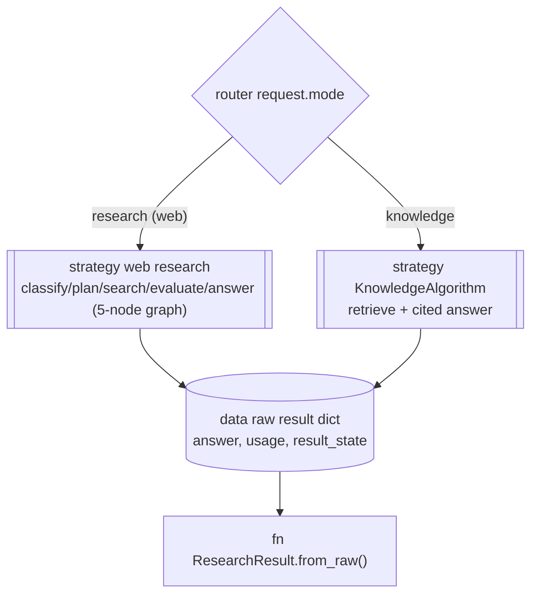
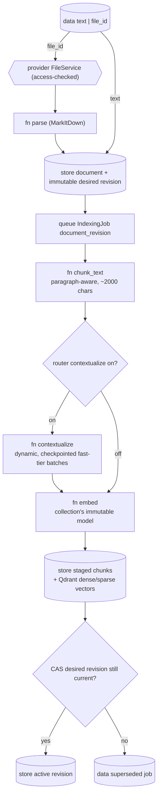
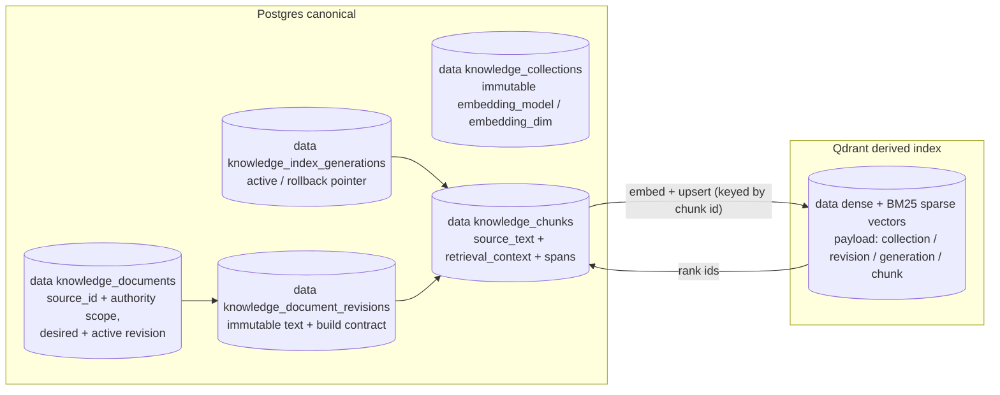
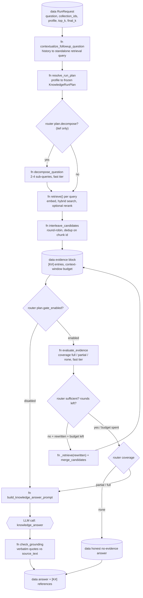
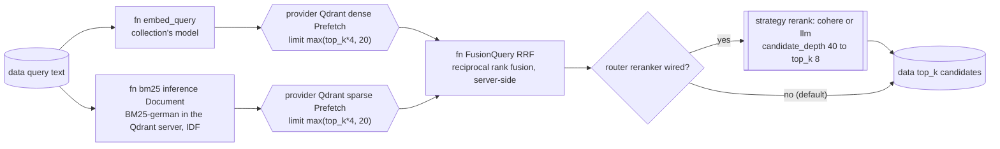

# Knowledge engine

> Files: `src/inqtrix/knowledge/` (`algorithm.py`, `retrieval.py`, `decompose.py`, `gate.py`, `grounding.py`, `contextualize.py`, `chunking.py`, `stores/qdrant_store.py`), `src/inqtrix/storage/knowledge_orm.py`

## Scope

This page is the knowledge engine: what `mode=knowledge` does with a raw document until it answers a question with citations. It covers the data model, ingestion and contextualization, the Postgres-canonical / Qdrant-derived storage topology, the end-to-end retrieval pipeline (hybrid search, RRF fusion, optional rerank, the sufficiency gate, and grounding), how that pipeline relates to the web-research loop, the Wissen workspace it surfaces through, and how retrieval and answer quality are evaluated.

It opens with two sections that do not describe Inqtrix internals at all: [The retrieval model in one pass](#the-retrieval-model-in-one-pass) explains what each kind of retrieval machinery does and why more than one of them is needed, and [Which engine owns which stage](#which-engine-owns-which-stage) maps every stage to the class of engine that runs it. Read those first if the terms below are unfamiliar; skip to [Two engines, one serialization](#two-engines-one-serialization) if they are not.

It does **not** cover the per-request stage matrix — that lives in [Retrieval profiles](../configuration/knowledge-profiles.md); every `INQTRIX_KNOWLEDGE_*` / `INQTRIX_EMBEDDING_*` / `INQTRIX_RERANKER_*` variable lives in [Settings and environment](../configuration/settings-and-env.md).

Knowledge retrieval is off by default. The hybrid, contextualization, and rerank stages described here engage only with the qdrant backend and the matching flags. Every line below differs from its default except `INQTRIX_KNOWLEDGE_SPARSE`, which is spelled out because it is the branch under discussion — so this block is a deliberate opt-in, not a description of an out-of-the-box deployment:

```dotenv
INQTRIX_KNOWLEDGE_ENABLED=true         # default false: no routes, no embedding provider
INQTRIX_VECTOR_BACKEND=qdrant          # default memory (dense-only); qdrant adds hybrid retrieval
INQTRIX_KNOWLEDGE_SPARSE=bm25_german   # default: the BM25 lexical branch (an algorithm inside the Qdrant server, no model)
INQTRIX_KNOWLEDGE_CONTEXTUALIZE=on     # default off: situating prefix per chunk at ingestion
INQTRIX_RERANKER_PROVIDER=cohere       # default none: the rerank stage is skipped visibly
```

## The retrieval model in one pass

Five things happen between a question and a cited answer, and they are five different *kinds* of machinery. Confusing them is the most common way to misread the rest of this page.

| Step | What it is | What it is not |
|---|---|---|
| Dense retrieval | A learned model maps text to a vector; nearby vectors mean related meaning. | Not a keyword search — it will not reliably find `CVE-2026-12345`. |
| Sparse retrieval (BM25) | A weighted term index: rare terms count more, long chunks less. | Not a model — no synonyms, no cross-language matching. |
| RRF | Arithmetic over the two result *lists*. | Not a model and not an embedding — it never reads the text. |
| Reranking | A model that scores question and passage *together*. | Not a retriever — it only reorders what retrieval already found. |
| The answer LLM | Writes the answer from the selected original passages. | Not a search step — it sees only what the stages above admitted. |

### Why two searches instead of one

Dense and sparse retrieval fail in *opposite* directions. That is the whole reason both run.

A dense embedding (`list[float]`, one vector per chunk) is a lossy compression of meaning into a fixed number of dimensions. That is what lets "Wie lange bleiben Datensicherungen erhalten?" retrieve a chunk that says "Sicherungskopien sind 90 Tage aufzubewahren" — the two share no word, but their vectors point in a similar direction. The same property is why an exact identifier can disappear: `DB-PROD-037`, `Artikel 17 Absatz 4`, or `AES-256-GCM` carry almost no distributional signal, so the compression discards them. Semantic proximity is also not the same as answering the question: a passage on why backups matter sits close to a question about retention periods without containing "90 Tage" anywhere.

BM25 has the mirror-image profile. It scores a chunk from how often the query's terms occur in it, how rare each term is across the corpus, and how long the chunk is, with saturation so that a hundred repetitions do not count a hundred times. A rare token like `DB-PROD-037` therefore dominates the score while a frequent one like "Daten" barely moves it. The cost is that BM25 has no notion of meaning: "Datensicherung" and "Backup" are unrelated tokens to it, and so are "Verschlüsselung" and "encryption".

Running both and fusing them is not redundancy. It is covering each branch's blind spot with the other's strength.

| Query characteristic | Dense | BM25 |
|---|---|---|
| Synonym or paraphrase of the document wording | strong | weak |
| Query and corpus in different languages | strong (the embedding models are multilingual) | structurally impossible except for shared tokens |
| Exact identifier, article number, product code | can miss | strong |
| Rare technical term appearing verbatim | varies | strong |
| Broad topical similarity | strong | only on word overlap |

**"Sparse embedding" is a slightly misleading name.** The sparse branch is stored as a vector, but it is not a second neural model. `Qdrant/bm25` is a tokenizer plus a weighting formula: it emits one weight per token that actually occurs and zero for every other position in the vocabulary. That is what "sparse" means — a handful of non-zero entries in a very large space, against a dense vector where nearly every position carries a value. The whole computation happens inside the Qdrant server (core BM25 inference, server >= 1.15.3): inqtrix sends the chunk or query text as an inference `Document` and Qdrant tokenizes, stems, and weights it next to the index — nothing is downloaded and no embedding library runs in the API or worker. The rarity (IDF) part of the weighting is likewise applied server-side, so it is computed against the collection actually being searched.

### What RRF does with the two rankings

The two branches return scores that cannot be compared. A dense cosine similarity of `0.84` and a BM25 score of `14.7` are not on one scale, and no fixed weighting makes them one: BM25 scores grow with corpus statistics and query length, cosine similarity does not.

Reciprocal Rank Fusion sidesteps this by discarding the scores and keeping only the *positions*. It scores a chunk by the sum of its reciprocal ranks across the branches:

```text
score(d) = Σ_i  1 / (k + rank_i(d))
```

where `rank_i(d)` is `d`'s position in branch `i` and `k` is a smoothing constant. Fusing by **rank** rather than by raw score is the point: it prevents one branch's score magnitude from drowning the other, and both branches contribute regardless of scale.

The consequence is that a chunk both branches rank highly beats one that only a single branch ranks first:

| Chunk | Dense rank | BM25 rank | Outcome |
|---|---|---|---|
| A — "90 Tage aufzubewahren" | 2 | 1 | strong in both; fused to the top |
| B — general text about backups | 1 | 7 | dense-only; loses to A |
| C — unrelated text containing "90" | 8 | 2 | lexical-only; loses to A |

RRF reads no text, understands no question, and produces no vector. It is a voting rule over two lists — which is exactly why it is safe to apply across branches whose scores mean different things.

### Why a reranker is still worth it after retrieval

Dense retrieval has a structural limitation that no amount of embedding quality removes: a chunk's vector is computed at ingestion, *before* any question exists. It must compress everything the chunk might ever be asked about into one point, and the question is compared against that point.

```text
question ──► one vector ┐
                        ├──► distance between two independently computed points
chunk    ──► one vector ┘     (the chunk's point was fixed at ingestion)
```

A cross-encoder reranker instead sees the question and the passage together, in one forward pass, and scores the pair:

```text
"Welche Aufbewahrungsfrist gilt für Backups?" + "Sicherungskopien müssen 90 Tage …"
                         ──► one relevance score
```

That is why it can separate "topically about backups" from "answers this question about backups" — a distinction the ingestion-time vector could not have encoded, because the question did not exist yet. It is also why it cannot replace retrieval: scoring every chunk this way would mean one model call per chunk per question. The two stages are complementary rather than alternatives. Retrieval buys recall cheaply over the whole collection; reranking buys precision expensively over a small pool.

The pool is small on purpose. With the defaults the reranker sees `INQTRIX_RERANK_CANDIDATE_DEPTH` (40) candidates and the answer receives `final_k` (8).

### What contextualization changes, and what it must never change

A chunk is retrieved alone but was written in context. Split at a paragraph boundary, a passage can lose the referent that made it meaningful:

```text
Sie sind 90 Tage aufzubewahren.
Danach sind sie unverzüglich zu löschen.
```

Nothing here says what "sie" refers to, so no query about backup retention matches it well in either branch. With `INQTRIX_KNOWLEDGE_CONTEXTUALIZE=on` (**default `off`**), a fast-tier LLM call generates one or two situating sentences per chunk at ingestion, and the *index* text becomes the situating prefix followed by the original body. Both the dense vector and the BM25 weights are computed from that combined text.

The boundary that matters: the generated prefix is persisted separately as `retrieval_context`, and the untouched body stays `source_text`. **Only `source_text` reaches the answer prompt, the citation, the document viewer, and the quote verification.** Model-generated text is allowed to help *find* a chunk; it is never allowed to become evidence. A quote of the situating prefix therefore does not verify as source content.

This split is also why the measured gain is a *retrieval* gain. The committed configuration note reports recall@1 moving from 0.9375 to 0.9688 on the EU-AI-Act hard evaluation set, on top of hybrid plus rerank ([`.env.example`](../../.env.example)) — a retrieval metric, because the answer never sees the generated text.

## Which engine owns which stage

Every stage below runs on exactly one class of engine, and they are not all models. This table answers "what would I have to configure, and what would it cost me?" for each stage in isolation; the per-profile view of which stages run together is in [Retrieval profiles](../configuration/knowledge-profiles.md).

| Stage | Engine class | Defined in | Cost per question | Runs when |
|---|---|---|---|---|
| Chunk contextualization | LLM, **fast** tier (`knowledge_contextualize`) | `contextualize.py` | none — runs at **ingestion**, `ceil(chunks / effective batch size)` calls per document | `INQTRIX_KNOWLEDGE_CONTEXTUALIZE=on` (default `off`) |
| Dense indexing and query embedding | Embedding model, pinned immutably per collection | `providers/embeddings.py` | one embedding call per embedding-model group in scope | always |
| Sparse indexing and query encoding | **No model** — BM25 tokenizer plus weighting (`Qdrant/bm25`), executed **inside the Qdrant server** (core inference, server >= 1.15.3 — checked at startup; nothing downloads at runtime), IDF applied server-side | `stores/qdrant_store.py` | none | `INQTRIX_KNOWLEDGE_SPARSE=bm25_german` on the qdrant backend |
| RRF fusion | **No model** — arithmetic over ranks, executed inside Qdrant | `stores/qdrant_store.py` | none | the hybrid path |
| Reranking | Cross-encoder API (`cohere`) **or** LLM, fast tier (`knowledge_rerank`) | `providers/rerankers.py` | one rerank call; `llm` is roughly an order of magnitude costlier and hard-capped at 20 candidates | `INQTRIX_RERANKER_PROVIDER` is not `none` (default `none`) **and** the profile enables rerank |
| Follow-up rewrite | LLM, **fast** tier (`knowledge_contextualize`) | `algorithm.py` | one call | the request carries prior `messages`/`history` |
| Query decomposition | LLM, **fast** tier (`knowledge_decompose`) | `decompose.py` | one call | `tief` only |
| Sufficiency gate | LLM, **fast** tier (`knowledge_gate`) | `gate.py` | one call per round | the gate is on and the profile grants rounds |
| Answer | LLM, **high** tier (`knowledge_answer`) — the only knowledge stage that also resolves a reasoning effort | `algorithm.py` | one call, plus at most one regeneration | always |
| Quote verification (grounding) | **No model** — deterministic normalized substring check | `grounding.py` | none | `INQTRIX_KNOWLEDGE_GROUNDING=on` (default) |

Read down the middle column. Five stages are always LLM calls — chunk contextualization, follow-up rewrite, decomposition, gate, answer — and exactly one of them, the answer, sits on the high tier; the other four are fast-tier. Reranking is a sixth, conditional LLM call: only the `llm` provider routes it through the deployment's own model, while `cohere` calls a dedicated cross-encoder endpoint instead.

Three consequences worth reading off this table:

- **Everything that decides *which* evidence the answer sees** — dense retrieval, the lexical branch, fusion, reranking — runs either on a model that is not an LLM or on no model at all. Swapping the answer model changes how the answer is written, not what it is written from.
- **The check that decides whether an answer may be published is plain code.** Evidence integrity depends on a model nowhere in this pipeline.
- **The fast tier carries more weight than its name suggests.** With contextualization enabled it is also the ingestion model, called once per chunk batch for every document, so `TIER_FAST_MODEL` drives indexing cost far more than it drives answer quality.

All LLM call sites resolve their model and effort through the central router (`model_routing.py`); per-call-site detail, the three tiers, and the resolution order are in [LLM calls, model tiers, and reasoning effort](websearch/nodes.md). There are no `KNOWLEDGE_*_MODEL` per-node environment variables: these nodes use the tier layer (`TIER_FAST_MODEL` / `TIER_HIGH_MODEL`). A per-run `model_tier` can redirect the answer and other mid/high steps; fast gate, decomposition, reranking and contextualization steps keep their assigned tier. The LLM reranker and ingestion contextualizer resolve when the container is built and pass no requested tier.

## Two engines, one serialization

This diagram answers: "Does `mode=knowledge` run through the same five-node research graph as web research?" It does not — the request is dispatched by the algorithm registry to a separate `KnowledgeAlgorithm`, but both engines emit the same raw result shape so run serialization, SSE events, and snapshots are shared.



Key transitions:

- `mode=knowledge` is **not** the web graph with a different backend — it is a distinct `KnowledgeAlgorithm` (`algorithm.py`) reached through the algorithm registry. The five-node graph (see [Research loop](websearch/loop.md)) never runs for a knowledge request.
- `KnowledgeAlgorithm.run()` returns a raw dict that mirrors the web-research shape (`answer`, `usage`, `result_state`), so `ResearchResult.from_raw`, native-run snapshots, completed-result export, and the SSE step stream consume knowledge runs without a parallel code path. Typed Knowledge result metadata, including retrieval degradations, is retained by this serialization rather than existing only in a transient event.
- The shared serialization is why the run card renders a knowledge run with the same machinery as a web run, only with `[K#]` evidence labels instead of `[E#]`.

## Ingestion: document to retrievable chunks

This diagram answers: "How does a raw document become embedded, retrievable chunks?" The browser-facing ingestion path is a durable server job. It reserves immutable source intent before it queues provider work, so retries and reordered completions cannot replace a document by accident.



Key transitions:

- **Parse** converts PDF/DOCX/PPTX/XLSX/HTML/Markdown to Markdown via MarkItDown; a file that yields no text (a scanned PDF without a text layer) fails loudly with HTTP 422 rather than producing a silently empty document.
- **Reserve** creates a stable logical document, a monotonically ordered desired revision, and the job identity in server-owned state before any contextualization or embedding call. Repeating the same `(collection, source, content hash)` request is idempotent. A later desired revision wins even when an older worker finishes last; the older job becomes `superseded` and never deletes or replaces the newer result.
- **Chunk** (`chunk_text_slices`) splits on blank-line paragraph boundaries, packs greedily up to `INQTRIX_KNOWLEDGE_CHUNK_MAX_CHARS` (default 2000 chars, ~500 tokens), and hard-splits oversize paragraphs on sentence boundaries. Every chunk carries an exact character span while it is processed and an exact UTF-8 byte span when persisted; repeated boilerplate is never rediscovered by prefix search.
- **Contextualize** (`contextualize.py`, `INQTRIX_KNOWLEDGE_CONTEXTUALIZE`, **default `off`**) generates a short situating context for each chunk; what it is for and where its output may and may not appear is in [What contextualization changes](#what-contextualization-changes-and-what-it-must-never-change). A deployment that has not set this flag indexes the plain chunk body, and the `Ctx` branch below is simply not taken. `25` is only the maximum call width. The planner grows a contiguous batch while the complete rendered prompt, the model-card context window, guaranteed JSON response space, and safety reserve fit; every resulting document window contains the entire source span of its batch. The number of calls is therefore `ceil(chunks / effective dynamic batch size)`, not one call per document.
- Up to three contextualization batches execute concurrently, bounded further by the provider's declared LLM-concurrency capability and by one process-wide gate on the shared contextualizer. Every validated batch is checkpointed independently with model and prompt hashes, including when calls finish out of order. The first dependency or validation failure stops new dispatch; already-running successful batches may still checkpoint, but no incomplete revision is published. Resume validates the stored set and starts only missing batches. The UI can retry, cancel, or explicitly request a separate raw-text build; it offers the raw build only where retrieval context is what failed (a contextualization or validation pause), not for an embedding, vector-store, or quota outage. That explicit choice is recorded as `ready_raw_by_user_choice`; there is no automatic raw fallback.
- Transient dependency failures open a circuit keyed by tenant, LLM provider, and resolved contextualization model. In PostgreSQL deployments this state is shared by API and worker replicas; it is not a process-local hint. During the configured cooldown, new calls stop before reaching the provider and their jobs pause with a typed reason. When the cooldown expires, a row-locked lease grants exactly one half-open probe. A matching probe token closes the circuit after recovery; a failed probe reopens it, and an expired lease can be reclaimed after a worker crash. Provider retry/backoff loops receive the indexing cancellation probe in the actual executor thread, so cancellation does not wait for the remaining retry ladder. Cooldown and probe lease are recovery coordination, never document deadlines or silent fallback criteria.
- **Automatic resume.** A `paused_dependency` job (contextualization, embedding, vector-store, or quota outage) carries a bounded resume plan in its checkpoint (`auto_resume`: attempts used, limit, due time, stop reason); its pause event carries the plan too, because that event ends the job's event stream. The API process sweeps every 30 seconds and resumes a due job the way a person's click does: as its creator, after the same access check, from the same checkpoint (locally where the API executes indexing, through the queue where a worker does). Waits grow from 60 seconds to 15 minutes with ±20 % jitter. `INQTRIX_REINDEX_AUTO_RESUME_ATTEMPTS` (default 5, `0` turns it off) resumes in a row without progress end the streak as `stopped: exhausted`; progress since the previous pause starts a new count, and a person's resume clears the plan. A validation pause never resumes on its own. One sweep resumes at most five jobs. While the contextualization circuit admits no call, the jobs it governs stay paused; once it admits one probe, exactly one of them resumes, and a resume that bounced at the still-open circuit does not use up an attempt. A job the sweep can never resume (its creator lost access, its execution identity is incomplete) stops visibly as `stopped: access` or `stopped: unavailable` (event `inqtrix.index.auto_resume_stopped`) and waits for a person. Every planned, performed, and stopped automatic resume logs one WARNING after the pause's own line and is counted in `inqtrix_indexing_auto_resumes_total`. The index view names what the pause waits for (from the error type, never the raw provider message) and the next attempt as a clock time with its count, for example "Next automatic attempt at 19:35 (2/5)", or why a streak ended; a paused run of several documents shows the soonest attempt among them. When automatic resume is switched off, a plan stored before the switch is not shown.
- **Content filter.** A batch whose completion the provider's content filter cut off (`finish_reason=content_filter`) is repeated once, visibly: a WARNING log line names the batch, and the cut-off generation carries Langfuse level WARNING. A request the filter refused outright (a structured `content_filter` rejection) is not repeated, because the refusal is bound to its content. When the repetition is cut off again, or the request was refused, the batch's chunks are indexed without retrieval context and the revision does not pause for it. A WARNING log line counts the chunks. The checkpoint records the batch as omitted, so a resume never calls the provider for it again. The marker becomes `_chunk_context_partial`, the document metadata holds `_chunk_context_omitted` (`{"chunks": n, "reason": "content_filter"}`), and the job's `document_completed` event carries `context_omitted_chunks`. The research desk reads that metadata and names the count beside "indexed" in the index's file rows and in a collection's document list; the index view lists its collection when it opens and when a run ends. A collection rebuild reports the count on that event only; the document metadata keeps the value its last revision wrote. Every other incomplete stop (`length`, `max_tokens` and the like) still pauses as `paused_validation`, because a repetition would not change it.
- **Embedding text is not evidence.** `retrieval_context` is stored separately from the immutable `source_text`. Their concatenation is the internal retrieval text: dense embedding and sparse indexing are built from it, and a configured reranker scores it. It never becomes reader-facing evidence. Answer prompts, citations, Document Find, Canvas evidence, previews, and exports receive the common `KnowledgeEvidenceHit.excerpt`, which is verified against the canonical document span.

## Data model

| Object | Id prefix | Key facts |
|---|---|---|
| Collection | `kc_` | Name plus an **immutable** `embedding_model` and `embedding_dim`, fixed at creation. |
| Document | `kd_` | Stable logical identity with `source_id`, a server-owned owner/workspace source scope, desired revision, active revision, title, metadata, and the currently active extracted text (up to `INQTRIX_KNOWLEDGE_MAX_DOCUMENT_CHARS`, default 2,000,000). |
| Revision | `rev_` | Immutable source text, content hash, parser/chunker/contextualization contract, desired sequence, and publication status. |
| Generation | `gen_` | One immutable collection-wide index build and its revision manifest; exactly one generation is active, retained predecessors can be rolled back. |
| Chunk | `kch_` | One retrieval unit with original `source_text`, optional `retrieval_context`, exact UTF-8 `source_start`/`source_end`, revision/generation identity, and the derived vector. |

**Why the embedding identity is immutable.** Every chunk in a collection must live in the same vector space: vectors from different models (or the same model at a different dimension) are geometrically incomparable, so mixing them would silently corrupt similarity scores. The dimension is recorded at creation — from the embedding catalog when the model is catalogued, otherwise probed with one real embedding call — and enforced on every upsert. A mismatch raises `EmbeddingDimensionMismatch` (HTTP 409), never a padded or truncated vector. Changing `INQTRIX_EMBEDDING_MODEL` only affects *new* collections.

**Why the full document text is kept.** It is the citable source view: the document viewer renders it (`GET /v1/knowledge/documents/{id}/text`), and snippet/quote highlighting works by text search within it.

**Why source scope is typed.** A `source_id` is unique only within its
tenant/owner/workspace authority. Asset metadata can identify a candidate
source but cannot authorize it. Ingestion copies the scope from the canonical
asset lifecycle into dedicated document columns; aggregate deletion matches
all four dimensions and a retained deletion permit. Missing, foreign, or
unbound identities never mint a deletion operation and never fall back to a
tenant-wide `source_id` cleanup.

**Retrieval text vs. evidence.** When contextual retrieval is on, the generated situating prefix is persisted as `retrieval_context`; the original body is `source_text`. Their concatenation builds the dense and sparse indexes and, when `INQTRIX_RERANKER_PROVIDER` is not `none`, is the passage text the `cohere` endpoint or the `llm` reranker scores against the query. Public search hits expose `excerpt`, never the combined embedding text. Every reader-facing excerpt and quote is verified against the canonical document's content hash and UTF-8 source span. Legacy chunks that cannot pass that check are excluded with a visible `chunks_require_reindex` warning; there is no fallback that presents synthetic retrieval text as source evidence. While the migration-marked compatibility generation is active, pre-lineage Qdrant payloads are admitted only for the exact verified canonical chunk ids recovered by the migration; canonical generation/revision hydration plus the same hash/span verification still gates every result. A validated shadow generation removes that compatibility branch automatically.

## Storage topology: Postgres canonical, Qdrant derived

This diagram answers: "Where does each piece of a chunk physically live, and what keeps them in sync?" The split follows the standard "Postgres = source of truth, vector DB = derived index" topology.



Key transitions:

- **Postgres holds the truth**: stable source and document identity, immutable document revisions, the desired/active revision pointers, generation history, canonical source text, and exact chunk provenance. A retrieval candidate is admitted only when its revision and generation match the active pointers and its UTF-8 span hashes back to the canonical document.
- **Qdrant is derived.** The Postgres-backed store places vectors in one physical Qdrant collection per embedding-model configuration. Logical collections, revisions, and generations are payload partitions; authorization remains a live transactional check rather than a Qdrant filter.
- **Why generations are logical inside the model collection.** A physical Qdrant collection per logical generation would force a multi-collection user query into a second fan-out and score-fusion implementation. The shared physical model index preserves one `KnowledgeService.search` pipeline. Atomicity comes from the Postgres generation pointer: search ranks candidates, hydrates only the active revision/generation, and geometrically over-fetches when stale points are still awaiting cleanup.
- **Rollback is pointer-based.** A collection rebuild writes a shadow generation without changing the active pointer. Publication validates revision identity, exact UTF-8 source spans and slices, chunk/point totals, and embedding dimension, then changes one transactional pointer. The previous generation remains `rollback_available` for `INQTRIX_GENERATION_ROLLBACK_RETENTION_SECONDS` (seven days by default). Retention first commits `deleting`, then removes and verifies derived vectors, and finally removes canonical chunk rows in the same transaction that marks the generation `deleted`. A crash or dependency error leaves `deleting`/`cleanup_failed`, never a falsely rollbackable row, and the existing worker maintenance cadence retries it idempotently.
- **Existing vector payloads migrate without a broad fallback.** The schema migration can recover canonical revision/generation rows and exact source spans in Postgres, but it cannot rewrite already persisted Qdrant payloads transactionally. Only while the explicitly marked compatibility generation is active, the vector filter admits payloads missing both lineage fields for the exact verified canonical chunk ids recovered by that migration. Postgres hydration still requires the active revision/generation, content hash, and exact source bytes. Activating any validated shadow generation removes this chunk allow-set from the search scope.

### Shared collections and maintenance

A collection list is a single authoritative owned-plus-accepted-shared view.
`view` permits metadata, document text, retrieval, and cited answers. `edit`
also permits ingest, document deletion, and reindex; collection deletion and
share management remain owner-only. Workspace membership does not grant
collection access by itself. When the optional common-workspace restriction is
enabled, every access verifies that the owner and recipient still share at
least one workspace.

Collection sharing covers extracted/indexed text and metadata, not the
uploader's original file binary. An editor can ingest a file they own into a
shared collection; its extracted text then belongs to the collection and
remains there after that editor leaves, while the binary remains accessible
only to the uploader. Client code must therefore hide binary download actions
for shared documents rather than constructing an endpoint the recipient cannot
use.

One collection-generation build is serialized per collection, but the active
generation remains readable throughout. Normal document revisions may continue:
the worker compares its staged manifest with the current active revisions and
reconciles deltas before its final publication check. A collection deletion
fences new generation work. The worker checks the requester's active account
and current `edit` access before and after external vector writes; losing that
authority ends the job as `authorization_revoked`. A current viewer can read
job state and events, while a current editor can pause, resume, choose a raw
build, or cancel. Backends without transactional collection metadata reject
generation operations rather than treating Qdrant or process-local state as an
authorization boundary.

## Retrieval pipeline: question to cited answer

This diagram answers: "What happens between a `mode=knowledge` question arriving and a cited answer leaving?" The node order is exactly the order of `KnowledgeAlgorithm.run()`. How much of this machinery runs is selected by the retrieval profile (`schnell` / `standard` / `gruendlich` / `tief` / `auto`); the diagram shows the maximal path.



Key transitions:

- **Follow-up contextualization** (`contextualize_followup_question`) runs only when the request carries prior `messages`/`history`. It rewrites the current follow-up into a standalone retrieval query before profile selection, decomposition, retrieval, and gate evaluation. The final answer still receives the original user question and the history, but the prompt states that history is context only, not evidence. Provider/parse failures fall back to the original question with `_knowledge_query_context_fallback` and `inqtrix.knowledge.contextualized`.
- **Decompose** (`decompose_question`, tief profile only) splits the retrieval query into 2-4 sub-queries on the fast tier. Each sub-query and the standalone retrieval query are retrieved independently.
- **Interleave** (`interleave_candidates`) merges the per-query result lists round-robin — one candidate per list in rotation, the original question's list first, duplicates collapsed on `chunk.id`. This guarantees every aspect contributes to the top-k instead of the first list crowding the others out (the aggregation-failure class a plain first-wins union reproduces). The return value remains a `RetrievalCandidateBatch`: typed degradations and source-integrity exclusions from every sub-query remain attached instead of being reduced to a plain candidate list.
- **Collection scope** (`knowledge_filters.collection_ids`) is resolved at admission (`KnowledgeService.resolve_ask_scope`, called by the chat and native-runs routers for `mode=knowledge`): an explicit, non-empty list is asserted strictly — one invisible collection denies the whole submission with a 404 — and an omitted/`null`/empty filter from an authenticated caller is pinned to the caller-visible collections (owned + accepted direct shares) before the run is stored, so a worker only ever re-executes a bounded request. An empty visible set remains the explicit empty scope and performs no embedding, store search, gate, or answer-model call. The execution actor's access to every pinned id is rechecked at run safepoints; losing one aborts with `authorization_revoked` instead of silently narrowing the evidence. Deployments without user auth (`AUTH_MODE` none/apikey) keep the historical ownerless view.
- **Mixed embedding-model scope** is handled inside the same `retrieve()` implementation used by Knowledge Desk, Kernel, and Mission. The concrete collection scope is partitioned by its immutable embedding model, the query is embedded once per model group, and each group runs through the same canonical store search. Scores from different vector spaces are never compared directly: the group rankings are interleaved by rank and de-duplicated before the common optional reranker and final projection. Every selected group therefore remains represented; no router or agent adapter narrows the corpus to the deployment's default model.
- **Retrieval widths**: `top_k` (per-(sub-)query width, `knowledge_filters.top_k`, 1-50) bounds each `retrieve()` call; `final_k` bounds the candidate pool actually surfaced to the answer. By default `final_k = min(top_k × profile.final_k_factor, EVIDENCE_K_MAX)` — only `tief` raises the factor above `1.0`, so its decompose/gate fan-out widens evidence instead of collapsing back to `top_k`; a profile without decomposition retrieves `final_k` directly. An explicit `knowledge_filters.final_k` pins it, overriding the factor. `EVIDENCE_K_MAX` and each profile's `final_k_factor` are published in `/v1/capabilities` (`knowledge.evidence_k_max`, `knowledge.profiles[].final_k_factor`); full request contract in [Retrieval profiles](../configuration/knowledge-profiles.md).
- **Retrieval degradation has two widths.** A technical vector cap or stalled backend page can under-fill the requested candidate pool even when the later reranker/final projection still fills every requested evidence slot. `inqtrix.knowledge.retrieval.degraded` therefore records `requested_candidate_pool`, `returned_candidate_pool`, `final_top_k`, `returned_hits`, and `final_evidence_complete` separately. Genuine corpus exhaustion is not mislabeled as a technical degradation. The same typed records live in `result_state.knowledge_retrieval`, the completed `/result` export, saved Knowledge answers, and reload reconstruction, so the UI cannot lose or reinterpret the warning after SSE disconnect.
- **Canonical exclusions are warnings, not missing evidence hidden as corpus exhaustion.** A ranked vector point whose original source cannot be verified remains a typed `RetrievalExclusion` through model-group fusion, reranking, decomposition interleave and gate-rewrite merge. The one shared projection maps `source_unverified` to `chunks_require_reindex` and `canonical_chunk_unavailable` to `chunks_pending_reconciliation`; future reasons remain visible under the generic integrity-warning code. Counts are persisted in `knowledge_retrieval.warnings`, emitted as bounded `inqtrix.knowledge.retrieval.warning` events and rendered by the same warning component used for synchronous Knowledge search. A count denotes exclusion observations across retrieval calls, not unique chunks: the text-free aggregate deliberately carries no point or chunk ids, so a point seen by multiple queries cannot be deduplicated by identity. The receipt contains no query, source id or evidence text.
- **Evidence budget** renders the candidates as `[K1] Title (Abschnitt N)` entries up to a context-window-derived character budget. Truncation happens once, here, and emits `inqtrix.knowledge.evidence.truncated` — the reference list and the prompt always describe the same set.
- **Contextualization prompt version.** The chunk-context prompt carries `CHUNK_CONTEXT_PROMPT_VERSION` (`prompts.py`); ingestion records it per document as `metadata._chunk_context_prompt_version` next to the `_chunk_context` marker, so the document list shows which prompt situated a document's chunks. A wording change does not reindex anything: existing collections keep their contexts, new and re-indexed documents get the new ones, and a collection may carry mixed generations until its next reindex. Resumable ingestion checkpoints that no longer match the current prompt, model or batch plan are discarded with a WARNING and the document is contextualized from scratch; a mixture of two generations inside one document is never published. The contexts are written in the language of the document.
- **Sufficiency gate** (`evaluate_evidence`, `gate.py`) is one fast-tier call returning a three-way coverage verdict. `full` answers normally; `partial` answers with the gaps named explicitly (a binary verdict would refuse answerable multi-aspect questions wholesale); `none` yields the honest no-evidence answer instead of a fabrication. An unparseable gate response fails *open* to sufficient with `_knowledge_gate_fallback`; clients must render that marker as a degraded judgement in the visible run ledger.
- **The agentic loop**: while the gate is not satisfied, proposes a rewritten query, and the profile's round budget (capped by `INQTRIX_KNOWLEDGE_GATE_MAX_ROUNDS`) has rounds left, `run()` retrieves the rewritten query, merges it into the candidate pool (`merge_candidates`, original ranking authoritative), re-renders, and re-gates.
- **Answer language** — one decision per run (`resolve_answer_language`): a question with a clear language (an umlaut or ß, or a lead of at least two function words for one language) is answered in it, whatever the interface shows; a question without one (a German question around English titles, a short question one word leads) is answered in the ask's `ui_language`, which the Knowledge Desk and the chat send, under a directive that asks for the question's language first; without it a lead of one function word decides, and only a question without any signal gets the language-neutral directive, the server's own texts then falling back to English. The answer prompt, the no-relevant-content message and every refusal of the run use that one decision.
- **Grounding** (`check_grounding`, `grounding.py`) verifies the answer's `QUOTES:` block of verbatim `[K#]` quotes (followed by the `ANSWER:` section) WITHOUT another LLM call: a formatting-tolerant (whitespace, Unicode/typography, case) verbatim-substring check against the specifically labelled chunk's `source_text` (the pre-contextualization body — a quote of the situating prefix must not verify as source content). Every quote is checked against two surfaces of its assigned evidence entry: the raw text, and the text with `\x0c`-anchored page-break sequences removed (`strip_page_break_artifacts`) — PDF extraction writes the printed page number plus a form feed INTO sentences that span a page break, and a faithful quote naturally omits that artifact. The form-feed anchor keeps the tolerance content-safe: a number without a form feed (an article number, a year) is never touched. A word broken at a line end (`high- risk`, `clas- sified`) verifies in both readings (`high-risk`, `classified`): quote and surfaces are also compared with every hyphen between two letters removed — the `quote_key` form, which the document analysis also deduplicates by. Numbers are content, never formatting: a hyphen or dash next to a digit stays and only a line break after it closes (`COVID-\n19` verifies as `COVID-19`, `3-5` never as `35`), and compatibility folding touches no character that is or yields a number, so superscript, subscript and fraction digits are compared as written (the exponent in `10²` never reads as `102`). Tolerance covers only encoding/typography and these two artifact classes, never paraphrase. A single deterministic repair may accept Markdown heading markers around both section headers; it never changes quote or answer text. Only a completely parsed response whose every quote verifies is publishable. Failure splits by cause, and only one of the two causes is retried: a parsed response with an unverifiable quote (`QUOTE_UNVERIFIED`) triggers at most ONE visible answer regeneration (`inqtrix.knowledge.answer.retry`, additive usage, both attempts recorded in `knowledge_grounding.attempts`), while a response that could not be parsed at all (`FORMAT_INVALID`) terminates immediately with no second attempt — regenerating a model that ignored the output contract is not a repair. If the retried attempt still fails, the run ends in the typed terminal failure, preserves consumed usage and bounded audit counts, and exposes only a safe explanation to Knowledge, chat, and Agent callers. The gate only ever judges what the model wrote: a completion the provider itself marks as incomplete (`INCOMPLETE_FINISH_REASONS` in `providers/base.py` — `length`, `content_filter`, …) or one that carries no text ends the run BEFORE grounding as the typed provider outcome `knowledge_answer_incomplete` (the message names the stop reason, consumed usage stays booked, no retry); an incomplete regeneration keeps the first attempt's grounding verdict, exactly like a regeneration call that fails. A published answer's quotes travel with the citations they support: each `[K#]` reference carries `quotes` (text, `verified`, `artifact_tolerated`) for its own label, in the answer's order. A rejected draft exposes none of them, and the run's compact `knowledge_grounding` metadata keeps counts only.

### The width funnel

Six numbers control how much evidence survives each step. Following one `standard` request through them, on defaults:

```text
question                     1
  ├─ dense branch      ─┐
  ├─ BM25 branch       ─┴─ each prefetches over a geometrically widened pool
  ├─ RRF fusion         → one fused candidate list
  ├─ reranker           → 40 candidates in (when one is configured)
  └─ answer prompt      → final_k = 8 entries, labelled [K1] … [K8]
```

None of these widths scale with corpus size, which is what keeps per-question cost bounded no matter how large a collection grows:

| Width | Default | Bound | Set by |
|---|---|---|---|
| `top_k` — per-(sub-)query retrieval width | 8 | 1–50 | `INQTRIX_KNOWLEDGE_TOP_K`, per request `knowledge_filters.top_k` |
| Rerank candidate pool | 40 | `int(depth × profile factor)`, hard ceiling 200 | `INQTRIX_RERANK_CANDIDATE_DEPTH` × the profile's factor |
| `final_k` — evidence entries reaching the answer | 8 | 1–`EVIDENCE_K_MAX` (40) | `min(top_k × profile.final_k_factor, EVIDENCE_K_MAX)`, or pinned by `knowledge_filters.final_k` |
| Gate rewrite rounds | 1 | 1–5 | the profile, capped by `INQTRIX_KNOWLEDGE_GATE_MAX_ROUNDS` (3) |
| Evidence character budget | derived | `max(8_000, (context_window − 4_000) × 3)` | the answer model's context window |
| Decomposition sub-queries | none | 2–4, `tief` only | the profile |

The character budget is the last gate and the only one that can drop an already-selected candidate. Truncation happens once, there, and emits `inqtrix.knowledge.evidence.truncated`, so the reference list and the prompt always describe the same set.

## Hybrid search and RRF

This diagram answers: "How do the dense and BM25 branches combine into one ranking?" It zooms into a single `retrieve()` call from the pipeline above (`stores/qdrant_store.py`). The conceptual argument for the two branches and for rank-based fusion is in [Why two searches instead of one](#why-two-searches-instead-of-one); this section is the implementation.



Key transitions:

- **Two branches, one Qdrant call.** `_sync_hybrid_search` issues a single `query_points` with two `Prefetch` branches — dense (the query embedding, `using="dense"`) and sparse (the query text as a BM25-german inference `Document` that the Qdrant server expands into a `SparseVector` itself, `using="sparse"`) — both under the same collection/revision/generation scope filter. Neither branch can see a different slice of the corpus than the other.
- **Two widening layers, not one.** Each branch fetches `prefetch_depth = max(top_k * 4, 20)` candidates — but the `top_k` that function receives is already a widened pool, not the requested evidence width. The store first over-fetches geometrically (`VECTOR_OVERFETCH_FACTOR = 8`, floored at `MIN_VECTOR_CANDIDATES = 64` and capped at `MAX_VECTOR_CANDIDATES = 512`, `stores/retrieval_contract.py`) so that candidates dropped during canonical hydration — stale generations, unverified source spans, duplicate documents collapsed by content hash — do not silently shrink the result. Reaching either bound is reported rather than absorbed: `vector_overfetch_cap` and `vector_candidate_stalled` travel on as typed degradation reasons.
- **Reciprocal Rank Fusion (RRF)** combines the two rankings server-side via `models.FusionQuery(fusion=models.Fusion.RRF)` — Qdrant computes the fusion, Inqtrix does not post-process the scores. The formula and why rank-based fusion is the right choice here are in [What RRF does with the two rankings](#what-rrf-does-with-the-two-rankings).
- **Reranker** (optional, `INQTRIX_RERANKER_PROVIDER`) re-scores a deeper candidate pool (`INQTRIX_RERANK_CANDIDATE_DEPTH`, default 40) down to the requested `top_k` (default 8). `cohere` calls a Cohere-rerank-schema endpoint (native or Azure serverless); `llm` is a listwise fallback through the deployment's own LLM, hard-capped at 20 candidates and roughly an order of magnitude costlier. The default is `none` — a visible capability flag, never a silent downgrade; hybrid without a reranker is warned about at startup because plain RRF can degrade top-1 precision on paraphrase queries.

## Cross-lingual retrieval (query and corpus in different languages)

A common case is a German question against English documents (or the reverse). The two branches behave very differently here:

- **Dense is multilingual out of the box.** The default embedding model (`text-embedding-3-small`) and the selectable alternatives (`text-embedding-3-large`, `BAAI/bge-m3`, `voyage-3-large`) map semantically equivalent text across languages into one shared space. A German query and an English chunk land near each other with **no translation and no language tag** — and a language *filter* would actively break this, so documents/chunks deliberately carry no language metadata.
- **BM25 (the sparse branch) is language-bound.** The lexical encoder tokenizes and stems in exactly one language (`bm25_german` today). Cross-lingual *keyword* matching is structurally impossible — "Verschlüsselung" and "encryption" share no token — so when the query and corpus languages differ the sparse branch contributes little or unstably. It does **not** contribute nothing: query and documents pass through the same encoder, so shared exact terms (names, codes, acronyms, numbers) can still match. A multilingual learned-sparse model such as BGE-M3 exists as a model family, but the current Qdrant core BM25 branch is monolingual. Query translation is not part of the current retrieval contract.
- **The cross-lingual lever is a multilingual cross-encoder reranker — optional, not required.** It stays a recommendation: `INQTRIX_RERANKER_PROVIDER=none` is the default and a valid choice, and a deployment without a reranker keeps the dense+BM25 path unchanged — the absent optional stage is declared by capabilities rather than treated as a runtime failure. When configured, the `cohere` provider (a rerank-schema adapter, not vendor-locked: native Cohere `rerank-v3.5`, Azure serverless, or any compatible self-hosted endpoint) re-scores the fused candidates against the original query directly across languages, over the already-multilingual dense branch — no new retrieval code. The `llm` reranker is a fallback whose multilingual quality depends on the configured LLM and costs latency/tokens; it is not the recommended cross-lingual lever.

**Visibility.** The capability manifest (`/v1/capabilities` and the admin runtime payload) publishes `sparse_mode` (`bm25` or `off`), `sparse_language` (the BM25 tokenizer language, e.g. `de`, or `null` when sparse is off), `sparse_multilingual: false`, and `cross_lingual_recommendation: "reranker"`, so clients can show the limitation honestly. When the *confidently* detected query language (an umlaut or ß, or a lead of at least two function words) differs from the tokenizer language, the run's `result_state.knowledge_sparse` carries the `_knowledge_sparse_tokenizer_mismatch` marker plus a redacted log/event (language codes only, never the query text). This signal is query-vs-**tokenizer** only; the current schema does not claim to detect query-vs-document language. The same-language default path adds no field, event, or log.

## The Wissen workspace

The React Research Desk (`apps/research-desk/src/features/knowledge/`) exposes the engine as the "Wissen" workspace with two modes and a shared reader. **Ask** submits the question as a native run (`POST /v1/runs` with `mode=knowledge` plus the selected collections, profile, and top-k). Follow-up asks include recent completed Q&A turns as `messages` so retrieval can resolve "that/there/also" style references, while old answers and old citations never become evidence for the new answer. The UI renders the live SSE step stream — contextualization, profile resolution, retrieval, gate rounds, grounding — inline before the cited answer appears. The answer card shows the verified quotes from the references: a quoted citation is marked as verified and the reader highlights the quoted span; clicking a `[K#]` reference opens the reader at the cited document. **Find** is a debounced literal retrieval search against `POST /v1/knowledge/search`, with hits grouped per document so one strong document does not read as twenty results. **Read** is the document viewer overlay both modes open into: the *extracted* tab renders the ingested text (the exact text retrieval and grounding verified against) with exact match highlighting for the opened quote or snippet, and the *original* tab streams the source binary via `/v1/files/{file_id}/content` when the document was ingested from a server file. The workspace gates every feature on the `/v1/capabilities` manifest, so deployments without hybrid retrieval, reranker, or file parsing degrade visibly instead of breaking.

## Evaluation

The retrieval eval (`tests/eval/test_retrieval_eval.py`) and the answer eval (`tests/eval/test_answer_eval.py`, the only eval that exercises the gate) run live against real embedding/LLM backends and parametrize over golden tiers:

| Tier | Corpus | Character |
|---|---|---|
| `base` | 10 committed German documents | Smoke-level retrieval sanity. |
| `hard` | EU AI Act, split per article (rebuilt from EUR-Lex) | Hard paraphrase and cross-article queries. |
| `bsi` | BSI IT-Grundschutz Bausteine + C5 criteria (rebuilt from official downloads) | Technical-control vocabulary. |
| `dora` | Regulation (EU) 2022/2554, split per article (rebuilt from the Publications Office) | Multi-hop/aggregation headroom. |
| `dora_holdout` | Shares the DORA corpus | NEVER tuned against — held-out overfitting-regression gate only. |
| `gquad` | GermanQuAD Wikipedia QA (generated locally, share-alike license) | Everyday-German counterweight to the legal tiers. |

`INQTRIX_EVAL_GOLDEN_SET` selects the tier and `INQTRIX_EVAL_KNOWLEDGE_PROFILE` the retrieval profile for the answer eval; both fail loudly at import on a typo (never silently grading the base set):

```bash
INQTRIX_EVAL_GOLDEN_SET=dora INQTRIX_EVAL_KNOWLEDGE_PROFILE=gruendlich \
  uv run --env-file .env pytest tests/eval/test_answer_eval.py -v

# Standard pip/plain-Python environment:
python -m pip install -e ".[dev]"
set -a
. ./.env
set +a
INQTRIX_EVAL_GOLDEN_SET=dora INQTRIX_EVAL_KNOWLEDGE_PROFILE=gruendlich \
  python -m pytest tests/eval/test_answer_eval.py -v
```

Baselines under `tests/eval/baselines/` are **deliberate commits**: a run never overwrites a baseline; a human reviews the artifact and commits the new floor with a rationale. Retrieval baselines are keyed `{tier}__{embedding-model}.json` (the base tier keeps the legacy unkeyed name); answer baselines are keyed `answer-{model}.json` for base/standard and `answer-{model}-{tier}-{profile}.json` otherwise.

Reading a baseline file: `_inqtrix_version` identifies the product version
whose behaviour is protected, while `_context` records the relevant stack
(store, embedding model, reranker, contextualization), current comparison
constraints, and known misses with their failure class. Retrieval baselines
carry `recall_at_1/3/5`, `mrr`, `ndcg_at_5`, and `multi_complete_at_5` (share
of multi-document queries with ALL labeled documents in the top-5). Answer
baselines carry `abstention_rate` (floor; `null` on tiers without
`no_evidence` queries, which then skip that gate), `false_refusal_rate`
(ceiling — the costlier error for users), and `citation_rate` (floor).
Absolute behaviour floors apply on top of the per-baseline values:
abstention ≥ 0.5, false refusal ≤ 0.10, citation ≥ 0.9.

## Related docs

- [Retrieval profiles](../configuration/knowledge-profiles.md) — the per-profile stage matrix, operator ceiling, and transport contract that select within this pipeline.
- [LLM calls, model tiers, and reasoning effort](websearch/nodes.md) — what every `knowledge_*` call site does and which tier resolves it.
- [Evidence pipeline](websearch/evidence.md) — the parallel evidence/citation flow on the web-research side (`[E#]` instead of `[K#]`).
