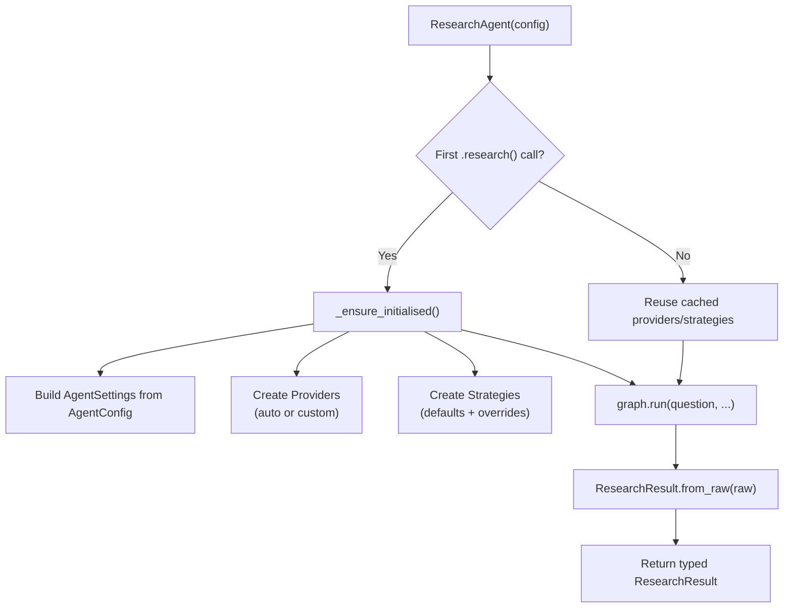
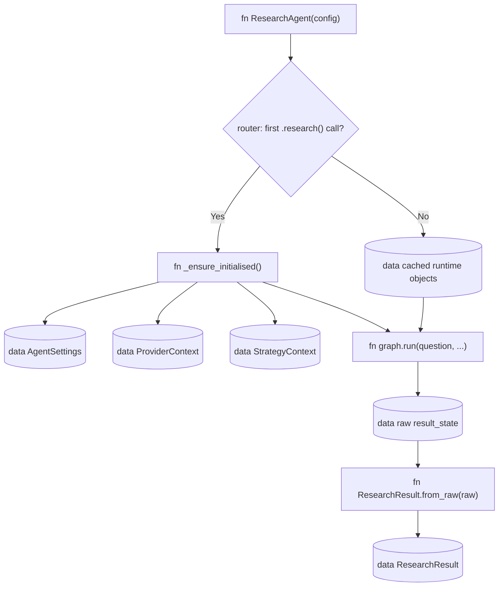

# Library API

> Files: `agent.py`, `result.py`, `__init__.py`

## Scope

This page covers the typed library entry point and the cross-resource HTTP
contracts that applications must treat consistently. The library surface is
lazy-initialised and backwards-compatible. The v0.2 platform HTTP contract is
a hard cut: clients must use canonical UUID identities, direct shares, and
integer revisions rather than legacy subject or cached-grant fields.

## `ResearchAgent`

The main entry point. Wraps the internal `graph.run()` machinery behind a clean interface.

```python
from inqtrix import ResearchAgent, AgentConfig

agent = ResearchAgent(AgentConfig(max_rounds=3))
result = agent.research("Question")
```

### Lifecycle

This diagram answers: "What does the public object do before the internal graph
starts?" Rectangles are methods, cylinder-style nodes are constructed runtime
objects, and the last node is the public Pydantic result.

Conventional flowchart


Typed flowchart


The public API hides the mutable `AgentState`. `graph.run()` returns a raw dict
for internal/parity use, then `ResearchResult.from_raw()` projects selected
fields into typed public models.

The agent is reusable across runs. A typical web server keeps a single `ResearchAgent` instance for the lifetime of the process (see [Web server mode](../deployment/webserver-mode.md)).

### Public methods

| Method | Purpose |
|--------|---------|
| `research(question, *, history="")` | Blocking run; returns a typed `ResearchResult`. |
| `aresearch(question, *, history="")` | The same run as a coroutine; works from any event loop, a notebook's included. |
| `stream(question, *, history="", include_progress=True)` | Generator that yields progress messages (optional) followed by answer chunks. Used for CLIs, SSE servers, and browser UIs. |
| `astream(question, *, history="", include_progress=True)` | Async generator with the same chunks as `stream()`. |

No method is thread-safe against the same agent instance. One `ResearchAgent` is safe to reuse across many sequential runs -- the compiled graph and the lazily created providers are cached -- but concurrent runs need one instance per worker or an external lock. The HTTP server uses a semaphore for concurrency (see [Web server mode](../deployment/webserver-mode.md)).

Every run executes on the process loop. A script, a notebook or an application that never configured one gets a background loop that Inqtrix starts on first use, once per process, and announces with one `INFO` line of the `inqtrix.aio` logger; nothing has to be set up. Inside an event loop, `await agent.aresearch(...)` keeps that loop free; the blocking `research()` also works there and holds the loop while it waits, like any synchronous call. Only a call on the process loop's own thread is refused (`inqtrix.aio.CalledOnLoopThread`), because it would wait for itself. A stream runs on while nobody reads it. A stream that ends early (`close()`, `aclose()`, an error, Ctrl-C) tells the run to stop and returns once the run ended at its next checkpoint, so no run outlives its stream; a provider call already in flight finishes first.

## `AgentConfig`

Pydantic `BaseModel` holding all `ResearchAgent`-relevant configuration. It covers agent behaviour, model selection via provider constructors, timeouts, cache settings, and provider connection settings. Server-only deployment settings remain in `ServerSettings`.

```python
AgentConfig(
    llm=MyCustomLLM(),           # Optional: custom LLM
    search=CustomWebSearch(),    # Optional: custom search
    stop_criteria=FastStop(),    # Optional: custom strategy
    max_rounds=2,
    report_profile=ReportProfile.DEEP,
)
```

Fields set to `None` (providers, strategies) are auto-created from defaults on first use. The tier models themselves live on the provider constructors, not on `AgentConfig`; `AgentConfig` carries only the routing knobs `model_tier`, `model` (an explicit model id that bypasses tier routing for the direct-chat answer) and `effort`. See [AgentConfig reference](../configuration/agent-config.md) for every field.

The current `AgentConfig` parametrizes the default iterative research
procedure. It does not yet expose `algorithm="..."` or a graph-topology field.

## `ResearchResult`

Pydantic model returned by `research()`:

| Field | Type | Description |
|-------|------|-------------|
| `answer` | `str` | Markdown-formatted answer |
| `metrics` | `ResearchMetrics` | Aggregated quality and performance metrics |
| `top_sources` | `list[Source]` | Sources ordered by answer-linked URLs first, then prompt-selected evidence URLs, then remaining discovered citations; tiers prefer run source records |
| `references` | `list[ReportReference]` | Exact source list of the report's appendix: the sources the body cites (`cited=true`, rendered under `## Referenzen`) first, then the sources the writer saw in the evidence overview but did not cite (`cited=false`, rendered under `## Weitere geprüfte Quellen`), each with label, URL and tier |
| `top_claims` | `list[Claim]` | Key claims with verification status, evidence counts, primary-need flag, and source-tier breakdown |
| `execution` | `AgentExecution \| None` | Effective Agent Desk route, model/effort, source policy, consent reason, and actual source-tool counts; absent for ordinary research and legacy results |
| `knowledge` | `KnowledgeResultState \| None` | Text-free Knowledge profile, gate, grounding and retrieval receipt; absent for non-Knowledge and legacy results |
| `web_search_ledger` | `dict[str, Any] \| None` | Read-only audit projection of provider search requests, provider answers and citations; linked pages are not fetched by Inqtrix |

The table above is the full field list; [Export helper](#export-helper) covers `to_export_payload`. `ResearchResult.from_raw()` bridges the internal state dict to the typed Pydantic model.

Typical library consumption:

```python
from inqtrix import AgentConfig, LiteLLM, PerplexitySearch, ResearchAgent

agent = ResearchAgent(AgentConfig(
    llm=LiteLLM(api_key="...", default_model="gpt-4o"),
    search=PerplexitySearch(api_key="...", model="sonar-pro"),
    max_rounds=3,
))

result = agent.research("What changed in EU AI Act implementation this month?")

print(result.answer)
print(result.metrics.confidence)
print(result.metrics.evidence_contract_status)
print([source.url for source in result.top_sources[:3]])
```

Use the public result when building applications. Inspect raw state only in
debugging or parity tooling, because internal ledger shapes can evolve more
quickly than the public model.

```python
result = agent.research("...")

result.answer                         # str, Markdown-formatted
result.metrics.confidence             # int, 0-10
result.metrics.rounds                 # int
result.metrics.elapsed_seconds        # float
result.metrics.total_citations        # int
result.metrics.total_queries          # int
result.metrics.prompt_tokens          # int
result.metrics.completion_tokens      # int
result.metrics.aspect_coverage        # float, 0.0-1.0
result.metrics.sources.quality_score  # float, 0.0-1.0
result.metrics.claims.quality_score   # float, 0.0-1.0
result.metrics.evidence_contract_status  # "clean" | "needs_review" | "source_context_only" | "algorithm_failed" | "unknown"
result.metrics.evidence_contract_causes  # list[str], why the status is "needs_review"
result.metrics.evidence_basis        # "provider_context" | "evidence" | "none" | "unknown"
result.metrics.confidence_cap        # int | None, with confidence_cap_reasons
result.top_sources                    # list[Source]
result.references                     # list[ReportReference]
result.top_claims                     # list[Claim]
result.execution                      # AgentExecution | None
```

`ResearchResult.from_raw()` bridges the internal state dict (TypedDict) to the typed Pydantic model. You normally do not call it directly — `ResearchAgent.research()` returns the typed object. The native HTTP endpoint `GET /v1/runs/{run_id}/result` returns the same public projection via `ResearchResult.to_export_payload()`.

## Internal-to-public projection

`ResearchResult` is deliberately smaller than `AgentState`. It is safe for
applications and HTTP clients, but it is not a full evidence ledger export.

| Public field | Internal source | Projection rule |
|---|---|---|
| `answer` | `raw["answer"]` / `AgentState.answer` | Markdown string after link sanitation, evidence audit, the evidence notice and basis line (see [Evidence notice and basis line](websearch/evidence.md#evidence-notice-and-basis-line)), and footer assembly. The headings, notes and footer the server adds read in the answer language; the footer names counts, time and confidence and no status code, so read `metrics.evidence_contract_status` for the contract. |
| `metrics.rounds` | `AgentState.round` | Number of completed search rounds. |
| `metrics.total_queries` | `AgentState.queries` | Length of the deduplicated query list. |
| `metrics.total_citations` | `AgentState.all_citations` | Count of known citation URLs, not count of verified evidence units. |
| `metrics.confidence` | `AgentState.final_confidence` | Evaluator confidence after guardrails and stop heuristics. |
| `metrics.sources` | `source_tier_counts`, `source_quality_score` | Aggregate source inventory quality. |
| `metrics.claims` | `claim_status_counts`, `claim_quality_score` | Quality of the complete computed claim assessment, independently of top-claims selection limits. `status_counts` holds `verified` (the search provider's excerpts that state the claim carry its support on their own), `attributed` (the support needs the search provider's answer, which ties the claim to its sources), `contested` and `unverified`; results stored before 0.2.0.10 have no `attributed` key and call provider attribution `verified`. |
| `metrics.evidence_contract_status` | `evidence_contract_status` (from `answer_claim_bindings`, `answer_evidence_bindings`, `algorithm_failures`) | `clean` (a cited sentence carries a consolidated claim and no cause listed in `evidence_contract_causes` holds), `needs_review` (claim carried, but such a cause holds), `source_context_only` (sources cited, no claim carried), `algorithm_failed` (synthesis blocked), `unknown` (no audit ran, or no citable evidence to audit). The evidence-depth gap does not decide the status. |
| `metrics.evidence_contract_causes`, `metrics.confidence_cap`, `metrics.confidence_cap_reasons` | `evidence_contract_causes`, `confidence_cap`, `confidence_cap_reasons` (the ceiling also from `evidence_depth_gap`) | What holds the contract at `needs_review`, the ceiling put on the confidence (the status ceiling, or 6 for a claim-bound answer with an active evidence-depth gap), and why. Decided once in the answer node together with the status. |
| `metrics.evidence_depth_gap_reasons` | `evidence_depth_gap.reason` | The reasons of an active evidence-depth gap; empty while the gap is inactive. |
| `metrics.evidence_basis`, `metrics.cited_reference_count`, `metrics.provider_only_reference_count` | `report_references`, web-search ledger | The material behind the references flagged as cited, derived by `research_references()` when the result is built; the answer node derives the basis line under the report with the same function. |
| `top_sources` | `answer`, `EvidenceOverview.allowed_urls`, `evidence_ledger`, `all_citations`, `source_records` | Capped source URLs ordered by actual answer use first, then visible EvidenceOverview URLs, then remaining report-eligible/discovered citations. Tiers prefer normalized `source_records` and fall back to default tiering. |
| `references` | `AgentState.report_references` | Exact structured counterpart of the rendered `## Referenzen` and `## Weitere geprüfte Quellen` appendix sections (`cited` tells them apart). It is not capped by `from_raw()` and should be used when a UI must match the report reference list. |
| `top_claims` | `AgentState.consolidated_claims` | First capped claims converted through `Claim.from_consolidated()`. |
| `execution` | `result_state.execution` | Canonical effective Agent Desk route, model/effort, source policy, consent reason, and successful tool-use counters. Present for current agent runs; `None` for non-agent and legacy results. |

`metrics.verified_claims_used_count` counts used verified claims across the
complete assessment. It is not limited by the length of `top_claims`, which is
a compact presentation list. The two values can therefore legitimately differ.
Attributed claims are not counted: a run on a provider that returns no page
text (Azure) reports `0` however much of the answer rests on attributed
claims.

For debugging weak answers, inspect the internal `result_state` returned by
`graph.run()` or the observability logs. For application code, prefer the typed
public result.

### `ResearchMetrics`

| Field | Type | Description |
|-------|------|-------------|
| `confidence` | `int` | Final confidence after the evaluate cascade, on the evaluator's 0–10 scale (`0` before any evaluator pass has completed). The range is enforced at the parse site, not on the field: `evaluate()` clamps with `max(0, min(10, ...))` (`src/inqtrix/nodes.py`), so `CONFIDENCE: 42` is capped at `10` and surfaced as a warning plus `confidence_clamped`. The Pydantic field declares no `ge`/`le` bounds; every later guardrail can only lower the value. |
| `rounds` | `int` | Number of `PLAN → SEARCH → EVALUATE` passes that actually executed. |
| `elapsed_seconds` | `float` | Monotonic wall time from `research()` call to final answer. |
| `total_citations` | `int` | Distinct URLs collected across all search rounds. |
| `total_queries` | `int` | Distinct queries executed after dedup. |
| `prompt_tokens` | `int` | Aggregate prompt-token usage across all LLM calls where the provider returned usage metadata; for parked/resumed agent runs the run total over every segment. |
| `completion_tokens` | `int` | Aggregate completion-token usage across all LLM calls where the provider returned usage metadata. |
| `aspect_coverage` | `float` | Share of the classify sub-questions the evaluator marked as answered in its last round (`COVERED_ASPECTS`), 0.0–1.0; `1.0` when the run had no sub-questions. |
| `evidence_consistency` | `int` | Evaluator consistency score on the evaluator's 0–10 scale. Parse failures inside `evaluate` store `5`; `0` is both the state default before the first evaluator pass and a score the evaluator itself can report, so an exported `0` does not tell the two apart. |
| `evidence_sufficiency` | `int` | Evaluator sufficiency score on the evaluator's 0–10 scale. Parse failures inside `evaluate` store `5`; `0` is both the state default before the first evaluator pass and a score the evaluator itself can report, so an exported `0` does not tell the two apart. |
| `sources` | `SourceMetrics` | Nested Pydantic model with `tier_counts` and `quality_score`. See [Source tiering](websearch/evidence.md). |
| `claims` | `ClaimMetrics` | Nested Pydantic model with `status_counts` and `quality_score`. See [Claims](websearch/evidence.md). |
| `answer_bound_claims_count` | `int` | Claim-level answer bindings that matched a consolidated claim (a cited sentence that plausibly carries it). URL-level matches are tracked separately and do not count here. |
| `unbound_answer_citations_count` | `int` | Answer citations that resolved to no EvidenceRecord (`unknown_citation`). |
| `verified_claims_used_count` | `int` | Verified consolidated claims (checked against the search provider's excerpt) marked as used in the final answer; attributed claims are not counted. |
| `evidence_contract_status` | `str` | `clean`, `needs_review`, `source_context_only`, `algorithm_failed`, or `unknown`. `clean` says that the cited sources carry recorded claims and a cited sentence restates one, not that a claim was checked against its source; it can still carry the ceiling of 6 of an active evidence-depth gap (see `confidence_cap`). A `needs_review` result without `evidence_contract_causes` was stored before that field existed and can also stand for an active evidence-depth gap alone. |
| `evidence_contract_causes` | `list[str]` | What holds the contract at `needs_review`, each entry sufficient on its own: `unknown_citation` (a cited link has no evidence record), `citation_without_claim` (a cited record carries no claim), `algorithm_failure` (a non-blocking step failed). The evidence-depth gap is no cause; it caps the confidence instead. Empty for every other status and on results stored before the field existed. |
| `single_source_ratio` | `float` | Share of supported claims (verified or attributed) resting on a single source while the evidence-depth gap was active; `0.0` otherwise. |
| `evidence_depth_gap_reasons` | `list[str]` | Why the evidence-depth gap was active: `no_cross_checked_claims`, `majority_single_source_claims`, `central_claim_single_quality_source` (see [Evidence-depth gap](websearch/stopping.md#evidence-depth-gap)). Empty while the gap was inactive. |
| `confidence_cap` | `int \| None` | The ceiling the evidence contract put on `confidence`: `3` (`algorithm_failed`), `4` (`source_context_only`), `6` (`needs_review`, and any claim-bound answer with an active evidence-depth gap, `clean` included), or `None`. `confidence` can lie below it. |
| `confidence_cap_reasons` | `list[str]` | Why the ceiling applied: the status for the two lower ceilings; for the ceiling of 6 the entries of `evidence_contract_causes`, then the reasons of an active evidence-depth gap, so a `clean` answer the gap capped names only the gap's reasons. Four claims with two primary sources each are capped for `no_cross_checked_claims`, not for a single-source majority. |
| `evidence_basis` | `str` | The material behind the references flagged as cited. `provider_context`: every one carries only what the search provider returned about the source and no stored text of a document; this is what a web search yields, and the search provider's excerpt does not change it. `evidence`: any other mix, in practice a cited reference that carries the stored text of a document (a cited reference without any stored material also falls here). `none`: no reference is flagged as cited. `unknown`: a result stored before the field existed. An agent run names the basis of its review verdict by the same rule. The basis describes the references, not the claims: a claim can be `verified` against the search provider's excerpt while the basis reads `provider_context`. |
| `cited_reference_count` | `int` | References flagged as cited: for a research report the sources its body cites. A run mode that does not set the flag counts every reference. |
| `provider_only_reference_count` | `int` | Cited references that carry only what the search provider returned. |

### `Source`

| Field | Type | Description |
|-------|------|-------------|
| `url` | `str` | Canonicalised URL. |
| `tier` | `str` | `primary`, `mainstream`, `stakeholder`, `unknown`, or `low`. |

### `ReportReference`

| Field | Type | Description |
|-------|------|-------------|
| `label` | `str` | Human-visible label selected for the report appendix, for example `E3`, `1`, or `Quelle 4`. |
| `url` | `str` | Canonicalised URL rendered in the final report's `## Referenzen` section. |
| `tier` | `str` | Source-tier classification using the same tier labels as `Source.tier`. |
| `tier_reason` | `str` | How the tier came about: `structural:<role>` (registry-class suffix), `model:<role>` (the claim-extraction call judged the source), a custom strategy's reason such as `strategy_default`, `unjudged`, or empty on payloads without provenance. A strategy placement takes precedence over model judgement. |
| `role_reason` | `str` | The extractor's evidence for a judged role in a few words; empty for structural and unjudged sources. |
| `cited` | `bool` | `true` when the answer body cites the source (`## Referenzen`); `false` when the writer only saw it in the evidence overview (`## Weitere geprüfte Quellen`). The report never lists an uncited source as a reference, so the reference list cannot overstate the evidence base; older payloads without the field validate as cited. |
| `statements` | `list[ReportReferenceStatement]` | Every statement the claim ledger ties to the source, from every search that cited it, once each: `text`, `status` (the claim's status) and `checked` (`true` when the search provider's excerpt of this source was checked and states it; a claim verified through the excerpt of another source is only attributed here). The report panel lists them under the source's details, so whatever the report could rest on is readable at the source it is attributed to. Agent evidence prompts leave the list out: an agent reads the stored texts themselves. Empty on payloads without claims and on older payloads. |

Use `references` for exact report/evidence views. `top_sources` remains a ranked
overview capped at 60 sources and may intentionally differ from the complete
report appendix.

### `AgentExecution`

| Field | Type | Description |
|-------|------|-------------|
| `effective_mode` | `str` | Algorithm that actually executed: `agent_kernel`; `workspace_agent` on runs of the retired mission engine. |
| `response_form` | `str` | Effective `auto`, `chat`, or `canvas` delivery form. |
| `depth` | `str` | Effective `normal` or `deep` depth. |
| `model` | `str` | Resolved model id; empty when the provider default remains unresolved. |
| `reasoning_effort` | `str` | Resolved effort token; empty when the provider default applies. |
| `source_policy` | `dict[str, str]` | Effective `web` and `knowledge` availability after a one-shot directive. |
| `knowledge_scope` | `str \| None` | Whose knowledge boundary the run searched: `all` (the session switch), `pinned` (attached collections) or `inherited`; `None` when the payload did not record it. |
| `knowledge_collection_count` | `int` | Collections inside that boundary; `0` when not recorded. |
| `consent_reason` | `str` | Stable machine reason for permission/approval state. |
| `tool_use_counts` | `dict[str, int]` | Successful source operations keyed by `web` and `knowledge`; zero is explicit. A use is not a search: a delegated research is one web use, a document read one knowledge use, and a batch of subtasks one web use when it carries a research assignment and one knowledge use when it carries a knowledge assignment. |
| `web_searches` | `int \| None` | Web searches the run's own provider calls executed; a delegated research reports its own in its snapshot. `None` when the payload did not record it. |
| `knowledge_searches` | `int \| None` | Searches of the knowledge base the run executed itself; a document read is no search. `None` when the payload did not record it (a stored mission run, an older payload). |
| `limits` | `dict[str, AgentExecutionLimit]` | Server-authored execution boundaries keyed by stable limit id; empty on older payloads. |
| `tool_grants` | `list[str]` | Tools the user approved for the whole run; empty when nothing is granted. |
| `source_coverage` | `list[AgentSourceCoverage]` | Per source version: the ranges the run read or searched, its size, and whether a continuation is still open. Empty for algorithms without windowed readers. |
| `document_analyses` | `list[AgentDocumentAnalysis]` | Per document a document analysis of the run read on the server: the ranges it analysed, those it did not with their reason, and whether it read the whole document. Empty when the run analysed none. |
| `work_profile` | `str` | Internal work profile the run executed under; empty for every ordinary run. |

Availability and use are intentionally separate: a source can be
`available` while its count remains zero. The complete block is also copied
into state-bearing native-run snapshots for live transparency; see [Run
events](../extending/runs-api.md#run-summary).

### `Claim`

| Field | Type | Description |
|-------|------|-------------|
| `text` | `str` | Atomic claim statement (post-consolidation). |
| `status` | `str` | `verified` (supported, and the search provider's excerpts that state the claim carry that support on their own), `attributed` (supported only together with the search provider's answer, which ties the claim to its sources: no excerpt states the claim, or the stating excerpts alone carry no support), `contested`, or `unverified`. Before 0.2.0.10 `verified` also covered provider attribution. See [Claims](websearch/evidence.md). |
| `claim_type` | `str` | `fact`, `actor_claim`, or `forecast`. |
| `support_count` | `int` | Number of claim-ledger entries that affirm the claim. Entries are counted, not sources or domains: two extractions of the same statement from two pages of one domain count as `2`. |
| `contradict_count` | `int` | Number of claim-ledger entries that negate the claim, plus the supporting entries of a claim of the same signature whose value conflicts with this one, counted the same way as `support_count` — entries, not sources. |
| `needs_primary` | `bool` | Whether the claim needs stronger evidence, usually primary-tier support or independent non-low cross-checking. |
| `status_reason` | `str` | Short reason for the verification status: the support structure, then what was checked, for example `primary evidence present; checked against the search provider's excerpt` or `primary evidence present; attributed by the search provider`. Results stored before 0.2.0.13 say `checked against source text` for the first case. |
| `source_tier_counts` | `dict[str, int]` | Breakdown by source tier (primary/mainstream/stakeholder/unknown/low). |
| `primary_basis` | `str` | Why the claim counts as primary-backed: `role` (a primary role on an affirmed, non-syndicated witness), `issuer:<label>` (the fact claim names the issuer of an unjudged witness), or empty. An explicitly placed `unknown` source is not unjudged. For an issuer basis, `status_reason` names the matched issuer. |
| `syndicated_count` | `int` | Supporting entries whose evidence snippet near-duplicated an already counted one (a reprint is one witness). |
| `sources` | `list[str]` | Normalised URLs backing this claim. |

Example public consumption:

```python
result = agent.research("Which companies changed 2026 AI capex guidance?")

for claim in result.top_claims:
    print(claim.status, claim.support_count, claim.text)

if result.metrics.evidence_contract_status != "clean":
    print("Answer evidence audit needs review:", result.metrics.evidence_contract_causes)
if result.metrics.confidence_cap is not None:
    # Also a clean answer: an active evidence-depth gap caps it at 6.
    print("Confidence capped at", result.metrics.confidence_cap, result.metrics.confidence_cap_reasons)
if result.metrics.evidence_basis == "provider_context":
    print("The cited sources carry only what the search provider returned")
```

## Export helper

`ResearchResult.to_export_payload(options)` produces a lightweight public view, used by parity tooling and UI integrations:

```python
from inqtrix import ResearchResultExportOptions

payload = result.to_export_payload(ResearchResultExportOptions(
    include_sources=False,
    max_claims=5,
))
```

`ResearchResultExportOptions` supports:

- `include_sources: bool` — include the `top_sources` block.
- `include_references: bool` — include the exact `references` block.
- `include_claims: bool` — include the `top_claims` block.
- `max_claims: int | None` — cap the number of claims in the export.
- `max_references: int | None` — cap the number of report references in this export only. `None` keeps every report reference.
- `max_sources: int | None` — cap the number of sources in the export.

When `execution` is present it is always exported as a complete block; the
source/tool transparency contract is not controlled by the evidence-list
include/cap options.

With the in-memory run store (`INQTRIX_STORAGE_BACKEND=memory`, the default) the native run API keeps this export payload only for `RUN_COMPLETED_TTL_SECONDS` (default 300) in process memory; an application UI on that backend should persist the payload itself after reading `/v1/runs/{run_id}/result`. With the Postgres run store the payload is written to the database and retained for `RUN_DURABLE_RETENTION_SECONDS` (default 90 days), so it survives restarts, reloads, re-logins, and other devices.

## Full JSON serialisation

`result.model_dump_json(indent=2)` serialises the complete structure, including every metric. Non-serialisable runtime internals (cancel event, deadline, thread pools) are never part of `ResearchResult`; they live on `AgentState` and are stripped before typing.

## Related docs

- [Agent config](../configuration/agent-config.md)
- [Providers overview](../configuration/providers.md)
