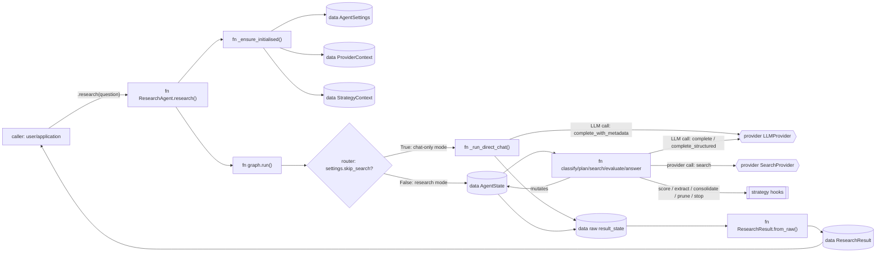
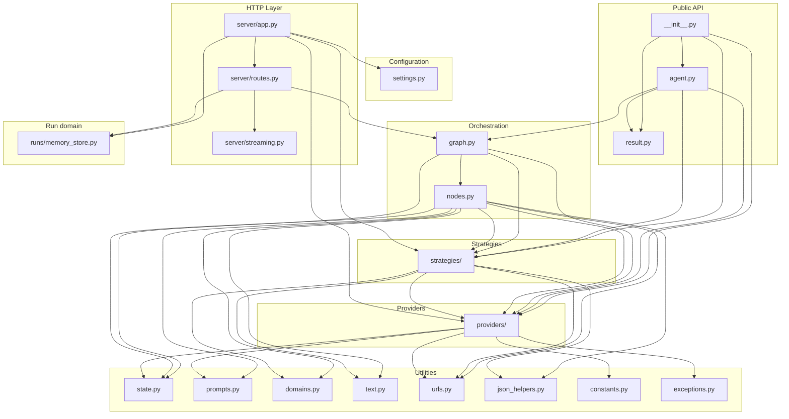

# Architecture overview

Inqtrix is an iterative research agent that runs a bounded multi-round loop of web search, evidence evaluation, and answer synthesis. This page is the high-level map. Individual concerns are covered in dedicated pages linked below.

## Scope

Reading this page gives you the mental model of the system:

- which modules exist and how they depend on each other,
- how a standard `research(question)` call flows through the five nodes,
- where each algorithmic concern lives (providers vs strategies vs orchestration),
- which file to touch for a given change.

## How to read this documentation

Assume you are following one question through the system. Each page should make
clear what exists, where it lives in code, who writes it, who reads it, how it
changes, and why the next transition happens. The internal runtime is a mutable
`AgentState` dict passed through a LangGraph state machine; most named data
objects in the docs are either fields on that state or derived public views.

Inqtrix currently has one default research procedure: an iterative
`classify -> plan -> search -> evaluate -> answer` loop. `AgentConfig` lets you
swap providers, strategies, budgets, and thresholds for that procedure. It does
not yet select a completely different algorithm or graph topology from the
public API.

The HTTP serving layer adds a second procedure on top of this loop: `mode=knowledge`
is dispatched by the algorithm registry to a separate `KnowledgeAlgorithm` (retrieval
over the deployment's own documents), not the five-node graph. It returns the same raw
result shape, so run serialization and the SSE stream are shared. See
[Knowledge engine](knowledge-engine.md).

## How to read the diagrams

The diagrams use shape and label prefixes to distinguish executable code from
data. When a page introduces a local diagram, the paragraph before it states the
question the diagram answers, and the paragraph after it names the important
transitions.

| Shape / label | Meaning | Example |
|---|---|---|
| `fn ...` in a rectangle | Python function or LangGraph node | `fn search()` |
| Cylinder-like node / `data ...` | State field, ledger, or stored view | `data AgentState.evidence_ledger` |
| Double-bracket node / `strategy ...` | Swappable strategy implementation | `strategy ClaimConsolidationStrategy` |
| Hexagon-like node / `provider ...` | LLM/search provider or external backend | `provider SearchProvider` |
| `LLM call: ...` | Concrete call to `LLMProvider.complete*` or strategy-owned helper call | `LLM call: evaluate prompt` |
| Diamond / `router ...` | Control-flow decision | `router done?` |

## System flow

This diagram answers: "What happens after a caller invokes
`ResearchAgent.research(question)`?" The left side is public API code; the
middle is the algorithm; the right side shows providers, strategies, and the
public result projection.

Key transitions:

- `ResearchAgent.research()` lazily creates `ProviderContext`,
  `StrategyContext`, and `AgentSettings` before the first run.
- `graph.run()` creates `AgentState`; every node reads and mutates that same
  state object on the standard research path.
- If `AgentSettings.skip_search` is true, `graph.run()` bypasses the LangGraph
  node loop and calls `_run_direct_chat()`, which uses the LLM provider directly
  and returns an uncited chat-only result with `round=0`.
- Providers perform external work: LLM calls and search calls. Strategies keep
  algorithmic policies replaceable inside the default procedure.
- `ResearchResult.from_raw()` is a public projection of selected state fields,
  not a full dump of every internal ledger.

**Core idea.** Rather than single-pass retrieval and synthesis, the agent
runs a bounded loop with independent stopping criteria, aspect coverage
tracking, and structured claim consolidation. Model selection is per call
site via the model tiers (high/mid/fast), not driven by risk.

## Design principles

| Principle | Implementation |
|-----------|----------------|
| Pluggable providers | Abstract `LLMProvider` and `SearchProvider` classes (see [Providers overview](../configuration/providers.md)) |
| Pluggable strategies | Five strategy ABCs with default implementations: source tiering, claim extraction, claim consolidation, risk scoring, stop criteria |
| Declarative graph | `GraphConfig` dataclass describes the internal default topology; `build_graph()` compiles it |
| Typed results | Pydantic `ResearchResult` with nested metrics (see [Library API](library-api.md)) |
| Lazy initialisation | `ResearchAgent` creates providers and strategies on first use |
| Backwards compatible | FastAPI server (`server/app.py`) works alongside the library API |
| No silent fallbacks | Every fallback path emits both a `log.warning(...)` and a progress marker (see [Iteration log](../observability/iteration-log.md)) |
| Constructor first | Providers never read environment variables directly; only the example scripts and the `Settings` bridge translate `.env` into constructor arguments |

## Module dependency graph

This diagram answers: "Which module owns which layer?" It is a file/package
dependency map, not a runtime call graph. Runtime data movement is explained in
[Research loop](websearch/loop.md) and [Nodes](websearch/nodes.md).

Key takeaways:

- Public callers enter through `agent.py` and receive typed models from
  `result.py`.
- `graph.py` wires the default node sequence; `nodes.py` contains the concrete
  step implementations.
- Providers and strategies are injected into nodes, so the default algorithm can
  use different backends without changing graph wiring.
- Native browser clients use the run store (`runs/memory_store.py` in-memory by default; `runs/postgres_store.py` + Valkey worker dispatch opt-in) as queue and event
  registry around the same `graph.run()` path; OpenAI-compatible chat clients
  continue to use `server/streaming.py`.

**Key property.** No circular dependencies. The dependency direction flows
strictly downward: Public API → Orchestration → Providers/Strategies →
Utilities.

## Layers

Every module under `src/inqtrix` belongs to one layer, and `tests/architecture/test_import_boundaries.py` holds every import to this table, the ones inside functions and under `TYPE_CHECKING` included. Only the database migrations stay outside it.

| Layer | Holds | May import |
|---|---|---|
| Kernel contracts | `harness/contracts/` | only itself |
| Kernel | the rest of `harness/` | the kernel contracts and the kernel layers below it |
| Base | small shared modules such as `aio`, `constants`, `exceptions`, `i18n`, `model_cards`, `settings`, `version`, also `observability/semconv.py` | base |
| Observability | `observability/`, `logging_config`, `runtime_logging`, `execution_failures` | base, observability, `auth` |
| Engines | the research modules (`graph`, `nodes`, `evidence`), `knowledge/`, `providers/` (with the measuring wrappers in `providers/tracing.py`) | base, observability, its own engine, `providers/`; `knowledge/stores/` also `storage/` and `auth/` |
| Plugins | `plugins/`, `capabilities/` | base, observability, engines, its own plugin |
| Agents | `agents/` | base, observability, engines, agents, `content/` |
| Application | `services/`, `project/`, `auth/`, `content/`, `core/`, `quota/`, `usage/`, `execution_authority` | base, observability, engines, agents, application, infrastructure |
| Infrastructure | `runs/`, `storage/`, `user_events` | base, observability, infrastructure, `auth/`, and the port and record modules named in `APP_PORT_MODULES`, whose adapters these stores are |
| Composition | `server/`, `worker/`, `deploy/`, `agent`, `periodic_sweep`, the package root | everything |

Every layer may import the kernel contracts. Plugins, agents and the application reach the rest of the kernel through the `inqtrix.harness` facade only; composition reaches all of it.

`tests/architecture/boundary_exceptions.py` lists the imports that do not follow the table yet. A new violation fails the test until someone lists it, where a reviewer sees it, and an entry whose import is gone fails as well. `tests/architecture/test_async_discipline.py` does the same for the async rules that a parse of the source can check, such as one event loop per process and no known blocking call inside `async def`, with exact counts per module in `async_exceptions.py`. A lock held inside `async def` is not among them: the in-memory stores hold theirs briefly on purpose.

## One event loop per process

Each API and worker process has one event loop: the API runs on uvicorn's, the worker's entry point owns its own. `aio.py` is the only thread bridge. Whatever must not block that loop leaves it through a lane, and the lanes stay apart because a job on one waits for the others.

| Lane | For | Threads |
|---|---|---|
| `aio.run_blocking` | short blocking or CPU-heavy work; it is also the loop's default executor, so `asyncio.to_thread` lands here | `INQTRIX_BLOCKING_POOL_SIZE` |
| `aio.run_provider_blocking` | long synchronous provider calls, so that a slow provider never queues in front of short work | `INQTRIX_PROVIDER_POOL_SIZE` |
| `aio.run_legacy_segment`, `aio.start_legacy_segment` | a whole synchronous engine or job body, until that engine is async, and short synchronous services an async caller needs | one per job slot of the process, plus `INQTRIX_BLOCKING_POOL_SIZE` for those short services |

Synchronous code reaches the loop through `aio.call_from_thread`. It raises on a loop thread, which would wait for itself, on a `run_blocking` thread, whose pool could end up waiting for itself. Without a configured loop it starts the library's own background loop, as a script or notebook needs; a process owner therefore configures its loop before anything reaches the bridge.

In the worker, claiming, heartbeats and the cancel poll are tasks on that loop, and the job queue uses the asyncio client. A blocking call on the loop therefore holds up every run and request of the process, in a worker their heartbeats too; `worker_claim_idle_seconds` has to stay at least six times `worker_heartbeat_seconds`, so that a short stall does not hand healthy runs to another worker. `inqtrix_event_loop_lag_milliseconds` shows such a stall, a watchdog logs the function behind one of more than 2 s, and `inqtrix_thread_lane_jobs` shows a full lane, which neither of the two can see. See [Metrics](../observability/metrics.md).

A process has one database engine, built by `storage/db.py::build_process_engine` when the process is composed and handed to every store. No store disposes it; the one who composed the process does, after everything that uses it has stopped. Its limit, `INQTRIX_DATABASE_POOL_SIZE`, is therefore the limit of the process. A task holds one connection at a time, so tasks cannot wait for each other's second one.

Each operation of a job store in `runs/` has two names, in the memory and the Postgres tier alike: `aget` for a coroutine, `get` for synchronous code on a lane. Both run the one implementation; the Postgres one on the process loop, the memory one where it is called. A sync name on the loop raises, because it would wait for itself. Nothing holds a store's thread lock across such a bridge or an `await`, because the loop needs that lock too. A job body gets a context of its own, so its log fields and its usage subject end with it.

## Where to change what

| Goal | Files to touch | Detailed reference |
|------|----------------|--------------------|
| Add a new search backend | `providers/` (implement `SearchProvider`) | [Providers overview](../configuration/providers.md), [Writing a custom provider](../extending/provider.md) |
| Add a new LLM backend | `providers/` (implement `LLMProvider`) | [Providers overview](../configuration/providers.md), [Writing a custom provider](../extending/provider.md) |
| Use Azure OpenAI as the LLM | `providers/azure.py`, see `examples/provider_stacks/azure_openai_*.py` | [Azure OpenAI provider](../configuration/providers.md) |
| Use Amazon Bedrock as the LLM | `providers/bedrock.py`, see `examples/provider_stacks/bedrock_perplexity.py` | [Bedrock provider](../configuration/providers.md) |
| Use Azure Foundry search | `providers/azure_web_search.py` | [Azure Foundry web search](../configuration/providers.md) |
| Change source quality tiers | the structural floor `domains.py::STRUCTURAL_SUFFIX_ROLES`, the extractor's role prompt (`prompts.py`), or a custom `SourceTieringStrategy` | [Source tiering](websearch/evidence.md) |
| Customise claim extraction | `strategies/_claim_extraction.py` | [Claims](websearch/evidence.md) |
| Customise claim dedup/consolidation | `strategies/_claim_consolidation.py` | [Claims](websearch/evidence.md) |
| Change risk scoring | `strategies/_risk_scoring.py` | [Nodes](websearch/nodes.md), [Sub-question coverage](websearch/stopping.md#sub-question-coverage) |
| Change stop or continue heuristics | `strategies/_stop_criteria.py`, `nodes.py` | [Stopping](websearch/stopping.md) |
| Add or rewire a graph node | `nodes.py` (node function), `graph.py` (wiring) | [Nodes](websearch/nodes.md), [Research loop](websearch/loop.md) |
| Change prompt templates | `prompts.py` | [Nodes](websearch/nodes.md) |
| Add new state fields | `state.py` (add to `AgentState` TypedDict) | [Nodes](websearch/nodes.md) |
| Add a new HTTP endpoint | `server/routes.py`, `server/app.py` | [Web server mode](../deployment/webserver-mode.md) |
| Change native run queue or events | `runs/memory_store.py`, `runs/records.py`, `server/routes.py`, `state.py`, `graph.py` | [Runs API](../extending/runs-api.md), [Web server mode](../deployment/webserver-mode.md) |
| Change timeouts or thresholds | `constants.py` (defaults), `settings.py` (env) | [Settings and env](../configuration/settings-and-env.md), [Timeouts and errors](../observability/forensic-cookbook.md#timeouts-and-errors) |
| Change request history or state initialisation | `state.py`, `graph.py`, `server/routes.py` | [Web server mode](../deployment/webserver-mode.md) |
| Add an organisation's trust list | a custom `SourceTieringStrategy` (the default keeps no site lists) | [Source tiering](websearch/evidence.md) |
| Add regression baselines | `parity/`, `tests/integration/` | [Parity tooling](../development/parity-tooling.md) |

All strategy and provider customisations are passed via `AgentConfig`; no subclassing of `ResearchAgent` is required.

## Related docs

- [Library API](library-api.md)
- [Data architecture](data-architecture.md) -- where each kind of data lives and why (Postgres source of truth, lean Qdrant, object store, Valkey, browser), the storage matrix, the local-first vs server-persistent split, and the project-persistence tier.
- [Knowledge engine](knowledge-engine.md) -- the second engine (`mode=knowledge`): hybrid retrieval, RRF, the gate loop, and grounding.
- [Agent platform](agent-platform.md) -- the workspace agent (`mode=workspace_agent`): staged phase machine, plans and approvals, child research runs, memo artifact.
- [Nodes](websearch/nodes.md)
- [Runs API](../extending/runs-api.md)
- [Providers overview](../configuration/providers.md)
