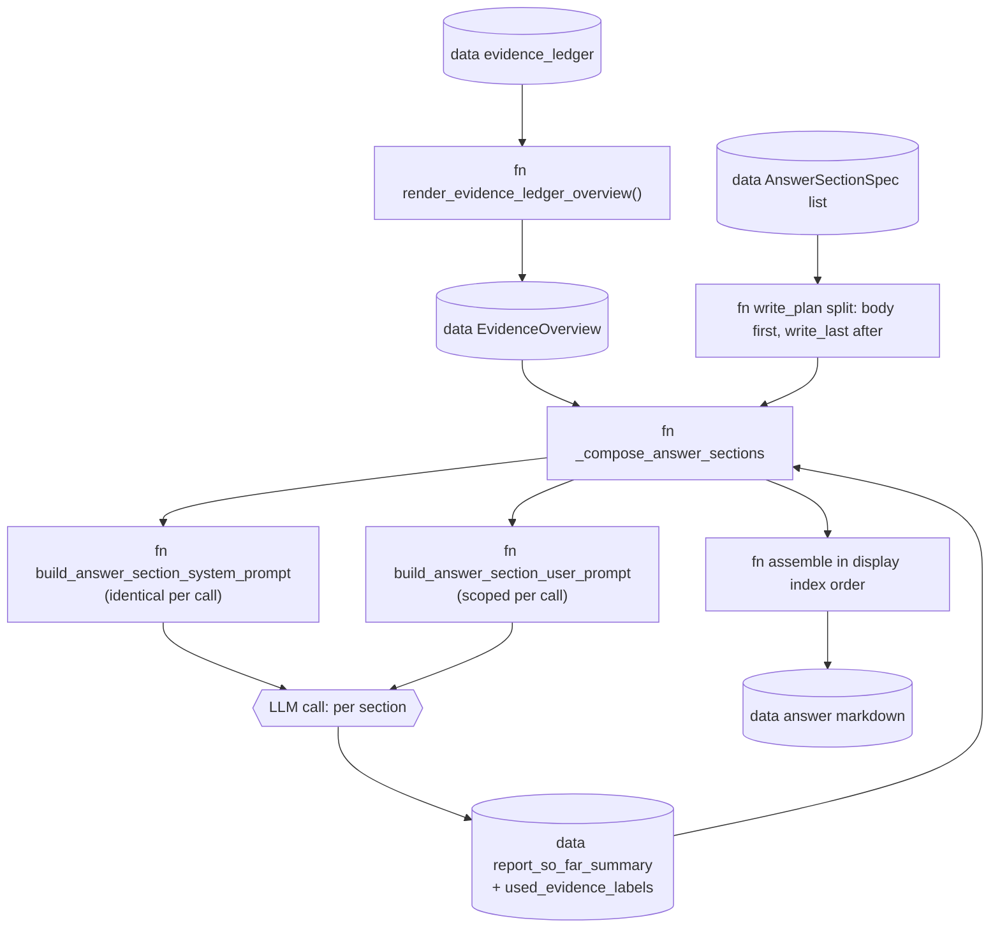

# Answer composition

## Scope

How Inqtrix turns the rendered EvidenceLedger overview into a multi-section
Markdown answer: one LLM call per section, the body sections first and the
write-last sections (`executive_summary` / `summary`) afterwards, with two
running memory fields (`report_so_far_summary` and `used_evidence_labels`)
carried between calls. Covers the exact system / user prompt structure, what
context each section receives, and the non-obvious coupling between the
record-ranking penalty for already-used labels and the soft user-prompt
hints.

Does NOT cover: how the evidence overview is built (see
[Evidence pipeline](evidence.md)), the stop logic that runs before
the answer node (see [Stopping](stopping.md)), or
provider-side authentication.

## Overview: one LLM call per section

The answer composer is `_compose_answer_sections()` in
`src/inqtrix/nodes.py` (lines 1468-1798). It iterates over the active
`AnswerSectionSpec` list (see
[Report profiles](../../configuration/report-profiles.md)) and issues
**one `LLMProvider.complete_with_metadata()` call per section**. The final
answer is the per-section bodies joined in display order.



Each section call returns a Markdown body and a `finish_reason`. The
composer accumulates the bodies, tracks which `[E…]` labels were cited
(`used_evidence_labels`), and builds a rolling compaction of the bodies
(`report_so_far_summary`) for the next section.

## Write plan: body sections first, write-last sections last

`_compose_answer_sections()` builds its iteration order from the
`AnswerSectionSpec.write_last` flag (`src/inqtrix/report_profiles.py`):

```python
write_plan: list[tuple[int, AnswerSectionSpec]] = [
    (display_index, section_spec)
    for display_index, section_spec in enumerate(answer_sections, 1)
    if not section_spec.write_last        # body sections first
] + [
    (display_index, section_spec)
    for display_index, section_spec in enumerate(answer_sections, 1)
    if section_spec.write_last            # then write-last sections
]
```

Display order is preserved at assembly time: each rendered body is stored
in `rendered_by_display_index[idx]`, the bodies are read out in
`sorted(rendered_by_display_index)` order, and `_join_rendered_sections()`
joins them with a blank line, stripping each section and dropping empty
ones -- the `##` headings carry the structure; no horizontal rule separates
the sections (the renderer draws none beneath headings either).

**Worked example — DEEP profile (6 sections):** headings are shown for a
German-language run; the composer resolves each section's `key` through
`HEADINGS` in `prompt_language.py` to the run's answer language (an English
run writes "Executive summary", "Background and context", ...).

| display_index | key | heading (de) | write_last | LLM-call order |
|---|---|---|---|---|
| 1 | `executive_summary` | Executive Summary | True | **6** (last) |
| 2 | `background` | Hintergrund / Kontext | False | 1 |
| 3 | `analysis` | Analyse | False | 2 |
| 4 | `perspectives` | Perspektiven / Positionen | False | 3 |
| 5 | `risks` | Risiken / Unsicherheiten | False | 4 |
| 6 | `conclusion` | Fazit / Ausblick | False | 5 |

Final answer order in Markdown: the executive summary first, then sections
2-6 in their natural order. The body sections are written before the
executive summary so that the summary can see them via
`report_so_far_summary`.

**COMPACT profile (4 sections):** `summary` ("Kurzfazit" / "Summary") is
`write_last=True` and appears at display_index 1; the other three are
written first.

## System prompt per section call

The system prompt for every section call is assembled from the same
blocks, but three of them change with the section: the style block from
`_build_section_answer_style()`, the closing line of SUB-QUESTION COVERAGE,
and the sub-section directive inside TRANSPARENCY OBLIGATION -- the latter
two switch on `owns_evidence_limits`, which the section plan assigns to
exactly one section (`evidence_limits_section_index()`).
It is built by
`build_answer_section_system_prompt()` in `src/inqtrix/prompts.py`, which
delegates to `_build_answer_system_prompt_with_style()` for the bulk of the
content. The block order is documented in
detail in [Evidence pipeline — Final answer system prompt](evidence.md#final-answer-system-prompt);
in short:

1. **Language directive** (always the first line, phrased in the answer
   language; language-neutral when the run's language stayed unresolved)
   followed by the **role + date line**.
2. **Section style block** from `_build_section_answer_style()` in
   `prompts.py`: role line, current section position
   ("Current section: 3/6 -- **Analyse**"), section instruction, length
   guidance.
3. **Standing rules** (always): EVIDENCE FIDELITY, SAFETY / PROMPT
   INJECTION, SELF-VERIFICATION, PRECISION ON LEGAL AND REGULATORY
   QUESTIONS, TEMPORAL PRECISION AND EPISTEMIC CARE, and the shared
   OUTPUT FORMAT block (`OUTPUT_FORMAT_BLOCK` in `prompt_language.py`,
   the same text the kernel and the direct chat carry).
4. **CLAIM CALIBRATION** (conditional on non-empty source/claim counts).
5. **SUB-QUESTION COVERAGE** (conditional on non-empty `required_aspects`,
   the classify sub-questions) followed by the **ANSWER FORM** block of the
   answer contract (`comparison`, `claim_check`, `data_extraction`,
   `news_briefing`; nothing for `general`).
6. **EVIDENCE DEPTH** (conditional on `evidence_depth_gap.active`).
7. **TRANSPARENCY OBLIGATION** (conditional on weak-evidence signals; in
   section mode the sub-section directive goes only to the section that
   owns the evidence limits). The sub-section heading and the inline
   marker are resolved to the answer language (`heading_for("uncertainties",
   ...)`, `marker_for("unconfirmed", ...)`).
8. **EVIDENCE OVERVIEW** (always): the embedded `evidence_overview.markdown`
   from `render_evidence_ledger_overview()`.
9. **CITATION RULES** (emitted whenever an evidence overview exists):
   cite inline with the bare label in square brackets only, e.g. `[E12]`,
   never with a URL behind it, and separate several labels with a space
   (`[E1] [E2]`, never `[E1][E2]`); the Markdown links are expanded after
   synthesis by `_expand_bare_evidence_label_links()` (`nodes.py:1035`),
   and the model must not write its own "Quellen" list.

The crucial property: **the full evidence overview is in every section's
system prompt**. Sections are not given a scoped sub-overview -- the
record-driven Markdown block (potentially the full 180 KB / 30 KB) appears
in every call. Per-section steering happens in the user prompt via the
`section_focus_labels` advisory.

## User prompt per section call

The user prompt is built fresh per section by
`build_answer_section_user_prompt()` in `prompts.py`.
Quoted verbatim, conditionals included:

```python
lines = [
    "User question:",
    question,
    "",
    f"Now write only the section '{heading}'.",
    f"Section focus: {instruction}",
]
if completed_headings:
    lines.extend([
        "",
        "Sections already completed:",
        *[f"- {title}" for title in completed_headings],
        "Avoid repetition and continue the argument consistently.",
    ])
if report_so_far_summary:
    lines.extend([
        "",
        "Report summary so far:",
        report_so_far_summary,
        "Continue the argument without rebuilding the same points.",
    ])
if used_evidence_labels:
    if synthesizing_existing:
        reuse_line = (
            "Base your condensation on these labels when you summarise "
            "statements from the sections already written."
        )
    else:
        reuse_line = "Prefer new evidence when it fits this section equally well."
    lines.extend([
        "",
        "Evidence labels already used:",
        ", ".join(used_evidence_labels),
        reuse_line,
    ])
if section_focus_labels:
    lines.extend([
        "",
        "Sources especially relevant to this section (a soft recommendation;"
        " you may also cite other sources from the evidence overview):",
        ", ".join(section_focus_labels),
    ])
lines.extend([
    "",
    f"Return only the section content without the main heading '## {heading}'.",
])
return "\n".join(lines)
```

### Parameters

| Parameter | Type | What is passed | When |
|---|---|---|---|
| `question` | `str` | Original user question | every section |
| `heading` | `str` | the section key resolved to the answer language, e.g. "Hintergrund / Kontext" (de) or "Background and context" (en) | every section |
| `instruction` | `str` | `AnswerSectionSpec.prompt_instruction` | every section |
| `completed_headings` | `list[str]` | Headings of already rendered sections | from section 2 onward |
| `report_so_far_summary` | `str` | Rolling 2400-char compaction of rendered body sections (`_compact_section_summary()`) | from section 2 onward; relevant especially for write-last sections |
| `used_evidence_labels` | `list[str]` | `[E1, E12, ...]` labels already cited in earlier sections | from section 2 onward |
| `section_focus_labels` | `list[str]` | Per-section selected visible-label hint list from `select_section_evidence_records()` | every section |
| `synthesizing_existing` | `bool` | `True` for write-last sections | only `executive_summary` / `summary` |

### Hidden coupling

- The full evidence overview is in the **system prompt** of every section
  call; `section_focus_labels` is an advisory bullet in the user prompt,
  not a filter. The LLM may cite any visible source label whose URL is in
  `EvidenceOverview.allowed_urls`.
  This is **intentional**: cross-section argumentation needs the same
  reference pool.
- `select_section_evidence_records()` in `src/inqtrix/evidence.py` (lines
  1359-1442) ranks records to pick the focus hints. Records whose label is
  in `used_evidence_labels` receive a **`-16` ranking penalty**, so coverage
  spreads naturally across sections. This is the only place the
  composer's running state mutates the renderer's behaviour.
- `synthesizing_existing=True` only changes the user-prompt wording
  ("Stuetze deine Verdichtung auf diese Labels …" instead of "Nutze neue
  Evidence bevorzugt …"). It does not forbid new citations -- a write-last
  section may still cite a record that no body section touched.

## `report_so_far_summary`: what goes to the summary-LLM

`_compact_section_summary()` in `src/inqtrix/nodes.py`:

```python
def _compact_section_summary(heading: str, text: str, max_chars: int = 900) -> str:
    """Return a deterministic compact summary of one rendered section."""
    compact = " ".join((text or "").split())
    if len(compact) > max_chars:
        compact = compact[:max_chars].rstrip() + "..."
    return f"{heading}: {compact}" if compact else ""
```

The composer concatenates one such line per rendered body section. The
result is then truncated from the front to keep at most 2 400 characters:

```python
report_so_far_summary = (f"{report_so_far_summary}\n{section_summary}").strip()
if len(report_so_far_summary) > 2400:
    report_so_far_summary = "..." + report_so_far_summary[-2400:]
```

**Effect on the Executive Summary call:** the write-last section sees two
parallel views:

- in the **system prompt**, the full record-driven evidence overview (every
  citation it could reference);
- in the **user prompt**, a `Heading: 900-char whitespace-normalized body
  ...` compaction of every body section.

That lets the summary either cite directly from a record or fold an
argument that the body already developed. The composition is plain text,
not structured -- no claim IDs, no argument categories. This is a
known coupling.

### Synthetic example (after 3 rendered body sections)

```text
Bisherige Report-Zusammenfassung:
Hintergrund / Kontext: Die GKV-Reformkommission hat im April 2026 erstmals
einen Vorschlag zur Privatisierung bestimmter Zahnersatzleistungen formuliert
[E3], begruendet ueber die laufenden Beitragsdebatten ... [E7][E12]
Analyse: Drei zentrale Treiber wurden identifiziert: 1) Beitragssatzanstieg
in 2025 [E1], 2) wachsende Demografie-Last [E4], 3) Praezedenzfaelle in NL
und CH [E15] ...
Perspektiven / Positionen: KZBV widerspricht (Pressemitteilung [E3]),
waehrend Patientenschutzverbaende einen Mittelweg vorschlagen [E8] [E20] ...

Fuehre die Argumentation fort, ohne dieselben Punkte neu aufzubauen.

Bereits verwendete Evidence-Labels:
E1, E3, E4, E7, E8, E12, E15, E20

Stuetze deine Verdichtung auf diese Labels, wenn du Aussagen
aus den geschriebenen Abschnitten zusammenfasst.
```

## `used_evidence_labels` tracking

Source: `_extract_evidence_labels()` in `nodes.py`.
Regex extracts every `[E\d+]` token from each rendered section body. The
composer accumulates the set across the run:

The label set is used in **two places**:

1. **Soft hint in the user prompt** (above). Wording depends on
   `synthesizing_existing`.
2. **Hard penalty in the focus ranking** inside
   `select_section_evidence_records()`: records whose label is in
   `used_evidence_labels` receive `score -= 16`. This deliberately spreads
   the source coverage so later body sections do not all keep reaching for
   the same few records.

The two effects compound: the user prompt says "prefer new evidence", and
the focus hint independently surfaces less-used records. The LLM is never
**forbidden** from re-citing a label; it just has to overcome both nudges.

## AnswerSectionSpec reference

File: `src/inqtrix/report_profiles.py` (`class AnswerSectionSpec`, lines
33-71). Fields:

| Field | Type | Meaning |
|---|---|---|
| `heading` | `str` | The Markdown `##` heading rendered for the section. |
| `prompt_instruction` | `str` | Section instruction; goes into both the system style block and the user prompt as "Abschnittsfokus". |
| `length_guidance` | `str` | Qualitative length hint ("3-4 Saetze", "ausfuehrlich, 6-10 Saetze"). |
| `required` | `bool` | Extension hook only: defaults to `True` and is `True` in every stock section of all three profiles. The composer never evaluates it -- it only copies the flag into the section log entry (`nodes.py:1658`) and the forensic `section_plan` (`nodes.py:5580`); no code path skips a section because of it. |
| `write_last` | `bool` | When True, this section is written **after** all `write_last=False` sections, so it can see the body via `report_so_far_summary`. |
| `owns_evidence_limits` | `bool` | Owns the consolidated disclosure of evidence limits and open questions. At most one explicit owner; otherwise the last non-summary section owns it, falling back to the last section in an all-summary plan. Headings do not determine ownership. |

The shared writer state carries `evaluate_status`, `gaps`, `uncovered_aspects`
and `coverage_source` from evaluation. These are evidence about the research's
limits, not new instructions from source material. The composer passes the
resolved disclosure responsibility to every section prompt, including summaries
written after the body. An insufficient evaluation or a judged uncovered aspect
requires disclosure even when all collected claims are verified.
Within a composed H2 section, the disclosure uses an H3 subheading. The
normalizer treats a new H2 as spillover into another report section, so asking
the writer for an H2 would discard the disclosure and everything after it.

Extraction and answer prompts share `evidence_fidelity_block()` with Agent Desk
writers. It requires preservation of conditions, scope and time references:
a conditional rule does not establish that its conditions currently hold.
Source roles, verification labels and valid citation bindings do not establish
semantic support for the final prose. This is a model instruction; the composer
does not mechanically prove semantic correctness.

Answer-to-claim bindings use the complete assessment in
`consolidated_claims_full`, so a supported statement remains eligible for
grounding even when it falls outside the compact top-claims selection.
`used_in_answer` is projected by claim ID into both views; public usage counts
describe all assessed claims used, while `top_claims` remains bounded.

Without an evidence overview or supplied citations, the answer is a direct
response from general knowledge. The writer must not invent source labels or
URLs, even when a profile's section instruction asks for citations. Citation
requirements apply only to sources actually provided to that call.

### COMPACT (`_COMPACT_ANSWER_SECTIONS`)

| display_index | key | heading (de) | heading (en) | write_last |
|---|---|---|---|---|
| 1 | `summary` | Kurzfazit | Summary | **True** |
| 2 | `key_points` | Kernaussagen | Key points | False |
| 3 | `detail_analysis` | Detailanalyse | Detailed analysis | False |
| 4 | `context_outlook` | Einordnung / Ausblick | Context and outlook | False |

### DEEP (`_DEEP_ANSWER_SECTIONS`)

| display_index | key | heading (de) | heading (en) | write_last |
|---|---|---|---|---|
| 1 | `executive_summary` | Executive Summary | Executive summary | **True** |
| 2 | `background` | Hintergrund / Kontext | Background and context | False |
| 3 | `analysis` | Analyse | Analysis | False |
| 4 | `perspectives` | Perspektiven / Positionen | Perspectives and positions | False |
| 5 | `risks` | Risiken / Unsicherheiten | Risks and uncertainties | False |
| 6 | `conclusion` | Fazit / Ausblick | Conclusion and outlook | False |

## Concrete walkthrough: one DEEP run

Setup: a German-language question about GKV / Privatisierung Zahnleistungen
(so the resolved headings are the German ones), `evidence_ledger`
has 18 report-eligible records, depth-gap is active (3 verified, 1
cross-checked, 2 single-source-quality), `evidence_overview.markdown` is
40 KB. The composer runs in write order **1 → 2 → 3 → 4 → 5 → 6 in
display order is 2 → 3 → 4 → 5 → 6 → 1**.

### Call 1 — Hintergrund / Kontext (display 2/6)

System prompt: directive + header + CLAIM CALIBRATION + SUB-QUESTION
COVERAGE + EVIDENCE DEPTH (active) + section style ("Current section: 2/6 --
**Hintergrund / Kontext** ...") + EVIDENCE OVERVIEW + CITATION RULES.

User prompt: `question`, "Now write only the section 'Hintergrund /
Kontext'", `completed_headings=[]`, empty `report_so_far_summary`, empty
`used_evidence_labels`, `section_focus_labels=[E3, E7, E12]`,
`synthesizing_existing=False`.

LLM output (synthetic): "Die GKV-Reformkommission hat im April 2026 ..."
with inline citations labelled `E3`, `E7` and `E12` at their allowlisted source URLs.
→ `used_evidence_labels={E3, E7, E12}` after `_extract_evidence_labels`.

### Call 2 — Analyse (display 3/6)

User prompt now carries:
- `completed_headings=["Hintergrund / Kontext"]`
- `report_so_far_summary="Hintergrund / Kontext: Die GKV-Reformkommission hat ..."`
- `used_evidence_labels=[E3, E7, E12]` with the "Prefer new evidence" line
- `section_focus_labels=[E1, E4, E15]` (the focus ranker assigned `-16` to
  E3/E7/E12 so they did not surface again)

LLM output cites E1, E4, E15 (and maybe E12 again if the argument needs
it).

### Calls 3, 4, 5 — Perspektiven / Positionen, Risiken, Fazit

Each call sees the accumulated state. By the end of call 5, the composer
has `used_evidence_labels={E1, E3, E4, E7, E8, E12, E15, E20}` and a
`report_so_far_summary` near 2400 chars (older summary lines start dropping
from the front).

### Call 6 — Executive Summary (display 1/6, write_last)

System prompt: same as call 1 except the section style is now
"Current section: 1/6 -- **Executive Summary**".

User prompt:
- `completed_headings=["Hintergrund / Kontext", "Analyse", "Perspektiven /
  Positionen", "Risiken / Unsicherheiten", "Fazit / Ausblick"]`
- `report_so_far_summary` = the full body compaction (last 2400 chars)
- `used_evidence_labels=[E1, E3, E4, E7, E8, E12, E15, E20]` with the
  "Base your condensation on these labels …" line
- `synthesizing_existing=True`
- `section_focus_labels=[E1, E3, E4]` (top-ranked overall)

LLM output (synthetic, ~600 chars): a concentrated summary that mostly
re-cites the labels the body already used.

### Final assembly

`rendered_by_display_index[1]` = Executive Summary, `[2]` = Hintergrund,
…, `[6]` = Fazit / Ausblick. Sorted: 1, 2, 3, 4, 5, 6. The final answer
reads with the Executive Summary on top, exactly as if it had been written
first.

## Surfaced complexity: section composer

| Item | Status |
|---|---|
| Full evidence overview in every section's system prompt; `section_focus_labels` is only an advisory hint in the user prompt | **documented** (intentional design — cross-section argumentation needs the same reference pool) |
| `used_evidence_labels` has two effects: soft hint in the user prompt AND `-16` hard penalty in `select_section_evidence_records()` | **documented** (intentional spreading mechanism) |
| `report_so_far_summary` is plain-text compaction with `Heading: 900-char body`, no structured claim IDs or argument categories | **simplification candidate** -- a structured summary with claim IDs would let the write-last section avoid drift |
| `synthesizing_existing=True` only changes user-prompt wording, does not forbid new citations | **documented** (intentional softness) |
| Write order ≠ display order: write-last sections run last but appear at their declared display index | **documented** here and in [Nodes](nodes.md) |

## Related docs

- [Nodes](nodes.md) -- the answer node at a glance, plus citation allowlist.
- [Evidence pipeline](evidence.md) -- how `EvidenceOverview` and the system-prompt blocks are built.
- [Knowledge engine](../knowledge-engine.md) -- the single quote-then-answer prompt for `mode=knowledge`, contrasted with this per-section composer.
- [Stopping](stopping.md) -- triggers for the conditional CLAIM CALIBRATION / EVIDENCE DEPTH / TRANSPARENCY OBLIGATION blocks.
- [Report profiles](../../configuration/report-profiles.md) -- where `AnswerSectionSpec` lists and char budgets live.
