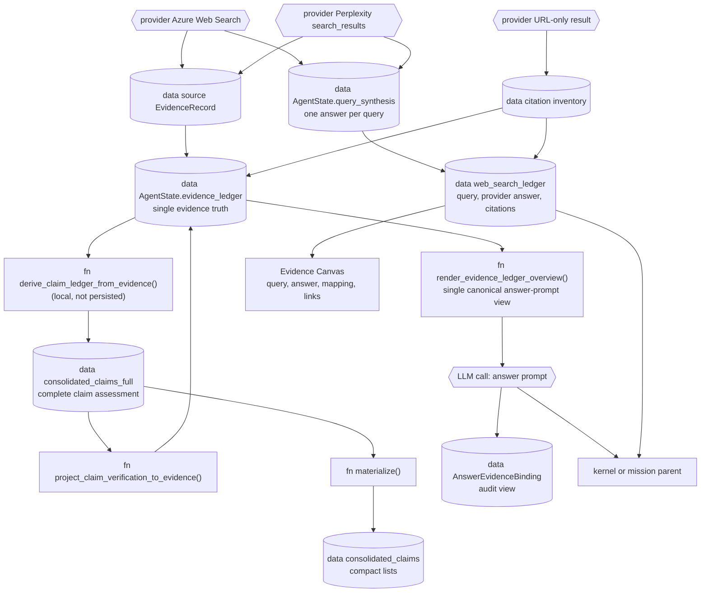
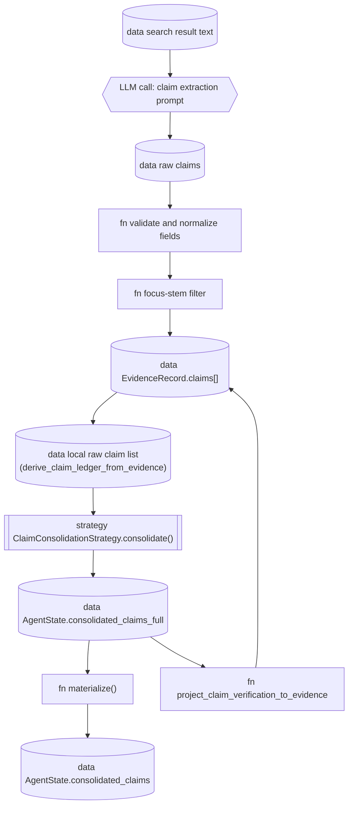

# Evidence pipeline

## Scope

How Inqtrix carries provider-grounded search results into the final report
without losing the exact query, the coherent provider answer, or the links
returned with it. This page covers the Research graph's working evidence
ledger, the durable web-search ledger used by the Agent, the answer-prompt
projection, child-to-parent handoff, and post-answer audit binding. Web research
uses only search-provider API results and content derived from those results.
Inqtrix does not fetch linked webpages or PDFs, and there is no operator switch
for a supplementary page retrieval. Internal evidence reads and review reuse
the retained API material. Public result and artifact projections expose the
provider-search records, excluding other stored ledger collections without
deleting historical data. This page does not describe provider
authentication or individual stop heuristics (see
[Stopping](stopping.md) and
[Research loop](loop.md)).

## Flow

Follow-up turns import the reference metadata of earlier visible, completed
session runs as well as session documents. A chat answer therefore does not
need to become a Canvas document to keep its evidence addressable. Full retained
API answers stay behind the existing origin-authorization check when read.
Turning off new web searches does not disable these internal reads.

Writer instructions treat source labels and evidence grades as provenance,
not automatic confirmation of a final sentence. Institutional statements require
explicit support in the available material. Derived recommendations remain
identified as such, with decision-changing conditions and alternatives stated
alongside them.

This diagram answers: "How does a provider result become a cited answer
sentence?" The full provider result remains available through synthesis. A
domain tier may influence ordering and confidence, but it cannot discard an
`unknown` result or require a second page read.



Key transitions:

- Provider-specific result shapes are normalized into `EvidenceRecord` rows
  without filtering records merely because a domain is unknown.
- `EvidenceRecord.claims[]` are projected into a **local** raw claim ledger
  (`derive_claim_ledger_from_evidence`, recomputed in `search()`, not a state
  field) so the claim consolidator can operate.
- Verification status is projected **back onto the EvidenceLedger** by
  `project_claim_verification_to_evidence`, so each record carries its own
  `verification_status` / `verification_basis` -- this is what makes the ledger
  self-describing and removes the need for a separate bundle list.
- The answer prompt sees exactly one view: the Markdown overview produced by
  `render_evidence_ledger_overview` directly from the EvidenceLedger. It is
  record-driven (eligible records become labelled source blocks under their
  search query so the rich query synthesis shows once; a source the search
  answer cites at several places is one block), and the citation
  allowlist is the union of visible source-block URLs. There
  is no parallel report-evidence-bundle / prompt-evidence-unit / rendered-
  context channel and no separate numbered prompt-citation map.
- The durable `web_search_ledger` retains the exact query, provider identity,
  coherent provider answer, every returned citation, timing, usage, status,
  and non-fatal notice. It is audit state, not a second search pipeline.
- A child research report reaches its parent together with this ledger. The
  parent may evaluate, consolidate, or ask another question, but it does not
  require a linked webpage to be fetched before it may use the provider result.

The graph shows that provider output is not forced into one shape. Azure's
synthesized web-search answer is stored once in `query_synthesis`; its cited
URLs still become source records so the final report has concrete anchors.
Per-source snippets remain associated with their URLs. URL-only providers
contribute citation inventory. In every case the user can open the returned
link, while the Canvas separately shows what Azure actually returned to
Inqtrix.

One coherent provider answer can synthesize several links. Therefore every
ledger citation carries an honest mapping status:

- `provider_answer_context`: the provider associated supporting answer context
  with this citation;
- `provider_citation_marker`: the provider annotated only the rendered citation
  marker (Azure's common case), or supplied no annotation at all and only
  nearby answer context was available -- either way the provider exposed no
  1:1 claim mapping;
- `provider_snippet`: the provider returned URL-specific snippet metadata;
- `source_only`: the provider listed the URL but supplied no exclusive passage.

The Canvas shows the complete coherent answer for the query and never claims
that a sentence came from exactly one URL unless the provider supplied that
mapping. Credential-bearing URLs are redacted before provider output,
metadata, prompts, checkpoints, or UI state can observe them. Provider prose
is kept under a visible persistence bound; truncation includes an explicit
marker rather than silently masquerading as a complete result.

There is no LLM-backed grouping step in `search()` and no LLM step in the
answer-prompt view: claim consolidation and the evidence overview are
deterministic projections over the EvidenceLedger. The only LLM call after the
research loop is the per-section answer composer (see
[Answer composition](answer.md) for the section-by-section flow,
prompt templates, and write-last summary mechanism).

Claim extraction is the one structured helper call inside `search()`. The
default `LLMClaimExtractor` first asks the active `LLMProvider` whether the
claim-extraction model supports native JSON-schema output. Built-in Bedrock,
Anthropic, and Azure OpenAI adapters answer this through
`supports_structured_output(model=...)` and use their provider-native schema
mechanism (`outputConfig.textFormat`, `output_config.format`, or
`response_format`). Providers that do not opt in keep the legacy prompt-based
JSON path. Parse failures, schema-shape failures, API failures, and token-limit
stops all remain visible as `ALGO-FAIL claim_extraction`; a valid
`{"claims": []}` response is logged separately as a valid-empty extraction.

## Primary truth vs views

`evidence_ledger` is the Research graph's canonical **working** truth. It joins
the query, source, citation, provider snippets/passages, raw claims, and --
after `project_claim_verification_to_evidence` -- each claim's verification
standing. The Agent's `web_search_ledger` is the durable projection used
across parent/child and Canvas boundaries. It is derived from the provider
result and does not introduce another search, ranker, filter, or prompt
renderer.

Every ledger search retains the stable invocation/query id, exact query,
provider and bounded parameters, start/end timestamps, provider-reported token
usage, status, non-fatal notice, coherent provider answer, and citation list.
This protected run audit distinguishes a bad search result from later
extraction or synthesis errors without copying private queries into ordinary
application logs.

The other evidence-related fields are kept deliberately minimal:

- `consolidated_claims_full`: the complete consolidation, written each round
  before `materialize()` applies presentation caps. It supplies verification
  projection, quality counters, cross-check targets, stop diagnostics and
  answer-to-claim bindings. `scoring.claim_assessments()` is the shared read
  path. The field is absent until a complete assessment is available; an
  explicitly empty complete assessment is authoritative. A supplied state
  without this field uses its available `consolidated_claims` assessment.
- `consolidated_claims`: the bounded materialised selection for the evaluator's
  compact claim-list hint and public `top_claims`. The answer marks usage in
  both lists by `claim_id`, including when a custom materializer returns copies.
- `all_citations`: flat URL inventory for source-tier scoring; not an
  answer-prompt citation source.
- `evidence_depth_gap`: diagnostic over the complete claim assessment that flags
  shallow single-source evidence for the next planning round. See
  [Stop criteria](stopping.md#stop-criteria).
- `score_ledger`: chronological diagnostic snapshots built from the
  EvidenceLedger, consolidated claims, evaluator output, and answer audit.
  See [Score ledger](../../observability/forensic-cookbook.md#score-ledger).

There is no `context`, `claim_ledger`, `report_evidence_bundles`,
`selected_report_evidence`, `unverified_evidence_notes`, or
`prompt_evidence_units` state field. Claimless sources are **not**
degraded: a report-eligible `EvidenceRecord` with `claims=[]` still carries
`source_snippet`, `source_passages`, and `citation_set`, while
the query-level synthesis lives once in `state["query_synthesis"]`; it is
rendered as a `source-context` block in the
overview -- usable for attributed, source-backed statements, just not as a
cross-checked hard fact.

Terminology used below:

| Term | Role | Stored where | Read by |
|---|---|---|---|
| **Working truth** | Complete graph-local representation of search-derived evidence and projected verification | `AgentState.evidence_ledger` | claim projection, evidence overview, answer audit |
| **Durable web-search contract** | Exact queries, coherent provider answers, citation metadata, mapping precision, timing, usage, and status | `web_search_ledger` inside the existing evidence artifact | audit, resume, kernel/mission handoff, Canvas |
| **Parent handoff** | Complete child report plus its translated references and web-search ledger | child tool result and evidence artifact | kernel or mission parent |
| **Claim assessment** | All computed claim statuses, independently of display caps | `consolidated_claims_full` | `plan`, `evaluate`, stop diagnostics, answer bindings, quality counters and observability via `claim_assessments()` |
| **Compact claims view** | Bounded selection for compact lists | `consolidated_claims` | Evaluator claim-list hint and public `top_claims` |
| **Answer-prompt view** | The single record-driven Markdown overview the answer composer consumes | rendered on demand by `render_evidence_ledger_overview()` (not persisted) | `answer()`, section composer |
| **Audit view** | Post-answer check that cited URLs resolve to EvidenceRecords | `answer_evidence_bindings` | metrics, debugging |

## EvidenceRecord

One evidence row. `record_type` is currently always `source`; query-level
provider synthesis is not copied onto each record, but stored once in
`state["query_synthesis"][query_id]`.

```python
EvidenceRecord = {
    "evidence_id": "ev_9f3c4f2a1b22d0",
    "record_type": "source",
    "report_eligible": True,
    "query_id": "qry_3546f9a7bd7465",
    "query": "Meta 2026 AI capital expenditures official filing",
    "source_id": "src_704e45c2c8b896",
    "citation_id": "cit_d5ebe5322bd948",
    "canonical_url": "https://investor.atmeta.com/investor-news/...",
    "domain": "investor.atmeta.com",
    "tier": "primary",
    "tier_reason": "model:company_primary",
    "role_reason": "Investor-Relations-Seite des Unternehmens",
    "provider": "PerplexitySearch",
    "source_title": "Meta Reports First Quarter 2026 Results",
    "source_snippet": "Meta reports revenue and 2026 capital expenditure guidance...",
    "source_date": "2026-04-30",
    "last_updated": "2026-05-01",
    "source_passages": [
        {
            "passage_id": "passage_ev_9f3c4f2a1b22d0_1",
            "origin": "source_snippet",
            "text": "Meta expects full-year 2026 capital expenditures of 115-135 USD billion.",
            "char_count": 86,
        }
    ],
    "claims": [
        {
            "raw_claim_id": "raw_claim_5f587376c11924",
            "claim_id": "claim_62ff008895f616",
            "claim_text": "Meta plans 2026 AI capital expenditures of 115-135 USD billion.",
            "claim_type": "fact",
            "polarity": "affirmed",
            "needs_primary": True,
            "evidence_snippet": "Meta expects full-year 2026 capital expenditures...",
            "verification_status": "attributed",
            "verification_basis": "primary_source",
            "supporting_evidence_ids": ["ev_9f3c4f2a1b22d0", "ev_a4417c19cf8842"],
            "supporting_domain_count": 2,
            "checked_here": False,
        }
    ],
}
```

The ledger stores source records plus extracted source passages and claims. For
Azure, the full synthesized answer lives in `query_synthesis.provider_answer`;
Azure citation URLs become report-eligible source records without duplicating
the same answer text into every URL row.

## RawClaim

`RawClaim` rows are claim-support rows derived from `EvidenceRecord.claims[]`.
They are a compatibility view for the existing consolidation strategy, not a
separate truth source. One raw claim may point back to one or more evidence
records.

```python
RawClaim = {
    "raw_claim_id": "raw_claim_5f587376c11924",
    "claim_text": "Meta plans 2026 AI capital expenditures of 115-135 USD billion.",
    "evidence_snippet": "Meta expects full-year 2026 capital expenditures...",
    "claim_type": "fact",
    "polarity": "affirmed",
    "needs_primary": True,
    "source_urls": ["https://investor.atmeta.com/investor-news/..."],
    "source_ids": ["src_704e45c2c8b896"],
    "citation_ids": ["cit_d5ebe5322bd948"],
    "evidence_ids": ["ev_9f3c4f2a1b22d0"],
    "published_date": "2026-04-30",
    "signature": "meta plans capital expenditures",
    "round": 0,
    "query": "Meta 2026 AI capital expenditures official filing",
    "query_id": "qry_3546f9a7bd7465",
}
```

The `round` field is always `0` in this derived view: the search node records
the round on its raw claim entry, but `_claim_payload()` does not copy it onto
`EvidenceRecord.claims[n]`, so the back-projection has nothing to read.

`search()` derives this view after assembling evidence records. If `evidence_ledger` has
no claims, the local raw claim list stays empty and evaluation/answer must
treat hard facts conservatively. The raw view is never persisted on
`AgentState`. Two consolidated projections are: `consolidated_claims`
(materialised, used for compact lists) and
`consolidated_claims_full` (the pre-`materialize()` list, written each round
in `search()`, used for verification and quality).

## ConsolidatedClaim

`ConsolidatedClaim` is the verification view produced by
`ClaimConsolidationStrategy.consolidate()` (default implementation in
`src/inqtrix/strategies/_claim_consolidation.py`). It groups raw claims by
signature and decides whether the claim is `verified`, `attributed`,
`contested`, or `unverified`, along with its `verification_basis`. See
[Claims](#claims) for the full rules; the possible bases (the support
structure) are `primary_source`, `cross_checked`, `quality_source`,
`contested`, `missing_primary_source`, and `weak_evidence`. Static source tiers remain ranking and confidence metadata.
They do not filter provider-grounded content out of the answer path.

```python
ConsolidatedClaim = {
    "claim_id": "claim_62ff008895f616",
    "signature": "meta plans capital expenditures",
    "claim_text": "Meta plans 2026 AI capital expenditures of 115-135 USD billion.",
    "claim_type": "fact",
    "needs_primary": True,
    "support_count": 2,
    "supporting_evidence_ids": ["ev_9f3c4f2a1b22d0", "ev_a4417c19cf8842"],
    "contradicting_evidence_ids": [],
    "status": "attributed",
    "status_reason": "primary evidence present; attributed by the search provider",
    "verification_basis": "primary_source",
    "checked_urls": [],
    "source_urls": ["https://investor.atmeta.com/...", "https://www.bloomberg.com/..."],
    "citation_set": [{"label": "E1", "url": "https://investor.atmeta.com/..."}],
    "member_claim_ids": ["raw_claim_5f587376c11924", "raw_claim_a8..."],
    "member_claim_texts": ["Meta plans 2026 AI capital expenditures ..."],
    "round_first_seen": 0,
    "round_last_updated": 0,
    "source_tier_counts": {"primary": 1, "mainstream": 1, "unknown": 0},
    "primary_basis": "role",
    "syndicated_count": 0,
    "values": ["amount:115000000000 USD", "amount:135000000000 USD", "date:2026"],
    "conflicting_claim_ids": [],
}
```

`values` lists what the claim states (the 2026 is the time scope of the
amounts here), and `conflicting_claim_ids` names the claims of the same
signature whose values contradict this one (see
[Values in claim identity](#values-in-claim-identity)).

Both round fields are always `0`: neither `EvidenceRecord` nor its claim
payload carries a `round`, so `derive_claim_ledger_from_evidence()` falls back
to `0` before the consolidator ever sees a round number.

After consolidation, `project_claim_verification_to_evidence()` writes the
`status` / `verification_basis` / `supporting_evidence_ids` /
`supporting_domain_count` fields back onto every matching
`EvidenceRecord.claims[n]`, so the EvidenceLedger is self-describing for the
overview renderer.

## Rendering: EvidenceLedger → Markdown

The answer composer never reads the EvidenceLedger directly; it reads exactly
one rendered Markdown block produced by
`render_evidence_ledger_overview()` in `src/inqtrix/evidence.py`. This is the
**single canonical answer-prompt view** -- there is no parallel bundle list,
no prompt-evidence-unit list, no rendered-context channel.

### Signature

```python
def render_evidence_ledger_overview(
    evidence_ledger: list[dict[str, Any]],
    *,
    max_total_chars: int,
    max_record_chars: int,
    label_by_evidence_id: dict[str, str] | None = None,
    query_synthesis: dict[str, dict[str, Any]] | None = None,
) -> EvidenceOverview:
```

### EvidenceOverview dataclass

```python
@dataclass(slots=True)
class EvidenceOverview:
    markdown: str                           # the Markdown block handed to the LLM
    label_urls: dict[str, str]              # visible E1 -> canonical URL
    allowed_urls: list[str]                 # URLs of visible source blocks
    label_by_evidence_id: dict[str, str]    # EvidenceRecord-id -> URL-canonical label
    rendered_record_count: int              # records that made it into markdown
    omitted_record_count: int               # records dropped purely because of budget
    rendered_evidence_ids: list[str]        # visible EvidenceRecord ids
    omitted_records: list[dict]             # the dropped records, named (label, url, query, reason)
    omitted_query_ids: list[str]            # searches that lost at least one record
    omitted_by_query: list[dict]            # per search: query text, omitted, rendered
```

### Filter

Only records with `report_eligible=True` AND a non-empty primary URL
(`canonical_url` or first citation URL) are eligible for rendering. Everything
else is skipped silently (it is not budget loss, it is "not report material").

### Order

Eligible records are first **labeled by canonical URL** in trust-then-density
order, *before* the budget cut is applied, so the same source URL has one
`E1`/`E2` label even when several EvidenceRecords reference it. The label order
comes from `_evidence_record_score()`:

```python
score  = _SOURCE_CONTEXT_TIER_RANK[tier]            # tier weight
score += _VERIFICATION_RANK[verification_label]     # how strongly the record's claims are verified
score += min(30, len(claims) * 5)                   # up to 6 claims
score += min(12, len(source_passages) * 2)          # up to 6 passages
score += min(4, len(source_snippet) // 120)
if source_date not in ("", "unknown"): score += 3
```

with the two ranking tables exactly:

```python
_SOURCE_CONTEXT_TIER_RANK = {
    "primary":     60,
    "mainstream":  50,
    "stakeholder": 40,
    "unknown":     25,
    "low":        -100,
}
_VERIFICATION_RANK = {
    "cross-checked":          50,
    "primary-source":         42,
    "contested":              30,
    "single-source verified": 24,
    "source-context":         12,
    "unverified":              8,
}
```

After per-record labels are assigned, the renderer groups records by their
`query_id` (the search query that produced them), ranks groups by the score of
their best record, and renders top-to-bottom under "RESEARCH RESULT R1",
"RESEARCH RESULT R2", … blocks. Each group may show the provider synthesis
once, under the heading "Search answer (context; not independently
verified):"; individual records contribute their claims, evidence snippets,
and source passages without repeating query-level context.

Within a group, every source is one block. Azure records one EvidenceRecord
per place its search answer cites a source at, and the writer reads the
source once: the block's title, date and tier come from the best of these
records, its standing from the statements of all of them (as when a search
had one record per source), and its content is the union of their lines. A
place that adds no line of its own costs no characters.

### Budget

Two budgets apply:

| Budget | SCHNELL | COMPACT | DEEP | Effect |
|---|---|---|---|---|
| `max_total_chars` (`prompt_evidence_total_char_budget`) | 64 000 | 100 000 | 180 000 | Budget for the rendered source blocks. Above it the renderer thins the view round-robin (below); every record that does not fit is counted in `omitted_record_count` and named in `omitted_records` / `omitted_by_query`. It is not a hard cap on the final string -- the `HINWEIS: … weitere belegfaehige Quellen …` footer is appended after that accounting, so the Markdown can end up one footer line longer than the budget. |
| `max_record_chars` (`prompt_evidence_record_char_limit`) | 1 800 | 2 200 | 2 600 | Per-source-block budget. When a block exceeds it, evidence lines are trimmed with a visible `[...weitere Belege dieser Quelle wegen Budget gekuerzt]` marker; header / label / metadata are always kept. |

The budget is spent **round-robin over the score-ranked query groups**: pass
N gives every still-open group its N-th source (in rank order, with every
place it is cited at) before pass N+1 starts. A group whose grown block no
longer fits is closed — its remaining sources are the budget tail, each
named with every record of its places (`reason: budget_tail`); a group whose
first source does not fit at all falls whole (`reason: whole_group`). So a
budget that is too small for everything thins every search evenly, and every
search keeps at least its best source as long as the budget holds one block
per search. Before, the highest-ranked groups took the largest prefix that
fit and the lowest-ranked searches (typically the `unknown`-tier half of a
comparison question) vanished from the writer's view, and the report read as
"nothing found" for them.

When records are dropped because of the total budget, the renderer appends a
visible footer line:

```text
HINWEIS: 12 weitere belegfaehige Quellen aus 3 Suchen passten nicht in das
Evidenz-Budget und sind in dieser Uebersicht nicht enthalten.
```

so budget loss is **never silent** -- the answer-LLM sees that some report-
eligible sources were left out, the report's appendix names the count and the
searches under "Hinweis zur Vollständigkeit", the node span carries the
counters (`inqtrix.evidence.*`, WARNING level) and the worker log a WARNING,
and `ResearchMetrics.omitted_evidence_record_count` /
`omitted_evidence_query_count` hand the cut to a parent run, whose task
outcome then has `coverage = partial` (see the agent platform docs).

**Two views of the same ledger.** The answer node renders the `full` record
view (claims, snippets, passages per source) under the profile budget. The
evaluate node renders the `compact` view (`record_view="compact"`: header
plus a few bounded claim lines, no snippets or passages; a source without
extracted claims keeps one bounded line of its snippet or first passage so
it is never a bare header) under the profile's evaluator budget
(`evaluate_evidence_total_char_budget`, `evaluate_evidence_record_char_limit`
per source), so the evaluator judges the **breadth** of every source the run
has while the writer reads the depth.
Before, the evaluator saw a 24 000-char full-block excerpt — on a DEEP run a
fraction of the ledger — and named GAPS for sources the run already had.

The query-level fields fed into each `RECHERCHE-ERGEBNIS` header come from
`state["query_synthesis"]` and are included once per query group. They are
governed by the same visible overview budget as the source blocks.

### Stable labels across section prompts

The answer composer renders the full EvidenceOverview once, stores the
`label_by_evidence_id` map on state, and reuses it for every per-section prompt.
That means every EvidenceRecord for the same Reuters URL resolves to the same
`E12` label. Section hints are limited to labels whose source blocks were
visible in the full overview.

### Example output (synthetic, ~25 lines)

```text
RESEARCH RESULT R1
Search query: Meta 2026 AI capital expenditures official filing
Search answer (context; not independently verified):
Meta gave FY2026 capex guidance of 115-135 USD billion (Q1 2026 release), with
both the official IR page and Bloomberg corroborating the range. Analysts
flagged elevated AI-infrastructure spend; no source contradicted the range.
Sources from this search:
[E1] Meta Reports First Quarter 2026 Results
  Date: 2026-04-30 | Tier: primary (company_primary) | Standing: its own text checked; primary source
  Statements checked against this source's text:
  - Meta plans 2026 AI capital expenditures of 115-135 USD billion.
  Text the search provider returned from this source:
  - Meta expects full-year 2026 capital expenditures of 115-135 USD billion.

[E2] Meta lifts 2026 capex range on AI buildout
  Date: 2026-04-30 | Tier: mainstream (reporting) | Standing: attributed by the search provider; page not read
  Statements the search provider attributes to this source:
  - Meta raised its 2026 capex range, citing AI infrastructure.
  Search-provider text these statements were taken from:
  - Meta raised its 2026 capex range to $115B-$135B, citing AI infrastructure ...
```

A statement is listed as checked only under the source whose own text was
checked (`checked_here`); everything else is what the search provider
attributes to the source. The text a provider returned from a page and the
provider text a statement was extracted from (the answer, for most
providers) keep separate headings, and neither is called evidence.

## Verification labels per record

Two functions in `src/inqtrix/evidence.py` read the verification fields
projected onto every `record.claims[n]` by
`project_claim_verification_to_evidence()`:

- `_record_support_standing()` is the record's support structure, as if every
  supported claim (verified or attributed) had been checked. Ranking
  (`_VERIFICATION_RANK` in the record score), section selection and the URL
  audit read it, so they treat every search provider alike whether or not it
  returns source text.
- `_record_verification_label()` is the standing the writer sees: the support
  standing when this record's own source text was checked for one of its
  claims (`checked_here`), else `provider-attributed` for a supported record.

The labels are the internal vocabulary of ranking, the URL audit, the binding
records, the API and forensics. A prompt never shows them: the overview's
"Standing:" line reads `STANDING_TEXT[label]`, plain words the writer can pass
on, because a model quotes a short label it reads into the report ("provider-
attributed Angaben"). The writer legend in `prompts.py` lists the same plain
words and tells the writer never to quote standings, block headings or other
working terms, but to say in plain words of the answer language what supports
a statement.

Both walk a fixed precedence chain -- `cross-checked`, then `contested`, then
`primary-source` / `single-source verified`, then `unverified` -- so
`contested` wins over `primary-source` on a record that carries both, even
though `_VERIFICATION_RANK` scores `primary-source` higher. Possible values:

| Label | Shown in the prompt as | Trigger (across all claims of the record) | Allowed report use |
|---|---|---|---|
| `cross-checked` | its own text checked; independently confirmed | A supported claim has `verification_basis == "cross_checked"` and this record's text was checked | Hard fact, cite with the label. |
| `contested` | sources disagree | Some claim is `contested` (in status or basis) | Show both sides, attribute. |
| `primary-source` | its own text checked; primary source | A supported claim has `verification_basis == "primary_source"` and this record's text was checked | Hard fact within that scope; cite with the label. |
| `single-source verified` | its own text checked; one source | Another supported claim, this record's text checked | Allowed, but must be inline-attributed ("according to [E12] …"). |
| `provider-attributed` | attributed by the search provider; page not read | Supported claims, but this record's own text was not checked (Azure never returns page text) | Attributed to the source in plain words once per paragraph, table row or list item; dates and figures always carry the label; never presented as the source's own wording or as established fact. |
| `source-context` | background only; no extracted statement | The record has no claims at all (claimless background) | Allowed for context / source-backed statements; not a cross-checked hard fact. |
| `unverified` | insufficiently supported | All claims have `status="unverified"` (a weak source, or a statement that needs a primary source and has none) | Never stated as fact; named only as unconfirmed. |

The support standing feeds the `_VERIFICATION_RANK` bonus in the record-score
formula above, so cross-checked records rise to the top of the overview within
their tier band, checked or attributed alike.

## Final answer system prompt

The system prompt of every per-section answer LLM call is built by
`_build_answer_system_prompt_with_style()` in `src/inqtrix/prompts.py` (lines
~405-702). It is **identical across all section calls** of a single answer --
only the section-specific style block (heading / instruction / position /
length guidance, see [Answer composition](answer.md)) changes.
The block order below reflects the actual emission order in code: the
language directive (first line), the role/date line, the section style
block, the unconditional guardrail blocks (EVIDENCE FIDELITY, SAFETY,
SELF-VERIFICATION, PRECISION, TEMPORAL PRECISION, OUTPUT FORMAT), then
CLAIM CALIBRATION, SUB-QUESTION COVERAGE, EVIDENCE DEPTH,
TRANSPARENCY OBLIGATION, COMPETING EXPLANATIONS, the evidence block, and
finally the conversation-history block.

### 1. Header (always emitted)

Role, language directive and the section style block, plus five guardrail
blocks emitted unconditionally:

- **SICHERHEIT / PROMPT-INJECTION**: search content is treated as untrusted;
  embedded instructions are ignored.
- **SELBST-VERIFIKATION**: each claim must be checked against its source;
  unconfirmed claims must be marked.
- **PRAEZISION**: precise rules for legal / regulatory citations.
- **ZEITLICHE PRAEZISION**: temporal language for ongoing processes.
- **FORMATIERUNGS-REGELN**: Markdown structure rules.

### 2. CLAIM CALIBRATION (conditional)

Triggers when `source_counts` or `claim_counts` are non-empty. Shows the
source-tier mix, the quality score, and the verified / contested / unverified
breakdown, plus the primary-source obligation count. Lets the LLM calibrate
the language strength.

### 3. SUB-QUESTION COVERAGE (conditional)

Triggers when `required_aspects` is non-empty. Lists required and uncovered
aspects; instructs to mark uncovered aspects inline as `(unbestaetigt)`.

### 4. EVIDENCE DEPTH (conditional on `evidence_depth_gap.active == True`)

Emitted when the depth-gap diagnostic in
[Stop criteria](stopping.md#stop-criteria) is active --
i.e., 3+ supported claims (verified or attributed) but most ride on a single
source, or a central numeric claim only has one quality source backing it.
Tells the LLM:

```text
EVIDENCE DEPTH -- IMPORTANT FOR THE TONE OF THE REPORT:
- Of {N} supported statements only {k} are independently confirmed; {m} ({p}%)
  rest on a single source.
- Treat only independently confirmed statements or statements from a primary
  source as hard facts, and only where their own text was checked; attributed
  statements are always attributed to their source.
- Statements from a single source MUST be attributed inline ('according to
  [E12] ...') and kept in cautious wording ('reports', 'states', 'is said to').
- Do NOT present figures, actor attributions and causal statements that stem
  from a single source as established fact.
- The section '{risks heading}' MUST name this thin cross-check situation
  explicitly as an evidence limit of the report.
```

### 5. TRANSPARENCY OBLIGATION (conditional on `evidence_is_weak`)

Triggers when **any** of:
- `unverified_count > verified_count + attributed_count` (more unsupported
  than supported claims), or
- `claim_needs_primary_supported < claim_needs_primary_total` (primary
  obligations unmet), or
- `evidence_depth_gap.active == True`.

In section mode only the section that owns the evidence limits
(`owns_evidence_limits` in the section plan) is instructed to add the
uncertainties sub-section; its heading is resolved to the answer language
("Unsicherheiten / Offene Punkte" / "Uncertainties and open points").

### 6. EVIDENCE OVERVIEW + CITATION RULES + QUANTITY RULE FOR REPORTS (conditional on a non-empty `evidence_overview`)

These three blocks share a single `if evidence_overview:` branch -- they are
emitted together or not at all. When the overview is empty but
`allowed_citations` is not, the prompt falls back to a short `NOTE ON THE
EVIDENCE` block and carries no citation rules whatsoever.

The single canonical evidence view. The LLM is told the structure (query
groups, per-source labels, verification labels, citation rule) and then
receives the embedded `evidence_overview.markdown` produced by
`render_evidence_ledger_overview()`.

Quoted from `prompts.py`:

```text
CITATION RULES:
- Cite sources INLINE only with their label in square brackets, e.g. [E12];
  write NO URL after it -- the links are attached automatically after the
  synthesis.
- Separate several source labels with a space, e.g. [E1] [E2], never as
  [E1][E2].
- Place the citation directly after the supported statement.
- Invent NO URLs and NO labels; use exclusively the sources of the overview.
  When the assignment is unclear, write '(unconfirmed)'.
- Ignore markers such as [unmapped:*] or [unrendered:*] as evidence; they only
  show that a provider citation cannot be cited as a visible source block.
- In this section: at least one citation-bound source directly at every
  substantial statement; in subsections (###) 1-2 sources directly at the
  relevant facts.
- For contested or multi-perspective statements cite at least two sources of
  different actors or tiers.
- Create NO own reference, source or link section at the end of the answer;
  these sections are appended by the system.
```

The unconfirmed marker is resolved to the answer language
(`(unbestätigt)` for German runs).

### Embedded evidence block

After the rules, the system prompt embeds `evidence_overview.markdown` (the
output of the renderer above) verbatim. Because the same system prompt is
sent to every section LLM call, every section sees the **full** evidence
overview, not a section-scoped subset (`section_focus_labels` in the user
prompt is only a soft hint -- see
[Answer composition](answer.md)).

## AnswerEvidenceBinding

After answer generation, the audit checks whether the cited URLs match
EvidenceRecords.

```python
AnswerEvidenceBinding = {
    "binding_id": "bind_ev_2aa4f188ac31e0",
    "citation_url": "https://investor.atmeta.com/...",
    "evidence_id": "ev_9f3c4f2a1b22d0",
    "verification": "primary-source",
    "binding_status": "matched",
}
```

This URL-level audit resolves every cited link to an EvidenceRecord:

- `matched`: the URL resolves to a record carrying a verified or contested
  claim.
- `source_context`: the URL resolves to a claimless or unverified record.
- `unknown_citation`: the URL resolves to no record at all.

The `evidence_contract_status` (`clean` / `needs_review` /
`source_context_only` / `algorithm_failed` / `unknown`) is decided by the
**claim-level** binding (`_build_answer_claim_bindings`: does a cited sentence
plausibly carry a consolidated claim?), not by this coarser URL audit. The URL
audit contributes the `unknown_citation` signal that forces `needs_review`. See
[Score ledger](../../observability/forensic-cookbook.md#score-ledger).

## Mini example: one fact through the pipeline

1. `SearchProvider.search()` returns a Bloomberg + Meta-IR result for the
   query "Meta 2026 AI capital expenditures official filing" and records the
   exact query, invocation id, timing, usage, provider parameters, provider
   synthesis, snippets, and URLs.
2. `search()` stores the provider answer once in `query_synthesis[query_id]`
   and normalizes both cited URLs into `record_type="source"` records. The full
   Azure answer and all returned links also enter `web_search_ledger`.
3. `derive_claim_ledger_from_evidence()` projects the nested
   `EvidenceRecord.claims[]` into a flat list of `RawClaim`s (not persisted on
   state).
4. `DefaultClaimConsolidator.consolidate()` groups the two claims by
   signature "meta plans capital expenditures", finds 2 affirmed
   supports and no contradiction, and -- because one of the two sources is
   `primary` tier -- reads the primary structure first:
   `verification_basis="primary_source"`. Azure returned no page text, so no
   source text checked the claim: `status="attributed"`, `status_reason=
   "primary evidence present; attributed by the search provider"`. The
   `cross_checked` structure is only reached when no primary-tier source backs
   the claim.
5. `project_claim_verification_to_evidence()` writes that
   `verification_status` / `verification_basis` /
   `supporting_evidence_ids=["ev_9f3c4f2a1b22d0", "ev_a4417c19cf8842"]` back
   onto every matching `record.claims[n]`.
6. The child passes its complete report and `web_search_ledger` to the parent.
   No URL is removed because its tier is `unknown`, and no page-read contract
   is required.
7. `render_evidence_ledger_overview(...)` ranks records by
   `_evidence_record_score()`, assigns one label per canonical URL (`E1` for
   Meta IR, `E2` for Bloomberg), groups them under their query, renders the
   Markdown block, and returns an `EvidenceOverview` with
   `rendered_record_count=2`, `omitted_record_count=0`,
   `allowed_urls=["https://investor.atmeta.com/...", "https://www.bloomberg.com/..."]`.
8. `_build_answer_system_prompt_with_style()` assembles the final system
   prompt (directive → header → CLAIM CALIBRATION → EVIDENCE OVERVIEW → CITATION RULES
   → embedded `evidence_overview.markdown`); the answer composer runs one LLM
   call per section with this system prompt and a section-specific user
   prompt (see [Answer composition](answer.md)).
9. `audit_answer_evidence_bindings()` records that the generated answer cited
   both `https://investor.atmeta.com/...` and
   `https://www.bloomberg.com/...` near the capex sentence → binding status
   `matched`.

The important maintenance rule: graph-local evidence fields originate in
`EvidenceRecord`; durable web-search fields originate in the provider result
and are deterministically projected into `web_search_ledger`. Neither
consumer may silently invent or drop a claim, query, provider answer, or link
to make the two representations agree.

## Claims

> Files: `strategies/_claim_extraction.py` (`LLMClaimExtractor`), `strategies/_claim_consolidation.py` (`DefaultClaimConsolidator`)

### Claim lifecycle

This diagram answers: "How does free text from a search result become a
verified or contested claim?" The first transition is usually an LLM call; the
remaining transitions are deterministic validation, filtering, and
consolidation.



Key transitions:

- `LLMClaimExtractor` asks for atomic JSON claims per source.
- Validation prevents unsupported URLs and malformed fields from entering
  the ledger.
- Claims are attached to their `EvidenceRecord.claims[]` -- the primary
  truth. The "raw claim list" is a local variable in `search()` derived via
  `derive_claim_ledger_from_evidence()`; it is **not** persisted on
  `AgentState`.
- `consolidate()` groups raw claims by signature and assigns a `status`
  (`verified` / `contested` / `unverified`) plus a more specific
  `verification_basis` (see [Status determination](#status-determination)).
- `project_claim_verification_to_evidence()` writes the verification fields
  back onto each matching `record.claims[n]`, so the EvidenceLedger is
  self-describing.

### Claim schema

This is the extractor output shape before it is projected into
`EvidenceRecord.claims[]`. The model itself returns only `claim_text`,
`evidence_snippet`, `claim_type`, `polarity`, `needs_primary` and
`provider_refs` (JSON schema `inqtrix_claim_extraction_v2`); the extractor
then adds `source_urls` and `binding_status` by resolving `provider_refs`,
and the prompt explicitly forbids the model from returning URLs. The claim's
`published_date` is not a model field: the search node sets it from the
`source_date` the provider returned for the citation the claim binds to
(the first bound citation with a date), else `unknown` — a date the model
invents is not evidence.

```json
{
  "claim_text": "Precise, atomic statement",
  "claim_type": "fact | actor_claim | forecast",
  "polarity": "affirmed | negated",
  "needs_primary": true,
  "source_urls": ["https://..."],
  "published_date": "YYYY-MM-DD or unknown (from the bound citation, set by the search node)"
}
```

Post-parse normalisation:

- Actor-verb regex may reclassify `"fact"` to `"actor_claim"` when speech verbs are found.
- `needs_primary` is forced to `false` for every claim type other than `fact`; for `fact` claims the model's boolean is taken unchanged, and the primary-hint regex only fills in when the model returned no boolean at all (which the structured-output schema already prevents).
- `source_urls` are never returned by the model: the extractor resolves each `provider_refs` entry against the provider citation map of the same search result, keeping only normalised URLs that are already on that result's citation allow-list -- a result that carries no citations at all skips the allow-list check instead of rejecting every ref. Refs that resolve to nothing are dropped and logged as unknown refs.
- The model's refs are checked against the provider's text. Where the claim's `evidence_snippet` stands exactly once in the search answer and a citation the source map resolves closes its paragraph or list item (a Markdown link `([domain](url))` or a numbered marker `[2]`), that citation is the provider's attribution: a model choice foreign to it is rebound and counted (`provider_refs_rebound`, one WARNING per extraction), a choice that shares it stays. An excerpt the text does not place keeps the model's refs (`provider_refs_unchecked`). Replayed on the extraction inputs of six runs of 17.10.2026: 300 of 393 claims placeable, 11 of them rebound.
- Non-fatal provider errors are tolerated: the search result stays in the loop even when no structured claim is produced for it (iteration-log marker `_claim_extraction_fallback`).
- Each result keeps at most `claim_max_items` claims -- 6 (SCHNELL) / 8 (COMPACT) / 24 (DEEP).

### Signature-based deduplication

1. Leave out the values the claim states: dates, percentages and amounts
   (see [Values in claim identity](#values-in-claim-identity)).
2. Tokenise the rest via regex (`[a-zA-Z0-9äöüÄÖÜß]+`, lowercase).
3. Remove tokens shorter than 3 characters, except identity tokens: a token
   with a digit (`50` in "Artikel 50", `1a` in "Abs. 1a", `2024` in
   "2024/1689") and an upper-case Roman numeral of up to four letters (`II`
   in "Kapitel II").
4. Remove negation tokens (`kein`, `keine`, `keinen`, `keinem`, `keiner`, `nicht`, `ohne`, `no`, `not`, `never`, `none`, `without`).
5. Remove German and English stopwords (75 unique words).
6. Fallback: if all tokens were removed, keep tokens minus negations only.
7. Keep the first 16 tokens in order, join with spaces → signature string.

Claims with the same signature and the same values but different polarity
are detected as a conflict and receive `status = contested`.

### Values in claim identity

Source: `src/inqtrix/strategies/_claim_values.py`. A value belongs to what a
claim says: "Artikel 50 ist ab dem 2. August 2025 anwendbar." and the same
sentence with 2026 make the same statement about different dates. The
signature therefore leaves the values out, and `consolidate()` splits every
signature group by the claim's normalised values. Each split becomes one
consolidated claim with its own `claim_id` and a `values` list
(`date:2026-08-02`, `percent:7`, `amount:35000000 EUR`; a trailing `~` marks
a value that is not exact).

| Value | Read from | Normalised to |
|---|---|---|
| Date | "2. August 2026", "2 August 2026", "August 2, 2026", "02.08.2026", "2026-08-02"; "August 2026"; a lone year 1900-2100 | `2026-08-02`, `2026-08`, `2026` |
| Percentage | `%`, Prozent, percent; Prozentpunkte / percentage points as `points` | the decimal (`29,7 %` → `29.7`) |
| Amount | a number with a scale (Tsd., Mio., Mrd., thousand, million, billion, bn) and/or a currency (€, EUR, Euro, $, USD, Dollar, £, GBP, CHF) | the decimal and the currency code (`35 Mio. Euro` → `35000000 EUR`) |

Every other number (an article, a paragraph, a regulation number, a count)
is identity and stays in the signature. A date next to a percentage or an
amount is that value's time scope ("steigt 2026 auf 13,90 Euro"), part of
the identity rather than a value to compare. A value after rund, etwa,
über, bis zu, mindestens, about, up to and similar words is not exact, and
neither is a number whose separator the language decides (`1,250`: English
thousands or German decimals); it keeps its written form.

Equal values support each other. Two splits of one signature contradict
each other when they have the same time scope and, for one kind, each
states exactly one exact value, of the same currency for an amount, and the
two differ; a coarser date does not contradict a finer one that contains it
("2026" and "2. August 2026"). Both sides become `contested` with
`status_reason="conflicting values"`, name each other in
`conflicting_claim_ids`, and count the other side's supports as
`contradict_count`. The rule is deliberately narrow: a claim with several
values of one kind (a start and an end, a range) or a paraphrase with other
words contradicts nothing here, so a false conflict cannot hide a fact.
Syndication runs inside a split, so a reprint with another date stays the
other side of the conflict.

### Materialisation caps

The local raw claim list (derived per round from `EvidenceRecord.claims[]`)
is not persisted. The persisted `consolidated_claims` list is materialised
through `materialize()` with profile caps:

- `materialize_max_total` -- 16 (SCHNELL) / 24 (COMPACT) / 48 (DEEP)
  consolidated claims total.
- `materialize_max_unverified` -- 6 (SCHNELL) / 8 (COMPACT) / 48 (DEEP) of
  those may be unverified.

These caps limit compact lists. All computed assessments are projected back
onto `EvidenceRecord.claims[]`, including assessments outside the selection.
Changing a display cap changes neither verification status nor the population
used for quality counters. The evidence overview still applies its independent
rendering budgets and reports any omitted records.

### Status determination

Source: `DefaultClaimConsolidator.consolidate()` in
`src/inqtrix/strategies/_claim_consolidation.py`. A claim gets two fields:

- `verification_basis` is the **support structure**, read once over all
  affirmed witnesses (an affirmed entry that is not a reprint of another), the
  same for every search provider;
- `status` says **what was checked**: `verified` only when a source's own text
  states the claim, `attributed` when the search provider's answer is all that
  ties the claim to its sources.

A tier says who speaks, never what a page says, and provider prose (the
answer, the text around a citation, the excerpt a claim was extracted from)
is attribution, never verification. Before 0.2.0.10 a primary or mainstream
tier alone made a claim `verified`; stored results from that time say
`verified` where today's rule says `attributed`.

**Witnesses and independence.** Every URL an affirmed witness binds the claim
to is one unit: the provider answer that bound it (`query_id`), the source's
domain and tier, and the source's own text when the provider returned it
(`source_texts`, the page snippet; Azure returns none). Two units are
independent only when they come from different provider answers **and**
different registrable domains of a non-low source: one provider sentence
citing two pages is one witness, and so are two answers citing one site. The
number of independent witnesses is the smaller of the number of answers and of
domains among the non-low units.

**Structure** (first match wins, over all units):

| Structure (`verification_basis`) | Condition | Example |
|---|---|---|
| `primary_source` | a unit on a primary-tier source, or a `fact` claim naming the issuer of an unplaced (unknown, unjudged) source | an official or regulator URL; "Die KfW foerdert …" on kfw.de |
| `cross_checked` | two independent witnesses | two provider answers on two non-low domains |
| `quality_source` | a unit on a mainstream source | one editorial source |
| `missing_primary_source` | none of the above, and `needs_primary=True` (kept only for `fact` claims) | a central number with only unknown, stakeholder or low-tier support |
| `weak_evidence` | none of the above | evidence is too shallow |

**Status:**

| `status` | Condition |
|---|---|
| `contested` | affirmed and negated members of one value split coexist, or another split of the same signature states a conflicting value (see [Values in claim identity](#values-in-claim-identity)); basis `contested` |
| `verified` | a supporting structure, and the units whose own text states the claim reach one on their own (`page_states_claim`: every date, percentage, amount and identity number of the claim stands in the page text with the same normalized value, and at least half of its other content words, two at least; a claim without such a value is never checked by words). Near-identical page texts count once. `checked_urls` lists the pages |
| `attributed` | a supporting structure, and no checked text reaches one |
| `unverified` | no supporting structure |

`status_reason` names both parts, for example "primary evidence present;
attributed by the search provider" or "issuer identifies itself (kfw); checked
against source text".

Everything the research loop decides reads the structure and the supported
statuses together (`SUPPORTED_STATUSES` in `scoring.py`): stopping, the
evidence-depth gap, cross-check planning, the claim selection, the confidence
guardrails and the claim-quality score behave the same whether or not a
provider returns page text. What a report, a count or the user interface
shows reads the status.

Source tiers remain discovery, ranking, and source-quality signals. They do
not admit or reject a provider result. Unknown publishers remain in the
ledger and reach synthesis; a single unknown source is merely insufficient to
support a central claim.

`needs_primary` is an evidence-depth signal for factual claims. The
`quality_source` structure is still tracked by the depth-gap diagnostic and
cross-check planner because one quality source is useful but not
corroboration (see
[Evidence-depth gap](stopping.md#evidence-depth-gap) and
[Research loop](loop.md)).

### Claim-quality score

Source: `quality_metrics()` in
`src/inqtrix/strategies/_claim_consolidation.py`. The score is evidence-
depth weighted; each consolidated claim contributes one weight to the
average, depending on its `status` and `verification_basis`. A supported
claim (verified or attributed) weighs by its structure, so the score is the
same for every provider; the status counts say what was checked:

| `status` / `verification_basis` | Weight |
|---|---:|
| supported, `cross_checked` | `1.0` |
| supported, `primary_source` | `0.9` |
| supported, other basis (fallback) | `0.8` |
| supported, `quality_source` | `0.7` |
| `contested` | `0.5` |
| `unverified` (any basis) | `0.0` |

Formula: `claim_quality_score = sum(weights) / len(consolidated_claims_full)`,
rounded to 3 decimals.

**Worked example.** Five consolidated claims:

```text
claim_1: attributed, cross_checked    -> 1.0
claim_2: verified, primary_source     -> 0.9
claim_3: attributed, quality_source   -> 0.7
claim_4: contested                    -> 0.5
claim_5: unverified, weak_evidence    -> 0.0
                                 sum   = 3.1
                                 avg   = 3.1 / 5 = 0.62
```

Range: 0.0 (no supported or contested claims) to 1.0 (every assessed claim
has the `cross_checked` structure). A report whose supported claims are mostly
single-source `quality_source` claims therefore cannot get a perfect
claim-quality score -- that is by design, so the score reflects evidence
depth, not just support. The score is computed in `search` after claim
consolidation; `evaluate` and `answer` show the stored value to the model, and
the result reports it. No stop rule reads it.

### Materialisation for compact lists

`materialize(consolidated)` selects the compact list persisted alongside the
complete assessment on `AgentState`:

- keep `verified` claims first, then `contested` claims, then
  profile-specific `unverified` claims -- the concatenated list is
  truncated to `materialize_max_total` only at the end, so enough
  `verified` claims can push `contested` ones out entirely,
- keep profile-specific `unverified` claims, ranked by support count and
  source tier. COMPACT keeps a tighter uncertainty view; DEEP sets the
  unverified sub-cap equal to the total materialisation cap so
  weak-but-relevant evidence is visible to later stages without creating a
  separate hidden cut.

`select_answer_citations(consolidated, all_citations, max_items)` is
available but does not feed the answer prompt directly; the answer
composer derives its allowlist from
`EvidenceOverview.allowed_urls` (see
[Rendering the ledger](#rendering-evidenceledger--markdown)).
The public `top_sources` field in the result follows the
[result schema](../library-api.md): answer-linked URLs first,
prompt-selected evidence URLs second, remaining discovered citations last.

### How it is calculated

| Decision | LLM-driven? | Inputs | Formula / branch |
|---|---|---|---|
| Raw claim extraction | **LLM-parsed** (`LLMClaimExtractor`) | Search result text per source | Provider call returns JSON list; validator drops malformed entries; at most `claim_max_items` per source (6 SCHNELL / 8 COMPACT / 24 DEEP). |
| Signature dedup | Deterministic | Claim text | Values left out, token-regex + stopword/negation strip (identity tokens kept) + first 16 tokens joined; splits by normalised values. |
| `status` / `verification_basis` | Deterministic | provider-grounded source URLs, source tiers, support/contradiction counts, `needs_primary` | decision table above. |
| `claim_quality_score` | Deterministic | Each claim's basis | Weighted average per weights table. |
| Materialisation cut | Deterministic | Complete consolidation, profile caps | Select contested first, then verified and ranked unverified, up to `materialize_max_*`; verification and quality still use the complete consolidation. |

### Extending claim extraction

The default extractor is LLM-based (`LLMClaimExtractor`). Common customisations:

- **Swap the extraction prompt** — subclass `LLMClaimExtractor` and override the prompt builder. The output contract (the JSON schema above) must stay the same.
- **Plug in a rule-based extractor** — implement `ClaimExtractionStrategy.extract()` and pass an instance to `AgentConfig`. You are responsible for returning claims that match the schema.
- **Change the consolidation heuristics** — subclass `DefaultClaimConsolidator` or reimplement `ClaimConsolidationStrategy`. The nodes call `focus_stems_from_question`, `claim_matches_focus_stems`, `claim_signature`, `consolidate`, `materialize`, `quality_metrics` and `claims_prompt_view` -- all seven are abstract methods of the contract, so a reimplementation has to supply every one of them. `select_answer_citations` is also part of the ABC but currently has no production caller.

## Source tiering

> Files: `strategies/_source_tiering.py` (`DefaultSourceTiering`), `domains.py`

### Tier classification

The default contains no site lists. A source's tier comes from three places, in this
precedence, and the ledger names which one applied (`tier_reason`):

| Origin | `tier_reason` | What it is |
|---|---|---|
| **Configured strategy** | `structural:official_primary`, `structural:academic_primary`, or a custom strategy's reason | The default floor derives second-level suffixes from the bundled Public Suffix List using seven registry-class labels: `gov`, `gob`, `gouv`, `govt`, `mil`, `ac`, `edu`. Reserved top-level domains and explicitly declared state registries cover the remaining structural cases. The declarations are bounded independently by tests: seven labels, four top-level domains and at most sixteen state registries; the derived suffix set follows the bundled PSL. The floor emits only `primary` or `unknown`. A custom strategy may place a source in any tier. |
| **Extractor judgement** | `model:<role>` + `role_reason` | The claim-extraction call judges every unfixed source of its source card (`source_roles`, schema `inqtrix_claim_extraction_v2`): who speaks — `official_primary` (authority, regulator, court, parliament, central bank, statistics office, public funding bank or programme operator), `company_primary` (the organisation about itself), `academic_primary`, `reporting` (a newsroom), `commentary_stakeholder` (association, party, NGO, consultancy, interested provider), `aggregator_unknown`, `low` (forum, social media, user-generated content). `role_reason` keeps the model's evidence in a few words. Roles map to the five tier labels (`domains.py::ROLE_TO_TIER`). |
| **Unjudged** | `unjudged` | Neither the floor nor the extractor placed the source. It stays `unknown` — visible in the ledger, the report's reference list and on the trace (`inqtrix.source_roles.unjudged`), never a silent guess. |

The judgement is pinned **once per run** in the source registry
(`state["source_records"]`): a placement by the configured strategy wins over the model, the first model
judgement of a source wins over later ones (a contradicting judgement is a
WARNING and `inqtrix.source_roles.conflicts`), and only an unjudged source
takes a judgement. The whole round's judgements are pinned before its evidence
records are assembled. Retained records are refreshed before projecting the
claim ledger, which carries each URL's tier and placement reason
(`source_tiers`, `source_tier_reasons`, and `source_texts` for each source's own page
text), so the consolidator judges the `primary_source` structure
from the ledger — the strategy is only the fallback for a citation the run
never registered. Sources placed before an extraction batch carry `role_fixed`
on the source card and are not judged again. A custom strategy's tier without
a source role is written as `strategy:<tier>`; no official role is inferred
from the mere presence of a placement. Concurrent queries can still return
judgements for the same previously unjudged URL; the first accepted judgement
and the conflict rule resolve them.

The run-wide counters `inqtrix.source_roles.strategy`, `.model`, `.unjudged`
and `.conflicts` distinguish strategy placements (including the structural
floor), model placements, missing placements and conflicting judgements.
The per-round status line "Quellen-Rollen: N beurteilt, M nicht beurteilt,
K ungueltig" counts newly accepted judgements, newly discovered sources that
remain unjudged in the registry, and invalid judgements. The extractor counts
missing roles only among the unfixed sources actually shown on its card.
An overlong role reason is capped at 160 characters with a warning and
`source_role_reason_truncated_count` in the extraction metadata.

The writer sees the role behind the tier in the evidence overview
(`Einstufung: primary (official_primary)`); the answer prompt carries no
source-mix line and no instruction to weigh trust — labels, not a checklist
of scepticism. The evaluator keeps its one rule: central claims backed only by
`stakeholder` or `low` sources lower the confidence.

**Corroboration counts publishers, not hostnames.** Independence in the
claim status rules is counted per registrable domain (`urls.registrable_domain`,
eTLD+1 from the public suffix list bundled with the pinned `tldextract`
release, no network or disk cache). The private section is included, so
`alice.github.io` and `bob.github.io` are distinct registrations, while two
subdomains of one registration are ONE publisher. An
affirmed entry whose evidence snippet near-duplicates an already counted one
(token-set Jaccard ≥ 0.8, at least eight tokens) is a syndicated reprint: it
keeps its evidence id but adds no support and no independent domain
(`syndicated_count` on the consolidated claim). A fact claim that names the
issuer of an unjudged supporting source ("Die KfW foerdert …" from `kfw.de`)
has a second deterministic primary basis, `primary_basis="issuer:kfw"` (registrable-domain
label, umlauts folded, ≥ 3 characters, format labels such as `news` excluded);
a primary role yields `primary_basis="role"`. Both bases consider only
affirmed, non-syndicated witnesses. An explicitly placed source never gains
an issuer basis merely by naming itself; this includes a source assigned
`aggregator_unknown` or `unknown` by a custom strategy. `status_reason` names
an issuer match as "Herausgeber nennt sich selbst (kfw)". These are source-support
classifications; an official or company role alone does not establish that
every statement on the page is correct.

| Tier | Weight | Comes from |
|------|--------|------------|
| **primary** | 1.0 | structural floor; roles `official_primary`, `company_primary`, `academic_primary` |
| **mainstream** | 0.8 | role `reporting` |
| **stakeholder** | 0.45 | role `commentary_stakeholder` |
| **unknown** | 0.35 | role `aggregator_unknown`, or unjudged |
| **low** | 0.1 | role `low` |

Organisation-specific trust lists belong in a custom
`SourceTieringStrategy` (section "Replace the strategy" below), never in the
default.

### Quality score

```text
q_source = sum(weight[tier(url)] for url in citations) / len(citations)
```

Range: 0.1 (all low-tier) to 1.0 (all primary). An empty citation list yields `0.0` by convention and does **not** divide by zero.

The score is computed in `search` after each round. `evaluate` reads the stored value for [Stopping](stopping.md), and `answer` reads the same stored metrics for result reporting and citation context.

### When a URL contributes

A URL contributes to the aggregate score each time it appears in `all_citations`. Duplicates are deduplicated earlier in `search` via `normalize_url()`, so the score reflects distinct sources.

### Extending the tiering

Two extension points exist:

#### 1. Extend the structural floor

`strategies/_source_tiering.py::structural_suffix_roles()` derives its set
from `domains.py::STRUCTURAL_LABEL_ROLES`, `STRUCTURAL_TLD_ROLES`, and
`STRUCTURAL_REGISTRY_ROLES`. A leading label is a rule over the bundled PSL,
not an invitation to add individual sites. The explicit registry declarations
cover state registration classes that the label rule cannot derive, and
their test pins the size bound with a literal. A publisher or company is
judged by the extractor; an organisation that needs a fixed trust list
supplies a strategy.

#### 2. Replace the strategy

Implement `SourceTieringStrategy` and pass it to `AgentConfig`:

```python
from inqtrix import AgentConfig, ResearchAgent, SourceTieringStrategy
from inqtrix.urls import domain_from_url


class InternalWikiTiering(SourceTieringStrategy):
    def tier_for_url(self, url: str) -> str:
        if domain_from_url(url) == "internal-wiki.example.com":
            return "primary"
        return "unknown"

agent = ResearchAgent(AgentConfig(source_tiering=InternalWikiTiering()))
```

`search` calls `explain_url` for incoming provider URLs and retains the first
placement in the source registry. The base `explain_url` derives the tier
from `tier_for_url` and names it `strategy_default`, so even its `unknown`
result is an explicit strategy placement. Override `explain_url` to return
`tier_reason: "unjudged"` for URLs the model may judge. The default floor
already does this for unmatched URLs. Run scoring uses `quality_from_tiers`
over the pinned registry tiers, with `tier_for_url` as the fallback for
unregistered citations. `quality_from_urls` remains a concrete convenience
method for standalone callers; overriding it does not change run scoring.

### Interaction with stop criteria

Source tiering is consumed by several guardrail caps in [Stopping](stopping.md):

- **No-citation cap** — caps confidence at 6 if zero citations accumulated.
- **Low >> high cap** — caps at 7 if low-tier sources dominate over primary/mainstream.
- **Missing-primary cap** — caps at 8 when there are claims flagged `needs_primary` and none is verified, regardless of other primary sources in the citation pool.

## Related docs

- [Answer composition](answer.md) -- per-section LLM call flow, prompt templates, write-last summary.
- [Knowledge engine](../knowledge-engine.md) -- the parallel evidence and grounding flow for `mode=knowledge` (`[K#]` instead of `[E#]`).
- [Nodes](nodes.md) -- the five LangGraph nodes that own the pipeline.
- [Score ledger](../../observability/forensic-cookbook.md#score-ledger) -- diagnostic snapshots over this pipeline.
