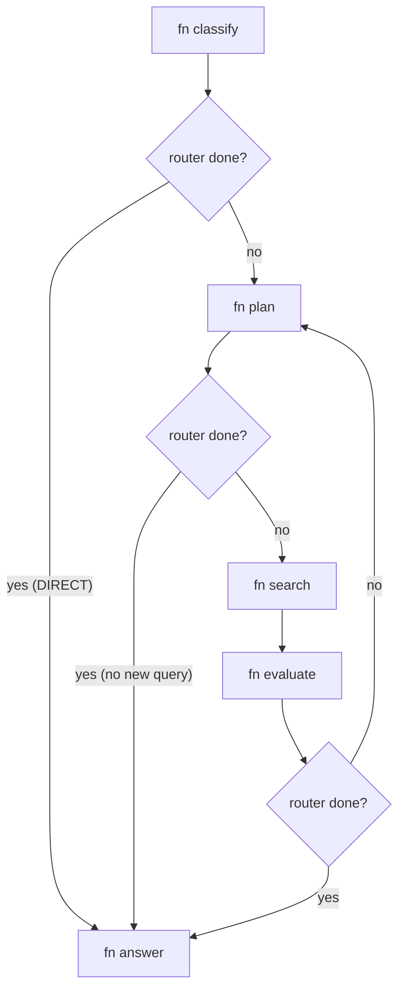

# Research loop

> Files: `src/inqtrix/graph.py`, `src/inqtrix/nodes.py`, `src/inqtrix/state.py`, `src/inqtrix/evidence.py`, `src/inqtrix/strategies/`, `src/inqtrix/prompts.py`, `src/inqtrix/report_profiles.py`

## Scope

This page explains how `mode=research` turns one question into a cited answer:
what the loop does, why it loops at all, how a search hit becomes evidence a
report may cite, and what makes the loop stop. Read it end to end — it is
written to be understood in one pass, not looked up.

It does **not** cover which model each stage calls
([LLM calls](nodes.md)), the knowledge/RAG engine that answers from your own
documents ([Knowledge engine](../knowledge-engine.md)), the workspace agent
that orchestrates whole missions ([Agent platform](../agent-platform.md)), or the
per-field reference for individual values ([Nodes](nodes.md),
[Evidence pipeline](evidence.md), and the detail pages beside it
([Stopping](stopping.md), [Answer composition](answer.md))).

Everything below is the default behaviour. No flag has to be set for the
research loop to run; the profiles in [Profiles](#profiles) only move budgets.

## The loop in one pass

Before any Inqtrix identifier: what actually happens is that the system asks a
search provider several questions, reads the answers, decides whether it now
knows enough, and — if it does not — asks better questions informed by what it
just read. It repeats that until an explicit criterion says stop, then writes
an answer that may only cite what it collected.

That is the whole idea. The rest of this page is how each of those steps is
made checkable.

### Why a loop instead of one search

A single retrieval pass cannot know what it missed. It returns the documents
closest to the question as asked, and nothing in that result set indicates
whether an important counter-source exists two phrasings away. The loop exists
so the stopping condition can be derived from the evidence that was actually
found, rather than from a fixed number of results.

That has a second consequence, and it is the more important one: the decision
to stop is built to be **adversarial toward the model's own confidence**. A
language model asked "is this enough?" will frequently say yes. So the raw
confidence value it reports is the *input* to a chain of deterministic checks,
every one of which can only lower it. There is no path by which a model talks
the loop into finishing early — with one narrow exception, named in
[The confidence value](#the-confidence-value-and-what-can-lower-it).

### Four things that are easy to confuse

Almost every misreading of this system comes from treating these four as the
same object. They are not, and their differences decide what may appear in an
answer.

| Object | What it is | What it is not |
|---|---|---|
| Search hit | One provider result: URL, title, snippet, date, rank. Provider-neutral raw data. | Not evidence yet, and not a fact — nothing has been checked. |
| `EvidenceRecord` | One row per *query × source*. The stored truth of a run, carrying source metadata, passages, and the claims found in that source. | Not one per URL and not one per claim — the same URL found by two queries produces two records. |
| Claim | One atomic, question-relevant assertion an LLM extracted from the text of a single search result, with a polarity (affirmed or negated). | Not a source and not a citation — a claim is an assertion *bound* to a source, and it can be wrong. |
| Citation | An `[E1]`-style label in the finished answer, assigned per canonical URL. | Not a claim. The answer writer never sees the consolidated claim list at all (see [From ledger to answer](#from-ledger-to-answer)). |

The two that matter most for reading a report: a **claim** is what someone
asserted, an **`EvidenceRecord`** is where it was found. Verification is a
statement about claims; citations are a statement about sources.

### Two invariants

**One mutable state per run.** Every node receives an `AgentState` (a
`TypedDict`), mutates it, and returns it. Nothing carries over between runs
except a `history` string. There is no shared memory between two questions.

**The evidence ledger is the only stored truth.** `state["evidence_ledger"]`
is the list of `EvidenceRecord`s. Everything else a reader sees — the claim
view, the rendered overview handed to the answer writer, the score ledger — is
a projection derived from it. When two views disagree, the ledger is right.

## The five nodes

The graph has five nodes and exactly one routing question: is `done` set?

The three diamonds are the same one-line router: `"answer" if state["done"]
else <next>`. No other field routes anything — not the round counter, not the
confidence, not the evidence count. Everything that decides whether to continue
does so by writing `done`, which is why the stopping logic is worth its own
chapter.

Note the missing arrow: `search` has **no** router. Even when `search` itself
decides the run is finished, control still flows to `evaluate`, which
recognises the situation and returns immediately — before the evaluator call
and before the guardrails. What it records is the generic reason `already_done`
for both shortcuts; which one fired, an empty query slice or an exceeded
deadline, is visible only in the iteration log's `skipped` field.

**`classify` — is a web search needed at all?** One LLM call decides the
language, the recency window and the question type, and decomposes the question
into up to three sub-questions. The answer contract and the list of aspects the
answer must cover come from beside it, out of the risk-scoring strategy —
deterministic keyword and profile logic, which is why they survive a classifier
failure untouched. If the model answers `DECISION: DIRECT`, the loop sets
`done` and jumps straight to `answer`: no search runs. Should the call *fail*,
the node explicitly does **not** take that shortcut — it continues with
deterministic defaults, because a broken classifier must not silently turn a
research question into an unsourced answer.

**`plan` — what to ask next.** One LLM call produces search queries and
nothing else; `plan` never calls the search provider. Queries are deduplicated
against everything already asked, and if deduplication leaves nothing new, the
node sets `done`. That is the second shortcut to `answer`, and it means an
exhausted question space ends the run without a special stop rule.

**`search` — turning results into evidence.** The heavy data stage, and the one
most often misdescribed. It makes **no reasoning LLM call**. It runs the
queries against the provider in parallel, then makes one claim-extraction call
per result that actually returned prose. Everything after that — consolidating
claims, projecting verification back onto records, assembling the ledger — is
deterministic Python. `search` is also the only node that increments the round
counter, so "round" means "completed search rounds".

**`evaluate` — is this enough?** One LLM call scores the collected evidence.
The node deliberately does not recompute the source and claim metrics; it reads
what `search` already produced in the same round. It then runs the confidence
caps and the stop heuristics, and decides whether to route back to `plan` or
forward to `answer`.

**`answer` — writing from the ledger.** No further searching. The answer is
written section by section from a single rendered evidence overview.

## One round in detail

### What `plan` puts in the query batch

Round width is `first_round_queries` for the first round and
`max(6, first_round_queries - 2)` afterwards. The floor of 6 dominates every
shipped profile, so all three run six later-round searches; only a
`first_round_queries` above 8 widens later rounds at all.

The queries are not free-form. `plan` builds explicit slots — gaps in aspect
coverage, cross-checks for claims that rest on a single source, primary-source
hunts, counter-evidence, and perspective slots that fill whatever width is
left over — and the prompt asks for one query per slot. If the model returns
too few, a deterministic fallback fills the remaining slots. The slot
machinery, not the model, is what guarantees the batch covers the weaknesses
the previous round exposed.

Two adaptive behaviours change a prompt rather than the code path. From round two
on, a low previous confidence adds a reformulation instruction to the planning
prompt, and an active falsification flag adds a mode that demands explicitly
disconfirming queries. A third sits in the *evaluator* prompt, not here: from
round two on — regardless of confidence — a block reminds the model that
"it does not exist" is a result, so an exhaustive search that found nothing is
not scored as a failed search.

### What `search` builds

Each provider result is split into two rows before anything else: a **source
record** per canonical URL (deduplicated, carrying the tier), and a **citation
record** per hit per query (carrying rank, title, snippet, date). One
`EvidenceRecord` is then assembled per citation record.

The claim-extraction call is constrained in a way that matters: **the model may
not output URLs.** It cites provider-local references — `[2]` for the second
source the provider listed — and the code resolves those to URLs itself. There
is exactly one path by which a claim acquires a source, and a model cannot
invent one.

A claim whose reference does not resolve is marked `unbound`, counted, and
surfaced as a warning. In practice it then disappears: claims attach to records
through their evidence IDs, and a claim with none attaches to nothing.

**A search hit with no extracted claim is not discarded.** A record is created
for every citation, claim or not, and a record counts as report-eligible as
soon as it has a canonical URL. Such a record is labelled *source context* and
the answer prompt describes it as usable but requiring inline attribution — not
as a confirmed fact.

### How a claim becomes verified

Claims are grouped by a **signature**: the claim text is tokenised, stopwords
and short tokens are dropped, and the first sixteen remaining tokens are
joined. Negations are removed on purpose, so that "X is rising" and "X is not
rising" share a signature and surface as a *contradiction within one group*
rather than as two unrelated topics. Direction is carried separately, in the
polarity field.

Status is then decided by the first matching rule, in this order:

| # | Condition | Result |
|---|---|---|
| 1 | Support and contradiction both present | `contested` |
| 2 | A primary source supports it | `verified` — primary |
| 3 | Two supporters from two non-low domains | `verified` — cross-checked |
| 4 | Two entries not marked as contradicting (or two distinct affirming domains), plus two distinct quality domains among all the claim's source URLs, whatever their polarity | `verified` — cross-checked |
| 5 | Two supporters including a primary, mainstream or stakeholder domain | `verified` — cross-checked |
| 6 | One supporter from a mainstream domain — a supporting primary source is already caught by rule 2, so it never decides here | `verified` — single quality source |
| 7 | The claim is a factual claim that needs a primary source and has none | `unverified` — missing primary |
| 8 | Anything else | `unverified` — weak evidence |

**Contradiction beats everything.** Rule 1 runs before every verification rule,
so a claim with primary support and a single counter-source is `contested`, not
`verified`.

**"Independent" means different things in different rules**, and this is the
easiest place to over-generalise. Rules 3 and 4 count *distinct registrable
domains* (eTLD+1, so two subdomains of one publisher are one witness), and a
syndicated reprint of an already counted snippet adds nothing. Rule 5 counts
*supporting entries*: two hits from the same mainstream domain reach it and
are recorded as cross-checked. The tier of a source feeds rules 2 through 7;
rule 2 also fires when a fact claim names the issuer of its own source
(`primary_basis="issuer:<label>"`).

### How sources are tiered

There are five tiers — primary, mainstream, stakeholder, unknown, low. A
source gets its tier once per run, in this precedence: the structural floor
(registry-class suffixes such as `.gov`, `.gv.at`, `.europa.eu`, `.edu`),
then the extractor's role judgement from the claim-extraction call
(`source_roles`: official/company/academic primary, reporting, commentary,
aggregator, low), else `unjudged` = unknown. No site lists; see
[Source tiering](evidence.md#tier-classification).

What a tier **does not** do is the part worth stating plainly, because the word
suggests otherwise: **a tier never admits or rejects evidence, and never
verifies a claim.** Even `low` is only sorted to the bottom of the rendering
order, never excluded. The only places where a low tier truly excludes
something sit outside the evidence chain entirely, in the supplementary link
list at the end of a report.

What a tier does do: it contributes to the ranking used when the evidence
overview is rendered, it feeds rules 2–7 of the status table above, and its
weighted average becomes one input to the stop signals.

## Why the loop stops

This is the question most often asked about a finished run, so it gets its own
chapter.

### The confidence value and what can lower it

The raw value comes from exactly one place: a `CONFIDENCE: <n>` line parsed out
of the evaluator's response. If the line is missing, the value becomes 5 and
the run records that it was not parsed — a visible degradation, not a silent
default.

Everything after that can only lower it. Three caps come from the model's own
other answers, seven are deterministic guardrails that read the collected
evidence:

| Cap | Fires when | Result |
|---|---|---|
| Contradictions | The evaluator reports contradictions | One or two below the stop threshold, by severity |
| Competing events | Confidence already at the threshold and the competing-event text is new (or before round 3) | One below the threshold |
| Evidence scores both zero | The evaluator reports consistency 0 and sufficiency 0 while confidence is already at the threshold | One below the threshold |
| No citations at all | The round produced none | At most 6 |
| Citations and ledger but no claims | Nothing could be extracted | At most 5 |
| Claims but none verified or contested | Nothing survived consolidation | At most 6 |
| Low-tier sources outnumber primary plus mainstream | and confidence above 7 | 7 |
| A claim needs a primary source and none exists | and confidence above 8 | 8 |
| Required aspects still uncovered | and confidence above 8 | 8 |
| Two or more contested claims | and confidence above 7 | 7 |

After the loop, the answer node applies one more ceiling derived from the
evidence contract: a failed algorithm caps at 3, a report resting only on
source context at 4, one flagged for review at 6.

**The one exception to "only lower".** If the evaluator call fails outright,
confidence is set to the previous value raised to at least 5 and then capped
two below the stop threshold — and the cap wins wherever it is lower, so the
result is 4 in `schnell`, 5 in `compact`, and 5 or 6 in `deep`. A run whose
evaluator is unreachable therefore lands on a fixed mid-range value instead of
inheriting an arbitrarily low one, but it cannot reach the threshold that would
stop it.

### The four stop heuristics

| Heuristic | Fires when | Effect |
|---|---|---|
| Stagnation | From round 2, confidence stuck at or below 4 and barely moving from a non-zero previous value, and either at least 30 citations gathered or falsification already triggered — but never in the same round falsification was armed | Stops |
| Plateau | From round 2, confidence unchanged, at least 6, and no active competing-event churn | Stops |
| Utility | The last two rounds both scored below 0.15 | Stops |
| Falsification | From round 2, confidence at or below 4 in two consecutive rounds | **Does not stop** |

Falsification is the odd one out and the most interesting: instead of ending
the run, it flips the next planning round into a disconfirming mode that
demands queries designed to *refute* the working hypothesis. A loop that cannot
raise its confidence is made to attack its own answer before it is allowed to
finish.

Two properties of the utility stop are worth knowing because they are easy to
misread. Its formula weights confidence gain, new citations, the evaluator's
sufficiency score, and newly verified claims. In the first round the confidence
term is fixed at a value that keeps the score above the threshold, and the stop
needs two consecutive low scores — so it cannot fire before round three, which
puts it out of reach for any profile capped below that.

Alongside the heuristics sit two direct comparisons in the node itself:
confidence at or above the stop threshold, and the round limit.

### The two vetoes

A stop decision is not final. Two conditions take it back:

- **Minimum rounds.** A run that stopped before reaching `min_rounds`
  continues, and the recorded stop reason is cleared.
- **Too little citable evidence.** A run that stopped while its ledger already
  holds records, but fewer report-eligible ones than the profile requires,
  continues. A completely empty ledger does not trigger the veto — it reads the
  ledger's contents, not its absence.

Both lose to the round limit — each is conditioned on the run being below
`max_rounds`, so the hard cap always wins.

### The evidence-depth gap

One diagnostic touches planning, stopping and writing at once, which is why it
is named here rather than buried. It looks at the consolidated claims and fires
when any of three things is true: at least three verified claims and none
cross-checked; at least three verified claims with a majority resting on a
single source; or a single central claim — one carrying a number or a
load-bearing term — verified by only one quality source.

Its three effects: `plan` adds a primary-source slot — aimed at the strongest
cross-check candidate, or at the question when there is none, and only while
the batch still has room — the plateau stop is suppressed while it is active
and rounds remain, and the answer prompt is told to write with the
corresponding reservation.

## From ledger to answer

The answer writer sees **one** view: a rendered Markdown overview built from
the ledger. There is no second evidence channel.

The filter into that view is deliberately wide — a record needs only to be
report-eligible and to resolve to a URL. There is no tier filter, no status
filter, no claim filter. Ordering, not exclusion, is what carries judgement:
records are grouped by query, ranked within a group by a score combining tier,
verification strength, claim density and passage count, and the groups
themselves are ordered by their best record. What a reader sees first is what
the run trusts most.

Budget is enforced group by group, and losing to it is visible rather than
silent: an omitted-record count is written into the prompt as an explicit note,
and a truncated source block says so inline.

Two facts about citations surprise most readers:

- **The model writes bare labels, never URLs.** `[E1]` is expanded to a
  Markdown link after synthesis, from the overview's own label table. A label
  with no entry becomes a visible "not assigned" marker instead of vanishing.
- **The allowlist is the set of visible blocks.** Links to anything not
  rendered into the overview are removed from the answer afterwards. A model
  cannot cite a source it was not shown.

And one that changes how to read a report: **the consolidated claim list never
reaches the answer prompt.** It goes to the evaluator only. The writer sees
claims solely as per-source lines inside each source block. Claims drive the
*stopping* decision; sources drive the *citations*.

## Profiles

Three profiles ship. They move budgets and bounds, never provider wiring.

| | `schnell` | `compact` (default) | `deep` |
|---|---|---|---|
| Maximum rounds | 1 | 2 | 3 |
| Minimum rounds | 1 | 1 | 2 |
| Confidence stop | 6 | 7 | 7 |
| First-round queries | 6 | 6 | 6 |
| Report-eligible evidence floor | 2 | 3 | 8 |

`schnell` exists for latency — quick lookups and agent child runs — and
defaults to a single round, so no multi-round heuristic applies unless the
caller sets `max_rounds` explicitly; an explicitly set field always wins over
the profile preset.

## Related docs

- [Nodes](nodes.md) — the per-node field reference behind this narrative.
- [Evidence pipeline](evidence.md) — record schemas and the rendering
  rules in full detail.
- [Stopping](stopping.md) — the cascade with
  every threshold spelled out.
- [LLM calls](nodes.md) — which model each stage calls, and why.
