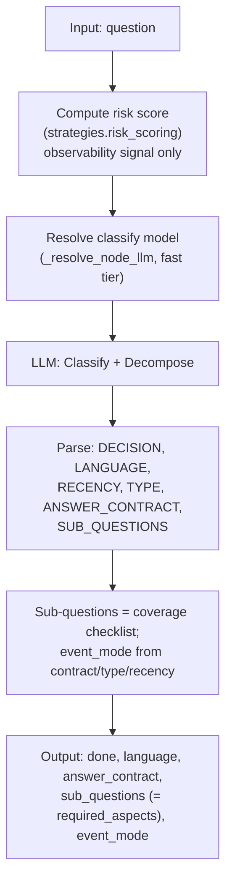
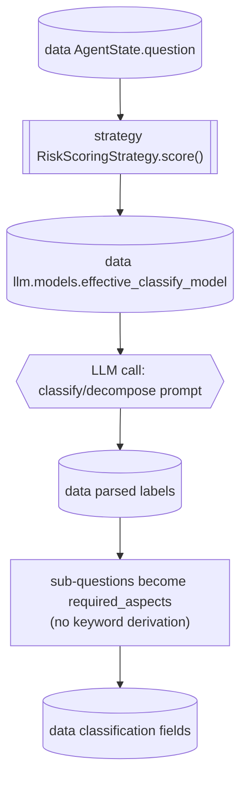
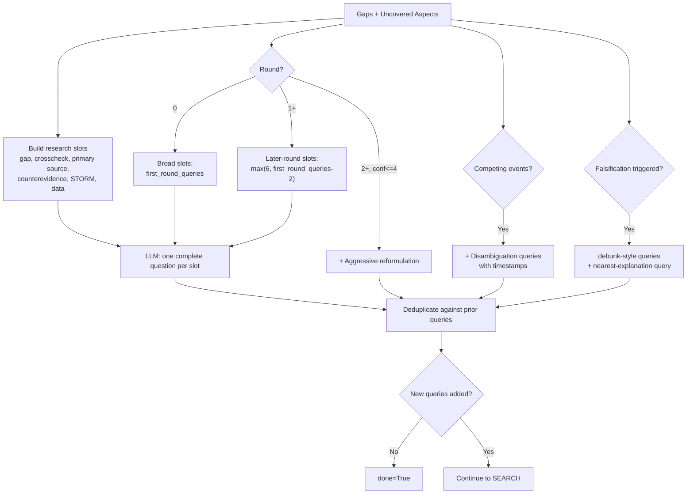
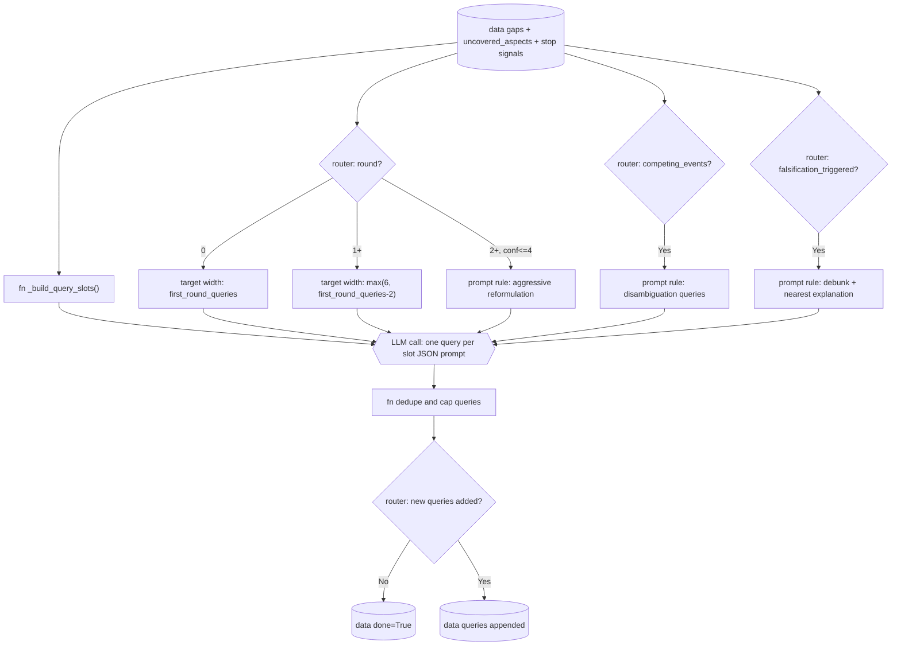
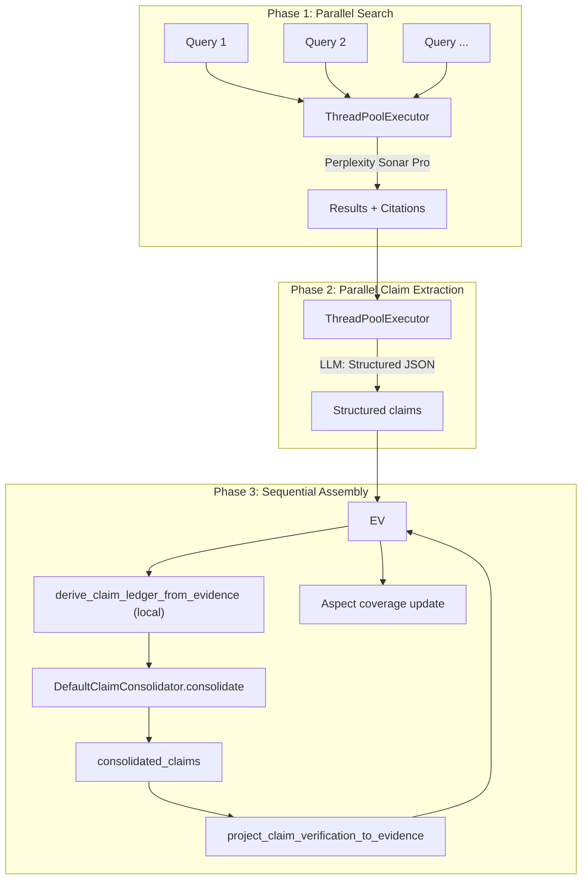
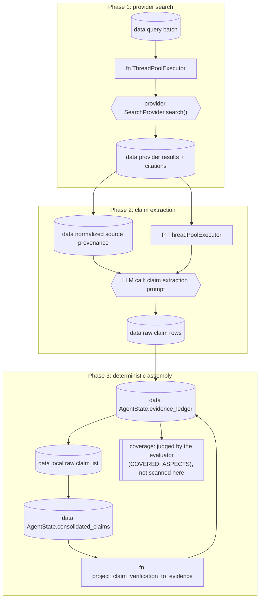
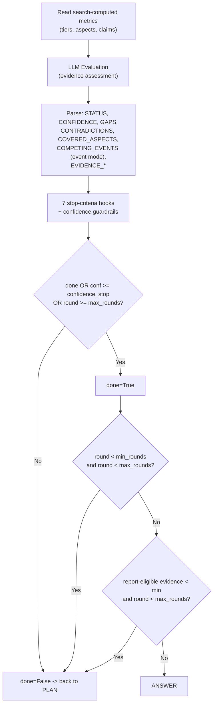
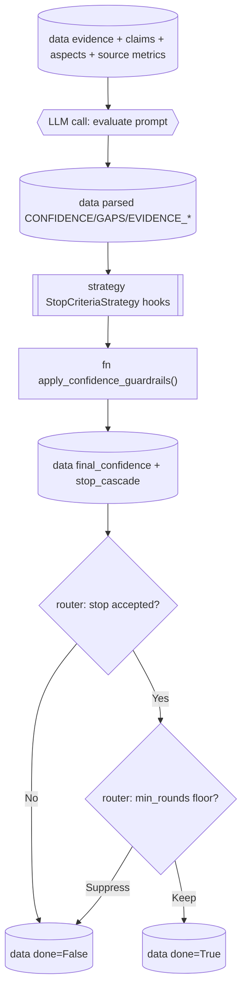
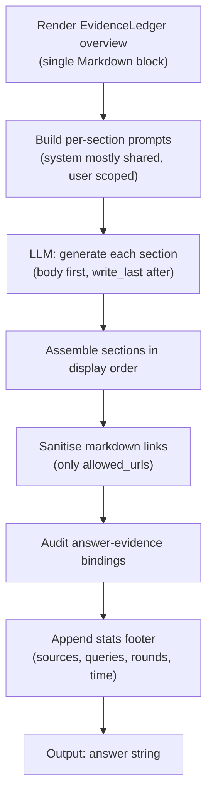
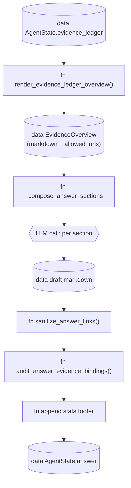

# Nodes

> File: `nodes.py`

## Scope

Per-node reference: purpose, control flow, LLM calls, state read/write, conditional strategies. For the loop as a whole, read [Research loop](loop.md) first. All five pipeline nodes (`classify`, `plan`, `search`, `evaluate`, `answer`) are covered here.

Read this page as the detailed procedure guide. For each node, separate four
things:

- **State fields** are stored on the mutable `AgentState` dict.
- **Provider calls** leave the pure Python runtime and talk to a search or LLM
  backend.
- **Strategy calls** are replaceable policy/algorithm helpers.
- **Routers** read `state["done"]` to decide the next node.

## LLM call inventory

This table answers: "Where does the model actually get called, and what is it
asked to produce?" Prompt text is mostly inline in `nodes.py`; the final answer
system prompt also uses `prompts.py`.

| Stage | Provider method | Model role | Prompt origin | Expected output | Parser / fallback |
|---|---|---|---|---|---|
| `classify()` | `LLMProvider.complete()` | `classify` node role (`fast` tier) | inline classification/decomposition prompt in `nodes.py` | fixed labels: `DECISION`, `LANGUAGE`, `SEARCH_LANGUAGE`, `RECENCY`, `TYPE`, `ANSWER_CONTRACT` (GENERAL / COMPARISON / CLAIM_CHECK / DATA_EXTRACTION / NEWS_BRIEFING; an unknown value falls back visibly to `general`), `SUB_QUESTIONS` | regex + JSON-list parser; fallback seeds conservative defaults and emits `_classify_fallback` |
| `plan()` | `LLMProvider.complete()` | reasoning/default model | inline query-planning prompt in `nodes.py` | JSON array of search-query strings | JSON-list parser; fallback uses the original question as a query and emits `_plan_fallback` |
| `search()` claim extraction | `ClaimExtractionStrategy.extract()` usually calls LLM | claim extraction | `LLMClaimExtractor` prompt | JSON claims per source | extractor validates and returns empty claims on non-fatal failures |
| `evaluate()` | `LLMProvider.complete()` | `evaluate` node role (`mid` tier) | inline evaluator prompt in `nodes.py` plus prompt suffixes | `CONFIDENCE`, `GAPS`, contradictions, competing events, evidence scores | regex parsing; conservative fallback emits `_evaluate_fallback` |
| `answer()` | `LLMProvider.complete_with_metadata()` | reasoning/default, optional fallback model | one call **per section**: section system + user prompt composed in `nodes.py` and `prompts.py`, grounded in the single record-driven evidence overview from `render_evidence_ledger_overview()` | Markdown section body with allowed citations | link sanitizer + evidence audit; visible fallback answer on timeout/provider failure. See [Answer composition](answer.md). |

## Node 1: `classify`

**Purpose.** Analyse the question, decide if web search is needed, detect language, decompose into sub-questions, derive required aspects, compute risk score.
This diagram answers: "How does the first node turn one user question into the
initial control and planning fields?"

Conventional flowchart


Typed flowchart


The transition out of `classify()` is controlled by `state["done"]`. `DIRECT`
sets `done=True`, so the graph routes straight to `answer()`. `SEARCH` leaves
`done=False`, so the next node is `plan()`.

### Risk scoring

Deterministic, regex-based (no LLM involved):

```text
risk(q) = I_recency + I_numeric + I_normative + I_long
```

| Family | Points | Triggers |
|--------|--------|----------|
| Recency | +1 | `aktuell`, `heute`, `neueste`, `zuletzt`, `diskussion`, `trend`, `ausblick`, `prognose` |
| Numeric | +1 | `prozent`, `mrd`, `mio`, `euro`, or any digit sequence (`\d+[%€]?`) |
| Normative | +1 | `soll`, `sollen`, `geplant`, `durchsetzbar`, `realistisch` |
| Long question | +1 | > 220 characters |

**High-risk flag.** Four independent `+1` families, so the reachable range is `0-4`. If `risk_score >= threshold` (default 4), the question is flagged `high_risk` — at the default that means all four families fired. This is an observability signal only (forensic events, `/health`, follow-up preservation); it does not change model selection — every node resolves its model via the model tiers (high/mid/fast) or a per-node override.

### Academic keyword override

If the LLM does not classify as academic but the text contains keywords like `paper`, `studie`, `preprint`, `doi`, `arxiv`, `peer-review`, the type is forced to `"academic"`.

### Fallback behaviour

- LLM call fails: heuristic type inference via `infer_query_type()` -- academic markers (`paper`, `studie`, `doi`, `arxiv`, `journal`, `peer-review`) win first, then news for recency keywords, otherwise general -- single sub-question = question verbatim, iteration-log marker `_classify_fallback` emitted, warning logged.
- Parsing fails partially: each missing field falls back independently; see `src/inqtrix/nodes.py` for the per-field rules.

Example state after `classify()`:

```python
{
    "language": "de",
    "search_language": "de",
    "recency": "week",
    "query_type": "news",
    "answer_contract": "news_briefing",
    "answer_contract_source": "llm",
    "event_mode": True,
    "risk_score": 4,
    "high_risk": True,
    "sub_questions": ["Was ist der aktuelle Stand der GKV-Reform?"],
    "required_aspects": ["Was ist der aktuelle Stand der GKV-Reform?"],
    "aspects_source": "llm",
    "done": False,
}
```

## Node 2: `plan`

**Purpose.** Generate search queries for the next research round, adapting to gaps and prior findings.

### Query count

| Round | Count | Rationale |
|-------|-------|-----------|
| 0 (first) | `first_round_queries` | Broad exploration |
| 1+ | `max(6, first_round_queries - 2)` | Targeted fan-out across gaps, cross-checks, and evidence-depth weaknesses |

The same internal helper is used by `plan()` and `search()`, so the number of
planned queries and the number of provider calls cannot drift apart. The floor
of 6 dominates every shipped profile: `schnell` and `compact` start at 6 and
`deep` at 8, so all three run **6** later-round searches. Only a
`first_round_queries` above 8 widens the later rounds at all.

### Adaptive strategies

All strategies listed below are additive — multiple can activate simultaneously.
This diagram answers: "Why does the next query batch look different from the
previous one?" Every box is a prompt instruction assembled by `plan()`.

Conventional flowchart


Typed flowchart


The graph routes to `search()` only when `plan()` appends at least one new
query and leaves `done=False`. If parsing succeeds but every query is a
duplicate or the planner cannot produce a useful query, `done=True` sends the
run directly to `answer()`.

| Strategy | Trigger condition | Effect |
|----------|-------------------|--------|
| Base diverse queries | Always | `first_round_queries` in round 0; `max(6, first_round_queries - 2)` in round 1+ |
| Query slots | Always | Builds one slot per intended search query; slot types cover gaps, cross-checks, primary-source search, counterevidence, STORM perspectives, and data verification |
| Alternative hypothesis (with temporal recency) | `round == 1` | One prompt block forces at least one query for alternative events/answers and one for the most current matching event, with an explicit 2-4 week window when the question says "recently" |
| STORM perspective diversity | Always as slot filler | Ensures unused slots become distinct perspectives instead of near-duplicate keyword searches |
| Aggressive reformulation | `round >= 2` AND `conf <= 4` | Completely rephrase using different terminology |
| Competing events disambiguation | `competing_events` set | Adds comparison instruction with timestamps |
| Falsification mode | `falsification_triggered` | At least two queries actively seek to disprove the premise; another query searches for the closest actual fact |
### Fallback behaviour

- LLM call fails: the parse seeds `[question]`, then the query slots built
  before the call (`_build_query_slots`, `nodes.py:427-545`) top the list back
  up to `target_query_count` (6 by default) with deterministic per-slot
  fallback questions via `_fallback_query_for_slot`; marker `_plan_fallback`
  emitted and `query_generation_mode="fallback_provider_error"` recorded.
- Parsed list empty or invalid JSON: the parser never returns an empty list —
  it returns the fallback with status `fallback_invalid_json_list`, and the
  slot loop tops it up the same way. `done=True` is set only when the dedupe
  against `s["queries"]` adds no new query (`added == 0`, `nodes.py:3046-3049`);
  in round 0 `s["queries"]` is empty, so even a failed parse leaves `done=False`.

## Node 3: `search`

**Purpose.** Execute queries in parallel, extract claims, assemble EvidenceRecords, derive claim/report views, and update context.

### Three-phase pipeline

This diagram answers: "What does `search()` actually build?" It is more than a
web-search call: the node first asks the search provider for results, then asks
the claim extractor to structure them, then derives the
internal ledgers used by evaluation and answer synthesis.

Conventional flowchart



Typed flowchart


Key transitions inside `search()`:

- Search results become normalized query/source/citation records.
- Claim extraction receives provider-neutral source provenance (URL, title,
  snippet, date, origin) when the provider exposes it; this keeps Azure and
  Perplexity shapes distinct at ingestion but common downstream.
- Extracted claims and provider source context are attached to `EvidenceRecord` rows.
- `evidence_ledger` is the **only persisted primary truth**. The raw claim
  list is a local variable inside `search()`, `consolidated_claims` is the one
  persisted claim view used by `plan`/`evaluate`. After consolidation,
  `project_claim_verification_to_evidence()` writes each claim's
  verification standing back onto the record it came from -- so the ledger
  is self-describing.
- There is no separate `context`, `claim_ledger`, `report_evidence_bundles`,
  `selected_report_evidence`, `unverified_evidence_notes`, or
  `prompt_evidence_units` state field. The answer composer reads one
  rendered Markdown overview from `render_evidence_ledger_overview()` -- see
  [Evidence pipeline](evidence.md#rendering-evidenceledger--markdown).
- A round with `claims=[]` is **not** degraded -- claimless records carry
  snippets, passages, and citations and are rendered as
  `source-context` blocks in the overview.
- The next graph node is always `evaluate()` because `search()` increments
  the round and writes the data evaluation needs.

### Search parameters (per call)

| Parameter | Value | Source |
|-----------|-------|--------|
| `search_context_size` | `"high"` | Maximum depth |
| `recency_filter` | explicit `web_recency` from the caller, else from classify | `"hour"`, `"day"`, `"week"`, `"month"` or `""`; a caller override may also be `"year"` and always wins over the classifier |
| `language_filter` | from classify | `["de"]`, `["en"]` |
| `domain_filter` | computed per query | Allowlist extracted `site:` domains |
| `search_mode` | `"academic"` if applicable | For scholarly sources |
| `return_related` | `True` on round 0 | Seeds future queries |

Before dispatch, the search node filters these hints through the active provider's capability metadata. Providers may expose either `supported_search_parameters` or `search_capabilities`; unsupported hints are omitted instead of being sent to a backend that cannot express them. The iteration log records the resolved `supported_parameters` list for each run.

### Domain filter logic

- Query contains one or more `site:domain` operators → allowlist all extracted domains.
- Otherwise → no domain filter. Source tiering classifies results after search
  instead of silently constraining the source pool before retrieval.

### Search caching

The search node caches nothing. Caching is a provider property: `PerplexitySearch`
keys a SHA-256 of query plus params and holds entries in a lock-guarded TTL
cache whose constructor defaults are 256 entries and 3600 seconds. Another
search provider may cache differently or not at all.

### Evidence and claim view caps

The search node writes the `evidence_ledger` first. The raw claim list and
`consolidated_claims` are deterministic projections from that ledger;
`search()` does not run a separate semantic-grouping LLM call.

The raw claim list (derived from `EvidenceRecord.claims[]` via
`derive_claim_ledger_from_evidence`) is a local variable in `search()` and is
not persisted on `AgentState`. The persisted `consolidated_claims` list is
grouped by `DefaultClaimConsolidator.consolidate()` and then narrowed by
`DefaultClaimConsolidator.materialize()` with the profile caps
`materialize_max_total` (16 SCHNELL / 24 COMPACT / 48 DEEP) and
`materialize_max_unverified` (6 SCHNELL / 8 COMPACT / 48 DEEP).

Valid empty claim extraction is a visible but non-fatal state. When search
answers and citations exist but the extractor returns `claims=[]`, the search
iteration records `claim_valid_empty` / `_claim_extraction_empty`, and
`query_summary` records `claim_extraction_valid_empty`. Invalid or
token-limited claim JSON counts as `ALGO-FAIL claim_extraction` via
`claim_fallbacks`. If every claim-extraction call across a forensic/deep run
fails, the answer node returns a diagnostic report instead of composing a
normal report from unaudited source context.

Example state after `search()`:

```python
{
    "round": 1,
    "queries": ["What did the health ministry publish about ..."],
    "all_citations": ["https://www.bundesgesundheitsministerium.de/..."],
    "evidence_ledger": [{"evidence_id": "ev_...", "record_type": "source"}],
    "consolidated_claims": [
        {
            "claim_id": "claim_...",
            "status": "attributed",
            "verification_basis": "cross_checked",
            "supporting_evidence_ids": ["ev_...", "ev_..."],
        }
    ],
    "source_quality_score": 0.8,
    "claim_quality_score": 0.9,
    "evidence_depth_gap": {"active": False, "supported_count": 4, "cross_checked_count": 3, "single_source_count": 1, "single_source_ratio": 0.25},
}
```

### Fallback behaviour

- Search provider fails for a query: that query is dropped, the remaining queries continue.
- Claim extraction fails for a result: kept without structured claims; the iteration log records `ALGO-FAIL claim_extraction`. Full-run failure in forensic/deep mode blocks normal report synthesis.

## Node 4: `evaluate`

**Purpose.** Score evidence quality, check stopping criteria, decide whether to continue.
This diagram answers: "How does evidence become `done=True` or `done=False`?"
The LLM produces evaluator text; strategy hooks and deterministic guardrails
turn it into stored stop signals.

Conventional flowchart


Typed flowchart


The seven ordered `StopCriteriaStrategy` hooks -- three before `apply_confidence_guardrails()` and four after -- are detailed in [Stopping](stopping.md). Relevant markers emitted by this node:

- `_confidence_parsed` — whether `CONFIDENCE: N` was parsed successfully.
- `_evidence_consistency_parsed` / `_evidence_sufficiency_parsed` — arithmetic sanity signals.
- `_evaluate_fallback` — LLM call failed; node derives a conservative fallback confidence and records conservative gaps.

`STATUS: SUFFICIENT|INSUFFICIENT` is requested in the evaluate prompt for evaluator discipline, but stop logic is driven by parsed numeric/text signals (`CONFIDENCE`, `GAPS`, contradiction/event/evidence fields) plus deterministic guardrails and post-LLM heuristics.

Example state after `evaluate()`:

```python
{
    "final_confidence": 6,
    "evidence_consistency": 8,
    "evidence_sufficiency": 6,
    "gaps": "Need one primary source for the cost estimate.",
    "done": False,
    "_stop_reason": "",
    "falsification_triggered": False,
}
```

If `done=False`, the router returns to `plan()` and the next query prompt reads
`gaps`, `uncovered_aspects`, `competing_events`, and
`falsification_triggered`. If `done=True`, the router moves to `answer()`.

## Node 5: `answer`

**Purpose.** Synthesise the final answer one section at a time from the
single record-driven evidence overview, then audit the resulting citations.
This diagram answers: "How does the EvidenceLedger become the final Markdown
answer returned to the caller?"

Conventional flowchart


Typed flowchart


The answer node does not perform new search. It renders the single canonical
evidence overview from the ledger (see [Evidence pipeline — Rendering](evidence.md#rendering-evidenceledger--markdown)),
invokes the section composer (one LLM call per section, body sections first
and `write_last` sections like `executive_summary` / `summary` afterwards),
sanitizes citations so only URLs in `allowed_urls` remain, then audits
whether the cited URLs map back to EvidenceRecords.

### Answer composer (one LLM call per section)

The section composer is a meaningful sub-pipeline on its own and gets its
own dedicated page: [Answer composition](answer.md). In summary:

- `_compose_answer_sections()` in `nodes.py` iterates
  through the active `AnswerSectionSpec` list and issues **one LLM call per
  section**.
- The **system prompt** is built by `_build_answer_system_prompt_with_style()`
  with `section_heading` set. Its bulk is shared across all section calls (full
  `evidence_overview` + conditional CLAIM CALIBRATION / EVIDENCE DEPTH blocks +
  CITATION RULES), but two blocks depend on the section, so the system prompt
  is not byte-identical between sections:
  - **TRANSPARENCY OBLIGATION** (fires when the evidence is weak): only the
    section that owns the evidence limits (`owns_evidence_limits` in the
    section plan, `evidence_limits_section_index()`) gets the directive to add
    an uncertainties block (`### Unsicherheiten / Offene Punkte` /
    `### Uncertainties and open points`, resolved to the answer language);
    every other section gets the inverse instruction not to open its own block.
  - **SUB-QUESTION COVERAGE** (fires when `required_aspects` is set): the same
    ownership decides whether open sub-questions are pointed at the risks
    section or marked inline with the language's unconfirmed marker
    (`(unbestätigt)` / `(unconfirmed)`).
    An **ANSWER FORM** block follows for the `comparison`, `claim_check`,
    `data_extraction` and `news_briefing` contracts (`answer_contract_block`).
  Beyond those two, only the section-specific style block (heading, position,
  length guidance) changes.
- The **user prompt** is built per call by
  `build_answer_section_user_prompt()` in `prompts.py` and carries the
  section's focus hint, the running `report_so_far_summary`, the
  accumulated `used_evidence_labels`, and the `synthesizing_existing`
  flag for write-last sections.
- **Write order ≠ display order.** Sections with `write_last=True` (DEEP
  `executive_summary`, COMPACT `summary`) are written **after** the body
  sections, so they can see the body via `report_so_far_summary`. They are
  re-assembled at their declared display index, which is why the Executive
  Summary still appears at the top of the answer.

### Citation allowlist

Citations are restricted to `EvidenceOverview.allowed_urls` -- the union of
canonical URLs whose source blocks are visible in the EvidenceOverview.
The link sanitizer (`sanitize_answer_links`) strips Markdown links to any
other URL. `answer_prompt_citations_max` (40 SCHNELL / 60 COMPACT /
500 DEEP) is declared on `AgentConfig` and `AgentSettings` and set by every
profile, but nothing in `src/` reads it; the number of citable URLs is
bounded only by `EvidenceOverview.allowed_urls`, which the record and total
character budgets of `render_evidence_ledger_overview()` decide. There is no
parallel numbered citation map -- labels are `[E1]`, `[E2]`, …, defined by
`label_urls` from the renderer.

### Answer format (headings follow the answer language)

Section list per profile is defined in
`src/inqtrix/report_profiles.py::_COMPACT_ANSWER_SECTIONS` and
`_DEEP_ANSWER_SECTIONS`. Every section has a language-independent `key`;
the `##` heading the composer writes is `heading(language)`, resolved
through `HEADINGS` in `prompt_language.py` (German and English tables,
English fallback). The prompts themselves are English.

COMPACT (4 sections; `summary` is `write_last=True`):
- `summary` (Kurzfazit / Summary) — executive summary; written last, no bullet points.
- `key_points` (Kernaussagen / Key points) — bullet points with citations.
- `detail_analysis` (Detailanalyse / Detailed analysis) — sub-sections with evidence.
- `context_outlook` (Einordnung / Ausblick / Context and outlook) — context and outlook; owns the evidence limits.

DEEP (6 sections; `executive_summary` is `write_last=True`):
- `executive_summary` (Executive Summary / Executive summary)
- `background` (Hintergrund / Kontext / Background and context)
- `analysis` (Analyse / Analysis)
- `perspectives` (Perspektiven / Positionen / Perspectives and positions)
- `risks` (Risiken / Unsicherheiten / Risks and uncertainties) — owns the evidence limits
- `conclusion` (Fazit / Ausblick / Conclusion and outlook)

Length is steered by per-section `length_guidance` in the spec, not a fixed
word target.

If no report-eligible records exist but source-context records do, the final
footer reports `Evidence-Contract: source_context_only`, not a
missing-evidence failure. Forensic/deep runs still block normal report
synthesis when claim extraction failed for the whole run.

### Section composer memory

For multi-section reports, `_compose_answer_sections()` carries two
deterministic memory fields between calls:

- `report_so_far_summary`: rolling 2400-char compaction of already rendered
  sections (heading + 900-char whitespace-normalized body per section), via
  `_compact_section_summary()`.
- `used_evidence_labels`: citation labels (`E1`, `E12`, …) already used in
  earlier sections, extracted via `_extract_evidence_labels()` regex.

Before each section, `select_section_evidence_records()` in
`src/inqtrix/evidence.py` picks a small label hint list based on the section
heading, required aspects, and already used labels (already-used labels get a
`-16` ranking penalty to spread coverage). The result is passed into the
user prompt as `section_focus_labels` -- a **soft hint**, not a filter: the
LLM still sees the full evidence overview in the system prompt and may cite
any allowed URL. See [Answer composition](answer.md) for the
exact prompt structure.

### Fallback behaviour

The answer node has three distinct LLM-call fallback paths and all of them are surfaced, because a fallback is never silent. Each path emits a `log.warning(...)` line, a `progress` event on the user-visible queue, an iteration-log marker (`_answer_fallback=True` plus a structured `_answer_fallback_kind` and `_answer_fallback_reason`), and prepends a visible `> [!WARNING] Antwort-Synthese-Fallback aktiv` block to the answer body so the degradation is also visible in the rendered markdown:

| `_answer_fallback_kind` | Trigger | Replacement body |
|---|---|---|
| `timeout` | `_compose_answer_sections` raised `AgentTimeout` | Visible warning header + the rendered EvidenceLedger overview (`evidence_overview.markdown` from `render_evidence_ledger_overview()`) verbatim, or a "no context yet" hint (`no_context_message`) when that overview is empty. |
| `no_fallback_model` | `_compose_answer_sections` raised a provider API error outside strict algorithm mode and `_resolve_answer_fallback_model()` returned `None` — the `evaluate` node's resolved model (the `mid` tier) is either empty or identical to the primary answer model | Same as `timeout`. |
| `fallback_model_failed` | The primary call raised, the fallback model was attempted (`emit_progress("answer_fallback_model")`), and the fallback model also raised. | Same as `timeout`, plus the original primary error class is included in `_answer_fallback_reason`. |

In strict algorithm mode -- `report_profile` DEEP **or**
`observability_profile=forensic`, see `_strict_algorithm_failure_mode()` --
none of these three paths run: a timeout or provider error inside the answer
node is recorded as a blocking algorithm failure and answered with the
`Evidence-Contract: algorithm_failed` diagnostic report, whether or not a
fallback model resolves.

A successful fallback-model attempt sets `fallback_attempted=True`, `fallback_succeeded=True`, leaves `_answer_fallback=False`, and is signalled by the `answer_fallback_model` progress event only.

This is separate from `ALGO-FAIL` handling. Blocking algorithm failures
(`claim_extraction` always, `evidence_overview` only under
`strict_algorithm_mode`) do not produce a
normal answer fallback; the node returns a short diagnostic report with
`Evidence-Contract: algorithm_failed` and pins confidence to 3 via
`min(final_confidence or 3, 3)` -- a higher value is capped down, an unset or
zero value is raised to 3.

## Per-node read/write summary

| Node | Reads | Writes |
|------|-------|--------|
| classify | `question`, `history` | `language`, `search_language`, `recency`, `query_type`, `answer_contract` (+ `answer_contract_source`), `event_mode`, `sub_questions`, `risk_score`, `high_risk`, `required_aspects` (= the sub-questions, `aspects_source`), `uncovered_aspects`, `aspect_coverage`, `done` |
| plan | classification fields, `final_confidence`, `gaps`, `falsification_triggered`, `competing_events`, `queries`, `round`, `evidence_depth_gap` | `queries` (appended), query-slot diagnostics, `done` if no useful new queries |
| search | next query batch, search hints, existing evidence/claims | `query_records`, `source_records`, `provider_citation_records`, `evidence_ledger`, `consolidated_claims`, `all_citations`, `source_quality_score`, `claim_quality_score`, `evidence_depth_gap`, `round` |
| evaluate | evidence, claims, aspects, source metrics, previous confidence | `final_confidence`, `gaps`, `competing_events`, `evidence_consistency`, `evidence_sufficiency`, `evidence_depth_gap`, `done`, `falsification_triggered`, `utility_scores`, `_stop_reason` (runtime dict key), `stop_cascade`, `score_ledger` |
| answer | Everything from the prior nodes | `answer`, `answer_finish_reason`, `answer_incomplete`, `answer_incomplete_reasons`, `final_confidence` (algorithm-failure pin and evidence-contract cap), `evidence_contract_status`, visible citation allowlist / label fields, `answer_claim_bindings`, `answer_evidence_bindings`, iteration log entries, token totals |

## Cancel and deadline

Every node reads `_cancel_event` via `check_cancel_event(state)`; if the event
is set, an `AgentCancelled` exception terminates the run at the next node
boundary. `deadline` is a monotonic timestamp used to shrink per-call
timeouts; see [Timeouts and errors](../../observability/forensic-cookbook.md#timeouts-and-errors).

## LLM calls, model tiers, and reasoning effort

### 1. What each LLM call does, and what it sees

All prompt templates are German (see
[`prompts.py`](../../../src/inqtrix/prompts.py)); the descriptions below are in
English.

| Call site | Concrete task | Prompt / template | Most important context fed in | Output + parsing | Volume |
|---|---|---|---|---|---|
| **classify** | Decides SEARCH vs. DIRECT; detects input language, optimal search language, recency (NONE/HOUR/DAY/WEEK/MONTH) and type (GENERAL/ACADEMIC/NEWS); names the answer form (`ANSWER_CONTRACT`: GENERAL / COMPARISON / CLAIM_CHECK / DATA_EXTRACTION / NEWS_BRIEFING) and **decomposes** the question into 1-4 content sub-questions that become the coverage checklist. | Inline prompt in [`nodes.py`](../../../src/inqtrix/nodes.py) (no separate system prompt). | `question`, today's date. | `KEY: VALUE` lines (DECISION/LANGUAGE/SEARCH_LANGUAGE/RECENCY/TYPE/ANSWER_CONTRACT) + a `SUB_QUESTIONS` JSON array; an unknown contract falls back visibly to `general`. Regex + JSON parse with visible fallbacks. | 1× per run |
| **plan** | Generates N new search queries for the next round; chooses strategy (breadth vs. depth vs. falsification vs. cross-check). | Inline prompt + **conditional strategy fragments** (see below). | `question`, `sub_questions`, `required_aspects`, `uncovered_aspects`, `gaps` (previous round), prior `queries`, `round`, `search_language`, `competing_events`, `final_confidence`, `falsification_triggered`, evidence-ledger size. | Strict JSON array of strings. JSON parse with status + slot fallback. | 1× per round |
| **evaluate** | Scores confidence (1-10), names gaps, detects contradictions / competing events, estimates evidence consistency + sufficiency; drives the stop decision. | Inline prompt + `build_evaluate_format_suffix(event_mode, aspect_count)` (COMPETING_EVENTS only in event mode, COVERED_ASPECTS only with sub-questions). | `question`, the **compact evidence-ledger overview** (every report-eligible source: header + claim lines, no passages, under the profile's full evidence budget), `required`/`uncovered_aspects` + coverage, `source_tier_counts`, consolidated claims + status counts, evidence-depth gap, previous-round `final_confidence`/`gaps`. | `KEY: VALUE` (STATUS/CONFIDENCE/GAPS/CONTRADICTIONS/COMPETING_EVENTS/EVIDENCE_*). Regex + stop-strategy heuristics + guardrails. | 1× per round |
| **answer** (per section) | Writes one markdown section of the final report with `[E*]` citations; iterates over the report profile's sections — 2 in `schnell`, 4 in `compact`, 6 in `deep`, each seeing the running report. The count is an upper bound: composition aborts after two consecutive empty sections (`_MAX_CONSECUTIVE_EMPTY = 2`). | `build_answer_section_system_prompt(...)` + `build_answer_section_user_prompt(...)`; full system prompt with style/safety/citation rules. | `question`, the **full evidence overview** + allowed citations + label map, source/claim metrics, `required`/`uncovered_aspects`, `competing_events`, conversation `history`, completed headings, report-so-far summary, used evidence labels, the section spec. | Free markdown: `###` subheadings and prose with `[E12]` citations. The `## <heading>` line is added by the composer, and the section prompt explicitly forbids the model from writing it. Normalisation + markdown repair + incompleteness detection. | up to 2-6× per run (doubled at most once when the answer-fallback model re-composes after a synthesis failure) |
| **claim_extract** | Extracts checkable single claims per search hit (`claim_text`, `evidence_snippet`, `claim_type`, `polarity`, `needs_primary`, `provider_refs`; the search node dates the claim from the bound citation) and judges every source of the card once (`source_roles`: who speaks, with a short reason; pinned in the run's source registry). | `build_claim_extraction_prompt(max_claims)`. | `question`, the **search hit full text** (capped by the active report profile: 16k chars in `schnell`, 24k in `compact` — the default — and 48k in `deep`), normalised citations, source-ref map, `max_claims`. | JSON schema via `complete_structured` (with a JSON fallback). Reasoning follows the **fast** tier's effort (`tier_fast_effort`; unset/`none` by default → no reasoning). | 1× per search hit (5-50+) |
| **direct_chat** | Answers directly without research on the `skip_search=true` short-circuit, which bypasses the classify/plan/search/evaluate/answer graph entirely (the conversational path). A `DECISION: DIRECT` from classify never reaches this call site: it sets `done` and routes classify → answer. | `_DIRECT_CHAT_SYSTEM_PROMPT` (role sentences + the shared `OUTPUT_FORMAT_BLOCK` and `WRITING_STYLE_BLOCK` from `prompt_language.py`) + a formatted prompt whose first line is the language directive, in [`graph.py`](../../../src/inqtrix/graph.py). | `question`, conversation `history`. | Free text. | 1× per run (`skip_search` only) |
| **knowledge_contextualize** (ingestion) | Generates the situating prefix for each chunk of a document being indexed (`retrieval_context`). Enriches the *index* text only; the prefix never reaches an answer or a citation. | `build_chunk_context_prompt(...)`. | Document head, the target chunk span, and bounded neighbouring text; every batch window contains the full source span of the chunks it describes. | Strict JSON via `complete_structured` (`complete_with_metadata` otherwise); a validated batch checkpoints independently. A dependency failure pauses the job (`paused_dependency`), malformed output pauses it (`paused_validation`) — never a silent raw build. | `ceil(chunks / effective batch size)` **per document at ingestion** (≤25 chunks per call, ≤3 batches concurrent); 0 when `INQTRIX_KNOWLEDGE_CONTEXTUALIZE=off`, the default |
| **knowledge_contextualize** (per request) | Rewrites a Knowledge Ask follow-up into a standalone retrieval query. Same node id and tier as the ingestion call above, different call site. | `build_knowledge_followup_context_prompt(question, history)`. | Current user question plus formatted conversation history; history is context only, not evidence. | Strict JSON object with `question`; provider/parse failures fall back loudly to the original question with `_knowledge_query_context_fallback`. | 0-1× per `mode=knowledge` run |
| **knowledge_decompose** | Splits a deep-profile knowledge retrieval query into independent sub-queries. | `build_knowledge_decompose_prompt(question)`. | Standalone retrieval query. | Strict JSON array; parse failure degrades to no split with a visible marker. | 0-1× per `mode=knowledge` run |
| **knowledge_rerank** | Listwise reordering of retrieved candidates when no rerank API is configured. Produces an order, not a calibrated relevance score. | `build_knowledge_rerank_prompt(query, documents)`. | Retrieval query plus at most 20 candidate texts, each truncated to 800 characters; the cap is enforced with a visible log line. | Strict JSON object with `ranking` (1-based), parsed by `_parse_ranking`. Unparseable JSON, out-of-range, duplicate, or incomplete indices raise `RerankerError` — a broken stage fails loudly, exactly like a broken rerank API. | 0-1× per retrieval call, only when `INQTRIX_RERANKER_PROVIDER=llm` |
| **knowledge_gate** | Judges whether retrieved `[K#]` evidence is sufficient and may propose a rewritten query. | `build_knowledge_gate_prompt(...)`. | Standalone retrieval query and rendered evidence block. | Strict JSON object; parse failure fails open with `_knowledge_gate_fallback`. | 0-N× per `mode=knowledge` run |
| **knowledge_answer** | Synthesises the cited Knowledge answer. | `build_knowledge_answer_prompt(...)`. | Original user question, optional conversation history, and current `[K#]` evidence excerpts. | Markdown answer, optionally preceded by a quote block verified by `grounding.py`. | 0-2× per `mode=knowledge` run — 0 when retrieval returned no usable candidates, otherwise one call plus at most one visible regeneration after a quote-unverified grounding rejection (`_ANSWER_GROUNDING_ATTEMPTS = 2`) |

**plan — conditional strategy fragments** (appended depending on state):
perspective-diversity (STORM), deep-review, alternative-hypothesis (round 1),
competing-events, reformulation (round ≥ 2 and confidence ≤ 4), falsification,
answer-contract, cross-check, query-slots, language-directive. The *strategy*
lives largely in the prompt, not the model — which is why a capable
non-thinking model is enough for `plan` (see the tier rationale below).

> Not part of the research flow: the parity diagnostic tool
> ([`parity/_analysis.py`](../../../src/inqtrix/parity/_analysis.py)) uses
> `reasoning_model` directly and is out of scope for the tier system. It still
> consumes the effective `settings.agent.reasoning_timeout`; it is not a
> separate timeout authority.

---

### 2. The three tiers and how nodes map to them

A node is mapped to a tier by the hard-coded `NODE_TIER_ASSIGNMENT` constant,
which holds 25 entries — 8 on **high**, 8 on **mid**, 9 on **fast**. The table
below lists all 25. One further routed call site, `agent_memory_reflection`, has
no entry and therefore falls back to the default tier **mid**.

Per-node model overrides exist for exactly six nodes — `classify`,
`claim_extract`, `evaluate`, `plan`, `answer` and `direct_chat`
(`CLASSIFY_MODEL`, `CLAIM_EXTRACT_MODEL`, `EVALUATE_MODEL`, `PLAN_MODEL`,
`ANSWER_MODEL`, `DIRECT_CHAT_MODEL`). Every `knowledge_*` and `agent_*` node has
no such field, so `<node>_model` resolves empty there and the tier decides.

| Call site | Default tier | Recommended effort | Rationale |
|---|---|---|---|
| **answer** | **high** | reasoning **on** | Final synthesis, largest quality lever, large context. The one path where extended thinking clearly pays off. |
| **plan** | **mid** | none | Strategy is scaffolded by the prompt; a capable non-thinking model suffices. Thinking would add latency to every round for marginal gain. |
| **evaluate** | **mid** | none | Confidence calibration; mid is capable enough and heuristics/guardrails carry much of the work. |
| **classify** | **fast** | none | Classification + decomposition; small models are reliable here; 1× per run. |
| **claim_extract** | **fast** | none | Highest volume (1× per hit) — the biggest cost lever; strict-schema extraction where reasoning hurts. |
| **direct_chat** | **mid** (request-selectable) | none | Single conversational call; mid balances quality and latency. Selectable per request via `model_tier`. |
| **session_title** | **fast** | tier default | One optional short topic label alongside the answer. Requires a dedicated Fast-tier model; no fallback to the main reasoning model. |
| **knowledge_contextualize** | **fast** | none | Two call sites share this node: the per-document ingestion prefix (highest knowledge volume — one call per chunk batch, so the tier choice dominates indexing cost) and the cheap follow-up query rewrite. Neither produces evidence; the answer still relies on retrieved `source_text`. |
| **knowledge_decompose** | **fast** | none | Small structured rewrite task; deep-profile only. |
| **knowledge_rerank** | **fast** | none | Listwise ordering over a capped candidate list. Roughly an order of magnitude costlier and slower than a cross-encoder rerank API, which is why it is the fallback rather than the recommended path. |
| **knowledge_gate** | **fast** | none | Repeated structured sufficiency checks; cost-sensitive and prompt-scaffolded. |
| **knowledge_answer** | **high** | reasoning **on** | Final cited synthesis over retrieved evidence, largest quality lever in Knowledge mode. |
| **agent_intake** / **agent_sufficiency** | **fast** | none | Workspace-agent assignment classification and coverage checks. |
| **agent_discovery_analyst** / **agent_contradiction** / **agent_file_analysis** | **mid** | none | Compression and comparison work: probe digests, contradiction checks, and the per-window extraction and reduce of a whole-document analysis. |
| **agent_plan** / **agent_synthesis** | **high** | none | The workspace agent's leverage points: executable planning and cited memo sections. |
| **agent_kernel** | **high** | none | The kernel's own reasoning loop; in `mode=agent_kernel` this is the node a per-run override targets (see section 5). |
| **agent_answer** | **high** | none | The workspace agent's final answer — an override-scoped thinking node (see section 5). |
| **agent_answer_light** | **mid** | none | The lighter answer variant; also override-scoped (see section 5). |
| **agent_patch** | **mid** | none | Bounded structured edits to existing text. |
| **agent_deep_review** | **high** | selected or tier default | The one review of both agent engines: the mission's memo or answer and the kernel's Deep outputs, judged against assignment, success criteria and evidence — as one structured call or as the review role. After a revision it also re-checks each applied edit of a model finding in one structured call (schema `RevisionCheckVerdict`): one row per segment the server lists, from which the server settles each edit; when that call holds an edit, a second call with the same request confirms it, and only an edit both hold counts as re-checked. Follows the selected model and effort without inheriting the kernel loop's automatic Deep effort increase. |
| **agent_skill_point_check** | **fast** | none | Structured per-point skill check; likewise pinned to the tier map (see section 5). |

`agent_citation_repair` is not in this table because it is not a routing node: it
has no `NODE_TIER_ASSIGNMENT` entry and exists only as a telemetry label. The
sole bounded repair of an unknown citation label reuses the model its caller
(`agent_synthesis`, `agent_answer`, or the kernel) already resolved.

Default tier effort is **unset** for every tier, so out of the box tiers differ
only by *model* and nothing gains implicit reasoning. Turn reasoning on
deliberately, e.g. `TIER_HIGH_EFFORT=medium` for `answer`.

---

### 3. Reasoning effort (provider-neutral)

`reasoning_effort` is a provider-neutral token: `""` (unset), `none`, `minimal`,
`low`, `medium`, `high`, `xhigh`. `""` means *inherit the provider's constructor
default*; an explicit `none` means *force reasoning off for this call*. That
sentinel difference is what keeps the change backward compatible.

| Provider | Mapping | Notes |
|---|---|---|
| **Anthropic / Bedrock** | `none` → no thinking. A graded level → `thinking={"type":"adaptive"}` + `output_config.effort=<level>`. | For Opus 4.7 adaptive thinking is the on-switch and `effort` an orthogonal cap. Haiku class: adaptive only (no `effort`), with a visible warning. `minimal` is not in the Anthropic/Bedrock set; it is downgraded to `none` (reasoning off) with a visible warning. |
| **Azure (OpenAI)** | `none`/unknown → omit `reasoning_effort` (force off, 400-safe). A graded level → top-level `reasoning_effort=<level>` and `temperature` is dropped (Azure rejects both together). | A graded level on a non-reasoning deployment surfaces loudly as an Azure HTTP 400. |
| **LiteLLM** | Normalized graded values are forwarded as the OpenAI-compatible `reasoning_effort` field for completion, structured-output, and chat calls. Unset/empty and `none` omit the field. | A gateway/model that does not support the requested effort fails visibly; Inqtrix does not silently strip it. |

Unsupported levels are downgraded to `none` with a visible warning (no silent
fallbacks).

---

### 4. Configuration — three layers, simple to fine-grained

**Layer 1 — one model for everything** (unchanged historical default):

```dotenv
REASONING_MODEL=claude-sonnet-4-6
```

**Layer 2 — three tiers** (constructor; the headline feature):

```python
# Anthropic — thinking only on the high tier
AnthropicLLM(
    api_key="sk-ant-...",
    tier_high_model="claude-opus-4-7",   tier_high_effort="medium",
    tier_mid_model="claude-sonnet-4-6",  tier_mid_effort="none",
    tier_fast_model="claude-haiku-4-5",  tier_fast_effort="none",
)

# Azure / OpenAI (GPT-5.4 family)
AzureOpenAILLM(
    azure_endpoint="https://...",
    tier_high_model="gpt-5.4",       tier_high_effort="medium",
    tier_mid_model="gpt-5.4",        tier_mid_effort="none",
    tier_fast_model="gpt-5.4-mini",  tier_fast_effort="none",
)
```

**Layer 3 — per-node model override** (beats the tier for one node):

```python
AnthropicLLM(
    api_key="sk-ant-...",
    tier_high_model="claude-opus-4-7", tier_mid_model="claude-sonnet-4-6",
    tier_fast_model="claude-haiku-4-5", tier_high_effort="medium",
    plan_model="claude-opus-4-7",  # pin plan to opus regardless of its tier
)
```

**Server mode (env):**

```dotenv
TIER_HIGH_MODEL=claude-opus-4-7
TIER_HIGH_EFFORT=medium
TIER_MID_MODEL=claude-sonnet-4-6
TIER_FAST_MODEL=claude-haiku-4-5
# optional per-node model override:
ANSWER_MODEL=claude-opus-4-7
```

#### Resolution order

```text
effective_tier: fast when the node is assigned fast; otherwise requested_tier OR default_tier
model(node):  requested_model  ->  <node>_model  ->  tier_<effective_tier>_model  ->  reasoning_model
effort(node): requested_effort  ->  tier_<effective_tier>_effort  ->  "" (inherit provider default)
```

A non-empty `requested_model` (the chat/editor model picker, or a skill pin,
selecting a concrete model instead of a tier) short-circuits the rest of the
model chain entirely: neither `<node>_model` nor the tier model is read, and the
effort on that path is `requested_effort` or `""` — the tier effort is not
consulted.

`requested_tier` comes from the per-run `model_tier` setting (see below). With
nothing configured, every node uses `reasoning_model` and inherits the
provider's default effort — byte-for-byte the historical behaviour.

Reasoning effort is configured **per tier**, not per node. Per-node granularity
exists for the *model* only.

---

### 5. Per-run tier selection (`model_tier`) and the chat path

`AgentSettings.model_tier` (env `MODEL_TIER`, or the per-request override
`model_tier`) replaces default mid/high assignments. Nodes assigned to fast keep
that tier and its effort. An explicit per-node model override still wins over the
tier for the *model*; effort follows the effective tier unless explicitly selected.
It does not
win over a per-run explicit model: `model` (`MODEL_OVERRIDE`, the chat and editor
model picker, and skill pins) short-circuits the whole tier and per-node lookup.

The HTTP override whitelist accepts `model_tier` (`"high"`/`"mid"`/`"fast"`).
Combined with `skip_search=true`, this lets a caller pick the **model class for
a direct-chat answer**:

```jsonc
POST /v1/chat/completions
{
  "messages": [{"role": "user", "content": "..."}],
  "agent_overrides": {"skip_search": true, "model_tier": "fast"}
}
```

#### React chat model switcher

The React Research Desk uses the same per-request hook for the Chat mode model
picker. Discovery surfaces expose a `chat_model_options` array with the
`direct_chat` resolution for each selectable tier (`high`, `mid`, `fast`):

```json
{
  "tier": "mid",
  "node": "direct_chat",
  "model": "claude-sonnet-4-6",
  "effort": "none",
  "model_source": "tier:mid",
  "effort_source": "tier:mid",
  "requested_tier": "mid"
}
```

The UI persists the selected tier as project UI state and sends
`agent_overrides.model_tier` on each `/v1/chat/completions` request. Specific
model names remain operator-owned configuration; browser clients can only choose
among the advertised tiers. Discovery is stack-scoped: on multi-stack servers
the UI must read the selected stack's `models.chat_model_options` and must not
silently fall back to `/health`, because `/health` describes the default stack.

#### Agent modes: model selection for planning, writing and review

For `mode=workspace_agent` a per-run override (`model_tier`/`model`/`effort` —
whether from the request or from a skill pin) applies ONLY to the thinking
nodes `agent_plan`, `agent_synthesis`, `agent_deep_review`, `agent_answer`, and
`agent_answer_light` (`_OVERRIDE_SCOPED_NODES` in `agents/algorithm.py`).
Classification, sufficiency, point checks and other helper roles keep their
configured tiers. The kernel (`mode=agent_kernel`) uses the selected settings
for `agent_kernel` and `agent_deep_review`. It records the selection after
request/skill precedence and before its automatic Deep effort increase. The
increase belongs to the loop and its revision; a review with no selected effort
uses its tier default, or the provider default for an explicitly selected model.
An explicit `none` remains an explicit choice. Sufficiency, skill-point checks
and memory reflection retain their independent tier assignments.

Single and batched mission children receive that recorded selection alongside
the parent's Agent tier/depth. They resolve their own roles from those settings;
the already-resolved kernel model and automatic Deep effort are not inherited.
The child's stored overrides and resolution events expose the actual handover.
Child research runs do not inherit the parent's model override, and plan
tasks cannot select their child's model tier. The selected Agent tier determines
the default child report profile and its allowed ceiling; tasks may choose an
in-ceiling profile. Without an Agent tier, normal/deep depth selects compact/deep.
Instant web tasks execute one search-provider call without a research child.
Every node still emits its `model_resolution` event, so the narrowed scope
is auditable per run (`model_source: explicit_request` appears only on the
thinking nodes).

---

### 6. Observability

Every resolved node emits `inqtrix.node.model_resolution` into the native run
event stream (and therefore the React live view when a sink is attached). With
the forensic observability profile active, the same descriptor is also written
as a `node_model_resolution` iteration-log event:

```json
{
  "event": "node_model_resolution",
  "node": "answer",
  "model": "claude-opus-4-7",
  "tier": "high",
  "effort": "medium",
  "model_source": "tier:high",
  "effort_source": "tier:high",
  "requested_tier": ""
}
```

If provider model metadata is missing, or resolution produces an empty model, the
runtime additionally emits a warning progress event and a
`node_model_resolution_warning` iteration-log marker. The latest descriptor for
each node is also kept in `state["node_model_resolutions"]` so terminal result
surfaces can report exactly what a run used.

`/health` and `/v1/stacks` expose resolver descriptors under `node_models` and
the Chat picker subset under `chat_model_options`. For OpenAI-compatible direct
chat, `/v1/chat/completions` adds `inqtrix.model_resolution` to non-streaming
responses, and the streaming path emits a metadata chunk with the same
`inqtrix.model_resolution` before answer tokens. The OpenAI-compatible top-level
`model` field remains `research-agent`; consumers that need the real provider
model should read the additive `inqtrix` block.

---

## Related docs

- [Answer composition](answer.md) -- per-section LLM call flow, prompt templates, write-last summary.
- [Evidence pipeline](evidence.md)
- [Stopping](stopping.md)
- [Stopping](stopping.md)
- [Source tiering](evidence.md)
- [Claims](evidence.md)
- [Iteration log](../../observability/iteration-log.md)
