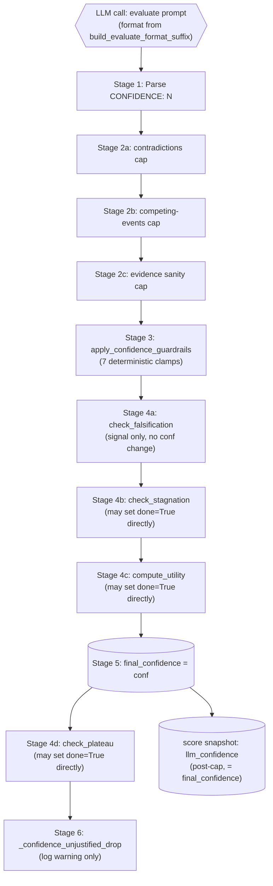
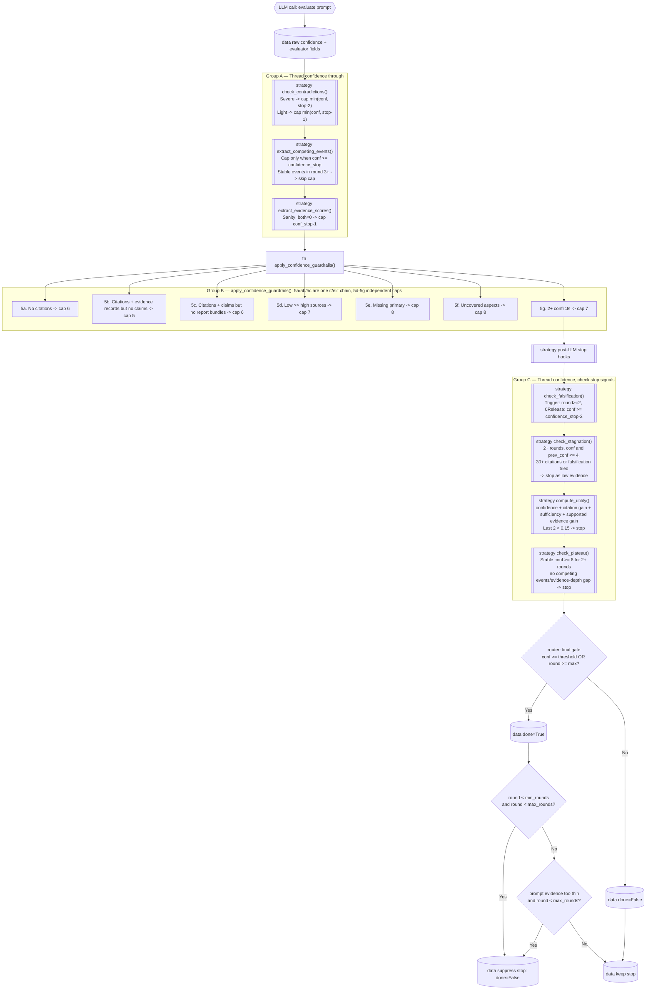
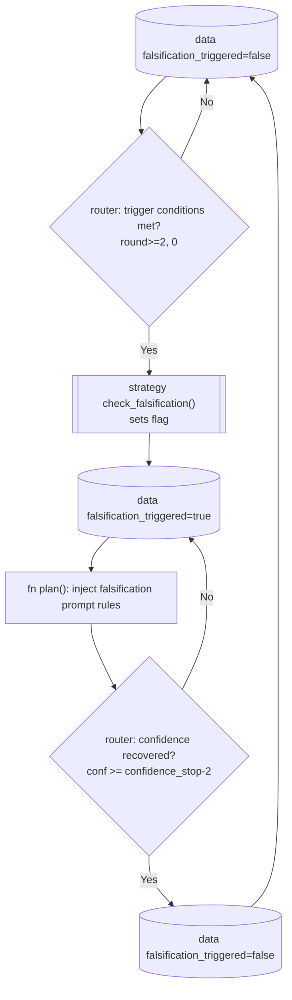

# Stopping

> Files: `nodes.py` (`evaluate()`, `apply_confidence_guardrails()`), `prompts.py` (`build_evaluate_format_suffix()`), `strategies/_stop_criteria.py` (`MultiSignalStopCriteria`)

## Scope

Why a research run stops. Two halves belong together here, so this page
carries both. The first is how `final_confidence` is computed: the LLM
produces a raw integer, then nine documented stages of caps, sanity checks,
guardrails, and post-LLM stop hooks adjust it before it is stored. The
second is how that value combines with utility, plateau, and min-rounds
vetoes to set `done=True` -- see [Stop criteria](#stop-criteria) below.
[Falsification mode](#falsification-mode) and [Sub-question coverage](#sub-question-coverage)
are the two stop-cascade inputs large enough to need sections of their own.

Cooperative cancellation is separate from these sufficiency decisions. When a
research node raises `AgentCancelled`, the graph carries that node's current
state back to the runner. Recorded provider usage and progress survive even
when invocation returns no final state; the initial graph input is not an
up-to-date accounting source. The same state recovery applies to a token-budget
stop, while its reason remains distinguishable from a client cancellation.
The existing run service books the returned usage before terminalizing the run.
No token estimation or additional provider call is part of this recovery.

The value is an integer **0-10**, enforced at parse time: the parser reads
`CONFIDENCE:\s*(\d+)` and immediately clamps with `conf = max(0, min(10,
_conf_raw))`. A malformed `CONFIDENCE: 42` is not silently accepted -- the
clamp logs a warning, emits a `warning`-severity progress event, and records
`confidence_clamped: true` in the evaluate iteration log. The later guardrails
are all conditional `min()` caps and `ResearchMetrics.confidence` carries no
field constraint, which is why the range is enforced here rather than
downstream. Within that range:

- `1..10`: evaluator-produced confidence after every cap.
- `0`: evaluator pass never completed (failure before parsing).

The primary effect of `final_confidence` is the threshold check
`conf >= confidence_stop` in the final stop gate (default `confidence_stop
= 6` for SCHNELL, `7` for COMPACT, `8` for DEEP).

## Pipeline overview



Within Stages 2-4 each stage can lower `conf` but never raise it. Two
paths outside that chain do produce a higher value: the evaluate error
fallback sets `conf = min(max(prev_conf, 5), confidence_stop - 2)`, and
the answer node's algorithm-failure paths lift a stored `0` to `3`.
Stages 4a-4d primarily **signal** decisions (`done=True`,
`falsification_triggered=True`) without modifying `conf` directly -- with
three exceptions: `check_stagnation`, `compute_utility` and
`check_plateau` can set `done=True` outright.

## Stage 1 -- LLM raw value

Provider call in `evaluate()`:

```python
# nodes.py — model + reasoning effort come from the central tier router
evaluate_model, evaluate_effort = _resolve_node_llm(s, settings, providers, "evaluate")
text = providers.llm.complete(
    prompt, model=evaluate_model, reasoning_effort=evaluate_effort, ...
)
```

The evaluate node maps to the **mid** tier by default; configure
`tier_mid_model` (and optionally `tier_mid_effort`) or pin `evaluate_model` to
change it. See [LLM calls](nodes.md).

The prompt is built inline in `nodes.py` and ends with
`build_evaluate_format_suffix()` from `prompts.py`. Quoted
verbatim:

```text
Reply EXACTLY in this format:
STATUS: SUFFICIENT or INSUFFICIENT
CONFIDENCE: 1-10
- Compare deliberately with the previous round, if there is one.
- When new evidence has been added AND no new contradictions or competing
  events appear, CONFIDENCE should NOT fall below the previous round's value.
  A decrease must be justified in CONTRADICTIONS or COMPETING_EVENTS.
GAPS: one sentence on what is still missing, in the language of the question (or 'None' when the evidence is sufficient)
CONTRADICTIONS: Are there contradictions between sources? (Yes/No + short explanation)
COMPETING_EVENTS: different matching events/explanations (or 'None')
COVERED_ASPECTS: JSON array of the numbers of the sub-questions the evidence answers directly (e.g. [1, 3]; [] when none)
EVIDENCE_CONSISTENCY: 1-10 (how consistently the sources agree, 10 = fully agreed)
EVIDENCE_SUFFICIENCY: 1-10 (how sufficient the evidence is for an answer, 10 = everything supported)
```

The parsers accept the German tokens (`Keine`, `Nein`, `Ja`) as well, so an
evaluator that answers in the question's language still stops correctly.

The suffix is built per round by `build_evaluate_format_suffix(event_mode=…,
aspect_count=…)`: the `COMPETING_EVENTS` line (and the competing-events
wording of the stability rule) exists only in **event mode** — a news
briefing, a `NEWS` query type or a short recency window (`hour`/`day`/
`week`; `month` is the classifier's default for market and regulation
questions and does not count). `COVERED_ASPECTS` exists only when the run
has sub-questions to cover. `STATUS` is parsed into `evaluate_status`
(log and span attribute only; confidence stays the stop signal).

The "should NOT decrease unless …" rule is an **instruction to the LLM**,
not a hard floor enforced in code. Stage 6 (`_confidence_unjustified_drop`)
detects when the LLM violates that rule, but it only logs a warning -- the
drop is accepted as-is. This is documented as a
known coupling.

Parsing in `nodes.py`:

```python
m_conf = re.search(r"CONFIDENCE:\s*(\d+)", a)
if m_conf:
    _conf_raw = int(m_conf.group(1))
    conf = max(0, min(10, _conf_raw))   # hard clamp to 0-10
    if conf != _conf_raw:
        _confidence_clamped = True      # iteration-log marker + WARNING
else:
    conf = 5
    _confidence_parsed = False          # iteration-log marker
```

A parse failure defaults to `5` and emits the `_confidence_parsed=False`
marker -- a No-Silent-Fallback signal that lands in `iteration_log` and the
forensic event stream.

`llm_confidence` is written only into the score snapshot (`scoring.py`),
not into the iteration log, and it holds the value after all caps --
identical to `final_confidence`; the raw parsed value is never persisted.

## Stage 2 -- Three immediate LLM-signal caps

Applied **after** parsing, **before** the deterministic guardrails. Each
cap can lower `conf` but cannot raise it.

### Stage 2a -- Contradictions cap

Source: `MultiSignalStopCriteria.check_contradictions()` in
`_stop_criteria.py`.

Regex: `r"CONTRADICTIONS:\s*(.+?)(?:\n|$)"`.

If the LLM did not return the block, or the line contains no substring
`ja`: no cap. The match is a plain substring test on the lowercased line
(a `Nein, ... Jahreszahlen ...` answer therefore caps), the
`CONTRADICTIONS:` regex is case-sensitive so a lowercase `contradictions:`
line never matches, and the severe-keyword list is ASCII-transliterated
(`voellig`, `gegensaetzlich`), so an umlaut spelling counts as a light
contradiction only.

If the line contains `ja`:

- **Severe** keywords (`grundlegend`, `fundamental`, `gegenteil`,
  `widerspricht`, `unvereinbar`, ...) → `conf = min(conf,
  confidence_stop - 2)`.
- Otherwise (light contradiction): `conf = min(conf, confidence_stop - 1)`.

**Example.** `confidence_stop = 8`, LLM said `CONFIDENCE: 9`,
`CONTRADICTIONS: ja, grundlegend widerspricht` → cap to `min(9, 8 - 2) = 6`.

### Stage 2b -- Competing-events cap

Source: `extract_competing_events()`.

Only in event mode (`state["event_mode"]`, set by classify): outside it the
evaluator is not asked for the line, any volunteered text is ignored,
`competing_events` is cleared and no cap fires: a comparison or market
question has no "competing event", and capping on text the evaluator
volunteered for such questions would force extra rounds.

Regex: `r"COMPETING_EVENTS:\s*(.+?)(?:\n|$)"`. The text is compared against
the previous round's `competing_events` to decide novelty. A round without
the line resets `competing_events` to empty: the previous round's ambiguity
must not survive into the plan block, the answer prompt and the metric as
if it had been confirmed again.

Trigger: only when `conf >= confidence_stop` **AND** (text is new OR
`round < 3`).

Effect: `conf = confidence_stop - 1`.

`confidence_stop` in every cap of this cascade is the RUN's threshold: the
evaluate node writes the profile-adjusted value into `s["_confidence_stop"]`
before the cascade and the strategy reads it from there. The strategy
instance is built once per process with the base settings; that value is
only the fallback, so a stricter profile is never capped at the process
default.

**Leniency from round 3 onward.** If the round is ≥ 3 and the competing
text is the same as the previous round, the cap is **skipped** -- the loop
already had two rounds to disambiguate and would otherwise thrash.

### Stage 2c -- Evidence-score sanity cap

Source: `extract_evidence_scores()`.

Parses `EVIDENCE_CONSISTENCY: 1-10` and `EVIDENCE_SUFFICIENCY: 1-10` into
state. The sanity cap fires only in this exact combination:

```python
if (s["evidence_consistency"] == 0 and s["evidence_sufficiency"] == 0
    and conf >= self._confidence_stop):
    conf = self._confidence_stop - 1
```

Defensive: a model claiming `CONFIDENCE: 9` while reporting both
consistency and sufficiency as `0` is almost certainly a parse glitch or a
hallucinated answer. The cap acknowledges the contradiction quietly. Parse
failures of either score fall back to `5` (with `_evidence_consistency_parsed`
/ `_evidence_sufficiency_parsed=False` markers).

## Stage 3 -- Deterministic guardrails

Source: `apply_confidence_guardrails()` in `nodes.py`.
Six top-level blocks holding seven possible clamps, no LLM involved -- the
second and third are an `if`/`elif` pair, so at most one of those two
fires. Each runs on the post-Stage-2 `conf` and reads only `AgentState`
counts.

| Guardrail | Trigger | Cap (or effect) |
|---|---|---|
| **No citations** | `not has_citations` (`len(all_citations) == 0`) | `conf = min(conf, 6)` |
| **No claims** | `has_citations` AND `has_evidence_records` AND `not has_claims` | `conf = min(conf, 5)` -- the `if` half of an `if`/`elif` pair with the next row; when citations exist but neither evidence records nor claims do, both branches are skipped and nothing caps `conf` |
| **No report bundles** | `has_citations` AND `has_claims` AND `not has_report_bundles` (no supported -- verified or attributed -- and no contested claim; `has_report_bundles()` in `nodes.py`, so a provider without page text is no reason) -- the `elif` branch of the row above, so at most one of the two fires | `conf = min(conf, 6)` |
| **Low-tier majority** | `low_n > (primary_n + mainstream_n)` AND `conf > 7` | `conf = 7` |
| **Needs-primary missing** | the extractor flagged at least one claim as primary-needing (`claim_needs_primary_total > 0`) AND none of them is supported, verified or attributed (`claim_needs_primary_supported == 0`) AND `conf > 8`; primary sources elsewhere in the citation pool do not satisfy those claims | `conf = 8` |
| **Open sub-questions** | `len(uncovered_aspects) > 0` AND `conf > 8` (the evaluator's own `COVERED_ASPECTS` judgement, see below) | `conf = 8` |
| **2+ conflicts** | `contested_conflicts >= 2` AND `conf > 7` (claim signatures with a contested claim: a value conflict contests both sides and counts once) | `conf = 7` |

### Hidden coupling -- first-writer-wins for gap hints

Not every guardrail that fires publishes a "gap hint" that the next
`plan()` will use to write a targeted query: the low-tier-majority clamp
only records a reason and never calls `propose()`. The no-citations /
no-structured-evidence / no-report-bundles branches propose
unconditionally, while the needs-primary, uncovered-aspects and
contested-claims branches propose only inside their cap condition, so an
uncovered aspect at `conf <= 8` yields no hint at all. The current
implementation lets only the **first** firing rule set the primary hint;
later guardrails still cap `conf` but their gap suggestion is ignored.

Low-tier majority and uncovered aspects can never both fire: the low-tier
clamp caps `conf` to `7`, which makes the uncovered-aspects condition
`conf > 8` unreachable in the same call -- and the low-tier clamp never
calls `propose()` at all, so it can never own the gap text. This is
documented as a known coupling.

### Hidden coupling -- empty-claim-ledger special case

The evidence-sufficiency clamp is not one of the guardrails: it sits in
`evaluate()` after `apply_confidence_guardrails()` has returned and lowers
`evidence_sufficiency` to at most `3` when citations and evidence records
exist but claim consolidation produced nothing. It takes effect in the
same round through `compute_utility()`, which reads `evidence_sufficiency`;
it does not feed Stage 2c on the next round, because
`extract_evidence_scores()` overwrites `evidence_sufficiency` from the
fresh evaluator output before the `0/0` sanity check reads it.

## Stage 4 -- Post-LLM stop-cascade hooks

These run **after** the guardrails. They mostly emit signals rather than
modify `conf`.

### Stage 4a -- Falsification toggle

Source: `check_falsification()`.

Trigger to **arm** falsification mode:

- `round >= 2`
- `0 < prev_conf <= 4`
- `conf <= 4`
- `falsification_triggered` currently `False`

Trigger to **release** falsification (when previously armed):

- `falsification_triggered=True` AND `conf >= confidence_stop - 2`

Falsification does not modify `conf`. It sets
`s["falsification_triggered"] = True/False`, which the next `plan()` reads
to inject "debunked" / "refuted" / "evidence against" queries. See
[Falsification mode](#falsification-mode).

### Stage 4b -- Stagnation check

Source: `check_stagnation()`.

Trigger:

- `round >= 2`
- `0 < prev_conf <= 4` AND `conf <= 4`
- `|conf - prev_conf| <= 1`
- falsification was **not** just triggered in this same round
- (`n_citations >= 30` OR `falsification_triggered=True`)

Effect: sets `s["done"] = True` and writes `_stop_reason =
"stagnation_low_evidence"`, but `evaluate()` reassigns `_stop_reason`
unconditionally in the same round and `_resolve_stop_reason()` does not
know that value, so the stored reason ends up as `strategy_done` (or
`round_limit`); a stagnation stop is only recognisable from the
`stagnation_detected` flag. The low confidence is **not** raised -- it
remains the low value as a "we searched broadly and found little, treat
the absence as a signal" finding.

### Stage 4c -- Utility score

Source: `compute_utility()`.

```python
_delta_conf       = (conf - prev_conf) / 10.0 if prev_conf > 0 else 0.5
_delta_cit_norm   = min(1.0, _new_cit / 10.0)
_sufficiency_norm = s["evidence_sufficiency"] / 10.0
_evidence_gain    = min(1.0, max(0, _new_supported_claims) / 3.0)  # verified + attributed
utility = (
    0.3 * _delta_conf
    + 0.2 * _delta_cit_norm
    + 0.2 * _sufficiency_norm
    + 0.3 * _evidence_gain
)
```

Stop condition: if two consecutive rounds both have `utility < 0.15`,
`done=True` is set with `_stop_reason = "utility_stop"`. There is no
domain-specific suppression, but the utility stop is guarded by
`not s["done"]`: if an earlier hook in the same round -- `check_stagnation`
runs first -- already set `done`, `utility_stop` stays `False` even when
both utility scores are below `0.15`.

Does not modify `conf`.

### Stage 4d -- Plateau check

Source: `check_plateau()`.

```python
_conf_stable_rounds = s.get("_conf_stable_rounds", 0)
if prev_conf > 0 and conf == prev_conf:
    _conf_stable_rounds += 1
else:
    _conf_stable_rounds = 0
s["_conf_stable_rounds"] = _conf_stable_rounds
```

Stop condition (sets `done=True`, `_stop_reason="plateau_stop"`):

- `round >= 2`
- `conf == prev_conf` (this round)
- `conf >= 6`
- `competing_events` not actively changing
- `stagnation_detected=False`
- **Suppression**: an active evidence-depth gap
  (`_evidence_depth_gap_active`) suppresses the stop, but only while
  `round < max_rounds`; it is a nested `if`/`else` inside the plateau
  branch rather than a further conjunct of the condition above, so in the
  final round the plateau stop fires even with the gap active.

In short: if confidence has been flat for two rounds at 6+ AND there is no
remaining cross-check work, stop. The depth-gap suppression is the bridge
between this stage and the answer-prompt EVIDENCE DEPTH block -- both react
to the same diagnostic (see [Evidence-depth gap](#evidence-depth-gap)).

Does not modify `conf`.

## Stage 5 -- Final assignment

```python
s["final_confidence"] = conf       # nodes.py
```

This is where the adjusted `conf` becomes `final_confidence`, but it is
not the last write: the answer node's three algorithm-failure paths lift a
stored `0` to `3`, and the evidence-contract cap lowers `final_confidence`
to 3, 4 or 6 depending on the contract status.

## Stage 6 -- Unjustified-drop diagnostic

Source: `nodes.py`:

```python
_confidence_unjustified_drop = bool(
    not _evaluate_fallback
    and int(_prev_conf or 0) > 0
    and int(conf) < int(_prev_conf)
    and _competing_unchanged_for_marker
    and not _contradictions_present_for_marker
)
if _confidence_unjustified_drop:
    log.warning("confidence drop without new contradictions...")
```

Triggers when the LLM produced a strictly lower CONFIDENCE than the
previous round, yet no new competing events appeared and no contradictions
were reported -- a violation of the evaluate format instruction
in Stage 1.

**Observational.** The drop is **not** auto-reverted to
`prev_conf`, but the marker itself is recorded:
`confidence_unjustified_drop` appears in the iteration log, in the
`evaluate` block of the score snapshot, and in the application log.

This is **intentional, not an oversight**: the marker is an
**observer**. The code accepts the drop verbatim and only logs the
warning; no stop heuristic, utility adjustment or plateau check acts on
it.

## Worked example -- 4-round run

Assume `confidence_stop = 8`, weak evidence scenario (no primary sources,
2 contested claims, depth-gap inactive yet).

| Round | LLM `CONFIDENCE:` | Stage 2 caps | Stage 3 guardrails | Stage 4 hooks | `final_confidence` | Notes |
|---|---|---|---|---|---|---|
| **1** | 9 | none | Contested ≥ 2: `conf > 7` → 7 | none | **7** | `_conf_stable_rounds=0`; `search()` increments `round` before `evaluate()` runs, so the first evaluate pass sees `round = 1`, never `0` |
| **2** | 7 | Contradictions "leichte" → `min(7, 8-1)=7` (unchanged); Competing events new + `conf >= 8`? no → skip | unchanged | `check_falsification`: not armed (`conf > 4`) | **7** | `_conf_stable_rounds=1` (stable since round 1) |
| **3** | 5 | Contradictions "ja, grundlegend" → `min(5, 8-2)=5` (unchanged) | unchanged | `check_falsification`: trigger (round ≥ 2, prev=7? no -- skip; trigger only if `prev_conf <= 4`); `check_stagnation`: skip (`conf > 4`) | **5** | `_conf_stable_rounds=0` (reset, value changed) |
| **4** | 6 | none | unchanged | `_conf_stable_rounds=0`; utility `0.18 + 0.12` last two? evaluate; plateau: no (`conf != prev_conf`) | **6** | Loop continues if `round < max_rounds` |

At round 4 the diagnostic `_confidence_unjustified_drop` would have
already fired in round 3 (5 < 7, no new competing events, but
contradictions were reported, so condition `_contradictions_present_for_marker`
was True → marker stays False).

## Configuration knobs

| Setting | Default | Effect |
|---|---|---|
| `confidence_stop` | 7 (COMPACT) / 7 (DEEP) / 6 (SCHNELL) | Final stop threshold. Lower to tolerate earlier termination. |
| `max_rounds` | 2 (COMPACT) / 3 (DEEP) | Hard cap on research rounds. |
| `min_rounds` | 1 (COMPACT) / 2 (DEEP) | Global floor that can suppress an already-triggered stop until reached. |
| `tier_mid_model` (provider) | `""` | Model for the evaluate node's tier. Put evaluate on a stronger model here (or via `evaluate_model`) for better structured-output / `CONFIDENCE` calibration. See [LLM calls](nodes.md). |

`confidence_stop`, `max_rounds`, and `min_rounds` live on
`AgentSettings`/`AgentConfig` (see
[Agent config](../../configuration/agent-config.md)) and can be overridden per
request via `agent_overrides` on the HTTP API (see
[Web server mode](../../deployment/webserver-mode.md)). The tier model is
configured on the provider — see [LLM calls](nodes.md).

## How it is calculated

| Stage | LLM-driven? | Inputs | Output |
|---|---|---|---|
| 1 LLM raw value | **LLM-parsed** (evaluator) | Question, aspects, evidence overview excerpt, previous-round context | `conf` int, parsed via regex and clamped to 0-10; an out-of-range raw value logs a warning and sets `confidence_clamped` |
| 2a contradictions cap | Deterministic | LLM `CONTRADICTIONS:` text | Lowered `conf` |
| 2b competing-events cap | Deterministic, event mode only | LLM `COMPETING_EVENTS:` text + previous round | Lowered `conf` |
| 2c evidence-sanity cap | Deterministic | LLM `EVIDENCE_CONSISTENCY:` + `EVIDENCE_SUFFICIENCY:` | Lowered `conf` (only `0/0 + high conf` case) |
| 3 guardrails | Deterministic | `all_citations`, `evidence_ledger`, complete claim assessment, tier counts, `uncovered_aspects` | Lowered `conf` (multiple caps) |
| 4a falsification | Deterministic | `round`, `conf`, `prev_conf` | `falsification_triggered` flag |
| 4b stagnation | Deterministic | `round`, `conf`, `prev_conf`, `n_citations`, falsification flag | `done=True` (no `conf` change) |
| 4c utility | Deterministic | `Δconf`, `Δcit`, `evidence_sufficiency`, `Δverified_claims` | `utility_score`, may set `done=True` |
| 4d plateau | Deterministic | `conf`, `prev_conf`, `_conf_stable_rounds`, `evidence_depth_gap` | May set `done=True` |
| 5 final assign | Deterministic | `conf` | `final_confidence` persisted |
| 6 unjustified-drop diagnostic | Deterministic | `conf`, `prev_conf`, contradictions/competing markers | Log warning only |

## Stop criteria

> Files: `strategies/_stop_criteria.py` (`MultiSignalStopCriteria`), `nodes.py` (`evaluate`)

### Why multiple signals

A single confidence threshold is easy to game: an LLM can hallucinate certainty, or the loop can stagnate at a high-but-unwarranted score. Inqtrix defends against both by combining LLM-reported confidence with structural signals (contradictions, competing events, source quality, aspect coverage, utility delta, plateau detection) and by treating them as independent caps rather than a single linear pipeline.

### Cascade structure

The heuristics are grouped into three phases. Confidence is threaded through each phase and can be reduced but not increased by caps. `check_stagnation` may stop the loop when evidence has stalled, but it must not raise weak-evidence confidence to the stop threshold.
This diagram answers: "Which code path can cap confidence or set `done=True`
inside `evaluate()`?" Strategy hooks are shown as strategy nodes; arithmetic
guardrails and final gates are owned by `nodes.py`.



The final stop decision is not a single strategy method in the current code.
`evaluate()` calls individual strategy hooks, then owns the final gate and the
global `min_rounds` suppression.

### Signal map (where metrics are produced and consumed)

| Signal | Produced in | Updated in | Consumed by |
|--------|-------------|------------|-------------|
| working `conf` / `final_confidence` | `evaluate` parses `CONFIDENCE` into working `conf`; stores `final_confidence` after Group C | Group A + guardrails + Group C in `evaluate` | final stop gate (`confidence_stop`), plateau/stagnation/utility, answer metrics |
| `evidence_consistency` | `extract_evidence_scores` | same | evidence sanity cap (only `0/0` + high confidence case), diagnostics |
| `evidence_depth_gap` | `search` and recomputed in `evaluate` from the complete claim assessment (see [_evidence_depth_gap()](#evidence-depth-gap)) | same | evaluate prompt, next-round query slots, plateau suppression, answer-prompt `EVIDENCE DEPTH` block trigger |
| `evidence_sufficiency` | `extract_evidence_scores` | same | utility formula and weak-evidence confidence cap |
| `competing_events` | `extract_competing_events` | same | competing-events cap and plateau suppression logic |
| `falsification_triggered` | `check_falsification` | trigger/release in same method | plan-mode query distribution; stagnation precondition |
| `utility_scores` | `compute_utility` | append per round | utility stop (`last two < 0.15`) |
| `score_ledger` | search/evaluate/answer snapshots built from current state | append per phase | progress report and stop diagnostics; `ResearchMetrics` reads `result_state` fields directly |
| `uncovered_aspects` | the evaluator's `COVERED_ASPECTS` line, parsed in `evaluate` (`coverage_source` = `llm`; a missing or unparsable line keeps the list and logs a WARNING, `coverage_source` = `missing`/`unparsable`) | classify seeds it with every sub-question; evaluate refreshes it each round | next-round gap slots (one per open sub-question, verbatim), answer-prompt SUB-QUESTION COVERAGE, guardrail cap (`conf <= 8`) |
| `report_eligible_evidence_count` | `evaluate` reads it from the current `evidence_ledger` (records whose `report_eligible` flag is set; the ledger sets that flag to `bool(canonical_url)` when a record is created) | same | suppresses early stopping when the final answer prompt would still be too thin (`min_report_eligible_evidence` profile knob, 2 SCHNELL / 3 COMPACT / 8 DEEP) |

### Key heuristic details

#### Competing-events suppression

If competing events stay unchanged into round 3+ (same text as the previous round), the cap in step 3 is skipped. The cap also only applies when confidence is already at or above `confidence_stop`. This prevents thrashing on repeated ambiguity while still forcing at least one explicit disambiguation round.

#### Falsification trigger and release

Trigger conditions to arm falsification:

- `round >= 2`
- `0 < prev_conf <= 4`
- `conf <= 4`
- `falsification_triggered` currently false

Release condition:

- if `falsification_triggered` is true and `conf >= confidence_stop - 2`, the flag is cleared.

Because release exists, falsification can trigger again later if the low-confidence trigger conditions reappear. See [Falsification mode](#falsification-mode) for the planning impact.

#### Negative-evidence hinting

Injected into the evaluate prompt when `round >= 2`. Every such round already gets the closing paragraph that treats a consistently empty search as a result: "it does not exist" is called a valid answer with high confidence (7–9). If additionally `prev_conf > 0` and `prev_conf <= 4`, a stronger hint is prepended that reads the unchanged low confidence as a strong signal that the premise of the question is false.

#### Evidence-depth gap

Source: `_evidence_depth_gap()` in `src/inqtrix/nodes.py`.
Inputs: the complete claim assessment from `scoring.claim_assessments()`.
Compact-list caps do not change the assessed population. Existing profile
limits still bound the research loop; a different complete evidence assessment
can change its stop decision.

Threshold constant: `_EVIDENCE_DEPTH_MIN_VERIFIED_BUNDLES = 3` (despite
the name, it counts verified consolidated claims, not bundles).

The diagnostic is **active** when **any** of:

| Reason | Trigger |
|---|---|
| `no_cross_checked_claims` | `supported_count >= 3` AND `cross_checked_count == 0` |
| `majority_single_source_claims` | `supported_count >= 3` AND `single_source_count / supported_count > 0.5` |
| `central_claim_single_quality_source` | at least one supported claim with `verification_basis == "quality_source"`, only one citation URL, and a claim text that matches the central-claim regex (numeric / benchmark / regulatory keyword) |

Supported claims are the verified and the attributed ones alike: the gap
measures the depth of the support structure, not whether a provider returned
page text.

The returned dict carries `active`, `reason` (comma-joined), `gap`
(human-readable explanation when active), and the per-trigger counts
(`supported_count`, `cross_checked_count`, `single_source_count`,
`single_source_ratio`, `quality_source_single_count`,
`central_single_quality_source_count`).

**Worked example.** 4 supported consolidated claims, all
`verification_basis="quality_source"`, all with one citation, one
of them containing a percentage:
- `supported_count=4`, `cross_checked_count=0` → `no_cross_checked_claims`
- `single_source_count=4`, ratio `1.0 > 0.5` → `majority_single_source_claims`
- `central_single_quality_source_count=1` → `central_claim_single_quality_source`
- `active=True`, `reason="no_cross_checked_claims,majority_single_source_claims,central_claim_single_quality_source"`.

The gap has three downstream effects:

1. The next `plan()` round receives a cross-check query slot via
   `_select_crosscheck_targets()` (see [Research loop](loop.md)).
2. `check_plateau()` suppresses a plateau stop while the gap is active
   (search continues even if confidence has been flat for two rounds).
3. The answer-node system prompt emits the **EVIDENCE DEPTH** block, which
   tells the LLM to inline-attribute single-source-verified claims and to
   mention the limited evidence depth in the report (see
   [Evidence pipeline — Final answer system prompt](evidence.md#final-answer-system-prompt)).

The gap does not override `confidence_stop` or `max_rounds`.

#### `min_rounds` suppression (global post-gate)

After all stop checks, `evaluate` applies a global floor:

- if `done=True` but `round < min_rounds` and still `round < max_rounds`,
- then the stop is suppressed (`done=False`) and the loop continues.

This applies uniformly to confidence, utility, plateau, and other stop reasons. `max_rounds` still wins as the hard cap.

#### Report-eligible evidence floor

After `min_rounds`, `evaluate` checks whether the current evidence can
produce enough report-facing material for the answer composer:

- `report_eligible_evidence_count` (count of EvidenceRecords whose
  `report_eligible` flag is set -- the ledger sets that flag to
  `bool(canonical_url)`) must reach
  `ReportProfileTuning.min_report_eligible_evidence` (2 SCHNELL / 3 COMPACT /
  8 DEEP; under SCHNELL the floor never fires, because `max_rounds=1` and the
  suppression requires `round < max_rounds`).

If a stop was accepted but the threshold is not met, and `round <
max_rounds`, the stop is suppressed and the next `plan()` call gets another
chance to fill the evidence. This guard is provider-neutral: it only reads
the persisted EvidenceLedger; there is no separate prompt-evidence-unit
list. `max_rounds` remains the hard cap.

### Stopping rules summary

| Rule | Condition | Effect |
|------|-----------|--------|
| **Confidence** | `conf >= confidence_stop` (default 7; SCHNELL 6, DEEP 8) | Stop |
| **Max rounds** | `round >= max_rounds` (default 2; SCHNELL 1, DEEP 4) | Stop |
| **Contradictions** | Severe or light conflicting sources | Cap to `confidence_stop - 2` or `confidence_stop - 1` |
| **Competing events** | Multiple explanations (new) and `conf >= confidence_stop` | Cap to `confidence_stop - 1`; force disambiguation |
| **Falsification** | 2+ rounds, `0 < prev_conf <= 4` and `conf <= 4` | Arm debunk-style planning mode |
| **Falsification release** | `falsification_triggered` and `conf >= confidence_stop - 2` | Return to normal planning mode |
| **Stagnation** | No improvement + broad search done (30+ citations) | Stop as low-evidence exhaustion; do not raise confidence |
| **Utility plateau** | Last two rounds both utility < 0.15 | Stop, unless another heuristic already set `done` earlier in the same round; the global `min_rounds` and report-eligible floors can still take the stop back |
| **Confidence plateau** | Same conf >= 6 for 2+ rounds, no competing events changing and no active evidence-depth gap while rounds remain | Stop |
| **Negative evidence** | Round >= 2, searched broadly, found little | Prompt hint: infer absence as evidence |
| **min_rounds floor** | `done=True` but `round < min_rounds` and `< max_rounds` | Suppress stop and continue |
| **Report-eligible evidence floor** | `done=True`, evidence exists, `report_eligible_evidence_count < min_report_eligible_evidence`, and `< max_rounds` | Suppress stop and continue |

### Worked stop-cascade example

```text
round=3
raw CONFIDENCE: 9
extract_competing_events: event mode, competing_events found, conf>=stop -> cap to 7
guardrails: open sub-questions present, conf already <=8 -> no further cap
check_falsification: no trigger (conf>4)
compute_utility: 0.11 and previous 0.12 -> utility_stop would set done=True
final gate: done=True
min_rounds check: min_rounds=4 and round=3 -> suppress stop, done=False
result: loop continues to next PLAN round
```

The utility stop needs three rounds: in the first `evaluate` the confidence
delta falls back to `0.5` because `prev_conf == 0`, so that round's utility is
always at or above the `0.15` threshold.

### `StopCriteriaStrategy` ABC — full method list

| Method | Signature | Returns |
|--------|-----------|---------|
| `check_contradictions` | `(s, eval_text, conf) -> int` | Modified confidence |
| `extract_competing_events` | `(s, eval_text, conf) -> int` | Modified confidence |
| `extract_evidence_scores` | `(s, eval_text, conf) -> int` | Modified confidence |
| `check_falsification` | `(s, conf, prev_conf) -> bool` | Triggered flag |
| `check_stagnation` | `(s, conf, prev_conf, n_citations, falsification_just_triggered) -> tuple[int, bool]` | (conf, detected) |
| `compute_utility` | `(s, conf, prev_conf, n_citations) -> tuple[float, bool]` | (utility, stop) |
| `check_plateau` | `(s, conf, prev_conf, stagnation_detected) -> bool` | Stop flag |
| `should_stop` | `(state) -> tuple[bool, str]` | (stop, reason) |

### Implementing your own stop strategy

Subclass `MultiSignalStopCriteria` rather than `StopCriteriaStrategy` so you inherit the default cascade and only override the specific checks you want to change. The most common override in practice is `compute_utility` (tighter or looser plateau).

## Falsification mode

> Files: `strategies/_stop_criteria.py` (`MultiSignalStopCriteria.check_falsification`), `nodes.py` (`plan`)

### Motivation

Naive search loops keep asking the same question in slightly different words when confidence stays low. That behaviour is expensive and sycophantic — models tend to over-assert a premise they cannot disprove. Falsification mode inverts the search strategy after a few low-confidence rounds: the loop actively looks for disproof instead of looking for more supporting evidence.

The idea is inspired by the FVA-RAG line of work (*Falsification-Verification Alignment for Mitigating Sycophantic Hallucinations*).

### Trigger conditions

All of the following must be true:

- `round >= 2` (we have tried at least twice).
- `0 < prev_conf <= 4` (prior round had meaningful but low confidence).
- `conf <= 4` (current round also low).
- NOT already triggered (`falsification_triggered` is false).

The strategy records the new state by setting `falsification_triggered = True`.

Release rule in the same method:

- if `falsification_triggered` is true **and** `conf >= confidence_stop - 2`, the flag is cleared.

This means falsification is not permanently sticky. It can be armed, released, and later armed again if low-confidence trigger conditions return.

Minimal state transition:

```json
{
  "round": 2,
  "prev_conf": 4,
  "confidence": 3,
  "falsification_triggered": true
}
```

### Effect on the plan node

When `falsification_triggered` is true, the plan node generates queries in a different distribution:

- At least two new queries are **debunk-style** — they explicitly search for disproof, counter-examples, retractions, or absence of the claimed fact.
- Another query is **nearest-explanation** — it searches for the actual fact that has been confused with the user's premise.

The LLM prompt for plan acknowledges the switch explicitly, so that a reasoning model does not silently revert to confirmation-seeking queries.

Example query distribution after the trigger:

```text
2 debunk-style queries:
- "<claim> counter evidence retraction"
- "<claim> no evidence official source"

1 nearest-explanation query:
- "<confused term> actual policy status official source"
```

### Interaction with stagnation

Falsification is followed shortly afterwards by `check_stagnation`, but stagnation is suppressed in the very round falsification is armed (`not falsification_just_triggered`); it can only fire in a later round, when the persistent `falsification_triggered` flag is still set, or when broad search has reached 30+ citations. If the round count is sufficient and confidence stays low and nearly unchanged (`prev_conf` and `conf` both `<= 4`, `|conf - prev_conf| <= 1`), stagnation sets `done=True` and writes `_stop_reason="stagnation_low_evidence"`, but that value does not survive the round: `_resolve_stop_reason()` in `nodes.py` has no stagnation branch, so the reason is overwritten (normally with `strategy_done`) before the evaluate node returns. The low confidence itself is left unchanged. The reasoning: active disproof search failed to find support, so negative evidence is treated as informative without pretending the evaluator became highly confident.

### Interaction with negative-evidence hinting

The evaluate-prompt hint that treats absence of evidence as a legitimate signal (see [Stop criteria](#stop-criteria)) is injected whenever `round >= 2`. When `prev_conf > 0 AND prev_conf <= 4`, the hint is stronger, which lines up with the falsification pre-conditions. The two mechanisms are complementary: falsification changes the questions, negative-evidence hinting changes how the LLM scores the accumulated answer.

### What falsification does not do

- It does not reset the EvidenceLedger or the consolidated claims. Accumulated evidence remains available and continues to be consolidated.
- It does not lower the stop threshold. `confidence_stop` stays at its configured value; termination still requires either stagnation, plateau, max-rounds, or a confidence trajectory that crosses the threshold.
- It is not a standalone stop reason. It changes planning behavior; stop decisions still occur in the normal evaluate gate + stop cascade.

### Lifecycle diagram

This diagram answers: "How does one low-confidence state flag change the next
planning prompt?" The flag itself is written in `evaluate()` through
`StopCriteriaStrategy.check_falsification()`; the query distribution changes
later in `plan()`.



The diagram spans two nodes: `evaluate()` writes the flag, and the next
`plan()` call reads it. No evidence is deleted when the flag changes.

### Configuration

No dedicated configuration knob exists; the feature is fully driven by `confidence_stop`, `max_rounds`, and the internal trigger conditions. Custom `StopCriteriaStrategy` implementations that want to disable falsification should override `check_falsification` to always return `False` and never set `s["falsification_triggered"]`; the return value is a one-shot signal meaning "newly armed in this round" and is passed on only as `falsification_just_triggered` to `check_stagnation`, so an implementation that returns the persistent mode flag instead would suppress the stagnation stop in every round in which that flag is set.

## Sub-question coverage

> Files: `nodes.py` (`classify()` sub-questions, `_apply_evaluated_coverage()`, the open-sub-question confidence guardrail, and the gap slots in `_build_query_slots()`), `prompts.py` (`build_evaluate_format_suffix()`)

### Where the checklist comes from

The classify call returns the question's 1–4 content sub-questions
(`SUB_QUESTIONS`; each names object, region and period, never a method) and
they become `state["required_aspects"]` verbatim — the coverage checklist of
the run. `aspects_source` records whether they came from the model (`llm`) or
whether the parse failed and the question itself is the only entry
(`fallback`, logged as a WARNING with a status line). Nothing derives aspects
from keywords.

### Who judges coverage

Only the evaluator. Its prompt lists the sub-questions numbered under
`SUB-QUESTION COVERAGE` and asks for `COVERED_ASPECTS: [1, 3]`, the numbers of
the sub-questions the evidence answers directly; the evaluator sees every
report-eligible source in the compact evidence view, so the judgement covers
the whole ledger. `_apply_evaluated_coverage()` turns the list into
`uncovered_aspects` and `aspect_coverage = covered / total`
(`coverage_source = llm`). A missing or unparsable line keeps the open list
as it is and says so (WARNING + status line, `coverage_source =
missing|unparsable`); a run without sub-questions has `aspect_coverage 1.0`
and `coverage_source = none`. The search node does not estimate coverage —
before, a substring scan over the evidence text decided, so a rubric label
with a common token counted as covered and a real sub-question never did.

### What the open list drives

- the guardrail row **Open sub-questions** (`conf <= 8` while any is open);
- the plan node's gap slots: one slot per open sub-question, the
  sub-question verbatim as the search assignment (the slot fallback query is
  the sub-question itself);
- the answer prompt's `SUB-QUESTION COVERAGE` block (open items are named
  under the risks heading or marked inline with the language's unconfirmed
  marker);
- the evaluate node span (`inqtrix.aspect_coverage`, `inqtrix.coverage_source`,
  `inqtrix.evaluate_status`) and the evaluate iteration log.

## Related docs

- [Claims](evidence.md) -- how `claim_quality_score` and the contested claims behind `contested_conflicts` (Stage 3 inputs) are computed.
- [Iteration log](../../observability/iteration-log.md) -- where `_confidence_parsed`, `final_confidence`, and the per-round cap markers land.
