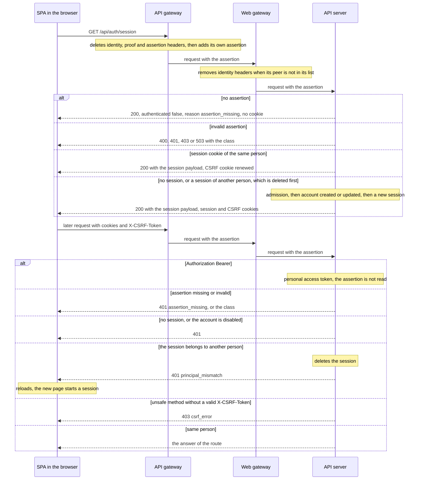
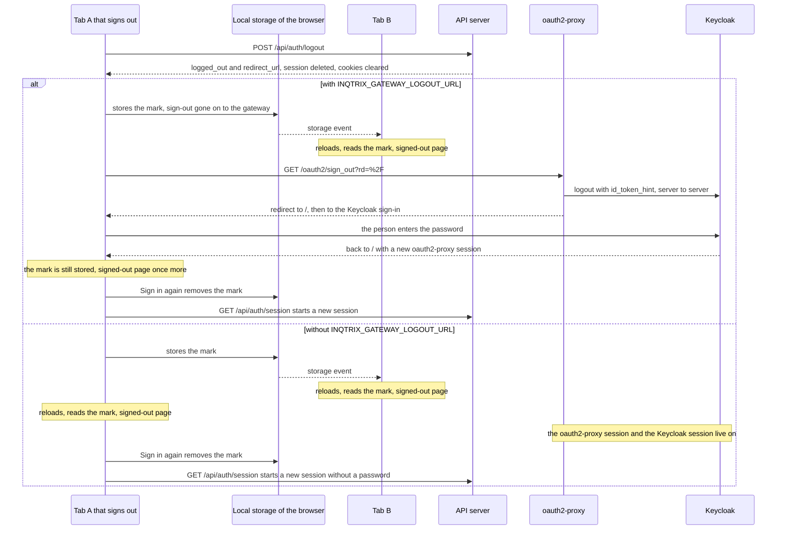
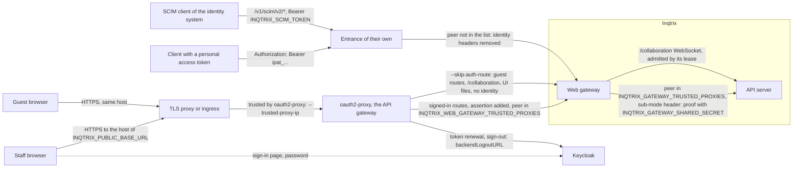

# Authentication modes

> Files: `src/inqtrix/auth/principal.py`, `src/inqtrix/auth/api_key.py`, `src/inqtrix/auth/oidc.py`, `src/inqtrix/auth/gateway.py`, `src/inqtrix/auth/jwks.py`, `src/inqtrix/server/routers/auth.py`, `src/inqtrix_web_gateway/identity_edge.py`, `deploy/compose/dex-config.yaml`, `deploy/compose/compose.gateway-acceptance.yaml`

## Scope

Authentication is a building block behind the `AuthProvider` seam: every
request resolves to a `Principal` (downstream code never holds
`Principal | None`), and the active mode is decided exactly once at startup
by `resolve_auth_mode()` and logged (`auth_mode=...` in the startup line).
Misconfiguration raises at startup instead of silently downgrading.

| Mode | Scenario | Principal | Credential per request |
|---|---|---|---|
| `none` | Single user on a local machine; no separation of data | anonymous, `user_id=null` | none |
| `apikey` | One shared token for scripts and a trusted UI; no separation of data | static, `user_id=null` | `Authorization: Bearer <key>` |
| `oidc` | Multi-user browser deployment against an identity provider | canonical `users.id` UUID (`oidc_session`) | session cookie + CSRF token |
| `local` | Multi-user with native email/password accounts (no external IdP) | canonical `users.id` UUID (`oidc_session`) | session cookie + CSRF token |
| `gateway` | Multi-user deployment behind an API gateway that signs people in | canonical `users.id` UUID (`oidc_session`) | the API gateway's assertion + session cookie + CSRF token |

Modes `none` and `apikey` have no per-user identity, so they separate no data: everyone who reaches the API reads and changes the same runs, documents and files. Putting a gateway in front of them does not change that. For several people behind an API gateway use `gateway`, which gives each person an account of their own.

### Mode resolution when `INQTRIX_AUTH_MODE` is unset

The default is the sentinel `infer`, which derives the mode for backwards
compatibility: a non-empty `INQTRIX_SERVER_API_KEY` means `apikey`, an empty
one means `none`. Pre-mode deployments keep behaving bit-for-bit without
touching their configuration.

An explicit `INQTRIX_AUTH_MODE` always wins, and contradictions fail loudly:

| Explicit value | Contradiction | Behaviour |
|---|---|---|
| `oidc` | issuer, client id, client secret, session secret, PAT pepper, or pseudonym pepper missing | `RuntimeError` at startup naming the missing variables |
| `oidc` | neither `INQTRIX_OIDC_REDIRECT_URL` nor `INQTRIX_PUBLIC_BASE_URL` set | `RuntimeError` at startup |
| `apikey` | `INQTRIX_SERVER_API_KEY` empty | `RuntimeError` at startup |
| `local` | `INQTRIX_SESSION_SECRET` or `INQTRIX_PAT_PEPPER` missing | `RuntimeError` at startup |
| `gateway` | session secret, PAT pepper, or pseudonym pepper missing; `INQTRIX_STORAGE_BACKEND` not `postgres`; SCIM on with a token under 32 characters or with `INQTRIX_REGISTRATION=invite`; SCIM off with both `INQTRIX_GATEWAY_PAT_MAX_TTL_DAYS` and `INQTRIX_GATEWAY_PAT_INACTIVE_DAYS` at 0 | `RuntimeError` at startup in the API server and the worker, naming each problem |
| `gateway` | an incomplete or unsafe sub-mode (see [Mode `gateway`](#mode-gateway)) | `RuntimeError` when the API server builds the provider |
| any other | `INQTRIX_SCIM_ENABLED=true` or `INQTRIX_GATEWAY_RESOLVER` set | `RuntimeError` at startup |
| `none` | `INQTRIX_SERVER_API_KEY` set | gate deliberately disabled; WARNING logged |

### Gated vs. open routes

Open by design in every mode, because UIs and probes need them before
credentials exist: `/health`, `/readyz` (the readiness probe load
balancers key on), `/v1/models`, `/v1/capabilities`, `/v1/stacks`
(multi-stack apps), and `/api/auth/config` (pre-login discovery — the
active mode, login methods, SSO provider name, whether
self-registration/owner-setup apply; `no-store`). In `local` mode the
first-run owner gate (`GET /api/setup/status`, `POST /api/setup/owner`)
and the login route `POST /api/auth/login/local` are necessarily open
too. Every other route takes the principal
dependency: `/v1/chat/completions`, `/v1/text/improvements`,
`/v1/editor/*`, `/v1/runs*`, `/v1/test/run`, and — when their feature
gates register them — `/v1/files*`, `/v1/knowledge/*`, `/v1/sources/*`.
In the cookie-session modes (`oidc`, `local` and `gateway`) the
`/api/auth/*` routes are additionally mounted; they are the credential
surface itself. `oidc` adds `GET /api/auth/login` and
`GET /api/auth/callback`; `local` adds `GET /api/setup/status`,
`POST /api/setup/owner`, `POST /api/auth/login/local`, and
`POST /api/auth/password`; `gateway` adds no login route, because its
sessions start in `GET /api/auth/session` from the API gateway's
assertion. All three share `GET /api/auth/session`,
`POST /api/auth/logout`, and the `/api/auth/tokens*` routes. Of these,
`/api/auth/logout`, `/api/auth/password`, and the token routes require an
authenticated session. In mode `gateway` with `INQTRIX_SCIM_ENABLED=true`,
`/v1/scim/v2/*` is mounted as well, behind its own bearer token (see
[Administration in `gateway` mode](create-and-manage-users.md#administration-in-gateway-mode)).

`GET /v1/stacks` is capability discovery, not a required business-data read.
A 404 there is an expected capability outcome, not a gate failure; see
[React UI](react-ui.md) for how the research desk handles it.

## Mode `none`

No configuration. Leave `INQTRIX_SERVER_API_KEY` empty (or set
`INQTRIX_AUTH_MODE=none` explicitly). Every request resolves to the
anonymous principal:

```bash
curl http://127.0.0.1:5100/v1/runs -X POST \
     -H "Content-Type: application/json" \
     -d '{"question":"Wie ist der Stand bei Smart Metern?"}'
```

## Mode `apikey`

| Variable | Required | Notes |
|---|---|---|
| `INQTRIX_SERVER_API_KEY` | yes | the single shared token |
| `INQTRIX_AUTH_MODE` | no | `apikey` is inferred from the key; set it explicitly to fail loudly if the key goes missing |

The gate is byte-identical to the legacy static Bearer check: constant-time
comparison via `hmac.compare_digest`, and 401 responses keep the historical
envelope `{"error": {"message": ..., "type": "unauthorized"}}` with a
`WWW-Authenticate: Bearer` header.

```bash
curl http://127.0.0.1:5100/v1/chat/completions -X POST \
     -H "Authorization: Bearer dev-secret-xxxxx" \
     -H "Content-Type: application/json" \
     -d '{"model":"research-agent","messages":[{"role":"user","content":"hi"}],"stream":true}'
```

## Mode `oidc`

| Variable | Required | Notes |
|---|---|---|
| `INQTRIX_AUTH_MODE` | yes | must be `oidc` (never inferred) |
| `INQTRIX_OIDC_ISSUER` | yes | pinned issuer URL; discovery and every id_token must echo it |
| `INQTRIX_OIDC_CLIENT_ID` | yes | OAuth client registered at the IdP |
| `INQTRIX_OIDC_CLIENT_SECRET` | yes | confidential-client secret (the server is the OAuth client, not the browser) |
| `INQTRIX_SESSION_SECRET` | yes | CSRF-token derivation secret; rotating it invalidates outstanding CSRF tokens, sessions survive |
| `INQTRIX_PAT_PEPPER` | yes | Server-side HMAC pepper for personal access tokens; required from first boot even before any token exists. Rotating it invalidates every issued token |
| `INQTRIX_PSEUDONYM_PEPPER` | yes | Instance-wide secret behind the stable `usr_<hex16>` subject references in logs, traces, and audit correlation; set the SAME value for the API server and every worker so one person keeps ONE reference across processes. Rotating it deliberately unlinks every previously written pseudonym |
| `INQTRIX_OIDC_REDIRECT_URL` | one of the two | absolute callback URL registered at the IdP (exact string match) |
| `INQTRIX_PUBLIC_BASE_URL` | one of the two | empty redirect URL derives `{base}/api/auth/callback` |
| `INQTRIX_SESSION_MAX_AGE_SECONDS` | no | absolute session lifetime, default `28800` (8 h); expiry yields 401 and the SPA re-runs the login redirect — no silent refresh |

### Browser flow

```text
GET /api/auth/login            302 to the IdP authorization endpoint
                               (code flow, PKCE S256, state, nonce;
                                a short-lived flow cookie binds the
                                transaction to this browser)
        ... user authenticates at the IdP ...
GET /api/auth/callback?code=&state=
                               server-side code exchange + id_token
                               validation; 303 back into the SPA with
                               an HttpOnly session cookie and a
                               JS-readable CSRF cookie
GET /api/auth/session          SPA bootstrap: {"authenticated": true,
                               "user": {"id": "<uuid>", "email": ...,
                               "display_name": ..., "role": ...},
                               "project_namespace": ...,
                               "csrf_token": ...} — or {"authenticated": false}
POST /api/auth/logout          destroys the server-side session
                               (CSRF-protected like every unsafe request)
```

Every unsafe method (`POST`/`PUT`/`PATCH`/`DELETE`) of a cookie-authenticated
request must carry the bootstrap token in the `X-CSRF-Token` header; a
missing or invalid token returns 403 with `"type": "csrf_error"`.

After session bootstrap, the Research Desk also sends
`X-Inqtrix-Expected-User-Id` on protected API requests. This is not an
authentication credential: the server still resolves the cookie/PAT normally,
then compares the live principal with the user whose state the SPA rendered.
If another tab changed the cookie session, the request is rejected before the
domain operation with `409 principal_changed` and the SPA reloads. API clients
that omit the additive header keep the existing contract. SSE stream gating is
covered in [Security model](security-model.md).

Session, login-flow, and user records follow `INQTRIX_STORAGE_BACKEND`:
`memory` (default, single process, logins lost on restart) or `postgres`
(logins survive restarts and replica switches). See
[Settings and env](../configuration/settings-and-env.md).

## Bring your own IdP

Inqtrix speaks only standard OIDC — discovery, authorization code + PKCE —
and hardwires no identity provider. Dex, Keycloak, Entra ID, Okta, and
authentik are configuration, not code. `(issuer, subject)` is retained only
inside the authentication adapter as the external-account binding. A
successful login resolves that binding to the deployment-local `users.id`
UUID; every ownership, membership, quota, sharing, session, PAT, audit, and
actor decision uses that UUID. Email is display metadata, never an identity
key.

Beyond the connection variables above, the claim-mapping contract:

| Variable | Default | Purpose |
|---|---|---|
| `INQTRIX_OIDC_SCOPES` | `openid profile email` | authorization-request scopes |
| `INQTRIX_OIDC_USERNAME_CLAIM` | `preferred_username` | display username, the name other people see in comments and while co-editing; falls back to email, then `sub`; dot-paths descend nested claims. Set it to `name` to show the full name when the identity provider sends one |
| `INQTRIX_OIDC_EMAIL_CLAIM` | `email` | email claim |
| `INQTRIX_OIDC_GROUPS_CLAIM` | `groups` | group memberships; a JSON array, or a string split on `INQTRIX_OIDC_CLAIM_SEPARATORS`; dot-path capable |
| `INQTRIX_OIDC_ROLES_CLAIM` | `roles` | role assignments for admin elevation; dot-path capable (Keycloak `realm_access.roles` / `resource_access.<client>.roles`); may equal the groups claim |
| `INQTRIX_OIDC_ALLOWED_GROUPS` | empty | comma-separated admission allowlist; no overlap is a visible 403; `*` admits any authenticated user; empty disables the gate |
| `INQTRIX_OIDC_ALLOWED_DOMAINS` | empty | comma-separated email-domain admission allowlist (case-insensitive), orthogonal to groups; a login without an email is rejected |
| `INQTRIX_OIDC_ADMIN_ROLES` | empty | comma-separated role values that grant instance-admin on login (grant-only) |
| `INQTRIX_OIDC_ADMIN_GROUPS` | empty | comma-separated group values that grant instance-admin on login (grant-only) |
| `INQTRIX_OIDC_CLAIM_SEPARATORS` | space + comma | characters a string-valued group/role claim is split on (a JSON array is used as-is) |
| `INQTRIX_OIDC_GROUPS_STRIP_PATH_PREFIX` | `false` | strip one leading `/` from group values (Keycloak full-path groups) |
| `INQTRIX_OIDC_SKIP_EMAIL_VERIFIED` | `false` | explicitly bypass the requirement that `email_verified` is exactly `true`; missing and `false` are rejected alike, and enabling this bypass logs a warning |
| `INQTRIX_OIDC_DISCOVERY_URL` | empty | metadata URL override; the document's `issuer` must still match `INQTRIX_OIDC_ISSUER` |
| `INQTRIX_OIDC_USERINFO_FALLBACK` | `true` | fetch userinfo when the id_token lacks mapped claims (incl. the roles claim when admin elevation is configured) |
| `INQTRIX_OIDC_PROVIDER_NAME` | empty | SSO button display name surfaced by `GET /api/auth/config` (e.g. `Okta`) |
| `INQTRIX_OIDC_CA_CERT` | empty | PEM CA bundle for IdPs behind a private CA |

Group and role values are matched **literally** — configure the exact value
the IdP emits (a GUID, a name, a `/path`), not a friendly alias.

Provider mapping notes:

- **Entra ID** omits `email_verified` — set
  `INQTRIX_OIDC_SKIP_EMAIL_VERIFIED=true`. Groups arrive as object GUIDs by
  default (match the GUID). Genuine group **overage** (a distributed
  `_claim_names`/`_claim_sources` pointer, not an inline array) cannot be
  resolved from the token: it surfaces as a visible error when groups gate
  admission and a logged warning otherwise — never a silent empty-group
  admit. App roles arrive in the `roles` claim.
- **Okta** needs an extra `groups` entry in `INQTRIX_OIDC_SCOPES` for group
  claims; its thin id_tokens rely on the userinfo fallback (default on).
- **Keycloak** nests roles — dot-paths reach them:
  `INQTRIX_OIDC_ROLES_CLAIM=realm_access.roles` (realm) or
  `resource_access.<client>.roles` (client). Group paths arrive as
  `/Parent/Child`; set `INQTRIX_OIDC_GROUPS_STRIP_PATH_PREFIX=true` to drop
  the leading slash.

**Admin elevation from claims:** a user whose roles match
`INQTRIX_OIDC_ADMIN_ROLES`, or whose groups match `INQTRIX_OIDC_ADMIN_GROUPS`,
is promoted to instance-admin on login. This is **grant-only** — a non-match
never demotes. A demotion in the admin UI (last-admin-guarded) therefore lasts
only while the person no longer matches: remove them from the admin group or
role at the IdP first, otherwise their next login promotes them again.

The compose stack ships Dex behind the `oidc` profile as a development
reference IdP; any OIDC-compliant provider works the same way. Over plain
`http://127.0.0.1` set `INQTRIX_OIDC_INSECURE_DEV_COOKIES=true` — it drops
the `Secure` flag and the `__Host-` prefix, is logged loudly, and must never
be enabled in production. Copy-paste recipe:
[OIDC stack walkthrough](../../examples/webserver_stacks/oidc_stack.md).

## Mode `local`

Native email/password accounts for multi-user deployments without an
external IdP, and what the shipped stack configures:
`deploy/.env.stack.example` sets `INQTRIX_AUTH_MODE=local`. It is not the
code default — an unset `INQTRIX_AUTH_MODE` still resolves through the
`infer` sentinel described above, and the Helm chart ships
`INQTRIX_AUTH_MODE: infer`. The first visit creates the instance
owner; the in-app admin area then manages users, invitations, and access
tokens. It reuses the OIDC cookie session + CSRF machinery verbatim
under the synthetic issuer `local`; only the login transport
differs (a server-side password check via `POST /api/auth/login/local`).
Requires `INQTRIX_SESSION_SECRET`, `INQTRIX_PAT_PEPPER`, and the Postgres
backend for durable accounts. Self-signup is off by default;
`INQTRIX_LOCAL_REGISTRATION=open` only reports
`registration.self_service: true` from `GET /api/auth/config` — no public
signup route is mounted in either setting, so accounts are always created
through the first-run owner setup or by an admin. Walkthrough:
[Create and manage users](create-and-manage-users.md).

## Mode `gateway`

An API gateway in front of Inqtrix signs people in, and Inqtrix checks
what it asserts on every request. Use this mode when your organization
already runs a sign-in layer in front of its web applications, or an API
management layer that has to see every request, and Inqtrix should sit
behind it. When Inqtrix may talk to the identity provider itself, mode
`oidc` is simpler: it needs no component in front and no duties from one.

There is no login route in this mode. The API gateway adds an
*assertion* to each browser request, a statement of who the person is,
and Inqtrix verifies it. A cookie session still exists, because CSRF
protection, the admin surface, token management and editor collaboration
are bound to it, but it never replaces the assertion: every later request
carries the assertion again, and it must name the person the session was
started for.

```text
Browser ---> API gateway ---> web gateway ---> API server (/api, /v1)
             (sign-in layer,   (Inqtrix edge,
              optional API      serves the UI)
              management)
```

| Term | Meaning on this page |
|---|---|
| API gateway | Everything in front of Inqtrix that signs people in: a sign-in layer (browser sign-in, its own session, sign-out, token renewal), optionally followed by an API management layer (routing, throttling, consumer keys, checking or minting tokens). One component may do both. |
| web gateway | Inqtrix's own edge process (Compose service `web`, Helm web pod). It serves the UI and proxies `/api`, `/v1` and `/collaboration` to the API server. |
| assertion | The identity statement the API gateway adds to each request, in one of three sub-modes (below). |
| identity source | The issuer key under which Inqtrix binds accounts, together with each person's subject. An account belongs to exactly one `(issuer key, subject)` pair; Inqtrix never links accounts by email or across issuers. An identity source is exactly one identity system: subjects of two systems under one issuer key would share accounts, so several systems need an identity broker in front, one service that signs people in at all of them and issues the tokens under one issuer (Keycloak calls this identity brokering). |
| proof header | In sub-mode `header` and with a resolver of your own: a header that carries a shared secret and proves that the request came through the API gateway. |
| sub-mode | The kind of assertion: `jwt` or `header`, the value of `INQTRIX_GATEWAY_ASSERTION`, or a resolver of your own. Settings, the start line and `GET /api/auth/config` call it the assertion (`assertion=jwt`, `gateway_assertion`). |
| peer | The direct network neighbour that opens the connection to a process. The web gateway and the API server judge it by the address of that connection, never by an address in `X-Forwarded-For`. |
| entrance | A host name, port or path prefix through which one group of clients reaches the web gateway: the API gateway for staff browsers, and an entrance of their own for clients with a personal access token and for the SCIM client. |
| lease | The admission of the collaboration WebSocket for one document. An HTTP request with a valid assertion, or a guest session, issues it; it lives 60 seconds, and the browser renews it every 30 seconds through such a request (`INQTRIX_COLLABORATION_LEASE_TTL_SECONDS`, `INQTRIX_COLLABORATION_TOKEN_REFRESH_SECONDS`). |

The API gateway takes over sign-in, its session and sign-out; everything
that concerns people inside Inqtrix (admin rights, roles, quotas, sharing,
workspaces, audit) stays in Inqtrix, bound to the internal user id. Accounts
appear at a person's first session start or through SCIM 2.0; see
[Administration in `gateway` mode](create-and-manage-users.md#administration-in-gateway-mode).
Three ways to place the components:

- **The sign-in layer passes the identity provider's access token on**
  (sub-mode `jwt`). This is the form the local acceptance setup at the end
  of this section runs, with oauth2-proxy and Keycloak.
- **A sign-in layer signs people in, and an API management layer behind it
  mints an Inqtrix token** with the user scope (sub-mode `jwt` with a key
  file, because such layers often publish no JWKS). This needs no code; it
  is not live tested.
- **An API management layer stands only in front of API clients**, and
  browsers sign in through mode `oidc`. The API management layer passes
  personal access tokens on unchanged; no gateway mode is needed.

### Setup in steps

Set the mode up in this order. Each step names the section with the
details; the [oauth2-proxy recipes](#recipes) carry every value for
Keycloak, in eight numbered steps each.

1. **Choose the sub-mode:** `jwt`, unless the API gateway cannot pass the
   person's access token on ([Sub-modes](#sub-modes)).
2. **Draw the network path:** where TLS ends, which component is the API
   gateway, and from which address each process is reached by its peer:
   the web gateway by the API gateway, the API server by the web gateway
   ([Peer addresses](#peer-addresses),
   [Scheme behind a TLS proxy](#scheme-behind-a-tls-proxy)).
3. **Register the sign-in at the identity provider:** the client of the API
   gateway with its redirect URI, the user scope that only a person's
   sign-in receives, and the admin group (recipe step 1).
4. **Configure the API gateway** after its
   [duties](#duties-of-the-api-gateway) (recipe steps 2 to 4).
5. **Configure Inqtrix:** the visible values in the stack configuration,
   the secrets in the secrets file, never mixed; the web gateway receives
   its values from the same files (recipe steps 5 to 7). For Helm, see
   [Kubernetes](kubernetes.md).
6. **Settle the first administrator and who may sign in** before anyone
   else can pass the API gateway
   ([First administrator](#first-administrator),
   [Who may sign in](#who-may-sign-in)).
7. **Start and read the start lines** of the API server and the web
   gateway (recipe step 8).
8. **Sign in, then run the self-test** that follows the
   [duties](#duties-of-the-api-gateway).
9. **Optional:** SCIM provisioning
   ([Create and manage users](create-and-manage-users.md)), guest links
   ([Switching guest links on](../configuration/settings-and-env.md#switching-guest-links-on)),
   live collaboration ([Deploy editor collaboration](editor-collaboration.md)),
   Helm ([Kubernetes](kubernetes.md)).

### Sub-modes

| | `jwt` (recommended) | `header` | resolver of your own |
|---|---|---|---|
| Set with | `INQTRIX_GATEWAY_ASSERTION=jwt` | `INQTRIX_GATEWAY_ASSERTION=header` | `INQTRIX_GATEWAY_RESOLVER=module:Class` and an empty `INQTRIX_GATEWAY_ASSERTION` |
| The API gateway sends | the person's access token, raw (no `Bearer ` prefix), in a header of its own | identity headers (a subject, an email or a name, optionally groups) and the proof header | the headers the resolver declares, and the proof header |
| What proves the request | the signature from the configured keys, the pinned issuer, the audience, the user scope and the lifetime | the socket peer lies in `INQTRIX_GATEWAY_TRUSTED_PROXIES`, and the proof header carries the shared secret exactly once | as for `header`, then the resolver's own checks |
| Accounts are bound under | `INQTRIX_GATEWAY_JWT_ISSUER` and the subject claim | `INQTRIX_GATEWAY_ISSUER_KEY` and the subject header | `INQTRIX_GATEWAY_ISSUER_KEY` and the resolver's subject |
| Admin from groups or roles | yes (`INQTRIX_OIDC_ADMIN_GROUPS`, `INQTRIX_OIDC_ADMIN_ROLES`) | never; setting either is a start error | never; setting either is a start error |
| Confirmed email | yes: the `email` claim with `email_verified: true` | never | never |
| `gateway_assertion` in `GET /api/auth/config` | `jwt` | `header` | `resolver` |

Prefer `jwt`. A signature proves every value in the token, while a proof
header proves only that the request passed the API gateway, not that the
API gateway set every identity header itself. This is why `header` and a
resolver of your own never grant admin and never count an email as
confirmed: `INQTRIX_REGISTRATION=invite` and `INQTRIX_OIDC_ALLOWED_DOMAINS`
are start errors there, and workspace invitations are not accepted by
signing in (`registration.invitations_accepted_by_login` in
`GET /api/auth/config` reports this). A resolver of your own is described
in [Writing a custom auth provider](../extending/auth-provider.md).

**Keep the issuer key stable.** Every account is bound under the issuer
key and the subject. In `jwt` the issuer key is `INQTRIX_GATEWAY_JWT_ISSUER`,
which must equal the `iss` of the tokens, so with Keycloak the host name it
runs under and the realm name are part of every account. When the issuer
key changes, nobody finds their account again: without SCIM each person
gets a new, empty account at the next sign-in, with SCIM a sign-in creates
no account and answers 403 `not_provisioned`. There is no automatic
rekeying. The same holds for `INQTRIX_GATEWAY_ISSUER_KEY` in sub-mode
`header` and with a resolver of your own.

Every refusal has one outcome class. The same value is the `type` of the
error body, the class in the log and the identifier the UI shows. The
session start answers `{"error": {"message": ..., "type": "expired"}}`; every
other route wraps the same object in `detail`
(`{"detail": {"error": {...}}}`):

| Class | Status | Meaning |
|---|---|---|
| `assertion_missing` | 401 (200 at the session start) | The request carries no assertion. |
| `malformed` | 400 | A header value is too long, contains control characters or cannot be parsed. |
| `duplicate_header` | 400 | An assertion, proof or identity header appears more than once. |
| `untrusted_source` | 401 | The peer is not trusted, or the proof header is missing, repeated or wrong. |
| `signature_invalid` | 401 | Algorithm not allowed, a key embedded in the token, or the signature does not verify. |
| `expired` | 401 | `exp` has passed, or `nbf` or `iat` lies in the future. |
| `claims_invalid` | 401 | Wrong issuer or audience, the user scope is missing, the subject is unusable, or the token only points to its group list while groups gate admission. |
| `subject_is_email` | 403 | The subject has the form of an email address or equals the email. |
| `keys_unavailable` | 503 | No usable signing keys (see [Known limits](#known-limits)). |
| `resolver_failed` | 503 | A resolver of its own raised another exception than `GatewayAssertionError`; the log names only its type (see [A resolver of your own](../extending/auth-provider.md#a-resolver-of-your-own-for-mode-gateway)). |
| `principal_mismatch` | 401 | The session belongs to another person than the assertion. |
| `registration_denied`, `admission_denied`, `email_unverified` | 403 | Registration or admission refuses the first sign-in. |
| `not_provisioned` | 403 | SCIM is on and the identity provider has not provisioned this person. |
| `account_disabled` | 403 | The account is disabled, deleted by the identity provider or in erasure. |

#### What the `jwt` sub-mode checks

In this order:

1. The header named by `INQTRIX_GATEWAY_JWT_HEADER` appears once. The
   token is at most 16 KiB and has three parts. The whole request is
   tighter: the web gateway image can refuse a request head (the request
   line and every header, cookies included) above 16 KiB with 400,
   depending on how its bytes arrive. Keep the token, the API gateway's
   session cookies and the Inqtrix cookies together well below that, for
   example with few groups in the token.
2. The token header names an algorithm from
   `INQTRIX_GATEWAY_JWT_ALGORITHMS` (default `RS256,ES256`; allowed are
   `RS256`, `RS384`, `RS512`, `PS256`, `PS384`, `PS512`, `ES256`, `ES384`,
   never `none` or an HMAC algorithm) and carries no key of its own (`jwk`,
   `jku`, `x5u`, `x5c`). The signature verifies with the configured keys.
3. `iss` equals `INQTRIX_GATEWAY_JWT_ISSUER` byte for byte, a trailing `/`
   included; `aud` contains `INQTRIX_GATEWAY_JWT_AUDIENCE`; `scope` or `scp`
   contains `INQTRIX_GATEWAY_JWT_USER_SCOPE`.
4. `exp` is present and has not passed; `nbf` and `iat`, when present, do
   not lie in the future. All three allow
   `INQTRIX_GATEWAY_JWT_LEEWAY_SECONDS` (default 30, 0 to 120).
5. The subject claim (`INQTRIX_GATEWAY_SUBJECT_CLAIM`, default `sub`, a
   dot-path like the other claim settings) is a string of 1 to 255
   characters without control characters, and it neither has the form of
   an email address nor equals the email. The subject claim may never be
   `email`, `upn`, `preferred_username`, `unique_name` or the configured
   email claim: those values change or pass to another person.

Name, email, groups and roles come from the claim mapping of mode `oidc`
(`INQTRIX_OIDC_USERNAME_CLAIM`, `INQTRIX_OIDC_EMAIL_CLAIM`,
`INQTRIX_OIDC_GROUPS_CLAIM`, `INQTRIX_OIDC_ROLES_CLAIM` and the separator
and path settings in [Bring your own IdP](#bring-your-own-idp)). An email
counts as confirmed only when it comes from the claim `email` and the token
says `email_verified: true`. The name from the claim replaces a name that SCIM
set, at every sign-in: with SCIM, set `INQTRIX_OIDC_USERNAME_CLAIM=name` so
people keep showing their full name instead of their login name.

The signing keys come from exactly one source:
`INQTRIX_GATEWAY_JWKS_URL` (with `INQTRIX_GATEWAY_CA_CERT` for a private
CA), or `INQTRIX_GATEWAY_JWT_PUBLIC_KEY_FILE`, a JWK Set (RFC 7517, member
`keys`, every key with a `kid`) that is read once at start. A key file
suits an API management layer that signs tokens itself and publishes no
JWKS endpoint. The start warns when `INQTRIX_GATEWAY_JWKS_URL` does not use
`https`, because whoever controls a plain-text path to the keys can sign
for any person; mode `oidc` warns the same way about its issuer and
discovery URL.

**The user scope separates people from services.** Neither the audience
nor the token type tells a person's token from a token that the API
gateway or another service obtained for itself (client credentials, a
managed identity): both can carry the same audience. Inqtrix therefore
requires one scope value, without spaces, that only a person's sign-in
receives. In Keycloak this is a client scope assigned only to the sign-in
client; in Entra ID a delegated permission of the Inqtrix API, which
appears in `scp`, while application permissions of client-credentials
tokens appear in `roles`, which Inqtrix never reads for the scope. A token
without the user scope gets 401 `claims_invalid`, and no account or
session is created for it.

Inqtrix does not require the `typ` value `at+jwt` that RFC 9068,
section 4, prescribes for JWT access tokens, because many issuers set it
only on request or never. Following RFC 8725, section 3.12, the user scope
takes its place as the claim value that keeps person tokens apart from
other tokens.

#### What the `header` sub-mode checks

1. Without the subject header (`INQTRIX_GATEWAY_SUBJECT_HEADER`) there is
   no assertion.
2. The socket peer of the API server, never an address from
   `X-Forwarded-For`, lies in `INQTRIX_GATEWAY_TRUSTED_PROXIES`, and the
   proof header (`INQTRIX_GATEWAY_PROOF_HEADER`) appears exactly once with
   the shared secret (`INQTRIX_GATEWAY_SHARED_SECRET`, at least 32
   characters, compared in constant time). Otherwise 401
   `untrusted_source`.
3. Each identity header appears at most once.
4. The subject is 1 to 255 visible ASCII characters without space or
   comma; the email is at most 320 characters, the name at most 256, the
   groups value at most 8 KiB and 256 entries; no value contains control
   characters. With `INQTRIX_GATEWAY_HEADER_DECODING=percent`, name and
   groups are percent-decoded (UTF-8) first, so the API gateway can pass
   names outside ASCII.
5. A subject in the form of an email address, or equal to the email, is
   403 `subject_is_email`.

The groups value is split like a string-valued groups claim
(`INQTRIX_OIDC_CLAIM_SEPARATORS`, `INQTRIX_OIDC_GROUPS_STRIP_PATH_PREFIX`)
and serves only the group admission gate (`INQTRIX_OIDC_ALLOWED_GROUPS`). A
header never carries roles. At least one of `INQTRIX_GATEWAY_EMAIL_HEADER`
and `INQTRIX_GATEWAY_NAME_HEADER` must be set: without an email or a name,
an admin cannot recognize a person in the admin list, and sharing cannot
find them.

The proof header proves the hop, not the values. When the API gateway
forwards an identity header that it did not set itself, a value from the
client arrives with a valid proof. This is why the API gateway deletes
every configured identity header unconditionally
([duties](#duties-of-the-api-gateway)), and why headers never grant
admin.

### Session start, every later request, and sign-out

The SPA starts the session with `GET /api/auth/session`; it is the only
route that creates one.

| Situation | Answer of `GET /api/auth/session` |
|---|---|
| No assertion (the request did not come through the API gateway, or the API gateway sent none) | 200 `{"authenticated": false, "reason": "assertion_missing"}`, no cookie |
| A valid assertion and a session of the same person | 200 with the session payload; the CSRF cookie is refreshed |
| A valid assertion and a session of another person | that session is deleted, then as in the next row |
| A valid assertion and no session | admission (group gate, then the domain gate with a confirmed email), account creation or update, session and CSRF cookies; 200 with the session payload |
| An invalid assertion | 400, 401, 403 (`subject_is_email`) or 503 with the class |
| A refused sign-in | 403 `account_disabled`, `not_provisioned`, `registration_denied`, `admission_denied` or `email_unverified` |

The session payload has the shape of the other cookie-session modes
(`user.id`, `email`, `display_name`, `role`, `csrf_token`). A sign-in that
carries no email or no name never clears a value the account already has;
a missing name falls back to the email, then to the subject.

Every later request is checked like this:

- `Authorization: Bearer ...` is a personal access token, and nothing
  else. An assertion on such a request is never read.
- Otherwise the request needs a valid assertion (401 `assertion_missing`
  without one) and the session cookie, and the account of the session must
  be the asserted `(issuer key, subject)`. When it is not, for example
  because another person signed in to the API gateway in the same browser,
  Inqtrix deletes the session and answers 401 `principal_mismatch`. The
  SPA then reloads the page, and the new page starts a session for the new
  person, so nothing of the previous person's state carries over. Another
  open tab that still shows the previous person sends the old
  `X-Inqtrix-Expected-User-Id` with its next request, gets 409
  `principal_changed` and reloads as well. When a check of the session in
  the running page names another person, the SPA also reloads instead of
  showing that person in the page of the previous one.
- Unsafe methods need the `X-CSRF-Token` header as in mode `oidc`.
  Inqtrix does not leave CSRF protection to the API gateway: the gateway's
  own sign-in usually rides on a cookie that the browser sends along to
  any request.

Which checks does a request pass on its way, when does a session start,
and what happens when the browser's session belongs to another person than
the assertion? The sequence follows one browser through the session start
and through one later request.



The important transitions: a session starts only in
`GET /api/auth/session`, and on every later request the assertion must name
the person of the session; otherwise the session is deleted, and the reload
of the SPA leads into a new session start for the asserted person. A
personal access token never reads the assertion. The participants are
processes, the arrows HTTP requests and answers, and the notes what a
process does with a request; the answers pass back through the API gateway
and the web gateway.

A live stream (SSE) checks the session and the account before data
frames, not the `exp` of the assertion: it works with the headers of the
request that opened it, and a short-lived gateway token would otherwise
end every long stream. The session lives `INQTRIX_SESSION_MAX_AGE_SECONDS`
(default 28800, 8 h); after that a request gets 401, and the SPA reloads
the page, which starts a new session as long as the API gateway still
asserts the person. When a request gets 401 again within 30 seconds of
such a reload, for example because the browser does not send the session
cookie back (a `Secure` cookie over plain http, an API gateway that drops
the `Cookie` header) or the API gateway asserts the person only at the
session start, the SPA does not reload again: it shows **Gateway sign-in
failed** with the class of the 401. A tab keeps the time of its last
automatic reload in the browser's session storage; where the browser blocks
that storage, the brake cannot see an earlier reload, and the browser
console says so.

The collaboration WebSocket carries no identity headers. It is admitted by
a lease that an HTTP request with an assertion issued, and the lease is
renewed every 30 seconds through such a request. When the session ends,
collaboration accepts no further change at once and reads at most until
the lease expires (60 seconds).

**Sign-out.** `POST /api/auth/logout` (CSRF-protected) deletes the session
and answers `{"logged_out": true, "redirect_url": ...}` with the value of
`INQTRIX_GATEWAY_LOGOUT_URL`. The SPA first stores a sign-out mark in the
browser's local storage: every signed-in tab of the same browser reloads
into a signed-out page as soon as the mark is stored, every check of the
session reads the mark first, and no tab starts a new session until the
person chooses **Sign in again**. With a URL, the SPA then navigates there.
Usually that is the sign-out route of the API gateway, which also ends the
session at the identity provider; the
[oauth2-proxy recipes](#oauth2-proxy-with-keycloak-sub-mode-jwt) do this
server to server, without a confirmation. The signed-out page says that the
sign-out went on to the gateway, and after the next sign-in at the API
gateway it appears once more: **Sign in again** then continues without a
password. Without a URL (a start warning names this), the SPA shows the
signed-out page at once, and the API gateway's own session lives on, so
signing in again needs no password. The signed-out page says so, because on
a shared computer the next person would otherwise sign in as the previous
one. A sign-out at the identity provider outside Inqtrix does not reach
Inqtrix (the identity provider sends Inqtrix no notice); it takes effect
once the API gateway stops asserting the person.

What does each tab show after a sign-out, and when does the session at the
identity provider end? The sequence follows two signed-in tabs of one
browser with the [oauth2-proxy recipes](#recipes), first with
`INQTRIX_GATEWAY_LOGOUT_URL`, then without it.



The important transitions: the mark in the browser, not the server, keeps
every tab signed out, because the API gateway still asserts the person and
any check of the session would start the next session at once. With the
sign-out URL, oauth2-proxy ends the Keycloak session without a
confirmation, so the next sign-in asks for the password, and the
signed-out page then appears once more until the person chooses
**Sign in again**. A tab that reloads only after oauth2-proxy ended its
session gets the Keycloak sign-in instead, and the signed-out page after
it. Without the URL, both sessions in front of Inqtrix live on. Other tabs
keep their signed-out page until the person chooses **Sign in again**
there or reloads them. Where the browser blocks local storage, no mark is
stored and other tabs are not told; the browser console says so. Tabs and
the local storage are browser state, the other participants are
processes, and the arrows are requests, answers and storage events.

**What the UI shows.** The SPA renders no login form and never the token
form in this mode. Each answer of the session start leads to exactly one
state; the class appears as an identifier, because it carries no identity
value and helps administrators find the cause:

| Answer | State | Offered action |
|---|---|---|
| `assertion_missing` | No gateway sign-in detected | Reload |
| an answer that is not from Inqtrix: a redirect, an error page, an error in the API gateway's own format or a network error of the API gateway, for example after its own session expired | Renew your gateway sign-in | Reload, so the API gateway can show its sign-in |
| after a sign-out without `redirect_url` | Signed out, the sign-in at the gateway lives on | Sign in again |
| after a sign-out with `redirect_url`, and once more after the next sign-in at the API gateway | Signed out, the sign-out went on to the gateway | Sign in again |
| `account_disabled` | Account disabled | contact the administrator |
| `not_provisioned` | Not provisioned yet | wait for the next sync of the identity system, then contact the administrator |
| `registration_denied`, `admission_denied` | Access not granted | contact the administrator |
| `email_unverified` | No verified email | contact the administrator |
| `keys_unavailable`, `resolver_failed` | Sign-in service temporarily unavailable | Try again, on click only |
| any other class | Gateway sign-in failed, with the class | Reload; if it stays, give the administrator the class |

The state is announced to assistive technology, a failure or a refusal at
once, and its offered action takes the keyboard focus. While **Try again**
checks again, the button says so and takes no second click. A class appears
only in the form Inqtrix gives its classes (lower-case letters, digits and
underscores, up to 64 characters).

### Duties of the API gateway

Inqtrix states what it needs from the components in front of it; which
software fulfils it is configuration. Every duty applies to each sign-in
layer and each API management layer in front of Inqtrix:

1. **The assertion comes from the person's sign-in.** The user token or
   the identity headers derive from the sign-in of the person, never from
   an identity of the API gateway itself. A managed identity or a
   client-credentials token of the gateway is never sent towards Inqtrix
   as an assertion.
2. **Delete, then set.** On every route, the routes without sign-in
   included, the API gateway deletes every configured identity, proof and
   assertion header, also the ones it would not set for this person (for
   example the groups header of a person without groups), and only then
   sets its own values. In sub-mode `header` it sets the proof header only
   on authenticated requests. With a resolver of your own, the headers in
   `INQTRIX_GATEWAY_RESOLVER_HEADERS` count as identity headers.
3. **Ways without sign-in** (guests, the collaboration socket, the UI
   files) pass only through an entrance of their own or an explicit
   skip-auth list; see [Entrances and paths](#entrances-and-paths).
4. **Its own assertion header.** In sub-mode `jwt` the token travels in
   the header named by `INQTRIX_GATEWAY_JWT_HEADER`, as the raw JWT without
   the `Bearer ` prefix. `Authorization`, `Cookie`, `Host`, hop-by-hop
   headers, `X-Forwarded-*` and the headers below that must pass unchanged
   never serve as identity headers: the API server refuses them at start
   in every identity header variable, whichever sub-mode reads it, and the
   web gateway stays unready while one of them names such a header. The person's token
   never travels in `Authorization`: Inqtrix reads `Authorization: Bearer`
   only as a personal access token, so a sign-in layer that puts the token
   there breaks every browser request. On personal access token requests
   the API gateway leaves `Authorization` untouched. A sign-in layer that
   evaluates `Authorization` itself must not see token requests: give them
   an entrance of their own or a rule on the `ipat_` prefix.
5. **Token renewal.** In sub-mode `jwt` the sign-in layer renews the
   forwarded token before it expires. Inqtrix checks `exp` on every
   request, so otherwise every session ends with 401 `expired` when the
   token runs out, which is after five minutes with some identity provider
   defaults.
6. **Transport.** Requests that send no bytes while they work last up to
   630 seconds (editor AI) and 3630 seconds (chat completion without
   streaming); the chat stream carries no keepalive frames; SSE must not be
   buffered; the WebSocket `/collaboration` runs on the same host with
   `Origin`; request bodies reach 110 MiB. An idle collaboration connection
   needs an idle timeout above its longest pause. The defaults of most
   proxies are lower, and then runs or editor AI calls break off although
   the sign-in is fine. The values and an example are in
   [Edge timeouts and body size](kubernetes.md#edge-timeouts-and-body-size).
7. **Pass unchanged** the `__Host-` session and CSRF cookies,
   `X-CSRF-Token`, `X-Inqtrix-Expected-User-Id`, `x-inqtrix-workspace-id`,
   `x-inqtrix-guest-csrf` and `Origin`.
8. **Client address.** The API gateway writes the address of its peer on
   the right of `X-Forwarded-For`. The web gateway passes the chain of a
   trusted peer unchanged and replaces the chain of any other peer by that
   peer's address, and the API server counts `INQTRIX_TRUSTED_PROXY_HOPS`
   entries from the right (default 1, the right-most entry). The client
   address keys the throttle of guest-link unlocking and is the `ip` that
   audit entries record as their origin. Set the hop count to the number of
   entries that trusted proxies wrote, up to and including the client's:
   1 when the API gateway is the outer edge, as in the acceptance setup.
   A larger value reads an entry that the client wrote itself and can
   choose freely. The API server warns at start when
   `INQTRIX_TRUSTED_PROXY_HOPS` is not 1 in this mode; keep 1 unless a
   trusted proxy in front of the API gateway writes the client's address,
   as in this example with a TLS load balancer that writes its peer as
   well, and a client that sends a forged entry:

   ```text
   client 203.0.113.7 sends:            X-Forwarded-For: 198.51.100.9
   load balancer 10.0.0.2 writes:       198.51.100.9, 203.0.113.7
   API gateway writes its peer:         198.51.100.9, 203.0.113.7, 10.0.0.2
   web gateway (trusted peer):          unchanged
   INQTRIX_TRUSTED_PROXY_HOPS=2 reads:  203.0.113.7, the client
   with 1 it reads 10.0.0.2 for every client, with 3 the forged entry
   ```
9. **Operations.** Inqtrix accepts a valid `X-Request-ID` and continues an
   incoming `traceparent`, its sampling decision included (see
   [Logging](../observability/logging.md)). Either the API gateway records
   every trace it forwards, or it forwards no `traceparent`; otherwise
   requests vanish from the traces depending on a decision taken outside
   Inqtrix.
10. **Unauthenticated calls of the app.** On `/api/*`, `/v1/*` and
    `/health` the API gateway answers a request without its own sign-in
    with 401 instead of a redirect to its sign-in page (oauth2-proxy:
    `--api-route`). The SPA reads a redirect as an answer that is not from
    Inqtrix; on calls other than the session start it shows up as a failed
    action. While the SPA cannot read `/health`, it asks again every five
    seconds, and a redirect there would start a new sign-in each time.

**After setting up, test the bypasses yourself.** Each check should end as
noted:

| Check | Expected |
|---|---|
| A client sends forged identity headers (and a forged proof) through each entrance, the skip-auth routes included | the headers are gone; the request has no identity or the person's own |
| Identity headers sent straight to the web gateway port | removed while its peer list is set (the web gateway logs `untrusted_source` with header names only) |
| Identity headers with any proof value sent straight to the API server port (`header`, resolver of your own) | 401 `untrusted_source` |
| The same identity header twice through the whole path | 400 `duplicate_header` |
| A person without groups adds a groups header with an admin group | no admin; with a group gate, `admission_denied` |
| A service token (client credentials) through the API gateway | no session; in `jwt` 401 `claims_invalid` |
| A personal access token through its entrance | accepted with the person's identity |
| A forged `X-Forwarded-For` | the unlock throttle and the `ip` of audit entries use the real client address |
| An editor AI call, a long run and an idle collaboration session | none breaks off at the API gateway |

Two checks run with `curl` alone. Forged identity headers straight to the
web gateway port (in Compose `127.0.0.1:8080` by default), not through the
API gateway:

```bash
curl -s http://127.0.0.1:8080/api/auth/session \
  -H 'X-Inqtrix-Assertion: forged' -H 'X-Inqtrix-Subject: forged' \
  -H 'X-Inqtrix-Proof: forged'
```

The answer must be `{"authenticated":false,"reason":"assertion_missing"}`,
and the web gateway logs `Identity headers from a peer outside
INQTRIX_GATEWAY_TRUSTED_PROXIES were removed (outcome=untrusted_source
headers=...)`. Any other answer means that the web gateway passes identity
headers on from the address the request came from: its list is empty or
too wide ([Peer addresses](#peer-addresses)). A call of the app through the API
gateway without its sign-in must get 401, not a redirect (duty 10):

```bash
curl -s -o /dev/null -w '%{http_code}\n' https://<HOST>/api/auth/session
```

### Entrances and paths

Two bindings fix the layout. Guest links have the form
`{INQTRIX_PUBLIC_BASE_URL}/s/{token}`, and unlocking a link and every
guest change require `Origin` equal to that host. Guests therefore use the
same host as staff, and the way without sign-in is a path rule on that
host, not a second host. Guests also need `/collaboration` and the UI
files. A path rule does not tell staff from guests, so both are reachable
for everyone without a sign-in. That is safe: the WebSocket handshake
carries no identity headers, only a lease admits it, and the UI files are
public. The entry page `/` stays behind the API gateway, so it can show
its sign-in. Guest links and live collaboration are off by default; what
they need is in [Switching guest links on](../configuration/settings-and-env.md#switching-guest-links-on)
and [Deploy editor collaboration](editor-collaboration.md).

| Way | Host and paths | Who checks the sign-in | Identity, proof and assertion headers | CSRF | Ends with |
|---|---|---|---|---|---|
| Staff browsers | the host of `INQTRIX_PUBLIC_BASE_URL`; `/`, `/api/*`, `/v1/*` apart from the guest paths | the API gateway signs in; Inqtrix checks assertion and session on every request | only from the API gateway, after unconditional deletion | double submit: the token of the CSRF cookie returns in `X-CSRF-Token` ([Security properties](#security-properties)) | sign-out, then `INQTRIX_GATEWAY_LOGOUT_URL`; revocation below |
| Collaboration (staff and guests) | same host; `/collaboration` without sign-in | the lease, issued by a request with an assertion or by the guest session | never present | lease; `Origin` checked at the handshake | lease expiry |
| UI files | same host; the bundle files without sign-in | none | meaningless | none | none |
| External guests | same host; `/s/*`, `/v1/editor/share-links/*` (with `:unlock`), `/v1/editor/guest/*` without sign-in | guest link, password, guest session | deleted by the layer that separates the ways | `x-inqtrix-guest-csrf` and `Origin` equal to the host | end of the guest access |
| API clients with a personal access token | a host or path of their own, `/v1/*` with `Authorization: Bearer ipat_...`; or through the API gateway when it leaves `Authorization` untouched | the token check; an assertion is never read | meaningless; on an entrance of their own the web gateway removes them | none (no cookie) | token revocation, lifetime cap, inactivity |
| SCIM client | a host or path of its own; `/v1/scim/v2/*` | the SCIM token | as for tokens | none | none |

The probes `/health`, `/readyz` and `/collaboration/instance` carry no
identity. `/v1/chat/completions` with a personal access token is the
natural endpoint for an API management layer: it checks its own consumer
key in a header of its own and passes `Authorization` on unchanged. The
time limits of duty 6 apply there too.

Which way does each kind of client take into Inqtrix, and which setting
decides at each boundary whom a process trusts? The flowchart shows the
ways of the table for the [oauth2-proxy recipes](#recipes), with TLS ending
in front of oauth2-proxy.



The important transitions: only the signed-in routes of the API gateway
reach the API server with an identity, because the web gateway removes
identity, proof and assertion headers from every peer outside its own list
(`INQTRIX_WEB_GATEWAY_TRUSTED_PROXIES` in Compose). The skip-auth routes
and the entrance of their own carry no identity; guests, the WebSocket,
token clients and the SCIM client bring a credential of their own (guest
session, lease, personal access token, SCIM token). In sub-mode `header`
and with a resolver of its own, the API server takes identity headers only
from peers in its own list, the web gateway, and only with the proof; in
sub-mode `jwt` it accepts a validly signed token from any peer, because the
signature is the proof.
The boxes are processes and clients; the labels name the setting that
decides trust at that boundary.

The web gateway tells the ways apart only by its direct peer: from a peer
outside its `INQTRIX_GATEWAY_TRUSTED_PROXIES` it removes every configured
identity, proof and assertion header (and reports the names, never the
values, at most once a minute). Because guests need the same host, some
HTTP layer always separates the ways by path. Three layouts follow:

1. **A skip-auth list in the API gateway.** The API gateway is the peer of
   every way and stands in the web gateway's list; it deletes the
   configured headers on the skip-auth routes too. The local acceptance
   setup uses this layout with oauth2-proxy.
2. **A router of its own for the ways without sign-in**, next to the API
   gateway. If it stands in the web gateway's list, it deletes the headers
   itself and passes the client address on. If it does not, the web
   gateway removes the headers, but every guest request carries the
   router's address as client address, and the unlock throttle then
   counts all guests of a link together. Not live tested.
3. **A shared ingress in front of the web gateway**, for example the
   optional ingress of the Helm chart. All ways arrive with the same peer.
   If the ingress is not in the list, the web gateway removes the
   assertion of the sign-in way as well (with a non-empty list), and the
   client address is the ingress everywhere. Not live tested.

For layouts 2 and 3 the usual rule for trusted proxies applies: the outer
layer that separates the ways deletes the configured identity, proof and
assertion headers, and every trusted layer behind it stands in the list of
its successor and writes the client address that its trusted predecessor
saw on the right of `X-Forwarded-For`. The proof secret and the token
signature come only from the API gateway in every layout.

On the API server, `INQTRIX_GATEWAY_TRUSTED_PROXIES` lists the web
gateway; the web gateway's own list (Compose
`INQTRIX_WEB_GATEWAY_TRUSTED_PROXIES`, Helm `web.gatewayTrustedProxies`)
lists the API gateway. In sub-mode `jwt` an empty list on the web gateway
means that it removes nothing (the signature is the proof) and takes a
forwarded client chain from no peer, so the client address is the API
gateway's; set the list in `jwt` too. How to find the addresses is in
[Peer addresses](#peer-addresses).

The web gateway learns the mode and the sub-mode from the API server
(`GET /api/auth/config`), never from its own environment, and stays
unready, with the reason in its log, while the API server reports
`gateway` and one of these is missing: the identity header names (Compose
and Helm pass them to the web gateway explicitly); in sub-mode `header`,
the peer list and the subject and proof header names; with a resolver of
your own, the peer list, the proof header name and
`INQTRIX_GATEWAY_RESOLVER_HEADERS`. A set `FORWARDED_ALLOW_IPS` also keeps
it unready, and stops the API server at start, in this mode: both
processes start uvicorn with `proxy_headers=False` and read
`X-Forwarded-For` themselves. `INQTRIX_AUTH_MODE=gateway` runs only with
the Python web gateway; the nginx alternative refuses it at start, because
it cannot remove headers by peer.

### Peer addresses

The web gateway and the API server decide whom they trust by the address
of their direct peer, the address the connection comes from, never by an
address in `X-Forwarded-For`. Each process has a list of its own, as
comma-separated networks in CIDR form; a single address is written with
`/32` (IPv4) or `/128` (IPv6), and a bare address counts the same.

| Process | Variable | Lists | Sub-mode `jwt` | Sub-mode `header`, resolver of your own |
|---|---|---|---|---|
| Web gateway | Compose `INQTRIX_WEB_GATEWAY_TRUSTED_PROXIES`, Helm `web.gatewayTrustedProxies`; the process itself reads it as its `INQTRIX_GATEWAY_TRUSTED_PROXIES` | the API gateway, for example oauth2-proxy | optional, but set it: an empty list removes no header, and every client address becomes the API gateway's | required: the web gateway stays unready while the list is empty |
| API server | `INQTRIX_GATEWAY_TRUSTED_PROXIES` | the web gateway | only checked for its form and counted in the start line; the signature of the token is the proof | required: identity headers count only from these peers, with the proof |

**Finding the address.** Name the address from which the peer opens its
connection, as the receiving process sees it.

- **Compose.** A container gets its address on the project network when it
  is created, and the container engine picks the subnet of that network
  unless the Compose files fix it. Fix both in an overlay file of your
  own, as the acceptance overlay `deploy/compose/compose.gateway-acceptance.yaml`
  does: a subnet for the project network, a fixed address for `web` and one
  for the API gateway's service. Then list the two addresses with `/32`:
  `INQTRIX_WEB_GATEWAY_TRUSTED_PROXIES=10.89.250.250/32` (oauth2-proxy) and
  `INQTRIX_GATEWAY_TRUSTED_PROXIES=10.89.250.251/32` (the web gateway).
  Choose a private subnet that no other network of the host uses. Listing
  the whole subnet instead trusts every container of the project, and it
  may include the address from which the container engine forwards
  connections to a published port; prefer single addresses.

  ```yaml
  networks:
    default:
      ipam:
        config:
          - subnet: 10.89.250.0/24
  services:
    web:
      networks:
        default:
          ipv4_address: 10.89.250.251
    oauth2-proxy:
      networks:
        default:
          ipv4_address: 10.89.250.250
  ```

- **An API gateway outside the project network** reaches the web gateway
  through the port the stack publishes (`INQTRIX_WEB_BIND_ADDRESS`,
  `INQTRIX_WEB_PORT`). The web gateway then sees the source address that the
  container engine's port forwarding presents, which need not be the API
  gateway's own and may be shared with other clients of that port. Run the
  API gateway in the project network instead, as the recipes do.
- **Kubernetes.** Pod addresses change with every restart; the chart values
  and their consequences are in [Kubernetes](kubernetes.md).
- **Elsewhere**, the peer's own address when it connects directly, or the
  address of a NAT or load balancer that rewrites the source in between.

**Check.** The start lines count the entries:
`Identity edge: identity_header_policy=strip_untrusted headers=... trusted_proxies=1.`
on the web gateway and `Gateway authentication: ... trusted_proxies=1 ...`
on the API server. When the web gateway's list misses its real peer, it
removes the assertion of every staff request: the browser shows
**No gateway sign-in detected**, and the web gateway logs
`Identity headers from a peer outside INQTRIX_GATEWAY_TRUSTED_PROXIES were removed`
at most once a minute. When the API server's list misses the web gateway in
sub-mode `header`, the session start answers 401 `untrusted_source`, and the
browser shows **Gateway sign-in failed** with that class. The first
`curl` check after the [duties](#duties-of-the-api-gateway) shows whether
the list is too wide.

### Scheme behind a TLS proxy

The browser speaks HTTPS with the outermost component (a TLS load
balancer, an ingress, or the API gateway itself), and the components behind
it speak plain HTTP. Inqtrix still needs the public scheme and host: for
the `Origin` check of the collaboration WebSocket and of guest links, and
for the links it hands out (guest links, SCIM `location`, citations). One
rule covers it:

**Set `INQTRIX_PUBLIC_BASE_URL` to the exact origin the browser opens,
`https://<HOST>` without a path, for the API server, the worker and the web
gateway.**

- The web gateway then writes `X-Forwarded-Proto`, `X-Forwarded-Host` and
  `Host` towards the API server from this value, never from the request.
  Compose passes the variable from the stack configuration to all three
  services. Helm passes `config.INQTRIX_PUBLIC_BASE_URL` (or `extraConfig`)
  to the web pod as well, and derives the value from the chart's ingress
  when that is enabled.
- `INQTRIX_EXTERNAL_SCHEME` (Helm `web.externalScheme`) is then not needed
  for these headers. It is the fallback for a web gateway without a base
  URL, where it sets only the scheme and the host comes from the request.
  When both are set, they must name the same scheme, or the web gateway
  does not start (Helm: the chart does not render). Set to `https`, it
  also makes the web gateway send `Strict-Transport-Security`; the Helm
  chart sets it from the base URL by itself, Compose only when you set it.
- With neither value, the web gateway forwards the scheme of its own
  connection, `http` behind a TLS proxy, and the API server refuses the
  collaboration WebSocket, whose `Origin` is `https://<HOST>`.

The components in front pass the browser's `Origin` on unchanged (duty 7).
A TLS proxy in front of the API gateway may add an entry to
`X-Forwarded-For`, which changes `INQTRIX_TRUSTED_PROXY_HOPS` (duty 8). Where
to end TLS and the other production settings:
[Production checklist](production-checklist.md).

### First administrator

Settle the first admin before other people can pass the API gateway; a
start warning names a deployment where no sign-in can become admin, but it
does not set one up.

- **Sub-mode `jwt` (recommended):** an admin group or role at the identity
  provider (`INQTRIX_OIDC_ADMIN_GROUPS`, `INQTRIX_OIDC_ADMIN_ROLES`). The
  first session start of a member grants admin, and the same group restores
  admin rights later.
- **Sub-mode `header` or a resolver of your own:**
  `INQTRIX_GATEWAY_FIRST_USER_OWNER=true`, and you start the first session
  yourself while only you can pass the API gateway (an access rule of the
  API gateway or the group gate). Grant further admins in the admin UI.

`INQTRIX_GATEWAY_FIRST_USER_OWNER` (default `false`) works in every
sub-mode; in `jwt` the admin group is the better way, because the identity
provider keeps it and restores it. The switch works only while the
identity source has no active admin, so once the first admin exists it has
no effect: set it back to `false` then, so that the configuration says how
admins are made. Only admins bound under the issuer
key of the source count, so after a switch from mode `local` or `oidc` the
old admins, who cannot sign in through the API gateway, do not block it:
the first person of the source to sign in becomes admin, which should be
you. The same counting protects the last active admin of the source
against demotion, disabling and deletion, through the admin UI and through
SCIM.

Admin from a sign-in is only ever granted, never withdrawn. When an admin
demotes a person in the admin UI who is still in the admin group at the
identity provider, the person's next session start grants admin again,
and the audit records each role change made by a sign-in as
`user.role_updated` with the source `login_claim` (group or role) or
`first_owner`. Remove the person from the admin group or role at the
identity provider first. No command of `inqtrix-deploy` (the Compose
deployment tool) or `inqtrix-migrate` (the schema migration tool) grants
admin rights; in sub-mode `header` there is no way
back to admin rights when the last admin can no longer sign in, so keep at
least two admins.

### Who may sign in

Without a gate, every person the API gateway lets through gets an account
at the first session start. In the oauth2-proxy recipes, `--email-domain=*`
lets through everyone Keycloak signs in for the sign-in client, which in
Keycloak's default setup is every enabled user of the realm. Decide who
may sign in with at least one of these:

- `INQTRIX_OIDC_ALLOWED_GROUPS`: a session starts only for a member of one
  of these groups (the `groups` claim of the token in `jwt`, the groups
  header in `header`); anyone else gets 403 `admission_denied` and the page
  **Access not granted**. The gate runs only when a session starts: a
  person removed from the group keeps an open session until it ends (8 h
  by default); lock someone out at once with SCIM or an admin disable
  ([Revoking access](#revoking-access)).
- SCIM: a sign-in never creates an account, only the identity system does;
  a person it has not provisioned gets 403 `not_provisioned`
  ([Create and manage users](create-and-manage-users.md)).
- `INQTRIX_OIDC_ALLOWED_DOMAINS` (`jwt` only): only a confirmed email
  address of a listed domain.
- `INQTRIX_REGISTRATION=invite` (`jwt` only, without SCIM): only with an
  open invitation for the confirmed email address.

A restriction in the identity provider or in the API gateway works as
well, but Inqtrix cannot see it; test it with a person who must not get in.

### Revoking access

Only revocations inside Inqtrix take effect at once: an admin disable and
SCIM (`active: false` or `DELETE`). A sign-out at the identity provider
does not reach Inqtrix, and without SCIM nothing reports that a person
left. The times below are the defaults: session 8 h, collaboration lease
60 s with renewal every 30 s.

| Event | Next browser request | Open live stream (SSE) | Open collaboration WebSocket | Personal access tokens | Inqtrix session |
|---|---|---|---|---|---|
| Admin disable, SCIM `active: false` or `DELETE` | 401, then 403 `account_disabled` at the session start | ends at the next frame | writes refused at once, reads at most until the lease expires | 401 at once | deleted |
| Sign-out in Inqtrix | the signed-out page in every tab of the browser; with `INQTRIX_GATEWAY_LOGOUT_URL` the sign-out goes on there | ends at the next frame | as above | unchanged | deleted |
| Another person at the API gateway in the same browser | 401 `principal_mismatch`, the old session is deleted, a new one starts | ends at the next frame after that request | noticed with the next HTTP request with an assertion, with an open editor at the latest at the lease renewal; then as above | unchanged | the old one deleted |
| The API gateway stops asserting: the person left the identity provider without SCIM, access at the API gateway withdrawn, its session or the token expired | 401 `assertion_missing` or `expired`, or the API gateway answers itself | runs until the stream ends, at most until the session ends | the lease renewal fails; reads and writes at most until the lease expires | valid until the lifetime cap or the inactivity bound | stays until it expires |
| A group of `INQTRIX_OIDC_ALLOWED_GROUPS` withdrawn while the API gateway still asserts | still allowed: the group gate runs only at the session start | unchanged | unchanged | unchanged | stays until it expires |
| Sign-out at the identity provider outside Inqtrix | takes effect once the API gateway stops asserting (row 4) | as row 4 | as row 4 | unchanged | stays |
| The session expires | 401; the SPA starts a new session while the API gateway asserts | ends within the stream check interval (at most 30 s) | writes refused, reads at most until the lease expires | unchanged | gone |

Whoever must lock a person out at once uses SCIM or the admin disable.
Personal access tokens bypass the API gateway, so without SCIM two bounds
limit them, and at least one must be above 0 when SCIM is off:

- `INQTRIX_GATEWAY_PAT_MAX_TTL_DAYS` (default 90): the longest life of a
  token, counted from its creation and applied to tokens created before
  the bound. A new token without an expiry gets the cap; a longer
  explicit expiry is refused with 400.
- `INQTRIX_GATEWAY_PAT_INACTIVE_DAYS` (default 0, off): a token counts
  only while its owner started a gateway session within the last N days.
  It blocks the tokens, not the account; whoever uses only tokens signs in
  through the browser once every N days.

A token of an account that is not bound under the identity source (for
example a local account from before a switch) answers 401 in this mode.
Every request with a dead token that has the right secret writes an audit
row `pat.rejected` with the reason (`ttl_cap`, `owner_inactive`,
`foreign_issuer`, `user_disabled`, `expired` or `revoked`).

### Switching an existing deployment

- **From `oidc` to `gateway`:** in sub-mode `jwt` with the same identity
  provider and `INQTRIX_GATEWAY_SUBJECT_CLAIM=sub`, every person keeps the
  account. `INQTRIX_GATEWAY_JWT_ISSUER` must equal the `iss` of the tokens
  exactly, a trailing `/` included (Entra ID v1 tokens:
  `https://sts.windows.net/<tenant-id>/`), because mode `oidc` stored the
  raw `iss` and compared it without the trailing `/`. A difference gives
  `claims_invalid`, never new accounts. The identity provider must issue
  the user scope before the switch; otherwise every sign-in fails with
  `claims_invalid`. In sub-mode `header`, `INQTRIX_GATEWAY_ISSUER_KEY` may
  be the old OIDC issuer only if the subject header carries exactly the old
  `sub`. In Entra ID, `sub` differs per application while `oid` stays the
  same; switching the subject to `oid` creates new accounts. There is no
  automatic rekeying. Not live tested.
- **From `local` to `gateway`:** every person gets a new account at the
  first gateway sign-in or through SCIM, and runs, documents, workspaces
  and shares stay with the old accounts. What this means for
  administration, personal access tokens and the first admin is in
  [Administration in `gateway` mode](create-and-manage-users.md#administration-in-gateway-mode).
- **Back from `gateway` to `local` or `oidc`:** nothing is lost; accounts,
  locks and SCIM data stay, and SCIM is not mounted outside this mode.
  Remove `INQTRIX_SCIM_ENABLED=true` and `INQTRIX_GATEWAY_RESOLVER` first:
  in any other mode, either one stops the API server and the worker at
  start. A
  browser session started in `gateway` mode stays valid in the new mode
  until it expires (8 h by default), on the admin surface too, because a
  session is checked against its account, not against the mode that
  started it. Disable the accounts that must lose access at once (an admin
  disable ends their sessions immediately), and switch all API replicas at
  the same time. In mode `local`, gateway accounts reach no new browser
  session, since local accounts carry the issuer `local`.

### Known limits

- **JWKS key rotation.** The gateway keeps the JWKS for an hour. A token
  with an unknown key id refreshes the set at once, but at most once per
  five minutes for the whole cache, so that a stream of random key ids
  cannot make Inqtrix fetch on every request. A token signed with a new key
  that the cache has not seen yet can therefore get `signature_invalid` for
  up to five minutes. Publish a new key in the JWKS at least one hour
  before the first token is signed with it. When the endpoint fails, the
  known keys stay in use for up to 24 hours (a failing endpoint is asked
  again at most every 30 seconds); after that, every request with an
  assertion gets 503 `keys_unavailable`. This limit applies only to the JWKS URL: with
  `INQTRIX_GATEWAY_JWT_PUBLIC_KEY_FILE`, a rotation is a restart (add the
  new key to the set, restart, switch the signer, remove the old key
  later).
- **No immediate revocation by the identity provider without SCIM**: the
  identity provider sends Inqtrix no logout notice (no OpenID Connect
  back-channel logout into Inqtrix); see [Revoking access](#revoking-access).
- **The group gate runs only at the session start.**
- **No way back to admin rights in sub-mode `header`** when the last admin
  cannot sign in any more; keep at least two admins.
- **oauth2-proxy in sub-mode `header`** sets a header whose value comes
  from a secret source on every request it forwards, the skip-auth routes
  without a session included, so the proof header arrives there too. It
  deviates from duty 2 (proof only on authenticated requests). The recipe
  below stays safe under two conditions: every identity header that
  Inqtrix reads is one that oauth2-proxy sets from the session (so
  oauth2-proxy replaces a forged value on every route, and without a session
  it arrives empty), and the skip-auth list holds only the guest,
  collaboration and UI file paths, none of which reads the gateway identity.
  Run the self-test above on each skip-auth route. `jwt` remains the
  recommended sub-mode.
- **oauth2-proxy in sub-mode `header` passes no separate email:** with
  `userIDClaim: sub` it fills the session's user and email both with the
  subject, so the recipe passes the name and no email header.
- **SCIM covers users only**, not groups; workspace membership is assigned
  by the instance admin.

### Recipes

Each recipe separates three things: the **sign-in of the person** (which
token or which headers carry it), how the **API gateway proves itself as
the caller** (network path, peer list, shared secret; never a managed
identity of the gateway towards Inqtrix), and the **rights in Inqtrix**
(admission and admin). The two oauth2-proxy recipes run in the local
acceptance setup below over plain `http` on one machine; the values here
are for a host with TLS, and each step names where they differ from the
tested ones. Every other combination is not live tested and should be
checked with the self-test above after setting it up.

The placeholders: `<HOST>` is the public host of Inqtrix, `<KEYCLOAK-HOST>`
the host of Keycloak, `<REALM>` the realm and `<SIGN-IN-CLIENT>` the client
of oauth2-proxy. The acceptance setup uses `localhost:4180` and
`keycloak.localhost:8180` (both over `http`), `inqtrix-acceptance` and
`inqtrix-gateway`.

#### oauth2-proxy with Keycloak, sub-mode `jwt`

Keycloak signs the person in; oauth2-proxy, the API gateway, runs the
authorization code flow with PKCE and passes the person's access token on
in a header of its own.

**Step 1: Keycloak realm and sign-in client.** The test realm
`deploy/compose/gateway-acceptance-realm.json` holds every setting of this
step in importable form; its second client, `inqtrix-service`, exists only
for negative tests.

- Start Keycloak with a fixed `--hostname=https://<KEYCLOAK-HOST>`, never
  with `hostname-strict=false`, so that the issuer
  `https://<KEYCLOAK-HOST>/realms/<REALM>` is byte-identical for the
  browser, oauth2-proxy and Inqtrix. The host name and the realm name are
  part of every account; keep them stable ([Sub-modes](#sub-modes)).
- A client scope `inqtrix.user` with **Include in token scope** on. It is
  the user scope: assign it as a default scope only to the sign-in client,
  never to a client with a service account.
- A client scope for the groups, for example `inqtrix-groups`, with a group
  membership mapper: claim name `groups`, full group path off, added to the
  access token. The group `inqtrix-admins` makes instance admins; the groups
  that may sign in are your choice ([Who may sign in](#who-may-sign-in)).
- The sign-in client `<SIGN-IN-CLIENT>`, type OpenID Connect:
  - client authentication on (a confidential client with a secret), the
    standard flow only: no implicit flow, no direct access grants, no
    service account;
  - PKCE method `S256`;
  - valid redirect URI `https://<HOST>/oauth2/callback`, the callback of
    oauth2-proxy on the public host;
  - valid post logout redirect URIs `https://<HOST>/*`, as in the test
    realm; only the sign-out alternative under step 3, in which the browser
    itself goes to the Keycloak logout, uses them;
  - front channel logout off, full scope allowed off, lightweight access
    tokens off (`client.use.lightweight.access.token.enabled` is `false`),
    so that the access token carries the claims Inqtrix reads;
  - an audience mapper that adds `inqtrix` to the `aud` of the access token;
  - the default client scopes `basic` (it carries `sub`), `profile`,
    `email`, `inqtrix.user` and the groups scope; the test realm also has
    `web-origins` and `acr`.
- The realm's access token lifespan, 300 seconds in the test realm, is the
  bound that oauth2-proxy's renewal interval (`--cookie-refresh`, step 3)
  must stay below ([Lifetimes](#lifetimes-in-the-oauth2-proxy-recipes)).
- Every person needs a username or an email in the token, so that admins
  recognize them and sharing finds them. The subject is Keycloak's user id
  (`sub`).

**Step 2: oauth2-proxy alpha configuration.** A complete file for
`--alpha-config`. It equals the tested file
`deploy/compose/gateway-acceptance-oauth2-proxy-jwt.yaml` apart from the
placeholders and the names of the secret files.

```yaml
server:
  bindAddress: 0.0.0.0:4180
upstreamConfig:
  upstreams:
    - id: inqtrix
      path: /
      uri: http://web:8080/
      passHostHeader: true
      proxyWebSockets: true
      flushInterval: 1s
      timeout: 3700s
injectRequestHeaders:
  - name: X-Inqtrix-Assertion
    values:
      - claimSource:
          claim: access_token
providers:
  - id: keycloak
    provider: keycloak-oidc
    clientID: <SIGN-IN-CLIENT>
    clientSecretFile: /run/secrets/client_secret
    scope: openid email profile inqtrix.user
    code_challenge_method: S256
    backendLogoutURL: https://<KEYCLOAK-HOST>/realms/<REALM>/protocol/openid-connect/logout?id_token_hint={id_token}
    oidcConfig:
      issuerURL: https://<KEYCLOAK-HOST>/realms/<REALM>
      emailClaim: email
      groupsClaim: groups
      userIDClaim: sub
      audienceClaims:
        - aud
```

- `server.bindAddress: 0.0.0.0:4180` lets oauth2-proxy listen on every
  interface of its container; its default `127.0.0.1:4180` is reachable
  only from inside the container.
- `uri: http://web:8080/` is the web gateway under its Compose service name
  and port in the project network; elsewhere, name the address of your web
  gateway. `proxyWebSockets` carries `/collaboration`, `flushInterval: 1s`
  passes the live streams (SSE) on without buffering them, and
  `timeout: 3700s` lies above the longest request without data flow
  (3630 seconds, duty 6).
- `injectRequestHeaders` puts the person's access token, raw and without
  `Bearer `, into `X-Inqtrix-Assertion` and replaces any header of that
  name a client sent. Never use `--pass-access-token` (its
  `X-Forwarded-Access-Token` cannot be an Inqtrix header name) or
  `--pass-authorization-header` (Inqtrix reads `Authorization` only as a
  personal access token).
- `backendLogoutURL` makes oauth2-proxy end the Keycloak session at the
  sign-out, server to server, with the person's ID token as `id_token_hint`:
  Keycloak asks no confirmation, and no other tab signs in again through
  that session.

**Step 3: oauth2-proxy flags and secrets.**

```text
--alpha-config=/etc/oauth2-proxy/alpha.yaml
--email-domain=*
--cookie-name=_inqtrix_gateway
--cookie-refresh=60s
--cookie-expire=8h
--redirect-url=https://<HOST>/oauth2/callback
--skip-provider-button=true
--reverse-proxy=true
--trusted-proxy-ip=<ADDRESS-OF-THE-TLS-PROXY>/32
--skip-jwt-bearer-tokens=false
--api-route=^/api/
--api-route=^/v1/
--api-route=^/health$
--cookie-csrf-per-request=true
--skip-auth-route=^/s/
--skip-auth-route=^/v1/editor/share-links/
--skip-auth-route=^/v1/editor/guest/
--skip-auth-route=^/collaboration
--skip-auth-route=^/assets/
--skip-auth-route=^/favicon
--skip-auth-route=^/apple-touch-icon\.png
```

The tested flags differ where the acceptance setup has no TLS proxy in
front of oauth2-proxy: `--redirect-url=http://localhost:4180/oauth2/callback`,
`--reverse-proxy=false` with `--trusted-proxy-ip=127.0.0.1/32`, and
`--cookie-secure=false` for plain `http`, which a host with TLS never sets.

- `--cookie-refresh=60s` stays below the realm's access token lifespan
  (300 seconds), so oauth2-proxy renews the token it passes on before
  Inqtrix answers 401 `expired`. `--cookie-expire=8h` ends oauth2-proxy's
  own session ([Lifetimes](#lifetimes-in-the-oauth2-proxy-recipes)).
  `--cookie-name` names oauth2-proxy's session cookie.
- `--redirect-url` is the callback on the public host, the valid redirect
  URI of step 1. `--skip-provider-button=true` sends a browser without a
  session straight to the Keycloak sign-in, without a page of oauth2-proxy
  in between.
- `--reverse-proxy=true` with `--trusted-proxy-ip` set to the address from
  which the TLS proxy connects: oauth2-proxy takes `X-Forwarded-*` headers
  only from that proxy, which must overwrite `X-Forwarded-Uri` with the
  real request path, so that a client cannot steer the route matching of
  oauth2-proxy. With nothing in front of oauth2-proxy, set
  `--reverse-proxy=false` and an address no peer has, as the acceptance
  setup does with `127.0.0.1/32`. A TLS proxy in front is not live tested;
  it can also change `INQTRIX_TRUSTED_PROXY_HOPS` (duty 8).
- `--skip-jwt-bearer-tokens=false`: a bearer token never signs anyone in
  at oauth2-proxy.
- `--api-route` for `^/api/`, `^/v1/` and `^/health$`: calls of the app
  without an oauth2-proxy session get 401 instead of a redirect to the
  sign-in (duty 10). `/health` belongs to them because the SPA asks it again
  every five seconds while it cannot read it; without the route,
  oauth2-proxy answers a signed-out tab with a sign-in redirect and starts a
  new sign-in flow every few seconds.
- `--cookie-csrf-per-request=true`: oauth2-proxy keeps one CSRF cookie per
  sign-in. Without it, a sign-in started in another tab, or by such a
  request, overwrites the cookie, and the sign-in the person completes
  fails at the callback with a 500 (Keycloak logs
  `pkce_verification_failed`).
- `--email-domain=*` lets through every person Keycloak signs in; who gets
  an account is decided in [Who may sign in](#who-may-sign-in).
- `--skip-auth-route` only for the ways without a sign-in of a person:
  guest links, the collaboration socket and the files of the app
  ([Entrances and paths](#entrances-and-paths)). Every other path needs
  the sign-in.
- Clients with a personal access token and the SCIM client cannot pass
  oauth2-proxy, which answers them 401 under `--api-route`; they use an
  entrance of their own, for example the web gateway's published port.
- No secret in a flag: the cookie secret, 32 characters (for example from
  `openssl rand -hex 16`; oauth2-proxy accepts only 16, 24 or 32 bytes, so
  not the 64 characters of `openssl rand -hex 32`), goes into the
  environment variable `OAUTH2_PROXY_COOKIE_SECRET`, and the client secret
  of `<SIGN-IN-CLIENT>` into the file `/run/secrets/client_secret`
  (step 4).
- The sign-out alternative: an `INQTRIX_GATEWAY_LOGOUT_URL` whose `rd=`
  names the Keycloak logout sends the browser to Keycloak. Keycloak then
  asks for a confirmation and keeps its session until the person confirms,
  and oauth2-proxy needs `--whitelist-domain` for the Keycloak host. The
  server-to-server sign-out of step 2 needs neither.

**Step 4: run oauth2-proxy next to the stack.** Add oauth2-proxy as a
service of an overlay file of your own, for example
`deploy/compose/compose.gateway.yaml`, so that it reaches the web gateway as
`web:8080` in the project network and both get fixed addresses
([Peer addresses](#peer-addresses)). The service `oauth2-proxy` of the
acceptance overlay is the template; with the values above it reads:

```yaml
networks:
  default:
    ipam:
      config:
        - subnet: 10.89.250.0/24
secrets:
  client_secret:
    environment: SIGN_IN_CLIENT_SECRET
services:
  web:
    networks:
      default:
        ipv4_address: 10.89.250.251
  oauth2-proxy:
    image: quay.io/oauth2-proxy/oauth2-proxy:v7.15.5@sha256:8498b0d0ef0a7b29686414000a08aee467f02d0299c9ed1e006a8f33fc017916
    command:
      - --alpha-config=/etc/oauth2-proxy/alpha.yaml
      # then every other flag of step 3, one list item each
    environment:
      OAUTH2_PROXY_COOKIE_SECRET: ${SIGN_IN_COOKIE_SECRET:?set SIGN_IN_COOKIE_SECRET}
    secrets:
      - client_secret
    volumes:
      - ./oauth2-proxy-alpha.yaml:/etc/oauth2-proxy/alpha.yaml:ro
    networks:
      default:
        ipv4_address: 10.89.250.250
    ports:
      - "127.0.0.1:4180:4180"
    depends_on:
      web:
        condition: service_healthy
    restart: unless-stopped
```

`SIGN_IN_CLIENT_SECRET` and `SIGN_IN_COOKIE_SECRET` come from a third env
file that only Compose reads, for example `deploy/.env.sign-in.secrets` with
mode 0600: the API server and the worker load the whole Inqtrix secrets
file, so oauth2-proxy's secrets stay out of it. Publish port 4180 where
your TLS proxy reaches it. `inqtrix-deploy` (the Compose deployment tool)
takes no overlay file of your own, so start Compose directly, secrets first
as in the [Stack quickstart](../getting-started/stack-quickstart.md):

```bash
podman compose -f deploy/compose/compose.stack.yaml \
  -f deploy/compose/compose.gateway.yaml \
  --env-file deploy/.env.stack.secrets --env-file deploy/.env.stack \
  --env-file deploy/.env.sign-in.secrets \
  up -d --build
```

The overlay file, the third env file and the TLS proxy in front are
adaptations of the acceptance overlay and not live tested.

**Step 5: Inqtrix stack configuration** (`deploy/.env.stack`, visible
values only). The file already has some of these keys, for example
`INQTRIX_AUTH_MODE=local` from the shipped example: change them instead of
adding them a second time.

```dotenv
INQTRIX_AUTH_MODE=gateway
INQTRIX_STORAGE_BACKEND=postgres
INQTRIX_PUBLIC_BASE_URL=https://<HOST>
INQTRIX_GATEWAY_ASSERTION=jwt
INQTRIX_GATEWAY_JWT_HEADER=X-Inqtrix-Assertion
INQTRIX_GATEWAY_JWT_ISSUER=https://<KEYCLOAK-HOST>/realms/<REALM>
INQTRIX_GATEWAY_JWT_AUDIENCE=inqtrix
INQTRIX_GATEWAY_JWT_USER_SCOPE=inqtrix.user
INQTRIX_GATEWAY_JWKS_URL=https://<KEYCLOAK-HOST>/realms/<REALM>/protocol/openid-connect/certs
INQTRIX_GATEWAY_SUBJECT_CLAIM=sub
INQTRIX_OIDC_ADMIN_GROUPS=inqtrix-admins
INQTRIX_OIDC_ALLOWED_GROUPS=<GROUPS-THAT-MAY-SIGN-IN>,inqtrix-admins
INQTRIX_GATEWAY_TRUSTED_PROXIES=10.89.250.251/32
INQTRIX_WEB_GATEWAY_TRUSTED_PROXIES=10.89.250.250/32
INQTRIX_GATEWAY_LOGOUT_URL=/oauth2/sign_out?rd=%2F
```

- `INQTRIX_PUBLIC_BASE_URL` is the one value for scheme and host behind
  the TLS proxy ([Scheme behind a TLS proxy](#scheme-behind-a-tls-proxy)).
- `INQTRIX_GATEWAY_JWT_ISSUER` equals the `iss` of the tokens byte for
  byte; the acceptance setup uses
  `http://keycloak.localhost:8180/realms/inqtrix-acceptance`.
- `INQTRIX_OIDC_ALLOWED_GROUPS` is the group gate; the acceptance setup
  runs without it ([Who may sign in](#who-may-sign-in)).
- `INQTRIX_GATEWAY_TRUSTED_PROXIES` names the web gateway for the API
  server. `INQTRIX_WEB_GATEWAY_TRUSTED_PROXIES` names oauth2-proxy; only
  Compose reads it and hands it to the web gateway as that process's own
  `INQTRIX_GATEWAY_TRUSTED_PROXIES` ([Peer addresses](#peer-addresses)).
- `INQTRIX_GATEWAY_LOGOUT_URL` leads the browser through the sign-out of
  oauth2-proxy back to the start page.
- `INQTRIX_TRUSTED_PROXY_HOPS` keeps its default 1 unless a proxy in front
  of oauth2-proxy writes the client's address (duty 8).

**Step 6: Inqtrix secrets** (`deploy/.env.stack.secrets`, mode 0600, next
to the stack's other credentials):

```dotenv
INQTRIX_SESSION_SECRET=<RANDOM-VALUE>
INQTRIX_PAT_PEPPER=<RANDOM-VALUE>
INQTRIX_PSEUDONYM_PEPPER=<RANDOM-VALUE>
```

Three independent random values, for example each from
`openssl rand -hex 32`. Keep them in the secrets file: `inqtrix-deploy`
refuses keys like these in the stack configuration, but the direct
`podman compose` start of step 4 checks nothing.

**Step 7: what the web gateway receives.** Nothing more to set in Compose:
the stack file passes these values from the same two files to the web
gateway, and never a secret.

```dotenv
INQTRIX_PUBLIC_BASE_URL=https://<HOST>
INQTRIX_GATEWAY_JWT_HEADER=X-Inqtrix-Assertion
INQTRIX_GATEWAY_TRUSTED_PROXIES=10.89.250.250/32
```

The last line comes from `INQTRIX_WEB_GATEWAY_TRUSTED_PROXIES`. A web
gateway run without the stack file needs these values in its own
environment; with Helm, the header name goes into `config:` and the list
into `web.gatewayTrustedProxies` ([Kubernetes](kubernetes.md)).

**Step 8: start and check.** The start lines of a correct setup:

```text
Gateway authentication: assertion=jwt issuer_key='https://<KEYCLOAK-HOST>/realms/<REALM>' trusted_proxies=1 logout_url=set first_user_owner=False scim=off.
Identity edge: identity_header_policy=strip_untrusted headers=x-inqtrix-assertion trusted_proxies=1.
```

The first comes from the API server, the second from the web gateway,
whose `/health` then answers 200. While one of its values is missing, it
answers 503, and an ERROR line names what is missing. A WARNING at start
names a missing sign-out URL, a deployment in which no sign-in can become
admin, a hop count other than 1, or a JWKS URL without `https`. Then sign
in as a member of `inqtrix-admins`: the admin area appears. Sign out once:
Keycloak asks for the password at the next sign-in, and the signed-out page
appears once more before **Sign in again**
([Session start, every later request, and sign-out](#session-start-every-later-request-and-sign-out)).
Finish with the self-test after the [duties](#duties-of-the-api-gateway)
and a sign-in of a person who must not get in.

#### oauth2-proxy with Keycloak, sub-mode `header`

oauth2-proxy passes identity headers from its session and a proof header
from a secret file. Headers never grant admin; the first admin comes only
from `INQTRIX_GATEWAY_FIRST_USER_OWNER` ([First administrator](#first-administrator)),
later admins from the admin UI, and groups serve only the group gate. Prefer the `jwt` recipe ([Sub-modes](#sub-modes)).

**Step 1: Keycloak realm and sign-in client.** As step 1 of the
[`jwt` recipe](#oauth2-proxy-with-keycloak-sub-mode-jwt); the same realm
serves both in the acceptance setup. Inqtrix reads no token here, but the
alpha configuration requests the scope `inqtrix.user`, and the groups reach
the group gate through the groups header.

**Step 2: oauth2-proxy alpha configuration.** A complete file for
`--alpha-config`. It equals the tested file
`deploy/compose/gateway-acceptance-oauth2-proxy-header.yaml` apart from the
placeholders and the names of the secret files.

```yaml
server:
  bindAddress: 0.0.0.0:4180
upstreamConfig:
  upstreams:
    - id: inqtrix
      path: /
      uri: http://web:8080/
      passHostHeader: true
      proxyWebSockets: true
      flushInterval: 1s
      timeout: 3700s
injectRequestHeaders:
  - name: X-Inqtrix-Subject
    values:
      - claimSource:
          claim: user
  - name: X-Inqtrix-Name
    values:
      - claimSource:
          claim: preferred_username
  - name: X-Inqtrix-Groups
    values:
      - claimSource:
          claim: groups
  - name: X-Inqtrix-Proof
    values:
      - secretSource:
          fromFile: /run/secrets/shared_secret
providers:
  - id: keycloak
    provider: keycloak-oidc
    clientID: <SIGN-IN-CLIENT>
    clientSecretFile: /run/secrets/client_secret
    scope: openid email profile inqtrix.user
    code_challenge_method: S256
    backendLogoutURL: https://<KEYCLOAK-HOST>/realms/<REALM>/protocol/openid-connect/logout?id_token_hint={id_token}
    oidcConfig:
      issuerURL: https://<KEYCLOAK-HOST>/realms/<REALM>
      emailClaim: email
      groupsClaim: groups
      userIDClaim: sub
      audienceClaims:
        - aud
```

- `server`, `upstreamConfig` and `backendLogoutURL` work as in the `jwt`
  recipe.
- oauth2-proxy has no claim source `sub`; with `userIDClaim: sub` the
  session's `user` holds the subject. It fills its email with the same
  value, so this recipe passes no email header (the subject would
  otherwise equal the email and be refused as `subject_is_email`); the
  name header names the person.
- Every identity header Inqtrix reads is one that oauth2-proxy sets from
  its session, so oauth2-proxy replaces a forged value on every route. The
  proof header comes from the file `/run/secrets/shared_secret`, also on
  the skip-auth routes; read the limit in [Known limits](#known-limits).

**Step 3: oauth2-proxy flags and secrets.** The same flags as in the `jwt`
recipe:

```text
--alpha-config=/etc/oauth2-proxy/alpha.yaml
--email-domain=*
--cookie-name=_inqtrix_gateway
--cookie-refresh=60s
--cookie-expire=8h
--redirect-url=https://<HOST>/oauth2/callback
--skip-provider-button=true
--reverse-proxy=true
--trusted-proxy-ip=<ADDRESS-OF-THE-TLS-PROXY>/32
--skip-jwt-bearer-tokens=false
--api-route=^/api/
--api-route=^/v1/
--api-route=^/health$
--cookie-csrf-per-request=true
--skip-auth-route=^/s/
--skip-auth-route=^/v1/editor/share-links/
--skip-auth-route=^/v1/editor/guest/
--skip-auth-route=^/collaboration
--skip-auth-route=^/assets/
--skip-auth-route=^/favicon
--skip-auth-route=^/apple-touch-icon\.png
```

The reasons are the same as in step 3 of the `jwt` recipe, among them
`--api-route=^/health$` (the SPA asks `/health` again every five seconds
while it cannot read it, which must not start a sign-in) and
`--cookie-csrf-per-request=true` (a sign-in started in another tab must not
break the one the person completes). The tested flags differ in the same
places. The
secrets: `OAUTH2_PROXY_COOKIE_SECRET` and the client secret as in the `jwt`
recipe, and the shared secret, at least 32 characters, as the file
`/run/secrets/shared_secret`.

**Step 4: run oauth2-proxy next to the stack.** As step 4 of the `jwt`
recipe, with a second secret for the proof, from the same third env file:

```yaml
secrets:
  client_secret:
    environment: SIGN_IN_CLIENT_SECRET
  shared_secret:
    environment: SIGN_IN_SHARED_SECRET
services:
  oauth2-proxy:
    secrets:
      - client_secret
      - shared_secret
```

**Step 5: Inqtrix stack configuration** (`deploy/.env.stack`, visible
values only; change existing keys instead of adding them twice):

```dotenv
INQTRIX_AUTH_MODE=gateway
INQTRIX_STORAGE_BACKEND=postgres
INQTRIX_PUBLIC_BASE_URL=https://<HOST>
INQTRIX_GATEWAY_ASSERTION=header
INQTRIX_GATEWAY_ISSUER_KEY=gateway:sso
INQTRIX_GATEWAY_SUBJECT_HEADER=X-Inqtrix-Subject
INQTRIX_GATEWAY_NAME_HEADER=X-Inqtrix-Name
INQTRIX_GATEWAY_GROUPS_HEADER=X-Inqtrix-Groups
INQTRIX_GATEWAY_PROOF_HEADER=X-Inqtrix-Proof
INQTRIX_OIDC_ALLOWED_GROUPS=<GROUPS-THAT-MAY-SIGN-IN>
INQTRIX_GATEWAY_FIRST_USER_OWNER=true
INQTRIX_GATEWAY_TRUSTED_PROXIES=10.89.250.251/32
INQTRIX_WEB_GATEWAY_TRUSTED_PROXIES=10.89.250.250/32
INQTRIX_GATEWAY_LOGOUT_URL=/oauth2/sign_out?rd=%2F
```

- `INQTRIX_GATEWAY_ISSUER_KEY` is the issuer key of the accounts: any
  stable value, never `local` or `inqtrix:system` (the acceptance setup
  uses `gateway:acceptance`). Keep it stable ([Sub-modes](#sub-modes)).
- `INQTRIX_GATEWAY_FIRST_USER_OWNER=true` makes the first person who signs
  in an admin; sign in first yourself while only you can pass, then set it
  back to `false` ([First administrator](#first-administrator)). The
  acceptance setup runs with `false`.
- Both peer lists are required in this sub-mode: the API server takes
  identity headers only from the web gateway, and the web gateway stays
  unready without its list ([Peer addresses](#peer-addresses)).
- `INQTRIX_OIDC_ADMIN_GROUPS`, `INQTRIX_OIDC_ADMIN_ROLES`,
  `INQTRIX_OIDC_ALLOWED_DOMAINS` and `INQTRIX_REGISTRATION=invite` are start
  errors here.

**Step 6: Inqtrix secrets** (`deploy/.env.stack.secrets`, mode 0600):

```dotenv
INQTRIX_SESSION_SECRET=<RANDOM-VALUE>
INQTRIX_PAT_PEPPER=<RANDOM-VALUE>
INQTRIX_PSEUDONYM_PEPPER=<RANDOM-VALUE>
INQTRIX_GATEWAY_SHARED_SECRET=<THE-VALUE-OF-SIGN_IN_SHARED_SECRET>
```

The shared secret has at least 32 characters and the same value as the
file `/run/secrets/shared_secret` of oauth2-proxy; the web gateway never
receives it. `inqtrix-deploy` refuses it in the stack configuration.

**Step 7: what the web gateway receives.** Nothing more to set in Compose;
the stack file passes these values from the same two files:

```dotenv
INQTRIX_PUBLIC_BASE_URL=https://<HOST>
INQTRIX_GATEWAY_SUBJECT_HEADER=X-Inqtrix-Subject
INQTRIX_GATEWAY_NAME_HEADER=X-Inqtrix-Name
INQTRIX_GATEWAY_GROUPS_HEADER=X-Inqtrix-Groups
INQTRIX_GATEWAY_PROOF_HEADER=X-Inqtrix-Proof
INQTRIX_GATEWAY_TRUSTED_PROXIES=10.89.250.250/32
```

With Helm, the header names go into `config:` and the list into
`web.gatewayTrustedProxies` ([Kubernetes](kubernetes.md)).

**Step 8: start and check.** The start lines of a correct setup:

```text
Gateway authentication: assertion=header issuer_key='gateway:sso' trusted_proxies=1 logout_url=set first_user_owner=True scim=off.
Identity edge: identity_header_policy=strip_untrusted headers=x-inqtrix-groups,x-inqtrix-name,x-inqtrix-proof,x-inqtrix-subject trusted_proxies=1.
```

Sign in first yourself, check that the admin area appears, set
`INQTRIX_GATEWAY_FIRST_USER_OWNER=false` and re-create the API server
(Compose: `up -d`, because a `restart` keeps the old environment); the
start line then says `first_user_owner=False`. Grant further admins in the
admin UI, and run the self-test after the
[duties](#duties-of-the-api-gateway), on each skip-auth route as well.

#### Lifetimes in the oauth2-proxy recipes

These values act together; the values are those of the acceptance setup.

| Lifetime | Set by | Value | When it runs out |
|---|---|---|---|
| Access token | Keycloak, access token lifespan of the realm | 300 s | Never seen while oauth2-proxy renews it first. Without renewal, in sub-mode `jwt` every request gets 401 `expired` after five minutes; sub-mode `header` does not read the token. |
| oauth2-proxy session refresh | `--cookie-refresh` | 60 s | Not an end: on the next request after this time, oauth2-proxy renews the tokens of its session. Keep it below the access token lifespan. |
| oauth2-proxy session | `--cookie-expire` | 8 h | oauth2-proxy no longer asserts the person: calls of the app get 401 from oauth2-proxy, the SPA reloads, and oauth2-proxy sends the browser to the Keycloak sign-in, without a password while the Keycloak session lives. |
| Keycloak session | SSO session idle and SSO session max of the realm | 1800 s idle, 36000 s at most | oauth2-proxy can no longer renew the tokens; the person signs in at Keycloak again, with the password. |
| Inqtrix session | `INQTRIX_SESSION_MAX_AGE_SECONDS` | 28800 s (8 h, the default) | The next request gets 401, the SPA reloads, and a new session starts from the assertion without a password, as long as oauth2-proxy still asserts the person. |

Keep `--cookie-refresh` below the access token lifespan; that one is a
requirement. The other values only set how often a person signs in again,
and the Keycloak values decide whether that sign-in asks for the
password.

#### Azure API Management with Entra ID (not live tested)

Nothing in this recipe ran in a test setup. The Inqtrix side, the
variables and the checks, is the same code as in the Keycloak recipes;
what it says about Entra ID, API Management and the sign-in layer are
assumptions about those products, marked as such. Check every step with
the self-test after the [duties](#duties-of-the-api-gateway).

Azure API Management does not sign browsers in. It stands behind a
sign-in layer as the API management layer (sub-mode `jwt`, below), or only
in front of API clients while browsers sign in through mode `oidc`; the
second needs no gateway mode.

1. **Register the Inqtrix API in Entra ID.** An app registration for the
   API with an Application ID URI; `requestedAccessTokenVersion: 2` in its
   manifest, so that the issuer is
   `https://login.microsoftonline.com/<TENANT-ID>/v2.0`; a delegated
   permission (a scope, for example `Inqtrix.User`) as the user scope, which
   appears in `scp`, while client-credentials tokens carry application
   permissions in `roles` instead; app roles for admins, assigned to people
   or groups; `email` as an optional claim of the access token when you
   want an email in the admin list. Prefer app roles to groups when people
   belong to many groups: a token in group overage carries no group list,
   and when groups gate admission Inqtrix refuses it with `claims_invalid`.
2. **Register the sign-in layer.** A web application registration with the
   sign-in layer's callback as redirect URI, a client secret and the
   delegated permission of step 1, with admin consent.
3. **Configure the sign-in layer.** Assumption: oauth2-proxy with its
   generic OIDC provider against the issuer of step 1, configured like the
   Keycloak recipe (the same `injectRequestHeaders`, flags and skip-auth
   routes). It requests `openid`, `profile` (which `oid` needs), `email`,
   `offline_access` for the renewal of duty 5 and the delegated scope of
   step 1 as `<APPLICATION-ID-URI>/Inqtrix.User`; its
   `--cookie-refresh` stays below the lifetime of Entra ID access tokens.
   Its sign-out route goes on to the Entra ID sign-out.
4. **Place API Management.** Behind the sign-in layer and in front of the
   web gateway. It may check the token with `validate-jwt` against the
   same issuer, audience and user scope, and passes it on unchanged; it
   never replaces it with a token of its own managed identity. API
   Management must be reachable only from the sign-in layer (a network
   rule): a client that reaches it directly bypasses the layer that deletes
   the headers, and the web gateway would still trust API Management. Where
   clients can reach it, API Management itself deletes every configured
   identity, proof and assertion header first, one `set-header` per header,
   before it sets any value of its own:

   ```xml
   <inbound>
     <base />
     <set-header name="X-Inqtrix-Assertion" exists-action="delete" />
     <set-header name="X-Inqtrix-Subject" exists-action="delete" />
     <set-header name="X-Inqtrix-Name" exists-action="delete" />
     <set-header name="X-Inqtrix-Groups" exists-action="delete" />
     <set-header name="X-Inqtrix-Proof" exists-action="delete" />
     <!-- then, on authenticated operations only, its own values with exists-action="override" -->
   </inbound>
   ```

   `exists-action` acts only on the headers a policy names explicitly; a
   header without a policy passes through.
5. **Set the time limits of duty 6** in API Management: forwarding timeout
   above 3630 seconds, response buffering off for the live streams,
   WebSocket support for `/collaboration`, request bodies up to 110 MiB.
   Where your tier allows less, the matching feature breaks: a shorter
   timeout cuts editor AI calls (up to 630 seconds) and chat completions
   without streaming (up to 3630 seconds), buffering stalls the live
   streams, without WebSocket support live collaboration does not connect,
   and a smaller body limit refuses larger uploads.
6. **Configure Inqtrix** (stack configuration; assumptions about Entra ID
   marked in the list below):

   ```dotenv
   INQTRIX_AUTH_MODE=gateway
   INQTRIX_STORAGE_BACKEND=postgres
   INQTRIX_PUBLIC_BASE_URL=https://<HOST>
   INQTRIX_GATEWAY_ASSERTION=jwt
   INQTRIX_GATEWAY_JWT_HEADER=X-Inqtrix-Assertion
   INQTRIX_GATEWAY_JWT_ISSUER=https://login.microsoftonline.com/<TENANT-ID>/v2.0
   INQTRIX_GATEWAY_JWT_AUDIENCE=<CLIENT-ID-OF-THE-INQTRIX-API>
   INQTRIX_GATEWAY_JWT_USER_SCOPE=Inqtrix.User
   INQTRIX_GATEWAY_JWKS_URL=https://login.microsoftonline.com/<TENANT-ID>/discovery/v2.0/keys
   INQTRIX_GATEWAY_SUBJECT_CLAIM=oid
   INQTRIX_OIDC_ADMIN_ROLES=<VALUE-OF-THE-ADMIN-APP-ROLE>
   INQTRIX_GATEWAY_TRUSTED_PROXIES=<ADDRESS-OF-THE-WEB-GATEWAY>/32
   INQTRIX_WEB_GATEWAY_TRUSTED_PROXIES=<OUTBOUND-ADDRESSES-OF-API-MANAGEMENT>
   INQTRIX_GATEWAY_LOGOUT_URL=<SIGN-OUT-ROUTE-OF-THE-SIGN-IN-LAYER>
   ```

   - Assumption: with version 2 tokens, `aud` is the client id of the
     Inqtrix API registration, not its Application ID URI, and `scp` holds
     the scope name without the `api://` prefix. Compare both with a
     decoded token before the first sign-in.
   - Assumption: Entra ID publishes its keys at the JWKS URL above.
   - `oid` is the subject because `sub` differs per application; a switch
     of the subject claim later gives everyone a new account.
   - Entra ID sends no `email_verified`, so an email counts as unconfirmed:
     no invitations by sign-in and no domain gate.
   - Check which name claim your tokens carry (`preferred_username` by
     default) and set `INQTRIX_OIDC_USERNAME_CLAIM` if needed.
   - The secrets (`INQTRIX_SESSION_SECRET`, `INQTRIX_PAT_PEPPER`,
     `INQTRIX_PSEUDONYM_PEPPER`) go into the secrets file as in step 6 of
     the Keycloak recipe.
7. **Peers.** The web gateway's list holds the addresses from which API
   Management connects (its outbound addresses as the web gateway sees
   them), the API server's list the web gateway
   ([Peer addresses](#peer-addresses)).
8. **First admin and admission.** Admin from the app role
   (`INQTRIX_OIDC_ADMIN_ROLES`); who may sign in as in
   [Who may sign in](#who-may-sign-in). With SCIM provisioning from Entra ID,
   accounts appear before the first sign-in
   ([Create and manage users](create-and-manage-users.md)).
9. **Check.** Clients with a personal access token present the API
   Management subscription key in its own header, and
   `Authorization: Bearer ipat_...` passes unchanged. Run the self-test,
   including a forged `X-Forwarded-For` (duty 8).

### Local acceptance setup

`deploy/compose/compose.gateway-acceptance.yaml` starts Keycloak with a
test realm (`deploy/compose/gateway-acceptance-realm.json`) and
oauth2-proxy in front of the web gateway, with Inqtrix in mode `gateway`.
It is a test fixture for one machine, never a production setup. It runs as
a Compose project of its own, because it fixes the subnet of the project
network so that the web gateway and the API server can name their peers:

```bash
podman compose -p inqtrix-gateway \
  -f deploy/compose/compose.stack.yaml \
  -f deploy/compose/compose.gateway-acceptance.yaml \
  --env-file <stack secrets> --env-file <stack config> \
  --env-file <acceptance values> \
  --profile knowledge --profile s3 --profile workers --profile collaboration \
  up -d --build
```

The acceptance values live in a private file per run, never in the
repository: `INQTRIX_GATEWAY_ACCEPTANCE_ASSERTION` (`jwt` or `header`,
selecting the sub-mode of the API server and the matching oauth2-proxy
configuration at once), the client secrets, the password of the two test
users, the Keycloak bootstrap admin password, the oauth2-proxy cookie
secret, the shared secret, the admin groups (empty with `header`) and,
optionally, SCIM. The header comment of the overlay lists every
variable. The realm has two test users: `alice`, a member of
`inqtrix-admins` and therefore an admin in sub-mode `jwt`, and `bob`
without a group. Its client `inqtrix-service` has a service account with
the Inqtrix audience but without the user scope, for the cases in which
Inqtrix must refuse a token. The browser opens `http://localhost:4180` (oauth2-proxy);
Keycloak answers on `http://keycloak.localhost:8180`. Browsers other than
Chromium may refuse `Secure` cookies over plain `http`; for such a run set
`INQTRIX_OIDC_INSECURE_DEV_COOKIES=true` in the stack configuration, and
`INQTRIX_EDITOR_GUEST_LINKS_ALLOW_INSECURE_HTTP=true` for guest links.

## Security properties

- **BFF pattern** — the server is a confidential OAuth client; tokens are
  validated at login and then discarded. The browser only ever holds an
  opaque session id, never a token.
- **PKCE S256 + state + nonce** on every authorization request; a
  short-lived flow cookie binds the transaction to the initiating browser
  (login-CSRF defense).
- **id_token validation** — algorithm allowlist (RS256/ES256), pinned
  issuer, audience, expiry, one-time nonce; JWKS cached with a TTL and
  cooldown-limited refresh on unknown key ids.
- **CSRF** — OWASP signed double-submit: the token is an HMAC over the
  session id, delivered in a non-HttpOnly cookie and required back in the
  `X-CSRF-Token` header on every unsafe method. A successful
  `GET /api/auth/session` refreshes that readable cookie from the current
  server secret. The SPA uses this only for a typed `csrf_error`: each
  original request is retried at most once. Other 403 responses, guest tokens,
  and bearer-token requests are never retried through this path.
- **Cookies** — HttpOnly session cookie with the `__Host-` prefix,
  `Secure`, and `SameSite=Lax` in secure mode.
- **`Cache-Control: no-store`** on every `/api/auth/*` response.
- **Live account status** — cookie sessions and PATs resolve the canonical
  user on every request. Disabling a user invalidates existing credentials;
  re-enabling the account does not restore old sessions or PATs.
- **Gateway assertion on every request** (mode `gateway`). The session
  never replaces the assertion: each request must assert the person the
  session was started for, or the session is deleted. Sub-mode `jwt`
  verifies the signature with a pinned issuer, the audience and a user
  scope that service tokens do not carry; sub-mode `header` and a resolver
  of your own require a trusted peer and a shared secret and never grant
  admin or confirm an email. The web gateway removes identity, proof and
  assertion headers from every peer outside its trusted list, and every
  identity header may appear only once. Header, claim and SCIM values
  never reach the log.

## Canonical identity and direct sharing

`users.id` (`UUID`) is the only application-level user identifier. Public
session, user-search, admin, quota, workspace-member, and sharing contracts use
`user.id` or `user_id`; they do not expose or accept IdP subjects. Anonymous
and static-key deployments deliberately keep `user_id=null`, create no
synthetic user, and do not expose sharing.

Resource sharing is a direct user-to-resource consent contract. It supports
`view` and `edit` for `run`, `knowledge_collection`, `prompt_template`, and
`skill_template`. Collaboration-mode `editor_document` resources additionally
support `suggest`; that value is rejected for every other resource type. There
are no local sharing groups, inherited workspace resource rights, direct file
shares, or `comment`/`manage` permissions.
Workspace roles remain useful for workspace administration and, when enabled,
for constraining which users may receive a direct share; they do not themselves
grant access to a resource.

The lifecycle routes are:

| Route | Behaviour |
|---|---|
| `GET /v1/users/search?q=...` | Returns `id`, display name, and email for share recipients. |
| `POST /v1/shares` | Atomically creates only new pending shares. Body: `{"resource_type":"prompt_template","resource_id":"pt_...","invitees":[{"user_id":"<uuid>","permission":"edit"}]}`. Duplicate/invalid invitees return 400 with no writes; an existing active share returns 409. |
| `GET /v1/shares?resource_type=...&resource_id=...` | Owner-only lifecycle view for one resource. |
| `PATCH /v1/shares/{share_id}` | Owner-only permission update with `permission` and integer `expected_revision`; stale revisions return 409 with `current_revision`. Acceptance is retained for this same share. |
| `POST /v1/shares/{share_id}/accept` | Recipient-only, idempotent acceptance. Pending becomes active; an already accepted share returns its current record; revoked or foreign ids are indistinguishable 404s. |
| `DELETE /v1/shares/{share_id}` | Owner revokes, or recipient declines/leaves; returns 204. |
| `GET /v1/shares/inbox` | Incoming pending and accepted lifecycle records. It is not the resource list. |
| `GET /v1/shares/mine` | Owner summary of resources with outgoing shares. It is not the resource list. |

In the `access` object of resource lists, editor documents may also
return `permission="suggest"`. See
[Data architecture](../architecture/data-architecture.md) for the share
lifecycle, the `access` modes, and what an `edit` recipient may do.

TLS, CORS, and request limits are covered in
[Security model](security-model.md).

## Personal access tokens (oidc, local, gateway)

Browser sessions cannot serve scripts or CI; a signed-in user (in any
cookie-session mode) mints per-user Bearer credentials instead of falling
back to a shared key.
Shape `ipat_<token_id>_<secret>`; only the peppered HMAC of the secret
is stored, and the plaintext is shown exactly once at creation.

| Route | Effect |
|-------|--------|
| `POST /api/auth/tokens` | Create (body: `{"name": "ci-runner", "expires_in_days": 30}`; expiry optional). Returns the plaintext ONCE. 409 at the per-user cap. |
| `GET /api/auth/tokens` | List own tokens (never secret material). |
| `DELETE /api/auth/tokens/{token_id}` | Revoke own token; foreign/unknown ids are indistinguishable 404s. |

Requests authenticate with `Authorization: Bearer ipat_...` — the
header routes exclusively to token verification (no cookie fallback)
and needs no CSRF header. Token management itself is session-only: a
PAT cannot mint or revoke PATs. Tuning: `INQTRIX_PAT_MAX_PER_USER`
(default 10), `INQTRIX_PAT_DEFAULT_TTL_DAYS` (default 0 = no expiry).
Tokens persist only with the postgres storage backend; the memory
default logs a loud warning that they vanish on restart. Mode `gateway`
adds a lifetime cap and an inactivity bound and accepts only tokens of
accounts bound under its identity source; see
[Revoking access](#revoking-access).

PATs can access ordinary resource APIs according to their principal, but they
cannot obtain a live editor collaboration lease. That transport requires the
cookie session id so lease rotation and immediate session revocation remain
bound to the active browser login.

## Invitation-gated registration and workspace invitations

`INQTRIX_REGISTRATION=invite` closes registration: a first-time login
is admitted only when an open invitation matches the login email, and
the acceptance simultaneously grants the invited workspace
membership — checked at the callback BEFORE any user record or
session exists. Existing users always pass (and still collect newly
opened invitations on their next login); disabled users are denied in
every mode. The setting requires the postgres storage backend
(memory invitations would evaporate on restart and lock everyone
out) — the contradiction fails loudly at startup. The default
`open` keeps the historical admit-everyone behaviour.

`INQTRIX_REGISTRATION=invite` is an admission gate of mode `oidc` and of
mode `gateway` in sub-mode `jwt`; it is a start error in sub-mode `header`,
with a resolver of your own, and with SCIM on. The `local` provider pins
its registration gate to `open`, because a password account is created by
the owner setup or an admin in the first place. An invitation is accepted
at a sign-in only when the identity provider confirms the email
(`email_verified: true` on the `email` claim); `GET /api/auth/config`
reports whether the deployment accepts invitations this way
(`registration.invitations_accepted_by_login`), and so does the answer
when an invitation is created. Where it does not, the instance admin
assigns workspace members directly (below). The workspace and invitation
routes below are mounted in every cookie-session mode (`oidc`, `local` and
`gateway`).

| Route | Effect |
|-------|--------|
| `POST /v1/workspaces` | Create a workspace; the creating admin becomes its OWNER (`{"name": "Team"}`). Instance admin only — a non-admin session gets 404 (workspace creation is platform administration, not self-serve). |
| `GET /v1/workspaces` | The caller's memberships. |
| `POST /v1/workspaces/{id}/invitations` | Invite an email (`{"email": ..., "role": "viewer\|commenter\|editor\|owner", "expires_in_days": 14}`); OWNER only; one open invitation per email and workspace (409 on duplicates). |
| `GET /v1/workspaces/{id}/invitations` | List (OWNER only). |
| `DELETE /v1/workspaces/{id}/invitations/{invitation_id}` | Revoke an open invitation (OWNER only). |

## Instance-admin quota administration

Per-user usage quotas (when `INQTRIX_QUOTA_ENABLED=true`) are tenant-wide
platform administration, so the admin surface is gated on `instance_role ==
"admin"` — never on workspace ownership. It lives under `/v1/admin/quota*`;
denials hide behind 404 (a non-admin session, a PAT, or anonymous), and every
mutation is audited (`quota.override` / `quota.override_cleared` /
`quota.reset`). The self-meter `GET /v1/quota/usage` is separate and available
to any scoped principal.

See [Create and manage users](create-and-manage-users.md) for what
`INQTRIX_QUOTA_ENABLED=false` means for accounts and workspaces.

| Route | Effect |
|-------|--------|
| `GET /v1/admin/quota` | Overview: metered users with usage, effective limits, and operator ceilings. |
| `PUT /v1/admin/quota/limits` | Set the tenant default or a per-user override (`{"user_id": "<uuid>\|default", "dimension": ..., "value": <int>=0>}`; `0` = unlimited). |
| `DELETE /v1/admin/quota/limits?user_id=...&dimension=...` | Drop a limit so it falls back to the next layer (204). |
| `POST /v1/admin/quota/reset` | Zero one user's current-window flow usage (`{"user_id": "<uuid>", "dimension": ...}`; stock dimensions are a 400). |

## Instance-admin workspace management

The instance admin (`instance_role == "admin"`) manages the deployment's
workspaces and their membership — creating spaces and positioning users into
them — on the platform-administration axis, independent of workspace
ownership. Available in every cookie-session mode (`oidc`, `local` and
`gateway`) when a user mirror and the membership store are wired; denials
hide behind 404 (a
non-admin session, a PAT, or anonymous). Every mutation is audited.

Workspace membership is optional for an instance admin; see
[Create and manage users](create-and-manage-users.md).

| Route | Effect |
|-------|--------|
| `GET /v1/admin/workspaces` | List every workspace with its member count. |
| `POST /v1/admin/workspaces` | Create a workspace (`{"name": "Team"}`); the admin becomes its OWNER. |
| `PATCH /v1/admin/workspaces/{id}` | Rename (`{"name": "..."}`). |
| `DELETE /v1/admin/workspaces/{id}` | Delete the workspace; memberships cascade. |
| `GET /v1/admin/workspaces/{id}/members` | Members with display name + email. |
| `POST /v1/admin/workspaces/{id}/members` | Assign a user (`{"user_id": "<uuid>", "role": "viewer\|commenter\|editor\|owner"}`); an unknown or disabled user is 404. |
| `PATCH /v1/admin/workspaces/{id}/members/{user_id}` | Change a member's role; demoting the last OWNER is refused (409). |
| `DELETE /v1/admin/workspaces/{id}/members/{user_id}` | Remove a member; removing the last OWNER is refused (409). |

### Confining sharing to workspaces

By default resource sharing is tenant-wide: any authenticated user may be a
share target, and the share typeahead (`GET /v1/users/search`) searches the
whole tenant. Set `INQTRIX_SHARING_RESTRICT_TO_WORKSPACE_MEMBERS=true` to
confine collaboration to workspace boundaries — a user may then only share
with people they share at least one workspace with, and the typeahead is
scoped the same way. The typeahead remains convenience only; grant, accept,
and every live resource access enforce the same boundary fail-closed.

The constraint is continuous; see
[Settings and env](../configuration/settings-and-env.md).

## Related docs

- [Security model](security-model.md)
- [Create and manage users](create-and-manage-users.md)
- [Writing a custom auth provider](../extending/auth-provider.md)
- [Deploy editor collaboration](editor-collaboration.md)
- [Settings and env](../configuration/settings-and-env.md)
- [React UI](react-ui.md)
