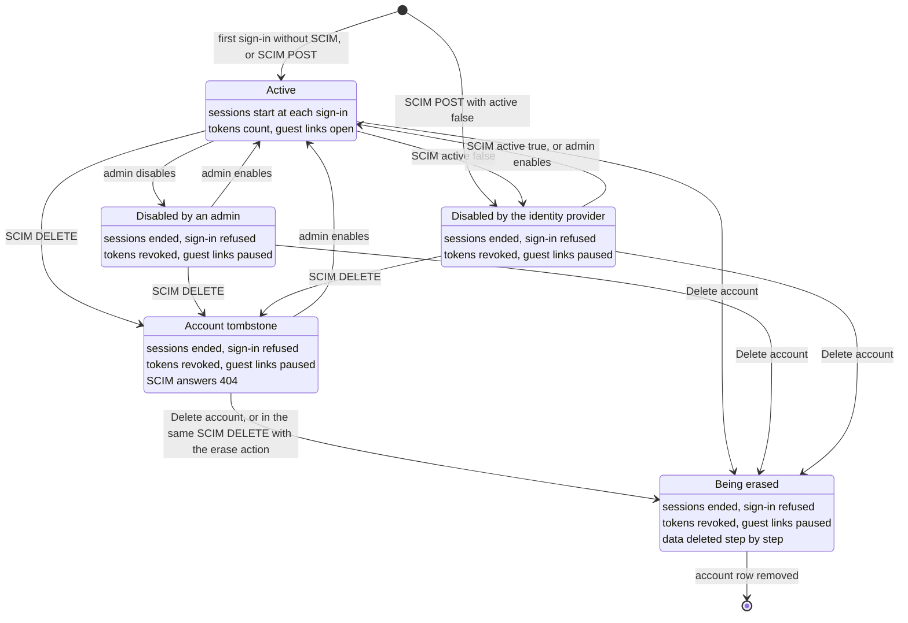

# Create and manage users

## Scope

How accounts come into being and how an admin manages them, across every auth
mode and through the web app's Admin section. Covers first-owner setup
(`local`), adding accounts, instance roles, disabling, erasing, personal access
tokens, and the administration of mode `gateway` with SCIM 2.0 provisioning. It
does **not** cover workspace-level sharing roles (a separate concept, see
below) or the wiring of OIDC and of an API gateway itself (see
[Auth modes](auth-modes.md)).

## How a user arrives, per mode

There is no single "create user" button that fits all modes — where identity
lives depends on the auth mode.

| Mode | User store | First user | More users | Sharing |
|---|---|---|---|---|
| `none` | none (one anonymous principal) | – | – | no (no scoped identity) |
| `apikey` | none (one static principal) | – | – | no |
| `local` | Postgres + argon2id | **first-run owner setup** | admin creates them (initial password) | yes |
| `oidc` | your IdP + a JIT mirror | first login (or allowed group) | IdP + invitations | yes |
| `gateway` | your IdP behind an API gateway + a JIT mirror | first sign-in through the API gateway; not admin by default ([First administrator](auth-modes.md#first-administrator)) | first sign-in, or SCIM 2.0 (then only SCIM) | yes |

`local` is the only mode with an in-app "create account" action, and it is the
default of the Stack Compose recipe rather than of the server itself (the server
default is `infer`, which resolves to `apikey` when `INQTRIX_SERVER_API_KEY` is
set and to `none` otherwise); the single-operator `none`/`apikey` modes have no
scoped identity and therefore no user management or sharing.

## Two role concepts — do not conflate them

- **Instance role** (`admin` / `user`) — instance-wide. `admin` unlocks the
  Admin section. The `/api/auth/session` payload carries the instance role as
  `user.role` (nested under `user`, not at the top level); the UI gate is
  default-closed (anything that is not exactly `admin` yields no admin surface).
- **Workspace role** (viewer / commenter / editor / owner) — membership and
  administration inside one workspace. It never implies access to a run,
  collection, prompt, or skill; those resources use explicit direct
  `view`/`edit` shares. Workspace membership only limits who may share when
  `INQTRIX_SHARING_RESTRICT_TO_WORKSPACE_MEMBERS=true`.

Promoting someone to instance `admin` does not change their workspace roles, and
vice versa.

### Multiple admins do not require workspaces

An instance may have two, three, or more active admins. Creating an account as
an instance admin does **not** create a workspace and does not require a
workspace membership. An instance admin without any workspace membership can
administer users, quotas, and workspaces. Quotas are independent as well. With
`INQTRIX_QUOTA_ENABLED=false`, adding users or admins does not activate
metering or impose an implicit limit. Details:
[Auth modes](auth-modes.md#instance-admin-workspace-management) and
[quota administration](auth-modes.md#instance-admin-quota-administration).

## `local`: first-run owner setup

On the first start of a `local` deployment the web app shows an **owner setup**
screen instead of the lock screen. The account you create there:

- becomes the **instance admin**;
- is logged in immediately (the server sets the session cookie);
- is the only owner — the setup screen never appears again (a second attempt is
  refused, race-safe).

The gate is driven by `GET /api/auth/config`, whose `registration.needs_owner`
flag is `true` only in `local` mode with no owner yet; `GET /api/setup/status`
answers from the same credential store, but it is registered in `local` mode
alone — every other mode returns `404` rather than `false`.

```bash
# Probe the gate (local mode, fresh DB)
curl -s http://localhost:8080/api/setup/status        # -> {"needs_owner":true}
```

## Adding more accounts (`local`)

An admin opens **Settings → Admin → Users → Create user** and enters an
email, optional display name, an initial password (the dialog can generate a
strong one), and a role. The initial password is shown **once** — copy it and
share it securely with the person; it is never retrievable again. There is no
email delivery; you hand the credentials over out-of-band.

Behind the UI this is `POST /v1/admin/users` (admin-session-only; a personal
access token can never administer users):

```bash
curl -s -X POST http://localhost:8080/v1/admin/users \
  -H 'Content-Type: application/json' -H "X-CSRF-Token: $CSRF" -b cookies.txt \
  -d '{"email":"mara@example.com","password":"correct-horse-battery-staple","instance_role":"user"}'
```

Account-creation policy is `INQTRIX_LOCAL_REGISTRATION` — `closed` (the
default) or `open`. Neither setting mounts a public signup route: `open` only
makes `GET /api/auth/config` report `registration.self_service: true`, an
advisory hint for a frontend. Accounts are always created through the
first-run owner setup or by an admin.

For `oidc` and `gateway`, users already live in the directory or IdP, and there
is no local "create": they appear in the mirror on first login, or in mode
`gateway` with SCIM when the IdP provisions them (see
[Administration in `gateway` mode](#administration-in-gateway-mode)).

## Managing users (all multi-user modes)

In **Settings → Admin → Users** an admin can, per row:

- **Change the instance role** (admin ↔ user) via the role select;
- **Disable / enable** via the status switch — disabling is a complete cut-off:
  the mirror flag is set, live sessions are purged, personal access tokens are
  revoked, and (for `local`) the password credential is disabled so login is
  refused. Re-enabling permits a fresh login but restores no old session or
  token; the user must sign in again and create new tokens when needed.

Two invariants protect the deployment from locking itself out, enforced
server-side (atomic) and reflected in the UI (the control is disabled with a
tooltip):

- you **cannot disable or demote yourself** (the "Sie"/"You" row);
- the **last active admin** can be neither demoted nor disabled.

### Erasing an account

Erasing removes an account together with everything it owns. It needs the
PostgreSQL backend and the deletion worker; the memory backend answers `503`.

**Preview first.** `GET /v1/admin/users/{id}/erasure-preview` counts what the
erasure reaches, rule by rule: the rows that are deleted (`deleted_rows`),
the aggregates that go through their own deletion (`delegated_rows`: library
sections with their files and blobs, knowledge collections and documents with
their vectors,
vector indexes, Agent and Knowledge Desk sessions, runs with their
checkpoints), the rows in other people's work that
move to the "Deleted account" placeholder (`reassigned_rows`) or lose their
reference to the account (`cleared_rows`), and anything that blocks the
erasure (`blockers`). `foreign_rows` counts the comments colleagues wrote
inside the account's own documents: those documents are deleted, and the
comments in them go with them.

**Start.** `DELETE /v1/admin/users/{id}` answers `202` with a deletion
operation. Follow it with `GET /v1/deletion-operations/{operation_id}`, sent
without a workspace, until its status is `deleted`. The deletion worker runs
it in steps:

1. **Cut off.** In the same transaction that starts the erasure, the
   account's sessions end, its personal access tokens are revoked and its
   password is refused. From then on every sign-in, enable or role change
   of the account is refused (`409 erasure_in_progress`), and the user list
   carries the operation in `erasure_operation_id`. A run or reindex job the
   account carries stops at its next safepoint, as it does when an account is
   disabled.
2. **Aggregates.** Data outside PostgreSQL goes first, through the same
   deletion operations the owner's own delete would start: the library
   section by section, each with its files and their blobs, knowledge
   documents the account added to other people's collections, its own
   collections with their vectors, vector indexes, sessions, and runs with
   their checkpoints. Last come sources that outlived their file, section or
   document: a source still marked live although nothing it belonged to
   exists any more. Each goes as a deletion of its own (target kind
   `source`): the Knowledge store removes whatever it still holds for that
   source, the erasure verifies that nothing remains, and the source keeps
   its source tombstone (below). Without the Knowledge service such a
   deletion fails rather than assume the source is empty.
3. **Rows.** The account's own rows are deleted in short batches, its
   comments in other people's documents included. Rows that belong to other
   people keep their content: a mention of the account is removed from a
   colleague's comment; an edit or a resolved comment thread in somebody
   else's document is attributed to the tenant's "Deleted account"
   placeholder, which is disabled, has no credential and is not listed; any
   other reference is cleared.
4. **End.** When nothing but the retained records names the account, the
   account row is removed.

Only the first and the last step take the tenant's security lock, each for
one short transaction like any other account change. The steps in between
hold no lock that sign-ins or other people's work wait for, so a large
account can be erased while everyone keeps working.

**What stays.** The audit log keeps every entry with its pseudonymous actor;
the account id it named becomes unresolvable. The usage ledger keeps its
rows until its own retention (`INQTRIX_USAGE_RETENTION_DAYS`) removes them.
Every source the erasure deleted (a library section, a file, a knowledge
document) keeps the *source tombstone* its deletion leaves: a row in
`source_lifecycles` with the source id, the account id and the state
`deleted`, and no content. It makes sure a late request cannot bring the
source back; the account id in it becomes unresolvable as well. It is not the
account tombstone that a SCIM `DELETE` leaves
([The lifecycle of an account](#the-lifecycle-of-an-account)).
Traces stay too: with content capture on, what the account's runs sent to and
received from the models stays in the tracing backend until
`INQTRIX_TRACE_RETENTION_DAYS` removes it. An erasure does not reach it, see
[Security model](security-model.md).

**Refusals** (`409`):

- `self_erase`: an admin cannot erase their own account;
- `last_admin`: the last active admin cannot be erased;
- `erasure_refused`: the account created a workspace that other people work
  in. `reasons` lists these workspaces with the same lines the preview shows
  as `blockers`; reassign or delete them first;
- `deletion_in_progress`: another administrator started erasing this account,
  and only that administrator can follow or retry the operation.

**Failure and retry.** If a step cannot finish, for example because a store
is unreachable or a run of the account is still stopping, the operation ends
as `delete_failed` with the reason, and the account stays cut off. Deleting
the account again resumes the same operation where it stopped; nothing that
is already gone is deleted twice.

**In the UI.** **Settings → Admin → Users → (row) → Delete account** shows
the preview and asks for the account's address before it starts. The row
then reads "Deleting" with its step and count (for example "Content
removed (2/5)") and leaves the list when the account is gone; its role,
status, password and delete controls are off meanwhile. A failed erasure
shows the reason and **Try again**. An erasure the list still names but that
cannot be read through the account (its start failed before it got an
operation, or another administrator holds it) reads "Deleting" with
**Try again** as well: deleting the account again resumes it, or the panel
shows the refusal, 409 `deletion_in_progress` while another administrator
holds it. The list follows up to ten erasures at a time; further accounts
read "Deleting" until one of them is done. Where
an erased account's edits stay in somebody else's document, the document's
activity names them "Deleted account" in the reader's language.

## Administration in `gateway` mode

In mode `gateway` an API gateway in front of Inqtrix signs people in, and
Inqtrix checks its assertion on every request; the setup is described in
[Mode `gateway`](auth-modes.md#mode-gateway). The admin surface works as in
the other cookie-session modes: **Settings → Admin → Users** lists the
accounts, changes the instance role, disables, enables and erases. What
differs is where accounts come from, what the identity provider can do to them
through SCIM 2.0, and what becomes of the accounts of an earlier mode.

### How accounts appear

Every account of the mode belongs to the identity source: the issuer key
(`INQTRIX_GATEWAY_JWT_ISSUER` in sub-mode `jwt`, `INQTRIX_GATEWAY_ISSUER_KEY`
otherwise) together with the person's subject. Inqtrix never matches accounts
by email: the same address under another subject is another account.

Keep the issuer key stable. Another value, for example after the identity
provider moved to a new host or realm name, starts a new identity source:
without SCIM every person gets a new, empty account at the next sign-in, with
SCIM every person gets `not_provisioned` until provisioned again, and the old
accounts stay behind with their data like the accounts of an earlier mode
([Switching from `local`](#switching-from-local)). Nothing moves accounts
from one issuer key to another.

| | Without SCIM (default) | With SCIM (`INQTRIX_SCIM_ENABLED=true`) |
|---|---|---|
| An account appears | at the person's first session start through the API gateway (just in time), if the admission gates of the mode let the person in | when the identity provider creates it through SCIM, also before the person's first sign-in |
| A sign-in without an account | creates one | is refused with 403 `not_provisioned`; the UI shows "Not provisioned yet" |
| Start line of the API server | `scim=off` | `scim=on` |

When people get `not_provisioned` although the identity provider shows them
as provisioned, the most common cause is the attribute mapping: the SCIM
`externalId` must carry the same immutable id that the API gateway sends as
the subject. With Microsoft Entra ID that is the `objectId`, which the token
carries as `oid` (`INQTRIX_GATEWAY_SUBJECT_CLAIM=oid`), so map `objectId` to
`externalId` (not live tested). A wrong mapping never creates a second account; it shows as
`not_provisioned`.

Profile values follow the latest source. A sign-in whose assertion carries an
email or a name overwrites that value; one that carries none leaves the stored
value in place, for example the one SCIM wrote. A missing name falls back to
the email and then to the subject, and only fills a name that is still empty.

### The lifecycle of an account

The diagram answers: what can happen to an account in mode `gateway`, who
causes each change, and what does each state mean for the person's browser
sessions, personal access tokens and guest links? It covers both ways of
creating accounts, with SCIM and without. Two terms first: an *account
tombstone* is what a SCIM `DELETE` leaves, a disabled account that SCIM no
longer sees and that neither a sign-in nor SCIM brings back; *Delete account*
is the admin action that starts the erasure of an account with everything it
owns ([Erasing an account](#erasing-an-account)).



Every arrow into a state other than **Active** ends the person's sessions
and revokes the personal access tokens in the same transaction; a sign-in in
such a state gets 403 `account_disabled`. The arrows back to **Active**
restore neither: the person signs in again and creates new tokens, and the
paused guest links work again unless they expired
([Guest links of inactive owners](#guest-links-of-inactive-owners)). Only an
admin brings back what an admin disabled or what a SCIM `DELETE` left: SCIM
`active: true` lifts only a lock that SCIM set, and against an admin's lock
it changes nothing and records `user.scim_enable_ignored`. An account
tombstone keeps its subject blocked, so a SCIM `POST` with it answers 409,
until an admin enables the account or an erasure removes it. When an erasure
ends, the account row is gone with its documents and their guest links, and
nothing blocks the subject any more: without SCIM the person's next sign-in
creates a new, empty account, with SCIM the next `POST` with the same
`externalId` does ([Removing a person](#removing-a-person)). The states are
data on the account row, shown in [What the admin list shows](#what-the-admin-list-shows);
the arrows are the admin actions and SCIM requests described below.

### First administrator

No sign-in becomes admin by default. In sub-mode `jwt` an admin group or role
at the identity provider (`INQTRIX_OIDC_ADMIN_GROUPS`,
`INQTRIX_OIDC_ADMIN_ROLES`) grants admin at the session start; in sub-mode
`header` and with a resolver of your own, admin never comes from groups or
roles. In every sub-mode, `INQTRIX_GATEWAY_FIRST_USER_OWNER=true` makes the
first person of the identity source who signs in an admin, as long as the
source has no active admin; with SCIM that person must be provisioned first.
Only admins bound under the identity source count, for this switch and for the
last-admin rule alike, so admins of an earlier mode do not. Once the source has
an active admin, the switch changes nothing; set it back to `false` then,
because a new identity source (another issuer key) would otherwise make its
first person admin again. SCIM never changes a role. The order of steps is in
[First administrator](auth-modes.md#first-administrator).

### Roles a sign-in grants

A sign-in only ever grants admin and never withdraws it. When a session start
changes the role, from the admin group or role of a `jwt` token or as the first
owner, the same transaction writes, next to `user.login_admitted`, the audit
entry `user.role_updated` with the detail
`{"instance_role": "admin", "source": "login_claim"}` (group or role) or
`{"instance_role": "admin", "source": "first_owner"}`; its actor is the person
who signed in. A role change in the admin UI writes the same action with the
administrator as actor and without a `source`. Both appear in
**Settings → Admin → Audit**. If you demote a person who is still in the admin
group or role at the identity provider, the next session start grants admin
again, so remove the person there first. Mode `oidc` records its sign-ins the
same way.

### Switching from `local`

Local accounts carry the issuer `local`, gateway accounts the issuer key of
the identity source, so every person gets a new account at the first sign-in
through the API gateway or through SCIM. Runs, documents, workspaces and shares
stay with the old accounts, and there is no way to transfer them to the new
ones. The old accounts cannot sign in in mode `gateway`, which has no password
login, but they stay in the admin list, and share search and quota selection
still offer them, because both search all active accounts, whatever their
source. Disabling an old
account takes it out of both; its guest links then pause (see
[Guest links of inactive owners](#guest-links-of-inactive-owners)), and the
people it shared with keep reading.

Personal access tokens of the old accounts answer 401 from the switch on: in
mode `gateway` a token counts only when its owner is bound under the identity
source. Each such request writes a WARNING log line and one audit entry
`pat.rejected` with the detail `{"reason": "foreign_issuer"}`, attributed to the
token's owner; a token that is already revoked, expired, older than
`INQTRIX_GATEWAY_PAT_MAX_TTL_DAYS` or owned by a disabled account is refused
with that reason instead. An automation runs again once its person has signed
in through the API gateway and created a new token under
**Settings → Account → Access tokens**. Modes `local` and `oidc` accept a token
whatever source its owner belongs to, so the gap can be closed in advance only
with a trial start: switch to `gateway` briefly, let the people behind
automations sign in and create their new tokens, switch back, move the
automations to the new tokens, and then switch for good.

If neither an admin group nor `INQTRIX_GATEWAY_FIRST_USER_OWNER` gives you the
first admin of the source, the same round trip helps: sign in once through the
API gateway, switch back to `local`, promote the new account in the admin UI
as an old admin, and switch to `gateway` again. More in
[Switching an existing deployment](auth-modes.md#switching-an-existing-deployment).

### Removing a person

Without SCIM nothing tells Inqtrix that a person left, and deleting the
account revokes no access: the erasure removes the account row, and the
person's next sign-in through the API gateway creates a new, empty account.
Remove the person at the API gateway or at the identity provider. Inside
Inqtrix only the admin disable blocks at once, and it keeps blocking, because a
sign-in never enables an account again. What ends when, personal access tokens
included, is in [Revoking access](auth-modes.md#revoking-access).

With SCIM, an erasure that an admin starts does not end the person's access
either: once the account row is gone, a SCIM `POST` with the same `externalId`
creates a new, empty account, for example at the next sync of an identity
provider that still provisions the person. Remove the person, or the person's
assignment to Inqtrix, at the identity provider; its SCIM `DELETE` leaves an
account tombstone that keeps the identifier blocked.

### Workspace membership without invitations

Accepting a workspace invitation by signing in needs an email address that the
identity provider confirms. In sub-mode `header` and with a resolver of your
own no sign-in carries one; in sub-mode `jwt` only a token whose `email` claim
comes with `email_verified: true` does. `GET /api/auth/config` reports this in
`registration.invitations_accepted_by_login` (`false` for `header` and for a
resolver of your own), and creating an invitation answers with the same value
as `accepted_by_login`. Where it is `false`, an invitation stays open, but no
sign-in accepts it. The instance admin then assigns people in
**Settings → Admin → Workspaces** (`POST /v1/admin/workspaces/{workspace_id}/members`;
see [Instance-admin workspace management](auth-modes.md#instance-admin-workspace-management)).
A workspace owner without instance admin rights cannot add anyone in that
case, and with `INQTRIX_SHARING_RESTRICT_TO_WORKSPACE_MEMBERS=true` sharing
depends on these assignments.

### SCIM 2.0 provisioning

With `INQTRIX_SCIM_ENABLED=true` the API server serves the SCIM 2.0 `Users`
resource under the path `/v1/scim/v2`, which the SCIM client reaches at an
entrance of its own ([Switching SCIM on](#switching-scim-on);
[Entrances and paths](auth-modes.md#entrances-and-paths)),
and SCIM becomes the
only way an account is created. It exists only in mode `gateway` (in any other
mode the setting is a start error), and `INQTRIX_REGISTRATION=invite` is a
start error beside it. SCIM sees only accounts bound under the identity source:
local accounts, accounts of another issuer and the "Deleted account"
placeholder answer 404. It covers users, not groups, and never changes a role.

| Variable | Default | Meaning |
|---|---|---|
| `INQTRIX_SCIM_ENABLED` | `false` | Serve the SCIM endpoints (mode `gateway` only). |
| `INQTRIX_SCIM_TOKEN` | empty | Bearer token of the SCIM client, at least 32 characters. |
| `INQTRIX_SCIM_DELETE_ACTION` | `disable` | What `DELETE /Users/{id}` does: `disable` or `erase` (below). |

#### Switching SCIM on

Inqtrix is the SCIM service provider, the server side of RFC 7644: it answers
on the endpoints below. The SCIM client is the provisioning service of your
identity system, which sends one request for every person it creates,
changes, deactivates or deletes. Not every identity system has one. Microsoft
Entra ID provisions through an enterprise application (attribute mapping in
[How accounts appear](#how-accounts-appear)); no identity system's SCIM
client is live tested. The local acceptance setup with Keycloak contains no
SCIM client: SCIM requests reach it straight at the web gateway port. Without
a SCIM client, leave SCIM off: accounts then appear at the first sign-in, and
an admin disable removes access at once.

1. **Create the token**: at least 32 random characters, for example from
   `openssl rand -hex 32`. Put `INQTRIX_SCIM_TOKEN` into the secrets file
   (Compose: `deploy/.env.stack.secrets`; Helm: the Secret, see
   [Kubernetes](kubernetes.md#secrets)); the deploy CLI refuses it in the
   stack configuration.
2. **Switch it on**: `INQTRIX_SCIM_ENABLED=true` in the stack configuration
   (Helm: `config:`), plus `INQTRIX_SCIM_DELETE_ACTION=erase` if a SCIM
   `DELETE` should also erase the account. Re-create the API server and the
   worker (Compose: `up -d`, because a `restart` keeps the old environment); both check the token at start. The API server's start line
   `Gateway authentication: ...` then contains `scim=on`.
3. **Open an entrance.** An *entrance* is a host or path in front of the web
   gateway. The SCIM client needs one that does not pass the sign-in of the
   API gateway, because the sign-in layer answers requests without its own
   session itself (oauth2-proxy with `--api-route=^/v1/` answers 401). A
   typical entrance is a host of its own at your TLS load balancer, for
   example `scim.example.com`, that forwards only paths below `/v1/scim/v2/`
   to the web gateway. A cloud identity system calls from the internet, so
   the entrance must be reachable from there over HTTPS; an identity system in
   your own network needs only an internal route. In Compose the web
   gateway's port listens on `127.0.0.1` by default
   (`INQTRIX_WEB_BIND_ADDRESS`), so the entrance is for example a reverse
   proxy on the same host; in Kubernetes it is a route of its own to the web
   Service. While the entrance is not in the web gateway's peer list, the web
   gateway removes identity headers that arrive through it; the SCIM routes
   read none either way.
4. **Configure the client** with the base URL
   `https://<ENTRANCE-HOST>/v1/scim/v2` and the token as a Bearer token
   (Entra ID calls them tenant URL and secret token), and map `externalId` to
   the subject the API gateway sends, the claim named in
   `INQTRIX_GATEWAY_SUBJECT_CLAIM` (Keycloak: `sub`; Entra ID: `objectId`,
   which the token carries as `oid`).
5. **Check the connection:**

   ```bash
   curl -si -H "Authorization: Bearer <SCIM-TOKEN>" \
     https://<ENTRANCE-HOST>/v1/scim/v2/ServiceProviderConfig
   ```

   The answer is 200 with `content-type: application/scim+json` and a
   document whose `patch` says `"supported": true`. Without the token, or with
   a wrong one, the answer is 401 with a SCIM error, and the API server logs
   `Gateway sign-in rejected (outcome=scim_unauthorized; ...)` at most once a
   minute. A redirect, a sign-in page or a 401 without a SCIM body comes from
   the sign-in layer: the entrance still passes through it.
6. **Provision.** Start the provisioning, the first sync, in the identity
   system. A `POST` with the subject of an account that a sign-in created
   before SCIM adopts that account (audit `user.scim_adopted`). A `POST` for a
   subject that SCIM already bound, for an account tombstone, for an account
   being erased, or with a `userName` that another account of the source
   carries answers 409 `uniqueness` and creates nothing; every other `POST`
   creates one (`user.provisioned`). From step 2 until a person is
   provisioned, a sign-in without an account gets 403 `not_provisioned`
   ("Not provisioned yet"), while existing accounts keep signing in, also
   those that the identity system never provisions, until an admin disables
   them. In a new installation, provision the first admin before that
   person's first sign-in.

#### Endpoints and rules

**Endpoints**, relative to `/v1/scim/v2`:

| Method and path | Behaviour |
|---|---|
| `GET /ServiceProviderConfig` | `patch` supported; `bulk`, `sort`, `etag` and `changePassword` not; `filter` with `maxResults` 200; authentication `oauthbearertoken`. |
| `GET /ResourceTypes`, `GET /ResourceTypes/User` | The `User` resource type only. |
| `GET /Schemas`, `GET /Schemas/urn:ietf:params:scim:schemas:core:2.0:User` | The `User` schema with the attributes Inqtrix keeps. |
| `POST /Users` | 201 with `Location`. Creates the account, or adopts an account of the identity source that SCIM never bound (for example one a sign-in created before SCIM was on): it keeps its `id`, and the audit records `user.scim_adopted`. 409 `uniqueness` when the `externalId` belongs to a bound account, a tombstone or an account being erased, or when the `userName` is taken. |
| `GET /Users` | `filter` is `userName eq "..."` (any case) or `externalId eq "..."` (exact), nothing else (400 `invalidFilter`); `startIndex` counts from 1, `count` is 100 by default and at most 200. Disabled accounts are listed, tombstones and accounts being erased are not. |
| `GET /Users/{id}` | 200; 404 for a tombstone, an account being erased or an account outside the identity source. |
| `PUT /Users/{id}` | Replaces the profile (below). |
| `PATCH /Users/{id}` | Changes single attributes (below). |
| `DELETE /Users/{id}` | 204; deactivates the account and leaves a tombstone, with `erase` also starts its erasure (below). |

Setting `active` to `false` on, or deleting, the last active admin of the
identity source answers 409, so the identity provider cannot lock out the last
admin who can still sign in. `Location` and `meta.location` use
`INQTRIX_PUBLIC_BASE_URL` when it is set, also when the SCIM client reaches
Inqtrix at an entrance of its own.

**Attribute mapping:**

| SCIM attribute | In Inqtrix | Rules |
|---|---|---|
| `id` | the account's internal id | Set by Inqtrix; an `id` in a `POST` body is ignored. |
| `externalId` | the subject the account is bound under | Required in `POST`, at most 255 characters, matched exactly. Immutable: a request may repeat it but never change it (400 `mutability`). Must be the id the API gateway sends as the subject. |
| `userName` | the SCIM user name | Required, at most 255 characters, unique within the identity source without regard to case (409 `uniqueness`). An account that SCIM never bound shows its `externalId` here. |
| `displayName` | the display name (admin list, share search) | At most 256 characters. |
| `name` | `givenName`, `familyName`, `formatted` | At most 256 characters per part; empty parts are dropped. |
| `emails` | the account's email: the entry with `primary: true`, otherwise the first | At most 320 characters; unconfirmed until a sign-in brings a confirmed address. Returned as one entry with `type: work` and `primary: true`. |
| `active` | `false` disables the account | A boolean, or the text `"true"` or `"false"` in any case; `true` when a `POST` leaves it out. |
| `meta` | `resourceType`, `created`, `location` | No `lastModified`. |
| everything else (`roles`, `groups`, `title`, extension schemas) | not kept | No effect, in `PATCH` too. |

Text values with control characters or lone surrogates are refused (400
`invalidValue`), and a filter value that no attribute could hold is refused as
400 `invalidFilter`.

**PUT** replaces `userName`, `displayName`, `name` and `emails`, and clears
what the body leaves out; `userName` is required. `active` changes only when
the body carries it: without it, the account keeps its state. An `externalId`
in the body must equal the account's.

**PATCH** applies its `Operations` in order; `op` is `add`, `replace` or
`remove` in any case, and `add` acts like `replace`. The paths are `active`,
`userName`, `displayName`, `name`, `name.givenName`, `name.familyName`,
`name.formatted`, `emails`, `emails[type eq "work"].value` and `externalId`, in
any case and also with the prefix `urn:ietf:params:scim:schemas:core:2.0:User:`.
Without a path, the value is an object whose keys are such paths, for example
`{"op": "replace", "value": {"active": false}}`. A `name` object sets only the
parts it names. `remove` clears `displayName`, `name`, one part of `name` or
`emails`; it needs a path (400 `noTarget`), and removing `userName`,
`externalId` or `active` is refused (400 `mutability`). Paths of attributes
Inqtrix does not keep change nothing and are no error.

**`active`.** `false` disables the account with the complete cut-off of an
admin disable (sessions, live streams and personal access tokens end) and
records the lock as one from provisioning. `true` lifts only such a lock: a
disable by an administrator stays, and so does an older disable without a
recorded source. The answer then still says `"active": false`, and the audit
records `user.scim_enable_ignored`. A sign-in never enables an account again.

**DELETE** acts by `INQTRIX_SCIM_DELETE_ACTION`:

| Value | Effect |
|---|---|
| `disable` (default) | In one transaction the account is disabled with the complete cut-off (an existing admin disable keeps its source) and becomes an account tombstone. Its data stay. |
| `erase` | The same, then the erasure of the account starts as **Delete account** would start it (see [Erasing an account](#erasing-an-account)), at most 10 erasure starts per hour. |

A tombstone is gone for SCIM: every later request on it answers 404, and the
list never shows it. A sign-in of the person gets 403 `account_disabled`. The
tombstone gives up its `userName`, so a new person can be provisioned under
the same user name (for example a reused UPN), but its `externalId` stays
blocked: a `POST` with it answers 409 `uniqueness`. An identity provider that
hands an identifier to someone new therefore never reaches the old account,
through SCIM or through a sign-in; while the tombstone stands, that identifier
gets no account at all. Once an erasure has removed the account row, the
tombstone is gone with it, and the `externalId` can be provisioned again as a
new, empty account.

With `erase`, the erasure belongs to no administrator: any active admin can
follow it (`GET /v1/admin/users/{id}/erasure`) and resume it with
**Delete account**. When the hourly limit is reached, the `DELETE` starts no
erasure and logs the WARNING `scim_erase_limited`. When the erasure is refused
(the account created a workspace that other people work in), the audit
records `user.erasure_refused` with the reasons, and the erasure preview names
them. In both cases SCIM still gets 204, the account stays a tombstone marked
"Erasure pending", and an administrator starts the erasure with
**Delete account**, after resolving what blocks it in the second case. A leaked
SCIM token thus cannot erase every account within minutes.

One limit is named. When an erasure fails to start after the account was
marked for erasure (the `DELETE` logs `scim_erase_start_failed`), the
administrator who resumes it with **Delete account** becomes its owner: other
administrators then see no progress for it and get 409 `deletion_in_progress`,
and at its end the audit names that administrator.

**Restoring a tombstone.** Only an administrator brings a tombstone back:
enabling it in the admin list (`POST /v1/admin/users/{id}:enable`) lifts the
tombstone and the lock together, and the audit entry `user.enabled` carries the
detail `{"restored_from_deprovisioning": "true"}`. The account returns with its
role and data, but without a SCIM user name until the identity provider binds
it again: a `POST` with the same `externalId` adopts it, and a `PUT`, or a
`PATCH` with `userName`, sets the name. Until then SCIM shows its `externalId`
as `userName`. Since the identifier may belong to another person by now, the
admin list asks before it enables a tombstone.

**Token and requests.** Only `Authorization: Bearer <INQTRIX_SCIM_TOKEN>` opens
the SCIM routes, every one of them; a cookie or a personal access token never
does, and the SCIM token opens no other route. Whitespace around the
configured value is ignored. The comparison runs over SHA-256 digests in
constant time, so it reveals neither the token's length nor its content. A
missing or wrong token answers 401 and counts as the outcome
`scim_unauthorized`, which the log reports at most once a minute. The token is
read at start: to rotate it, set the new value in Inqtrix and in the SCIM
client and re-create the API server (Compose: `up -d`, because a `restart` keeps the old environment). Bodies are JSON (`application/scim+json` or
`application/json`, otherwise 415) of at most 64 KiB (otherwise 413, also
without a declared length). Answers are `application/scim+json`, and errors
use the SCIM error message (`status`, `detail`, and `scimType` where RFC 7644
defines one). Neither the log nor the audit carries a SCIM value: log lines
name the operation, the outcome or the status and `scimType`, and the account
only by its pseudonym; audit entries name attributes only.

### What the admin list shows

| Status in **Settings → Admin → Users** | Fields in `GET /v1/admin/users` | Meaning |
|---|---|---|
| Disabled | `disabled: true`, `disabled_source: "admin"` (`null` for an older disable without a recorded source) | An administrator disabled the account. |
| Disabled "by the identity provider" | `disabled: true`, `disabled_source: "provisioning"` | SCIM set `active` to `false`. |
| Deleted by the IdP | `deprovisioned: true` | A SCIM `DELETE` left a tombstone. |
| Deleted by the IdP, Erasure pending | `deprovisioned: true`, `erasure_pending: true` | With `erase`: no erasure runs yet (hourly limit reached, or the erasure was refused); **Delete account** starts it. |
| Deleting | `erasure_operation_id` set | An erasure runs; see [Erasing an account](#erasing-an-account). |

Enabling an account that the identity provider locked or deleted asks for
confirmation first. A lock of the identity provider can be set again by the
next sync that sends `active: false`; the identifier of a tombstone may belong
to another person by now, who would then sign in to the old account.

### Audit of provisioning

Every change SCIM makes is written with the actor type `provisioning` and
without a user id; **Settings → Admin → Audit** names the actor
"Identity provider (provisioning)".

| Action | Written when | Detail |
|---|---|---|
| `user.provisioned` | `POST` created an account | `fields`: the attributes the body set, and `active` |
| `user.scim_adopted` | `POST` bound an existing account of the identity source | none |
| `user.scim_updated` | `PUT` or `PATCH` changed `userName`, `displayName`, `name` or `emails` | `fields`: the changed attributes |
| `user.disabled`, `user.enabled` | SCIM changed `active`; a `DELETE` of an enabled account writes `user.disabled` first | none |
| `user.scim_enable_ignored` | `active: true` met a disable by an administrator | none |
| `user.deprovisioned` | `DELETE` left a tombstone | none |
| `user.erasure_started` | `erase` started the erasure | `operation_id` |
| `user.erasure_refused` | `erase` could not start the erasure | `reasons`, as the erasure preview shows them |
| `user.erased` | an erasure that SCIM started ended, also when an administrator followed or resumed it (after a failed start, the administrator who resumed it is the actor) | `operation_id` |

### Guest links of inactive owners

A guest link is access from outside that only an active owner manages. While
the owner of a document is disabled (by an administrator or by the identity
provider), deleted by the identity provider or being erased, its guest links
pause: the link page, unlocking, the guest session and the guest's
collaboration lease answer `423` with the error type `guest_link_unavailable`
("This link is currently unavailable."), the guest page shows "Link currently
unavailable", and edits a guest sends meanwhile are not stored. Nothing is
revoked: once the owner is active again, the link and open guest sessions work
again, unless they expired in the meantime. An erasure deletes the documents
with the account, and their links with them. People inside Inqtrix who received
a document through a share keep reading it. This holds in every auth mode.
Switching guest links on is described in
[Switching guest links on](../configuration/settings-and-env.md#switching-guest-links-on).

### Database schema and the way back

SCIM keeps its state in four columns that migration `0097_scim_users` adds to
`users`: the SCIM user name, the `name` object, the tombstone and the source of
a disable. The migration only adds nullable columns, and its downgrade to
`0096` works as long as no account carries SCIM state. Once one carries a SCIM
user name or `name`, a tombstone or a lock from provisioning (in practice from
the first SCIM write on), the downgrade refuses with the counts of these rows
and changes nothing, because dropping that state would change how accounts map
to identities. A disable by an administrator is no SCIM state. The way back to
the previous release is then to restore the database backup taken before the
upgrade, and everything written after it is lost; see
[SCIM provisioning state](database-migrations.md#scim-provisioning-state-0097_scim_users).
Switching the auth mode back needs no downgrade (see
[Switching an existing deployment](auth-modes.md#switching-an-existing-deployment)),
but turn `INQTRIX_SCIM_ENABLED` off and remove `INQTRIX_GATEWAY_RESOLVER`
first: outside mode `gateway` either one stops the start of the API server
and the worker.

## Passwords (local mode)

Passwords must be at least 12 characters: owner setup, admin-created accounts,
admin password resets, and a user's own password change all reject a shorter one
with `400`, and the dialog shows the same "min. 12" hint. Length is the only
hard rule — the character-class hints beside the field feed the strength meter
and never block submission.

- **Change your own password** — a signed-in local user opens **Settings →
  Account → Security → Change password**, enters the current password and a new
  one. The session stays valid. (`oidc` and `gateway` passwords live
  upstream, so this only appears for `local`.)
- **Forgot a password** — there is no email reset; an admin sets a new one in
  **Settings → Admin → Users → (row) → Reset password**. The new
  password is shown **once** (copy + hand over securely); the user's live
  sessions are ended so the old password stops working immediately. PATs are
  left intact (a reset is not a full disable). To cut off all access instead,
  disable the account.
- **Brute-force protection** — repeated failed logins for the same
  `(email, IP)` are throttled (10 attempts / 5 min → 60 s lockout by default,
  `INQTRIX_LOGIN_RATE_LIMIT_*`); behind a proxy, also rate-limit at the edge
  ([Deploy to production](production-checklist.md#login-rate-limiting)).

## Personal access tokens

Any signed-in user (not just admins) manages **their own** API tokens under
**Settings → Account → Access tokens** — list, create, revoke. A created
token's plaintext is shown **once**; copy it immediately. Use it as a Bearer
token for the native API:

```bash
curl -s http://localhost:8080/v1/runs -H "Authorization: Bearer ipat_..."
```

Tokens are session-scoped to manage (a token can never mint or revoke tokens),
and a disabled user's tokens are revoked by the disable cascade.

In mode `gateway` a token counts only while its owner is bound under the
identity source, and two bounds limit it: `INQTRIX_GATEWAY_PAT_MAX_TTL_DAYS`
(default 90, applied to existing tokens too) and
`INQTRIX_GATEWAY_PAT_INACTIVE_DAYS` (off by default); see
[Revoking access](auth-modes.md#revoking-access).

## Related docs

- [Auth modes](auth-modes.md) — choosing a mode; how each authenticates.
- [Build a UI on Inqtrix](../extending/ui.md) — the native `/v1/runs` API and PATs.
- [Stack quickstart](../getting-started/stack-quickstart.md) — one-command start.
- [Database migrations](database-migrations.md): schema upgrades, downgrades and
  the way back with a backup.
- [Writing a custom auth provider](../extending/auth-provider.md): a resolver of
  your own for mode `gateway`.
