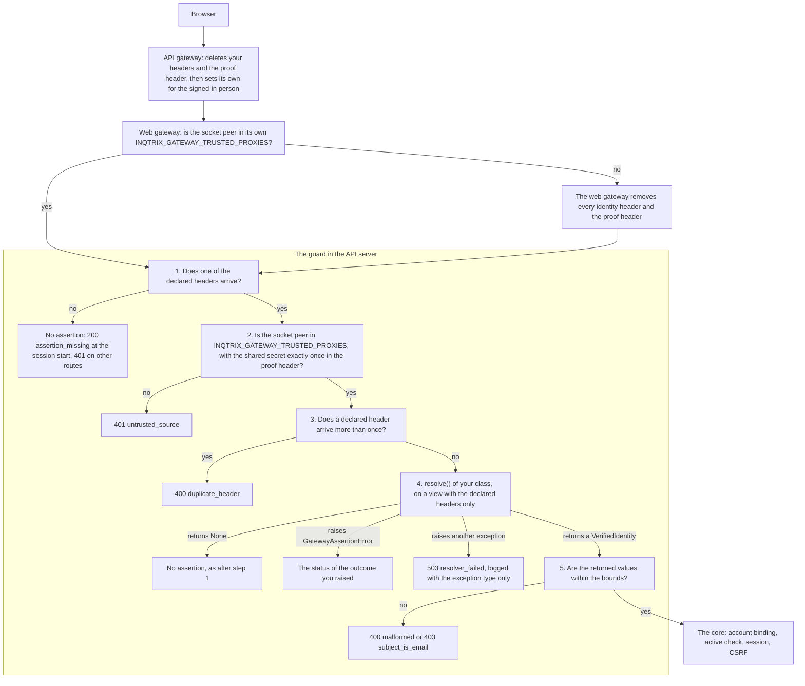

# Writing a custom auth provider

## Scope

How to plug your own authentication into the server when the built-in modes
(`none` / `apikey` / `local` / `oidc` / `gateway`) do not fit. Covers the
`AuthProvider` contract, the `Principal` it returns, the
`create_app(auth_provider=...)` injection seam, and a resolver of your own for
mode `gateway`, from writing it to running it in the Compose stack, on
Kubernetes or in an app you build yourself. For the built-in modes use
configuration instead
([Auth modes](../deployment/auth-modes.md)); to swap a storage backend see
[Writing a custom storage backend](storage.md).

Which seam fits depends on what stands in front of Inqtrix:

| Situation | What to write |
|---|---|
| An API gateway (a sign-in layer, optionally an API management layer) signs people in and passes each person's identity on every request, as a signed token or as identity headers | Nothing: configure [mode `gateway`](../deployment/auth-modes.md#mode-gateway). |
| The same, in a format of your own that the sub-modes `jwt` and `header` cannot read, carried in headers of its own (never in `Authorization` or `Cookie`) | A [resolver of your own](#a-resolver-of-your-own-for-mode-gateway) for mode `gateway`. |
| A browser login of your own (a bespoke SSO) that should get sharing, quotas and the admin surface | A subclass of `OidcAuthProvider` ([below](#reuse-the-session-machinery-recommended-for-cookie-logins)). |
| A gate that only decides whether a request may pass, in front of a single-user deployment (for example an mTLS front end) | An `AuthProvider` of your own. |

## The contract

Every request resolves to a `Principal` through an `AuthProvider`
([`src/inqtrix/auth/principal.py`](../../src/inqtrix/auth/principal.py)). The
ABC is small:

```python
from inqtrix.auth.principal import AuthMode, AuthProvider, Principal
from fastapi import Request


class MyAuthProvider(AuthProvider):
    @property
    def mode(self) -> AuthMode:
        ...  # one of "none", "apikey", "oidc", "local", "gateway"

    def resolve_principal(self, request: Request) -> Principal:
        ...  # the verified principal, or raise HTTPException(401)

    # Optional: build_principal_dependency() for an async check (below), and
    # async aclose() to release what the provider holds at shutdown.
```

`resolve_principal` is the synchronous path. If your check is async (a network
call, a DB lookup), override `build_principal_dependency()` to return an async
FastAPI dependency instead, as `OidcAuthProvider` does for cookie-session
lookups. `aclose()` does nothing by default; the app calls it at shutdown, and
because a lifespan may start again, whatever it closes must reopen on its next
use.

The `Principal` carries the canonical local `user_id`, `kind`
(`anonymous`/`static`/`oidc_session`/`pat`), `tenant_id`, and optional
`display_name`/`email`/`session_id`. The `kind` names the **transport**, not the
identity provider: `oidc_session` is the cookie session of `oidc`, `local` and
`gateway` alike. Scoped surfaces (workspaces, sharing, PAT ownership) require
`kind == "oidc_session"` or `"pat"` plus a non-null `user_id`. The admin
surface and token management also need the `session_id` of a stored session,
and a collaboration lease is issued only for such a session, so a provider
that hands out `oidc_session` principals without stored sessions loses them.
External
issuer/subject values stay inside the authentication adapter and its directory
binding.

`anonymous` and `static` principals always use `user_id=None`. They preserve
the unscoped single-user deployment modes and cannot participate in sharing.

## Reuse the session machinery (recommended for cookie logins)

If your provider is a browser login that should get sharing, quotas, the admin
surface, and CSRF "for free", **subclass `OidcAuthProvider`** and reuse its
session/CSRF/PAT/user-mirror machinery verbatim. The built-in providers of
`local` and `gateway` are built this way: `LocalAuthProvider` passes
`client=None` and differs only in its login route and a synthetic issuer, and
`GatewayAuthProvider` passes `client=None` and starts its sessions from the
API gateway's assertion instead of a login route. Read those for the pattern:

- [`src/inqtrix/auth/local.py`](../../src/inqtrix/auth/local.py)
- [`src/inqtrix/auth/gateway.py`](../../src/inqtrix/auth/gateway.py)

For an unscoped gate, where every request is the one `static` principal,
implementing `AuthProvider` directly is enough. Per-user identity from a header
belongs in mode `gateway` instead of a provider of your own: there the core
provides the canonical-user lookup, the active-user check, CSRF protection and
the lifecycle stores, and a resolver of your own (next section) only reads the
request. Merely returning a UUID from a header is not a safe substitute.

## A resolver of your own for mode `gateway`

In mode `gateway` a resolver turns one request into the identity the API
gateway asserted for it; the sub-modes `jwt` and `header` are the two built-in
resolvers ([Sub-modes](../deployment/auth-modes.md#sub-modes)). A resolver
of your own reads a format they cannot, for example identity headers that your
API gateway encodes or signs in its own way. It only reads: it never creates an
account, starts a session or grants a right, and it hands back no user id,
issuer, tenant or instance role. Binding by issuer key and subject, the active check,
sessions, CSRF, just-in-time creation, personal access tokens, SCIM and
deprovisioning stay in the core, under the issuer key
`INQTRIX_GATEWAY_ISSUER_KEY`, the identity source of the deployment (see the
terms of [Mode `gateway`](../deployment/auth-modes.md#mode-gateway)).

**Not live tested.** A resolver of your own in a real deployment (behind a real
API gateway, loaded from a mounted folder) has not been tested live. What this
section describes is pinned by offline tests, among them the web gateway and
the API server in one process.

From writing a resolver to running it:

1. Write the class: [The resolver contract](#the-resolver-contract) and the
   [Example](#example).
2. Test it without a server: [Testing your resolver](#testing-your-resolver).
3. Name its headers and set the mode:
   [Declaring the headers](#declaring-the-headers) and [Settings](#settings).
4. Run it [in the Compose stack](#running-it-in-the-compose-stack),
   [on Kubernetes](#running-it-on-kubernetes) or in an app you build yourself
   ([The library path](#the-library-path)), make yourself the first admin, and
   run the self-test of the API gateway.

### The resolver contract

A resolver is a class with two members and an optional third:

```python
from collections.abc import Collection

from starlette.requests import Request

from inqtrix.auth.gateway import VerifiedIdentity


class YourResolver:  # satisfies inqtrix.auth.gateway.GatewayIdentityResolver
    header_names: Collection[str]  # the headers resolve reads

    async def resolve(self, request: Request) -> VerifiedIdentity | None: ...

    async def aclose(self) -> None: ...  # optional
```

- `header_names` names every header `resolve` reads, as a collection (a tuple,
  list or set, never a single string). It is read once, at start.
- `resolve` is a coroutine function (`async def`); a synchronous one is a start
  error. It returns `None` when the request carries no assertion of yours, or
  the `VerifiedIdentity` of a person who signed in at the identity provider,
  never the identity of the API gateway itself, of a service or of a client. An
  invalid assertion raises `GatewayAssertionError(outcome)`.
- `aclose()` is optional. The API server calls it at shutdown; release a client
  there, and let it reopen on its next use.

The class needs no base class: `GatewayIdentityResolver` is a protocol
(`typing.Protocol`) that every class with these members satisfies.

`resolve` runs on every request that carries one of your headers and passes
the checks of the core (below): the session start and every later browser
request, the request that renews the collaboration lease every 30 seconds
included. It never runs for a personal access token, and a running event
stream does not call it again. Keep it fast and cache what you fetch, such as
keys. Inqtrix puts no time limit around `resolve`, so give every network call
a time limit of its own and report a time-out or an unreachable service as
`keys_unavailable`.

The types come from `inqtrix.auth.gateway`:

```python
@dataclass(frozen=True)
class VerifiedIdentity:
    subject: str                     # immutable id of the person, never an email
    email: str | None = None
    email_verified: bool = False     # ignored: a resolver of your own never confirms an email
    display_name: str | None = None
    groups: tuple[str, ...] = ()
    roles: tuple[str, ...] = ()      # kept, but roles grant admin only in sub-mode jwt


class GatewayAssertionError(Exception):
    def __init__(self, outcome: GatewayOutcome) -> None: ...
```

`GatewayOutcome` is a `typing.Literal` of outcome names; a resolver passes
one from the table below as a string. The outcome fixes the HTTP status; a
resolver cannot choose another one, and constructing the error with an outcome
outside this table raises `ValueError`:

| Outcome | Status | Raise it when |
|---|---|---|
| `malformed` | 400 | a value cannot be parsed |
| `duplicate_header` | 400 | a header appears more than once |
| `untrusted_source` | 401 | the request did not come the way it must |
| `signature_invalid` | 401 | a signature of your format does not verify |
| `expired` | 401 | the assertion is outside its lifetime |
| `claims_invalid` | 401 | the assertion does not prove a signed-in person |
| `subject_is_email` | 403 | the subject is an email address |
| `keys_unavailable` | 503 | keys or a service your check needs are unreachable |
| `resolver_failed` | 503 | your check failed and no other outcome names why; the core also sets it for every other exception |

The outcome is also the `type` of the error body (`{"error": {...}}` at the
session start, `{"detail": {"error": {...}}}` on every other route) and the
class in the log. Each way your code can end has one result:

| Your code | The request | The log |
|---|---|---|
| raises `GatewayAssertionError(outcome)` | ends with the status of the outcome | `Gateway sign-in rejected (outcome=<class>; ...)`, at most once a minute per class |
| raises any other exception, `HTTPException` and `RecursionError` included | ends with 503 `resolver_failed`, and a session that exists stays; at the session start the SPA shows **Sign-in service temporarily unavailable** with **Try again** | `A resolver of its own failed (outcome=resolver_failed error_type=<type>; ...)`, at most once a minute per exception type, then the line above with `outcome=resolver_failed` |
| returns anything but `None` or a `VerifiedIdentity` | ends with 500: a programming error, raised as `TypeError` | uvicorn's line for an unhandled exception, with type and frames |
| does not return | waits until a hop in front of Inqtrix gives up | nothing |
| raises in the constructor | the API server does not start | the start error ([Loading it from a setting](#loading-it-from-a-setting)) |

The core logs an exception of your code with its type only, never its text
or traceback, because both can carry header values. Translate the failures
you expect into the outcome that names them, so the class says what happened.
The `HTTPException(401)` of [the `AuthProvider` contract](#the-contract) does
not apply here: raised in `resolve`, it is one more exception and ends as
`resolver_failed`.

### What the core checks around it

The core wraps your resolver in a guard (`CustomResolverGuard` in
`inqtrix.auth.gateway`) that gives it the trust of sub-mode `header`, because
Inqtrix cannot see how a resolver checks its values.

Where does your code run, and what has happened to a request before
`resolve` sees it? The diagram follows one browser request from the API
gateway to the core of the API server; the numbers are the steps of the
guard, in the order the code runs them, and the boxes beside them are the
answers the guard gives instead of passing the request on.



Two transitions carry the protection. A header that a client forges never
reaches your code: on the way through the API gateway, the API gateway deletes
it before it sets its own value, and on any other way to the web gateway, the
web gateway removes it, because that peer is not in its list. The API server
does not rely on either: step 2 admits a request only from its own peer list
and with the shared secret, so a request that bypasses the web gateway ends
with `untrusted_source`. The second transition is step 4, the only step that
is your code; every exception it raises ends as an outcome, either the one
you chose or `resolver_failed`, and returning `None` reads like a request
without your headers. Deleting and setting the headers is a duty of your API
gateway, the web gateway and the guard are Inqtrix code, and the two peer
lists, the proof header and the declared headers are settings. In detail:

1. A request that carries none of the declared headers has no assertion; the
   resolver is not called, and the session start answers 200 with
   `"reason": "assertion_missing"` (other routes answer 401). One declared
   header is enough to go on.
2. Otherwise the socket peer, never an address from `X-Forwarded-For`, must lie
   in `INQTRIX_GATEWAY_TRUSTED_PROXIES`, and `INQTRIX_GATEWAY_PROOF_HEADER` must
   carry `INQTRIX_GATEWAY_SHARED_SECRET` exactly once (else `untrusted_source`).
3. Each declared header may appear at most once (else `duplicate_header`).
4. Only then does `resolve` run, on a view of the request that holds the
   declared headers alone: no cookie, no proof header, no other header, no
   query string and an empty body. A header you read but did not declare is
   simply absent, so a forgotten declaration fails closed instead of reaching
   your code unchecked. The rest of the request stays as the API server
   received it: `request.method`, `request.url.path` and `request.client` (the
   socket peer, which is the web gateway).
5. The values returned are checked:

| Field | Used for | Limit (outcome otherwise) |
|---|---|---|
| `subject` | binds the account, together with the issuer key | 1 to 255 characters without control characters (`malformed`); never in the form of an email address or equal to `email` (`subject_is_email`) |
| `email` | profile and share search | at most 320 characters without control characters (`malformed`) |
| `display_name` | profile and share search | at most 256 characters without control characters (`malformed`) |
| `groups` | the group gate `INQTRIX_OIDC_ALLOWED_GROUPS` | a tuple or list of at most 256 texts without control characters; groups and roles together at most 8 KiB in UTF-8 (`malformed`) |
| `roles` | nothing | as for `groups` |

When you declare several headers and only some of them arrive, step 1 still
calls `resolve`. Raise `claims_invalid` when the missing ones leave the
assertion incomplete: returning `None` would read as a request without any
sign-in.

The trust of sub-mode `header` has two consequences:

- **No admin from groups or roles.** Setting `INQTRIX_OIDC_ADMIN_GROUPS` or
  `INQTRIX_OIDC_ADMIN_ROLES` is a start error. The first admin comes only
  from `INQTRIX_GATEWAY_FIRST_USER_OWNER=true`: the first person who starts a
  session while the identity source has no active admin becomes admin, so
  start that session yourself before anyone else can pass the API gateway,
  and set the switch back to `false` afterwards. Grant further admins in the
  admin UI
  ([First administrator](../deployment/auth-modes.md#first-administrator)).
- **No confirmed email.** `email_verified` counts as `false` whatever the
  resolver returns, so `INQTRIX_REGISTRATION=invite` and
  `INQTRIX_OIDC_ALLOWED_DOMAINS` are start errors, and workspace invitations
  are not accepted by signing in (`GET /api/auth/config` reports
  `registration.invitations_accepted_by_login: false`).

The group gate `INQTRIX_OIDC_ALLOWED_GROUPS` works with the groups your
resolver returns.

The subject may contain spaces and commas, a distinguished name for example.
The guard counts each declared header line once, so a value that a hop folded
from two lines (`a, b`) passes it as one value; folding identity headers
breaks the duties of the API gateway, and the self-test in
[Duties of the API gateway](../deployment/auth-modes.md#duties-of-the-api-gateway)
shows whether a hop does it. A resolver serves exactly one identity system:
subjects of two systems under one `INQTRIX_GATEWAY_ISSUER_KEY` would share
accounts, so put an identity broker in front that issues for several systems
under one issuer.

### Example

An API gateway sends `X-Example-Identity: <payload>.<signature>`. The payload
is JSON with `uid` (the subject) and optionally `mail`, `name`, `groups` (a
list of strings) and `exp` (the end of its lifetime in seconds since the
epoch), encoded as base64url; the signature is the HMAC-SHA256 of that
base64url text, not of the decoded JSON, in hex, with the key in
`EXAMPLE_IDENTITY_SIGNING_SECRET`:

```python
"""example_identity: the identity an API gateway signs into one header."""

from __future__ import annotations

import base64
import hashlib
import hmac
import json
import logging
import os
import time

from starlette.requests import Request

from inqtrix.auth.gateway import GatewayAssertionError, VerifiedIdentity

HEADER = "X-Example-Identity"
KEY_VARIABLE = "EXAMPLE_IDENTITY_SIGNING_SECRET"

log = logging.getLogger(__name__)


class ExampleIdentityConfigError(RuntimeError):
    """The resolver's own configuration is missing or too weak."""


def _text(value: object) -> str | None:
    return value if isinstance(value, str) and value else None


class ExampleIdentityResolver:
    """Reads ``X-Example-Identity`` and checks its signature."""

    header_names = (HEADER,)

    def __init__(self) -> None:
        # Built without arguments, so the class reads its own configuration.
        # The start error names only the type of an exception raised here,
        # so the line before it names the variable (a name, never a value).
        key = os.environ.get(KEY_VARIABLE, "").strip()
        if len(key) < 32:
            log.error(f"{KEY_VARIABLE} must hold at least 32 characters.")
            raise ExampleIdentityConfigError(f"{KEY_VARIABLE} must hold at least 32 characters")
        self._key = key.encode()

    async def resolve(self, request: Request) -> VerifiedIdentity | None:
        value = request.headers.get(HEADER)
        if value is None:
            return None
        payload, dot, signature = value.rpartition(".")
        if not dot or not payload:
            raise GatewayAssertionError("malformed")
        try:
            presented = bytes.fromhex(signature)
        except ValueError:
            raise GatewayAssertionError("malformed") from None
        # The signature covers the base64url text as sent, not the decoded JSON.
        expected = hmac.new(self._key, payload.encode(), hashlib.sha256).digest()
        if not hmac.compare_digest(presented, expected):
            raise GatewayAssertionError("signature_invalid")
        try:
            claims = json.loads(base64.urlsafe_b64decode(payload + "=" * (-len(payload) % 4)))
        except (ValueError, RecursionError):
            # binascii.Error, UnicodeDecodeError and json.JSONDecodeError are
            # ValueErrors; RecursionError is JSON nested deeper than the
            # parser recurses.
            raise GatewayAssertionError("malformed") from None
        if not isinstance(claims, dict) or _text(claims.get("uid")) is None:
            raise GatewayAssertionError("claims_invalid")
        expires = claims.get("exp")  # optional here: seconds since the epoch
        if expires is not None:
            if not isinstance(expires, (int, float)) or isinstance(expires, bool):
                raise GatewayAssertionError("claims_invalid")
            if expires <= time.time():
                raise GatewayAssertionError("expired")
        groups = claims.get("groups", [])
        if not isinstance(groups, list) or not all(isinstance(group, str) for group in groups):
            raise GatewayAssertionError("claims_invalid")
        return VerifiedIdentity(
            subject=claims["uid"],
            email=_text(claims.get("mail")),
            display_name=_text(claims.get("name")),
            groups=tuple(groups),
        )
```

The signature is the plugin's own check on top of the guard; it gives the
resolver no more trust. The example checks it before it parses anything, so
only a value signed with the key reaches the JSON parser, and it reports
every value it cannot use with an outcome instead of passing it over: a value
without a dot or with a signature that is no hex is `malformed`, groups that
are no list of strings are `claims_invalid`. Lengths and control characters
need no code of your own, because the guard checks them after `resolve`.

Adapt what the example assumes about its format: `uid` must be a string (an
integer id, such as a personnel number, is `claims_invalid` until you convert
it), the hex of the signature may be upper or lower case, the key is text
(decode it first if your API gateway shares it as hex or base64), and a value
without `exp` stays valid as long as the key does. The guard's peer and proof
checks keep a copied value from arriving any other way than through the API
gateway; require `exp` when your API gateway sends it.

### Testing your resolver

Test the class before a deployment, in three steps.

**Unit test.** The test below builds the request as the API server receives
it from the web gateway (socket peer, proof header, your header) and passes it
through `CustomResolverGuard`, the guard the API server puts around every
resolver of your own. So it sees what a real request would get: the checks
of the guard, the view with your headers only, and `resolver_failed` for an
exception your code lets through. Save it next to `example_identity.py` and
run `pytest` in an environment where Inqtrix is installed:

```python
"""test_example_identity: the resolver behind the guard, without a server."""

from __future__ import annotations

import asyncio
import base64
import hashlib
import hmac
import ipaddress
import json

import pytest
from starlette.requests import Request

from example_identity import ExampleIdentityConfigError, ExampleIdentityResolver
from inqtrix.auth.gateway import CustomResolverGuard, GatewayAssertionError

SIGNING_SECRET = "test-signing-secret-of-at-least-32-characters"
PROOF = "test-shared-secret-of-at-least-32-characters"
WEB_GATEWAY = "10.89.240.251"


def signed(payload: bytes, key: str = SIGNING_SECRET) -> str:
    """A header value as the API gateway signs it."""
    encoded = base64.urlsafe_b64encode(payload).decode().rstrip("=")
    signature = hmac.new(key.encode(), encoded.encode(), hashlib.sha256).hexdigest()
    return f"{encoded}.{signature}"


def from_web_gateway(value: str) -> Request:
    """The request as the API server receives it: socket peer, proof, header."""
    return Request(
        {
            "type": "http",
            "method": "GET",
            "path": "/api/auth/session",
            "client": (WEB_GATEWAY, 50000),
            "headers": [
                (b"x-example-identity", value.encode("latin-1")),
                (b"x-inqtrix-proof", PROOF.encode()),
            ],
        }
    )


@pytest.fixture
def guard(monkeypatch: pytest.MonkeyPatch) -> CustomResolverGuard:
    monkeypatch.setenv("EXAMPLE_IDENTITY_SIGNING_SECRET", SIGNING_SECRET)
    return CustomResolverGuard(
        ExampleIdentityResolver(),
        trusted_networks=[ipaddress.ip_network(f"{WEB_GATEWAY}/32")],
        proof_header="X-Inqtrix-Proof",
        shared_secret=PROOF,
    )


def outcome(guard: CustomResolverGuard, value: str) -> str:
    with pytest.raises(GatewayAssertionError) as raised:
        asyncio.run(guard.resolve(from_web_gateway(value)))
    return raised.value.outcome


def test_signed_value(guard: CustomResolverGuard) -> None:
    value = signed(json.dumps({"uid": "u-1", "groups": ["staff"]}).encode())
    identity = asyncio.run(guard.resolve(from_web_gateway(value)))
    assert identity.subject == "u-1"
    assert identity.groups == ("staff",)


def test_wrong_signature(guard: CustomResolverGuard) -> None:
    value = signed(b'{"uid": "u-1"}', key="not-the-key-the-api-gateway-signs-with")
    assert outcome(guard, value) == "signature_invalid"


def test_deeply_nested_payload(guard: CustomResolverGuard) -> None:
    assert outcome(guard, signed(b"[" * 100_000 + b"]" * 100_000)) == "malformed"


def test_missing_secret_stops_the_start(monkeypatch: pytest.MonkeyPatch) -> None:
    monkeypatch.delenv("EXAMPLE_IDENTITY_SIGNING_SECRET", raising=False)
    with pytest.raises(ExampleIdentityConfigError):
        ExampleIdentityResolver()
```

With `except ValueError` alone in the example, `test_deeply_nested_payload`
fails with `resolver_failed`: the guard contains the `RecursionError`, and the
test shows that the resolver did not. `signed()` also makes values for a
manual check against the stack.

**In the image.** Before the first start, let the API image import and build
the class with its own Python and packages, the folder and the environment of
the `api` service; the command is in
[Running it in the Compose stack](#running-it-in-the-compose-stack).

**On the stack.** After the start, run the self-test of
[Duties of the API gateway](../deployment/auth-modes.md#duties-of-the-api-gateway).
With a resolver of your own, a sign-in through the API gateway answers
`GET /api/auth/session` with the session payload, and the start line of the
API server names `assertion=resolver` and your class. Your header and the
proof header sent from elsewhere end as the table there says: at the web
gateway port they are removed, at the API server port they get 401
`untrusted_source`. When every sign-in fails, the peer lists are the usual
cause; the table in [Start and first admin](#start-and-first-admin) tells the
cases apart.

### Declaring the headers

`header_names` and `INQTRIX_GATEWAY_RESOLVER_HEADERS` follow the same rules:

- each entry is an HTTP field name, a token of RFC 9110, checked as written (a
  lookalike such as the Kelvin sign in place of `K` is refused);
- at least one entry, and no name twice, without regard to case;
- never `Authorization`, `Cookie`, `Host`, a hop-by-hop header (`Connection`,
  `Keep-Alive`, `Proxy-Authenticate`, `Proxy-Authorization`,
  `Proxy-Connection`, `TE`, `Trailer`, `Transfer-Encoding`, `Upgrade`), an
  `X-Forwarded-*` header, the proof header, or a header the web gateway passes
  on unchanged (`Origin`, `X-CSRF-Token`, `X-Inqtrix-Expected-User-Id`,
  `X-Inqtrix-Workspace-Id`, `X-Inqtrix-Guest-CSRF`).

`INQTRIX_GATEWAY_RESOLVER_HEADERS` is a comma-separated list that must name
every header the resolver declares, without regard to case; otherwise the API
server does not start. A name the resolver does not declare is allowed: the
web gateway strips it like the others, and the resolver never sees it. Give
the web gateway the same value: it removes these
headers, like every other configured identity header, from each peer outside
its own `INQTRIX_GATEWAY_TRUSTED_PROXIES`, and it stays unready while the API
server runs a resolver of your own and the list, the peer list or
`INQTRIX_GATEWAY_PROOF_HEADER` is missing for it. The Compose stack passes the
variable to the `web` service, and the Helm chart passes it from `config:` or
`extraConfig:` to the web pod. Identity header variables of the built-in
sub-modes that you set beside a resolver (`INQTRIX_GATEWAY_JWT_HEADER`,
`INQTRIX_GATEWAY_SUBJECT_HEADER`, `INQTRIX_GATEWAY_EMAIL_HEADER`,
`INQTRIX_GATEWAY_NAME_HEADER`, `INQTRIX_GATEWAY_GROUPS_HEADER`) follow the same
naming rules and must differ from each other and from the proof header,
because the web gateway strips them too.

On its side, the API gateway deletes the declared headers on every route, the
routes without sign-in included, before it sets its own values, and it sets
the proof header only on authenticated requests; see
[Duties of the API gateway](../deployment/auth-modes.md#duties-of-the-api-gateway)
and [Entrances and paths](../deployment/auth-modes.md#entrances-and-paths).

### Settings

| Variable | Value |
|---|---|
| `INQTRIX_AUTH_MODE` | `gateway`, on the API server and on the worker; the web gateway learns the mode from the API server |
| `INQTRIX_GATEWAY_RESOLVER` | `module:Class` when the API server loads the resolver; empty on the [library path](#the-library-path) |
| `INQTRIX_GATEWAY_ASSERTION` | empty |
| `INQTRIX_GATEWAY_RESOLVER_HEADERS` | every header the resolver declares; API server and web gateway |
| `INQTRIX_GATEWAY_ISSUER_KEY` | the issuer key accounts are bound under, for example `gateway:sso`; never `local` or `inqtrix:system`, at most 255 characters |
| `INQTRIX_GATEWAY_PROOF_HEADER` | the header that carries the shared secret; API server and web gateway |
| `INQTRIX_GATEWAY_SHARED_SECRET` | at least 32 characters; API server only |
| `INQTRIX_GATEWAY_TRUSTED_PROXIES` | CIDR networks, never `0.0.0.0/0` or `::/0`; an address without a prefix counts as one address. On the API server the web gateway, on the web gateway the API gateway (Compose `INQTRIX_WEB_GATEWAY_TRUSTED_PROXIES`, Helm `web.gatewayTrustedProxies`); see [Peer addresses](#peer-addresses) |
| `INQTRIX_GATEWAY_FIRST_USER_OWNER` | `true` until you are admin: the first person who starts a session while the identity source has no active admin becomes admin; `false` again after that |
| `INQTRIX_GATEWAY_LOGOUT_URL` | the sign-out route of your API gateway; empty logs a start warning, and signing out of Inqtrix then leaves the session at the API gateway alive |
| `INQTRIX_OIDC_ADMIN_GROUPS`, `INQTRIX_OIDC_ADMIN_ROLES`, `INQTRIX_OIDC_ALLOWED_DOMAINS` | empty |
| `INQTRIX_REGISTRATION` | `open` (the default) |

Every gateway deployment also needs `INQTRIX_STORAGE_BACKEND=postgres`, the
secrets `INQTRIX_SESSION_SECRET`, `INQTRIX_PAT_PEPPER` and
`INQTRIX_PSEUDONYM_PEPPER`, and, without SCIM, a bound on personal access
tokens (`INQTRIX_GATEWAY_PAT_MAX_TTL_DAYS`, 90 by default); see
[Mode `gateway`](../deployment/auth-modes.md#mode-gateway). Each start check
names all of its problems at once; the deployment checks, the resolver
settings, the loading of the class and its contract are successive checks,
so a later one reports only after the earlier one passes. The variables are described in
[Settings and environment](../configuration/settings-and-env.md).

### Loading it from a setting

`INQTRIX_GATEWAY_RESOLVER=module:Class` names the class by its import path: a
dotted module path, one colon, a class name. The API server

- checks the settings above first and imports the module only when they hold,
  so the plugin's code never runs in an invalid setup;
- imports the module once at start (no discovery, no entry points, no
  reloading) and builds the class **without arguments**;
- refuses to start when the path is malformed, the module or one of its own
  imports is missing (the message names the missing module, so a missing
  plugin and a missing dependency of the plugin can be told apart), the import
  raises, the attribute is missing or not a class, the constructor raises
  (`SystemExit` included), or the instance breaks the contract above. The
  message names the variable, the path and the type of the error, never the
  error's text, which can carry values;
- names the class in its start line, as `module:Class` like the setting, for
  example:

```text
Gateway authentication: assertion=resolver issuer_key='gateway:sso' trusted_proxies=1 logout_url=set first_user_owner=True scim=off resolver=example_identity:ExampleIdentityResolver.
```

Since only the type of a constructor's exception reaches the start error,
the example names the missing variable in a log line of its own first. Without
`EXAMPLE_IDENTITY_SIGNING_SECRET` the API server ends with these two lines,
an `ERROR` of the logger `example_identity` and the `CRITICAL` line the
process stops with
([Why a process stopped](../observability/logging.md#why-a-process-stopped)):

```text
EXAMPLE_IDENTITY_SIGNING_SECRET must hold at least 32 characters.
Unhandled exception; the process stops: RuntimeError: INQTRIX_GATEWAY_RESOLVER=example_identity:ExampleIdentityResolver: building ExampleIdentityResolver() failed (ExampleIdentityConfigError)
```

`GET /api/auth/config` reports only `"gateway_assertion": "resolver"`, never
the class or the header names. Only the API server loads the resolver;
`INQTRIX_GATEWAY_RESOLVER` set in a process whose mode is not `gateway` is a
start error.

Because the class is built without arguments, it is its own composition root
(the place where configuration turns into constructed objects) and reads its
configuration itself, from the environment or from a file. This
is a deliberate exception from the
[Constructor-first convention](provider.md#constructor-first-convention) that
every other provider follows: the settings of Inqtrix are no plugin interface,
so the class gets none of them.

### The folder on `PYTHONPATH`

The official image needs no change: mount a folder that holds your module
read-only into the API container, on `PYTHONPATH`.

| Deployment | How |
|---|---|
| Compose stack | Set `INQTRIX_GATEWAY_RESOLVER_DIR` to the folder on the host, as an absolute path (Compose resolves a relative one against `deploy/compose/`). The `api` service binds it read-only at `/opt/inqtrix-plugins` and runs with `PYTHONPATH=/opt/inqtrix-plugins`; without the variable the bind is `/dev/null`, which Python skips. |
| Helm chart | Set `api.resolverVolume` to a Kubernetes volume source, for example `{configMap: {name: identity-resolver}}`. The chart mounts it read-only at `/opt/inqtrix-plugins` in the API pod and sets `PYTHONPATH` there; empty (the default) mounts nothing. |

The API container runs as user 1001 in group 0, so the folder and the module
must be readable for other users (for example mode `755` for the folder and
`644` for the file). The Compose stack binds the folder without relabelling
it: on a host that enforces SELinux, give the folder a label that containers
may read, such as `container_file_t`. A folder the container cannot read
makes the start error say `the module example_identity cannot be imported`, a
file it cannot read `importing example_identity failed (PermissionError)`.

### Running it in the Compose stack

With the example above, the Compose configuration reads:

```dotenv
# deploy/.env.stack; the folder /srv/inqtrix-plugins holds example_identity.py
INQTRIX_AUTH_MODE=gateway
INQTRIX_GATEWAY_RESOLVER=example_identity:ExampleIdentityResolver
INQTRIX_GATEWAY_RESOLVER_DIR=/srv/inqtrix-plugins
INQTRIX_GATEWAY_RESOLVER_HEADERS=X-Example-Identity
INQTRIX_GATEWAY_ISSUER_KEY=gateway:sso
INQTRIX_GATEWAY_PROOF_HEADER=X-Inqtrix-Proof
# The origin the browser opens; behind TLS the collaboration socket needs it.
INQTRIX_PUBLIC_BASE_URL=https://<HOST>
# The API server trusts the web gateway, the web gateway the API gateway:
# the fixed addresses of the Compose file below.
INQTRIX_GATEWAY_TRUSTED_PROXIES=10.89.240.251/32
INQTRIX_WEB_GATEWAY_TRUSTED_PROXIES=10.89.240.250/32
# The first person to start a session becomes admin: that should be you.
# Set it back to false once you are admin.
INQTRIX_GATEWAY_FIRST_USER_OWNER=true
INQTRIX_GATEWAY_LOGOUT_URL=<sign-out route of the API gateway>

# deploy/.env.stack.secrets
INQTRIX_GATEWAY_SHARED_SECRET=<at least 32 characters>
EXAMPLE_IDENTITY_SIGNING_SECRET=<the key the API gateway signs with, at least 32 characters>
```

#### Peer addresses

Each peer list names the socket peer a process sees, never an address from
`X-Forwarded-For`, and Inqtrix logs no peer address, so set the lists from
addresses you know (the rules for every sub-mode are in
[Peer addresses](../deployment/auth-modes.md#peer-addresses)):

| List | Names | In the Compose stack |
|---|---|---|
| `INQTRIX_GATEWAY_TRUSTED_PROXIES` of the API server | the web gateway | the address of the `web` container in the project network; the `api` service publishes no port, so from outside the project only the web gateway reaches it |
| `INQTRIX_WEB_GATEWAY_TRUSTED_PROXIES`, the list of the web gateway | the API gateway | the address the API gateway connects to the web gateway from |

Compose gives a container an address from a subnet it picks when it creates
the project network (`inqtrix_default`), and a container that is created
again can get another one. Fix both in a Compose file of your own, as the
local acceptance setup does in `deploy/compose/compose.gateway-acceptance.yaml`,
and run the API gateway in the same project, so that its address is fixed
too and it reaches the web gateway at `http://web:8080`. Take the fixed
addresses from the top of the subnet, like that setup, so that they do not
collide with the addresses Compose hands out to the other containers:

```yaml
# deploy/compose/compose.peers.yaml, a file of your own
networks:
  default:
    ipam:
      config:
        - subnet: 10.89.240.0/24   # a subnet no other network on the host uses

services:
  web:
    networks:
      default:
        ipv4_address: 10.89.240.251
  api-gateway:
    image: <image of your API gateway>   # its upstream: http://web:8080
    networks:
      default:
        ipv4_address: 10.89.240.250
```

An API gateway outside the project reaches the web gateway only through the
published port (`INQTRIX_WEB_BIND_ADDRESS`, `127.0.0.1` by default, and
`INQTRIX_WEB_PORT`, `8080`); for another host, bind it to an address that host
can reach and let a firewall admit only the API gateway. Which address the
`web` container then sees depends on how the container runtime forwards
published ports: it can be the API gateway's own address, or an address of
the runtime that every client of the port shares. A shared address in the web
gateway's list trusts every client of the port and leaves the shared secret
as the only check, so prefer the API gateway inside the project.

`docker inspect` (or `podman inspect`) on a container shows its address under
`NetworkSettings.Networks`, and `docker network inspect inqtrix_default` the
subnet of the project network.

#### Start and first admin

`inqtrix-deploy` adds only its own Compose files, so use `docker compose` or
`podman compose` with both files here. Compose sets the subnet only when it
creates the network: if the project ran without the file before, bring it
down once (`down` keeps the volumes). Before the first start, let the API
image import and build the class with the folder and the environment of the
`api` service; this also creates the network with its subnet:

```bash
docker compose -f deploy/compose/compose.stack.yaml -f deploy/compose/compose.peers.yaml \
  --env-file deploy/.env.stack.secrets --env-file deploy/.env.stack \
  run --rm --no-deps api \
  python -c "from example_identity import ExampleIdentityResolver as R; R(); print('resolver ok')"
```

It prints `resolver ok`, or the error with its text, since this is not the
start of the API server. Then start the stack with the same files:

```bash
docker compose -f deploy/compose/compose.stack.yaml -f deploy/compose/compose.peers.yaml \
  --env-file deploy/.env.stack.secrets --env-file deploy/.env.stack \
  up -d --build
```

Sign in through the API gateway yourself before anyone else can pass it: with
`INQTRIX_GATEWAY_FIRST_USER_OWNER=true` the first session start of the
identity source makes you admin. Check that the admin area appears, set the
switch to `false` and recreate the API container with the same files
(`up -d --force-recreate api`); the start line then says
`first_user_owner=False`. Further admins are granted in the admin UI. Then run
the self-test ([Testing your resolver](#testing-your-resolver)). When a peer
list is wrong, every sign-in fails in one of these ways:

| What you see | What is wrong |
|---|---|
| **No gateway sign-in detected** (`assertion_missing`), and the web gateway logs `Identity headers from a peer outside INQTRIX_GATEWAY_TRUSTED_PROXIES were removed (outcome=untrusted_source headers=...)` | the web gateway's list does not hold the address the API gateway arrives from |
| **Gateway sign-in failed** with `untrusted_source`, and the API server logs `Gateway sign-in rejected (outcome=untrusted_source; ...)` | the API server's list does not hold the address of `web`, or the API gateway sends another secret than `INQTRIX_GATEWAY_SHARED_SECRET` in the proof header |
| the web gateway stays unready, and its log names what is missing | the web gateway lacks its list, the proof header name or `INQTRIX_GATEWAY_RESOLVER_HEADERS` |

When the API gateway terminates TLS in front of the web gateway, see
[Scheme behind a TLS proxy](../deployment/auth-modes.md#scheme-behind-a-tls-proxy).

### Running it on Kubernetes

With the Helm chart the module comes from a ConfigMap, the settings from
`config:` and the secrets from the application Secret:

1. Put the module into a ConfigMap in the namespace of the release:

   ```bash
   kubectl -n <namespace> create configmap identity-resolver --from-file=example_identity.py
   ```

2. Add `INQTRIX_GATEWAY_SHARED_SECRET` and `EXAMPLE_IDENTITY_SIGNING_SECRET` to
   the application Secret, next to the other secrets of the mode
   ([Secrets](../deployment/kubernetes.md#secrets)): for production the Secret
   you name in `secret.existingSecret`, for a trial
   `--set-string secret.data.EXAMPLE_IDENTITY_SIGNING_SECRET=...` and the
   same for the shared secret. The chart passes the Secret to the API and
   worker pods; only the API pod reads the resolver's key.
3. Set the values, for example in a file you pass with `-f` to
   `helm upgrade --install`:

   ```yaml
   config:
     INQTRIX_AUTH_MODE: gateway
     INQTRIX_GATEWAY_RESOLVER: example_identity:ExampleIdentityResolver
     INQTRIX_GATEWAY_RESOLVER_HEADERS: X-Example-Identity
     INQTRIX_GATEWAY_ISSUER_KEY: gateway:sso
     INQTRIX_GATEWAY_PROOF_HEADER: X-Inqtrix-Proof
     # The API pods trust the web pods: the pod network they get addresses from.
     INQTRIX_GATEWAY_TRUSTED_PROXIES: <pod network of the web pods>
     INQTRIX_GATEWAY_FIRST_USER_OWNER: "true"
     INQTRIX_GATEWAY_LOGOUT_URL: <sign-out route of the API gateway>
     INQTRIX_PUBLIC_BASE_URL: https://<your domain>
   api:
     resolverVolume:
       configMap:
         name: identity-resolver
   web:
     # The web pods trust the API gateway, by the address they see it from.
     gatewayTrustedProxies: <addresses of the API gateway>
   secret:
     existingSecret: <name of the application Secret>   # leave out for a trial with secret.data
   ```

The chart mounts the ConfigMap read-only at `/opt/inqtrix-plugins` in the API
pods only and puts it on their `PYTHONPATH`. The web pods have no `envFrom`:
the chart copies the header names from `config:` to them and sets their list
from `web.gatewayTrustedProxies`, never the shared secret. A pod gets a new
address when it is replaced, so the API pods' list names the pod network
(`kubectl -n <namespace> get pods -o wide` shows the addresses of the web
pods).

A changed module takes effect only when the API pods restart: the API server
imports it once at start, and a change of your own ConfigMap does not roll
the pods, because the chart's checksums cover only its own ConfigMap and
Secret:

```bash
kubectl -n <namespace> create configmap identity-resolver --from-file=example_identity.py \
  --dry-run=client -o yaml | kubectl -n <namespace> apply -f -
kubectl -n <namespace> rollout restart deployment/inqtrix-api   # release name inqtrix
```

Then sign in through the API gateway yourself before anyone else can, as in
the Compose stack, set `INQTRIX_GATEWAY_FIRST_USER_OWNER` back to `"false"`
with the next `helm upgrade`, which rolls the pods, and run the self-test.
The rest of a Helm deployment, the edge timeouts of the API gateway included,
is in [Kubernetes](../deployment/kubernetes.md).

### The library path

When you build the app yourself
([Building the app yourself](../deployment/webserver-mode.md#building-the-app-yourself)),
pass the resolver to `build_gateway_provider` instead of naming it. Save the
block as `library_app.py` next to `example_identity.py`, or put that module on
`PYTHONPATH`, and start it with `python library_app.py`:

```python
"""library_app: the API server with a resolver passed in instead of named in a setting."""

import uvicorn

from inqtrix import configure_logging
from inqtrix.auth.gateway import build_gateway_provider
from inqtrix.server import create_app
from inqtrix.settings import Settings, check_retired_settings

from example_identity import ExampleIdentityResolver


def main() -> None:
    configure_logging(service="api")
    # Stops the start while a retired setting is set that must not stay;
    # in mode gateway that is FORWARDED_ALLOW_IPS.
    check_retired_settings()
    # Every setting of the table above, INQTRIX_GATEWAY_RESOLVER and
    # INQTRIX_GATEWAY_ASSERTION empty: the resolver is passed below.
    settings = Settings()
    provider = build_gateway_provider(settings, resolver=ExampleIdentityResolver())
    app = create_app(settings=settings, auth_provider=provider)
    # The options of `python -m inqtrix`: long-lived event streams and the
    # collaboration socket need its keep-alive and frame limits.
    uvicorn.run(
        app,
        host="0.0.0.0",
        port=5100,
        timeout_keep_alive=300,
        ws_max_size=settings.collaboration.max_frame_bytes,
        ws_max_queue=settings.collaboration.max_queued_frames,
        log_config=None,
        proxy_headers=False,
    )


if __name__ == "__main__":
    main()
```

`build_gateway_provider` runs the start checks of the API server and builds
the provider with its PostgreSQL stores from the settings; `create_app` uses
that provider as it is and calls its `aclose()` at shutdown, which passes the
call on to your resolver. `check_retired_settings()` is described under
[Retired variables](../observability/logging.md#environment-variables).

This process is the API server only. A deployment around it needs the same
parts as the stack:

- **Settings.** Every variable of [Settings](#settings) and of the paragraph
  below that table, with `INQTRIX_GATEWAY_RESOLVER` and
  `INQTRIX_GATEWAY_ASSERTION` empty, plus `INQTRIX_DATABASE_URL` and the
  resolver's own `EXAMPLE_IDENTITY_SIGNING_SECRET`.
- **Schema.** Migrate the database before the first start the way the
  deployment does it: the one-shot migration job of the API image, never a
  manual run while workloads are up
  ([Database migrations](../deployment/database-migrations.md)).
- **Worker.** A worker (`inqtrix-worker`), when you run one, gets the same
  settings, `INQTRIX_AUTH_MODE=gateway` included; it never loads the
  resolver.
- **Web gateway.** Mode `gateway` runs only behind the Python web gateway
  (`python -m inqtrix_web_gateway`, see
  [Direct host start](../deployment/react-ui.md#direct-host-start)). Point its
  `INQTRIX_BACKEND_URL` at this process and give it
  `INQTRIX_GATEWAY_RESOLVER_HEADERS`, `INQTRIX_GATEWAY_PROOF_HEADER` and its
  own `INQTRIX_GATEWAY_TRUSTED_PROXIES`, the API gateway
  ([web gateway variables](../configuration/settings-and-env.md#gateway-mode-web-gateway-variables)).
  The API server's list then names the address of the web gateway.

The rules of this path:

- Exactly one of `build_gateway_provider(resolver=...)`,
  `INQTRIX_GATEWAY_RESOLVER` and `INQTRIX_GATEWAY_ASSERTION` names the
  resolver; the start error names each one that is set.
- `build_gateway_provider` refuses any mode but `gateway`, so that every
  process of the deployment resolves the same one.
- Start uvicorn with `proxy_headers=False` and leave `FORWARDED_ALLOW_IPS`
  unset. Inqtrix reads `X-Forwarded-For` itself; with uvicorn's proxy headers,
  the guard's peer check would read an address from `X-Forwarded-For` instead
  of the socket.
- The resolver runs behind the same guard with the same checks. The start
  line names it as `resolver=<module>.<class>`, with a dot instead of the
  colon of the setting, because the name comes from the object.
- Here you build the instance yourself, so it may take its configuration as
  constructor arguments like any other provider.
- `create_multi_stack_app(..., auth_provider=provider)` takes the provider the
  same way.

### Trust

Whoever can set `INQTRIX_GATEWAY_RESOLVER`, or write to the mounted folder,
runs code in the API server with everything the API server can reach. That is
the trust you place in the image itself: set the variable only in the server's
environment, never in a surface people can change, mount the folder read-only,
and review the plugin like your own code.

### For plugin authors

- **Secret variables.** Give every secret your resolver reads a name that ends
  in a suffix the deploy CLI treats as secret, such as `_SECRET`, `_TOKEN`,
  `_PASSWORD`, `_API_KEY` or `_PRIVATE_KEY`; `_SECRET`, as in the example, is
  the simplest. `inqtrix-deploy` then hides the
  value in `config --redact` and in the commands it prints, and refuses the name
  in `deploy/.env.stack`, so it goes into `deploy/.env.stack.secrets`, which the
  `api` service loads as well. A name such as `EXAMPLE_HMAC_KEY` matches no such
  suffix, and its value would be printed.
- **Logging.** Never log a header value, a claim or an identity value (subject,
  email, name, groups, roles); Inqtrix itself logs header names and outcome
  classes only. In the API server your module's logger counts as a foreign
  library: records below WARNING are dropped and arguments appear as type
  names, except numbers and booleans, but a message you format yourself (an f-string) reaches the log as
  written, with only known secret shapes scrubbed; see
  [Content rule and foreign libraries](../observability/logging.md#content-rule-and-foreign-libraries).
  The example's constructor formats a variable name this way, never a value.
- **`aclose()` is optional;** give the resolver one when it holds a client.
- **One package, a unique name.** `PYTHONPATH` comes before `site-packages`
  (and before the standard library), so a module in the folder shadows an
  installed package of the same name, the dependencies of Inqtrix included.
  Put only your plugin package into the folder, under a name nothing installed
  uses.
- **Dependencies.** The official API image runs Python 3.12 with Inqtrix and
  the packages it depends on. The example needs only the standard library,
  `starlette` and `inqtrix.auth.gateway`. Any other package of the image is
  there because Inqtrix uses it, at the version that Inqtrix release ships;
  add what you need to the folder as pure Python, or build an image of your
  own on top of the official one that installs your resolver as a package.
  `INQTRIX_GATEWAY_RESOLVER` then names its class, and no folder is needed.
- **Fail at start.** Read and check your configuration in the constructor: an
  exception there stops the API server at start, while a problem found during
  a request fails only that request. Name the variable in a log line before
  you raise, as the example does, because the start error shows only the
  exception's type.

## Inject it

`create_app(auth_provider=...)` takes a pre-built provider and uses it verbatim,
bypassing the `INQTRIX_AUTH_MODE` env dispatch, so you never edit
`build_auth_provider`:

```python
import uvicorn

from inqtrix import configure_logging
from inqtrix.server import create_app


def main() -> None:
    configure_logging(service="api")
    app = create_app(auth_provider=MyAuthProvider())
    uvicorn.run(app, host="0.0.0.0", port=5100, log_config=None, proxy_headers=False)


if __name__ == "__main__":
    main()
```

Everything downstream (route mounts, the capability flags, the `apikey`-gate
banner) reads `auth_provider.mode`, so the rest of the server adapts with no
further wiring. `create_app` does not configure logging: call
`configure_logging` first, as `python -m inqtrix` does, and start uvicorn with
`log_config=None` so it keeps that configuration instead of installing its own
handlers, which would write client addresses and query strings unfiltered.
See [Logging](../observability/logging.md). Start it with
`proxy_headers=False` as well, as `python -m inqtrix` does: Inqtrix reads
`X-Forwarded-For` itself (`INQTRIX_TRUSTED_PROXY_HOPS`), so uvicorn must not
replace the socket peer or the scheme from it.

## Checklist

- `mode` returns one of the existing `AuthMode` values. Avoid a new kind unless
  you also extend every scoped surface because that change has a large blast
  radius.
- Failures raise `HTTPException(401/403)` — never return a partial/anonymous
  principal silently (no silent fallbacks).
- For scoped authentication, resolve every external identity to one active
  canonical `users.id` UUID on every request. Never expose or authorize by the
  external subject.
- The provider reads its configuration from constructor arguments, not the
  environment (Constructor-First); an `examples/` script or your own composition
  root translates env to constructor args. The one exception is a resolver that
  `INQTRIX_GATEWAY_RESOLVER` loads: it is built without arguments, is its own
  composition root and reads its configuration itself.
- If you mint sessions, reuse `kind="oidc_session"` so sharing/quota/admin work.

For a resolver of your own:

- `header_names` declares every header `resolve` reads, and
  `INQTRIX_GATEWAY_RESOLVER_HEADERS` names these headers, with the same value
  for the API server and the web gateway; the API gateway deletes them on
  every route.
- `resolve` is `async`, returns `None` or the `VerifiedIdentity` of a signed-in
  person, and raises only `GatewayAssertionError` with an outcome from the
  table above; any other exception ends as 503 `resolver_failed`. Its network
  calls have time limits of their own.
- The constructor checks the configuration and names a missing variable in a
  log line before it raises.
- Secret variables end in a suffix the deploy CLI redacts, and no header value,
  claim or identity value reaches a log line.
- The folder holds only the plugin package, under a unique name, readable for
  the container; dependencies come from the image or as pure Python.
- The API server's peer list names the web gateway, the web gateway's list the
  API gateway, each as the address that process really sees.
- `INQTRIX_GATEWAY_FIRST_USER_OWNER=true` until you started the first
  session yourself, `false` after that.
- On the library path: `INQTRIX_AUTH_MODE=gateway` on the API server and the
  worker, a migrated schema, the web gateway in front, `proxy_headers=False`,
  no `FORWARDED_ALLOW_IPS`.

## Related docs

- [Auth modes](../deployment/auth-modes.md) — the built-in modes (prefer config).
- [Mode `gateway`](../deployment/auth-modes.md#mode-gateway): the API gateway,
  its duties and the sub-modes.
- [Writing a custom storage backend](storage.md) — the matching seams for stores.
- [Create and manage users](../deployment/create-and-manage-users.md) — instance roles, disabling, PATs.
- [Web server mode](../deployment/webserver-mode.md#building-the-app-yourself):
  building the app yourself.
- [Kubernetes](../deployment/kubernetes.md): the Helm chart around a resolver
  of your own.
