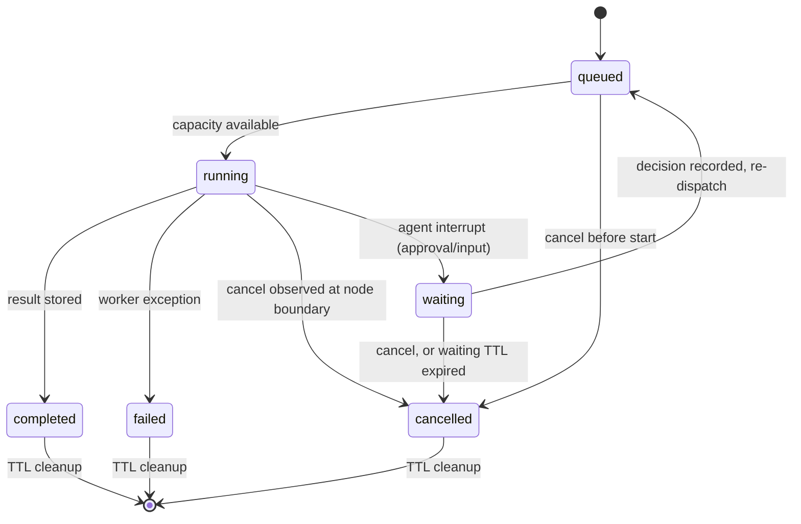

# Runs API

> Files: `src/inqtrix/server/routers/runs.py`,
> `src/inqtrix/server/routers/agent_runs.py`, `src/inqtrix/runs/shared.py`,
> `src/inqtrix/server/runs.py`, `src/inqtrix/state.py`, `src/inqtrix/graph.py`,
> `src/inqtrix/agents/`

## Scope

Structured live events for native browser UIs that need progress cards, queue state, cancellation, and a final report fetch. This page covers the `/v1/runs` API. The OpenAI-compatible `/v1/chat/completions` endpoint uses OpenAI-style chunks and may additionally include Inqtrix diagnostics such as `inqtrix.model_resolution`; see [Web server mode](../deployment/webserver-mode.md).

## Endpoint model

### Conversation titles

`POST /v1/session-titles` generates one optional short label alongside the
answer. The body is `{question, language?, stack?, target?}`. `language` is the
UI-language hint; confident question-language detection takes precedence.
For a saved conversation, `target` is `{kind: "chat" | "agent", id, revision}`.
The target must belong to the caller and match a supplied UI namespace.
Omitting the target generates a label without saving a conversation.

The response contains `title`, `reason`, and, when a call completed, `model` and
actual `usage`. A saved target also returns `current` with `title`,
`title_revision`, and `title_source`. `title: null` names a skip, including
`disabled`, `no_fast_model`, `provider_unavailable`, `rate_limited`, `timeout`,
`invalid_title`, or `title_changed`. Quota denial uses the standard quota
envelope. The client keeps its provisional title and does not delay the answer.

The call requires `TIER_FAST_MODEL`, has an eight-second deadline, and accepts
at most six words and 60 characters. Invalid output is discarded, not repaired
or retried. Optional work has a separate two-thread executor and process-local
admission: six requests per user per minute, two concurrent calls. Shared quota
and deployment edge limits still apply. Reported usage is booked when a provider
thread finishes even after its HTTP waiter timed out; late labels are discarded.

Chat-thread and Agent-session metadata carry `title_revision` and `title_source`
(`initial`, `generated`, `manual`). New conversations start `initial`; existing
and imported titles default to `manual`. The revision increments in the same
row update as the title, independently of `updated_at`. Generation changes only
an initial title at the expected revision and preserves the activity/sort time.
A manual rename wins even when the model committed while the user was editing.
Choosing the identical provisional text still changes ownership to `manual`.

Metadata PUTs send the observed revision and intended source. Stale title echoes
cannot overwrite the stored title; other metadata retains its existing write
contract. `title_preserved` reports that outcome, and clients reconcile the
returned title independently of activity timestamps. A competing manual edit is
reported visibly, with the attempted name retained for an explicit retry.
Unresolved manual saves are recoverable in the same tab after reload; recovery
never resubmits over a newer title. Unversioned clients can change an untouched
legacy title once; later conflicting writes receive HTTP409
`session_title_conflict` and require a client reload.

Only an explicit first message creates a title intent, including a conversation
opened empty beforehand. Desk changes do not cancel it. Renaming, deletion and
account/project changes invalidate stale replies. Old conversations are not
mass-retitled. Incognito chat retains its temporary label without a title call.

### Native runs

Native runs are short-lived server resources addressed by an opaque `run_id`:

| Route | Method | Purpose |
|---|---|---|
| `/v1/runs` | POST | Create a queued research run. Accepts either `question` or OpenAI-style `messages`. Agent runs additionally accept `response_form` (`"auto"`\|`"chat"`\|`"canvas"`) and `source_policy`; see below. A `mode: knowledge` ask accepts `"incognito": true` (only `true` or `false`, and never together with `session_id`; 400 otherwise): its spans carry no content whatever `INQTRIX_TRACE_CONTENT` says, and the run is deleted `RUN_INCOGNITO_RETENTION_SECONDS` after it ended. A `mode: knowledge` ask also accepts `"ui_language"` (`"de"` or `"en"`; 400 for any other value and for any other mode): the interface language, which the answer and every server text of the run use only where the question's own language is unclear; a question with a clear language is answered in it. Returns HTTP 202 with the run summary. `knowledge_filters` carries either explicit `collection_ids` (chips) or `scope: "all"` (the session knowledge switch: every collection the signed-in caller may see, resolved and pinned at submission; an unscoped principal keeps its tenant-wide view; 400 for any other `scope` value, and 400 for a `collection_ids` list with a non-string or empty entry — chips win over the switch, and the persisted filters then carry no `scope`); the run's execution snapshot reports the choice as `knowledge_scope` (`all`, `pinned`, `inherited`) plus `knowledge_collection_count`. A request that pins knowledge collections, uses `scope: "all"` or is a `mode: knowledge` ask is refused with HTTP 503 `knowledge_store_unavailable` (`reason`: `operator_disabled` or `store_unreachable`) while the knowledge store is not configured or does not answer the availability probe. |
| `/v1/runs` | GET | List visible queued, running, waiting, and retained terminal runs from the configured run store. |
| `/v1/runs/import` | POST | Persist a COMPLETED report carried in from a loaded project file — a terminal-run snapshot with no server-side execution, so it costs no run quota. `source_run_id` is required, but is provenance and an owner-scoped idempotency key only; the server always allocates the public `run_id`. Returns 200 with the run summary. |
| `/v1/runs/{run_id}` | GET | Fetch the current run summary. |
| `/v1/runs/{run_id}/events` | GET | Stream buffered and live events as Server-Sent Events. The server sends periodic SSE comment heartbeats (`: keepalive`) without allocating event sequences. The optional `?after=<sequence>` query parameter filters the REPLAY to events with a higher sequence (reconnect support); the live tail is unaffected. A non-integer value returns 400. With `?format=json` the SAME replay buffer returns immediately as a JSON page `{"object": "list", "data": [...], "terminal": bool}` instead of a stream — the polling fallback for clients behind SSE-buffering proxies. |
| `/v1/runs/{run_id}/children` | GET | List an agent run's direct child runs, newest first, as `{"object": "list", "data": [...]}`. Access is decided on the parent (a view share suffices); the children's own URLs stay owner-scoped. Standard runs return an empty list. |
| `/v1/runs/{run_id}/plan` | GET | The run's execution plan (latest version by default, `?version=` for older ones) with its tasks and the version history. 404 with `No plan available yet` before the agent proposed one. |
| `/v1/runs/{run_id}/tasks/{task_id}/result` | GET | Lazy full Agent task result: complete `answer_markdown`, references, claims, usage/metrics (for research children also `evidence_contract_status` and the capped `confidence`), error, and for a `file_analysis` task `document_analysis`: the server-built report of what was read of each document (analysed and unanalysed ranges with reasons, `text_read_to_end`, extraction status and pages without a text layer, named passages that did not become evidence by status, `windows_possibly_more`), the questions every window was asked, the verified findings, the documents found but not selected (`not_selected[]` with `reason` `document_limit`, or `window_limit` for a re-read of a document an earlier round read in part that the analysis's window budget no longer fitted), the documents found that an earlier round of the run already read and this analysis did not read again (`already_read[]`: `document_id`, `title`, `version`, `state` `read_to_end`, `budget` — a re-read would exceed the run's windows — or `beyond_reread` — a re-read cannot reach what stayed unread —, and `failure`: empty for a document an earlier round read, the stored code for one no earlier reading could open, which was never read and is not tried again; counted in `absence_blocked_by` as `documents_not_selected`), the documents in the searched collections (`collection_documents`), what the task's searches reported (`retrieval_warnings`: one text-free search notice per code with `code`, `count` (observations: one hit found by two searches counts twice), `searches`, `incomplete` and, for a candidate limit, the tightest `returned`/`requested` pair; an empty `code` marks an entry that could not be read), and `complete` / `absence_supported` with every limit behind them (`absence_blocked_by`: reason, document, count, whether it blocks coverage or only evidence, and whether it is a property of the stored document version). The plan/overview keeps only the compact `result_summary`: it holds at most 300 words, and a longer one ends in `[…]`; the task result holds the full text (`answer_markdown`, or for a failed task its `error.message`). |
| `/v1/runs/{run_id}/tasks/{task_id}/cancel` | POST | Cancel a pending Agent task or request cancellation for a running task. Returns the authoritative task status. Synthesis and already-terminal tasks reject incompatible cancellation with HTTP 409. |
| `/v1/runs/{run_id}/approvals` | GET | The run's approval requests, newest first. A plan-gate `decision_payload` names an attached result requirement by its parts and typed text only, never by the composed rule bodies; see [Result requirement](#result-requirement). |
| `/v1/runs/{run_id}/approvals/{approval_id}` | POST | Decide one approval: `{"decision": "approve"\|"reject"\|"edit", "plan"?, "note"?}`. `edit` carries the revised plan (validated by the same deterministic rules as the planner) and appends an approved plan version. Plan and replan gates additionally accept `report_guidance` and `report_rule_ids` ([Result requirement](#result-requirement)). The decision and the run's `waiting -> queued` resume commit atomically; replaying the SAME decision answers 200, a different one 409 `conflict`. Owner or edit share. |
| `/v1/runs/{run_id}/clarifications` | GET | The run's clarification questions, newest first. |
| `/v1/runs/{run_id}/clarifications/{clarification_id}` | POST | Answer one clarification with exactly one of `{"answer": ...}` (whole-round free text), `{"option_id": ...}` (legacy single option), or `{"answers": {question_id: {"option_ids": [...], "text": "..."}}}` for structured rounds — the map must resolve EVERY question of the round (partial maps 400). Resumes the run like a decision. Owner or edit share. |
| `/v1/runs/{run_id}/artifacts` | GET | Artifact metadata page (no bodies), `?kind&limit&cursor` keyset pagination. |
| `/v1/runs/{run_id}/artifacts/{artifact_id}` | GET | One artifact with body, refs, and revision history (`revisions[]`: `revision`, `created_by`, `created_at`, `status`); `?revision=` serves an older body. A revision's `status` is the artifact status its write carried: `writing` marks a streaming flush (a memo growing section by section), which the canvas keeps for diffs but does not offer as a version to pick; `ready` marks a finished write or a user edit. |
| `/v1/runs/{run_id}/artifacts/{artifact_id}` | PUT | Optimistic user edit: `{"content_markdown", "expected_revision"}`. 409 `conflict` with `current_revision` on a revision miss; 409 with `locked_by: "agent"` while the agent streams (`status: "writing"`). Owner or edit share. |
| `/v1/runs/{run_id}/artifacts/{artifact_id}` | PATCH | Metadata-only rename: `{"title"}` (non-empty, at most 200 characters). The `revision` does NOT advance and the content history never records a rename. Returns `{"id", "revision", "title", "updated_by"}`; 409 `conflict` with `locked_by: "agent"` while the agent streams. Owner or edit share. |
| `/v1/runs/{run_id}/artifacts/{artifact_id}/export` | POST | Copy the artifact into a NEW editor document (`{"target": "editor_document", "title"?, "folder_id"?}`), 201 with the document. Not idempotent — every call creates a fresh copy. 502 when editor persistence is not wired. |
| `/v1/agent-sessions*`, `/v1/agent-session-groups*` | GET/PUT/DELETE | Saved agent-desk sessions — a structural clone of the `/v1/knowledge-sessions` surface (private per user, groups); unlike knowledge sessions, the list rows carry the small `items_json` settings body. |
| `/v1/agent/memory*` | GET/PATCH/POST/DELETE | Personal long-term agent memory: accepted memories, candidates, search (`GET /v1/agent/memory?q=`), clear, and feedback history. Auth derives ownership; client owner fields are rejected. |
| `/v1/agent/runs/{run_id}/feedback` | POST | Store personal run feedback (`positive`/`negative`/`neutral`, optional `reason`, optional owner-checked `memory_id`). Shared run access does not grant personal memory access. |
| `/v1/runs/{run_id}/result` | GET | Fetch the final `ResearchResult.to_export_payload()` report after completion. Agent Desk results include the same canonical `execution` block as the live snapshot; Knowledge results include the text-free `knowledge_profile`, `knowledge_gate`, `knowledge_grounding`, `knowledge_retrieval`, `knowledge_candidates`, and `knowledge_evidence_used` receipt reconstructed from the result and terminal snapshot. |
| `/v1/runs/{run_id}/cancel` | POST | Cancel a queued run or request cancellation for a running run. Cancelling an agent run cascades over its child runs. |
| `/v1/runs/{run_id}` | DELETE | Permanently delete a terminal run (owner-only); returns 409 while the run is still active. Revokes any shares on the run. To delete an active run, cancel it first, poll the summary until it turns terminal (its summary carries `cancel_requested: true` in the meantime), then delete — the reference web client automates exactly this flow. |

The opaque `run_id` identifies the job, while the server binds that job to its
tenant, workspace, owner, and optional shares. Clients address work by
`run_id`; possession of an id never grants access.

### Agent source and execution request

The additive Agent Desk contract is:

```json
{
  "question": "Who won today's final?",
  "mode": "agent_kernel",
  "source_policy": {
    "web": "available",
    "knowledge": "disabled"
  },
  "response_form": "chat",
  "agent_overrides": {
    "depth": "normal",
    "model": "operator-published-model-id",
    "effort": "high"
  }
}
```

`source_policy.web` and `.knowledge` each accept `available` or `disabled`;
missing fields default to `available`, preserving old clients.
`source_policy` without an agent mode is rejected. Omission retains the
normal automatic/mission behaviour. The Agent Desk sends `web` as the
session's switch and `knowledge` as `available` only when the message
attached a collection. Inheritance to child runs and the full consent
model: [Agent platform](../architecture/agent-platform.md#source-policy).

### Result requirement

An agent run can carry a result requirement: how the deliverable has to
look. It is set in two places with one contract — on `POST /v1/runs`
before the run starts, and on a plan or replan approval
(`POST /v1/runs/{run_id}/approvals/{approval_id}`) of a mission run.

| Field | Type | Meaning |
|---|---|---|
| `report_guidance` | string, at most `report_requirement.max_chars` characters | Text the user typed. |
| `report_rule_ids` | list of prompt-template ids | Library rules to attach, in attachment order. |

Only ids travel. The server resolves label, revision and body from the
caller's OWN visible templates; one id the caller cannot see refuses the
whole request with 400 (`Unknown or non-visible rule: …`). Ids are
trimmed and deduplicated in attachment order before they are counted or
resolved — the same rule listed twice is one rule — and the rule cap
(`report_requirement.max_rules`) counts the DISTINCT rules, so four ids
naming three rules are accepted and four distinct rules are refused with
400. A non-list or an empty id is a 400 of its own. Both fields apply
only to agent modes.

The server composes one requirement block: every rule as
`[Rule: <label>] … [End rule: <label>]`, the typed text last as
`[Free requirement] …`, blocks separated by one blank line. Labels are
folded to one line with their brackets — ASCII and fullwidth — turned
into parentheses. Inside a body or the typed text, a frame marker has
its opening bracket turned into `(` in every letter case, with an ASCII
or a fullwidth bracket, with whitespace, soft hyphens or invisible
format characters (zero-width space, joiners, word joiner, byte order
mark) in its gaps, and with straight, typographic (single or double),
low or single reversed quotes or a backtick around a skill label, so no
contributed text can open or close a frame in these spellings. Letters
from other scripts that look like Latin ones, a fullwidth colon, the
double reversed quote and other invisible format characters (for
example bidirectional controls) are not recognised. A
composition longer than
`report_requirement.max_composed_chars` is refused with 400 and its
length named; it is never shortened.

The composed text is frozen with the run: a template edited afterwards
changes nothing a run is already working under, and resume never
re-resolves. On the submit path the run's durable request also keeps the
parts it was composed from, `report_rules`:

```json
[{"template_id": "pt_…", "label": "briefing", "title": "Executive Briefing", "revision": 3}]
```

`label` is the rule's composer handle; `title` is the display title the rule had when it was attached,
folded to one line, and present only when the template has one. A part stored before titles were kept
carries none, and a rule kept at a plan gate keeps the title it was frozen with: readers fall back to
`label`, nothing invents a title.

`report_rules` is server-set only, and so is the composed text the run
keeps as `report_requirement`. A `POST /v1/runs` body that carries
either is refused with 400 (`report_rules can only be set by the
server.`, `report_requirement can only be set by the server.`), exactly
like the internal role fields. The kernel binds its transcripts
to these revisions: a later run of the same conversation can read an
earlier run's transcript only while every rule it was bound to is still
visible to the reader at the same revision; an edited, deleted or no
longer shared rule closes the transcript (`unavailable`). The run's own
archives stay readable after a mid-run template edit, because the run is
frozen under its parts. A transcript whose descriptor names no rule
revisions — written by a server that did not record them, or by a run
whose durable request carries the composed text without `report_rules`
— is not rule-bound: its rule text stays readable to the session owner
after the rule is edited, deleted or unshared. Internal role runs (the
review and the mission's section writers) carry the requirement in
their handover; they are no conversation source, so a source id naming
one is refused as `unavailable`, exactly as the source catalogue leaves
them out.

A plan-gate decision stores the composed text for the mission's resume.
The approvals API never returns it: a decided plan gate's
`decision_payload` carries the parts and the typed text instead,

```json
{"report_requirement": {"free_text": "Audience: board.",
  "rules": [{"template_id": "pt_…", "label": "briefing", "title": "Executive Briefing", "revision": 3}]}}
```

so a rule deleted or unshared later is not readable through old
approvals (`rules` is empty when only text was typed). The composed
`report_guidance` string is never returned, also not by a stored decision
without `report_requirement`; such a decision predates stored parts and
answers a later gate decision with `409 conflict`, and a mission run
parked on it fails its resume with that named cause. An approval that sends
neither field leaves the earlier requirement standing; an explicitly
empty value clears it. The kernel reads earlier decisions of its
conversation through the same projection.

How the requirement ranks is stated to the writers in the same words by
both engines: evidence labels stay (a rule's own citation style comes
next to a label, never instead of it); the assignment, the typed free
requirement and the user's answers to clarifying questions in the run
narrow a rule where they say so explicitly; where two attached rules
conflict, the one attached first wins and the chat answer names the
conflict; the requirement wins over a skill, also one the kernel
loads later; and a rule applies to every deliverable document unless
the assignment scopes it, and to the chat answer only when that answer
is the deliverable. A mission's section writers read the requirement
as one for the whole memo — the outline places its structure and a
length it sets covers the whole memo — and write only their section.
The run event `inqtrix.agent.requirement.attached` records the
requirement a run starts under, and the `inqtrix.run` span carries the
attached rule ids, their revisions and the composed size
([tracing legend](../observability/tracing-legend.md#result-requirement)).

**Child runs.** The single mission a kernel run starts with
`run_deep_mission` inherits the requirement — text and `report_rules`,
frozen as the parent resolved them — because its memo is that run's
deliverable. Research children, the mission strands of `delegate_batch`
(each one of several memos) and role runs never inherit it.

**Plan and replan gates.** A plan or replan approval opens with the
requirement in force — the submitted one, or what the last earlier gate
decided — in its `payload`, in the same shape as a decision's parts:

```json
{"report_requirement": {"free_text": "Audience: board.",
  "rules": [{"template_id": "pt_…", "label": "briefing", "title": "Executive Briefing", "revision": 3}]}}
```

The key is absent when nothing is in force, and for a run whose stored
requirement does not split into its stored parts (a run queued before
the parts were kept; the server logs a WARNING). A decision that sends
either field replaces the whole requirement, and a field it does not
send counts as empty: to change only the typed text, resend the rule ids
from the gate payload with it, and to change only the rules, resend the
payload's `free_text`. A decision resolves only what the user changed: a
listed id that is already in force keeps the revision and the text the
run is frozen under — also after the template was edited, unshared or
deleted, without a 400 — and only an id the selection adds is resolved
from the caller's catalog. The rule cap and the composed ceiling apply
to the whole result. Replaying the same decision — the same typed text
and the same rule ids in the same order — answers 200 with what it
stored, without reading the catalog again, so also after a rule it added
was edited, unshared or deleted; another requirement on a decided gate
is a 409 `conflict`.

The capability manifest publishes the limits under
`agent.report_requirement`: `max_chars`, `max_rules` and
`max_composed_chars`. Every template on `/v1/prompt-templates` carries
`composed_chars`, the length of the block that template composes into
(label folded, body trimmed, markers defused — measured by the server's
own composition, in code points). A client pre-checks a selection by
adding the `composed_chars` of the attached rules, two characters for
each separator between blocks and, for typed text, the
`[Free requirement]` marker line plus the trimmed text; it never
re-implements the composition.

## Queue and lifecycle

`RUN_MAX_CONCURRENT` (default 100) caps active native provider work. Additional
`/v1/runs` jobs enter a bounded FIFO queue controlled by `RUN_QUEUE_MAX_SIZE`
(default 100). With the in-memory store, terminal runs remain fetchable for
`RUN_COMPLETED_TTL_SECONDS` (default 300). With the PostgreSQL run store,
terminal rows, their event history, and result payloads survive process
restarts and are retained for `RUN_DURABLE_RETENTION_SECONDS` (default 7776000,
90 days). An incognito knowledge ask leaves either store
`RUN_INCOGNITO_RETENTION_SECONDS` (default 900) after it ended, at the first
cleanup after that window: the API process runs one every minute, and every
store access in the API and the worker runs one as well.



The important transition is `queued -> running`: it is driven by the run store (in-memory by default; Postgres-backed with worker dispatch when the durable backends are configured), not by the client polling loop. Active jobs do not count against `RUN_QUEUE_MAX_SIZE`.

Agent runs add three non-terminal waiting statuses. `waiting_for_approval` and
`waiting_for_input` park the run (no execution slot held) until a HUMAN decision
resumes it back through `queued`. `waiting_for_children` parks it while its
child research runs execute: the store itself re-queues the parent when the
LAST child reaches a terminal state (the wake happens inside the child's
terminal transaction, so it cannot be lost), and a park that lands after the
last child already finished self-heals back to `queued` immediately. Because
the parent holds no slot while waiting, a pool smaller than one child wave
serialises the wave instead of deadlocking it. For every waiting status a
cancel ends the run (reason `cancelled_while_waiting`), or the waiting TTL
expires (default seven days) and the store auto-cancels it with the visible
reason `approval_timeout` (human waits) or `children_timeout` (children wait).
Waiting runs are excluded from orphan/stuck sweeps. Agent runs also carry
additive summary keys — `kind` (`agent` or `agent_child`), `children_url`,
`parent_run_id`, `root_run_id`, `session_id`, `last_event_sequence` — emitted
only when non-default, so standard run summaries keep the exact historical key
set.

`last_event_sequence` is the run's event position at the moment the summary was
read, and it exists for clients that consume the summary **and** the event
stream at once. A summary is a snapshot of the run row while the stream keeps
moving, so the two can disagree, and only a position says which of them is
ahead. The decision endpoints make this the normal case rather than a race:
`POST /v1/runs/{id}/approvals/{id}` and `POST /v1/runs/{id}/clarifications/{id}`
answer with a summary read inside the transaction that re-queues the run, so it
reports `queued` while the worker picks the run up milliseconds later. A client
that writes that status over what it has already streamed shows a queue
position for a run that is working — for as long as it takes the next lifecycle
event to arrive, which can be minutes. Compare `last_event_sequence` against the
highest event `sequence` consumed and keep the streamed `status`, `phase`,
`queue_position` and `snapshot` when the summary is not ahead.

## Run summary

Every list/detail response returns the same summary shape:

```json
{
  "run_id": "run_abc123",
  "status": "running",
  "queue_position": null,
  "question": "What changed?",
  "stack": "default",
  "workspace_id": null,
  "mode": "research",
  "agent_overrides": {},
  "created_at": 1760000000.0,
  "started_at": 1760000001.0,
  "finished_at": null,
  "elapsed_seconds": 12.34,
  "snapshot": {
    "current_node": "search",
    "completed_rounds": 1,
    "active_round": 2,
    "max_rounds": 4,
    "total_queries": 6,
    "executed_queries": 5,
    "total_citations": 21,
    "total_sources": 18,
    "confidence": 7,
    "source_tier_counts": {
      "primary": 2,
      "mainstream": 11,
      "stakeholder": 3,
      "unknown": 2,
      "low": 0
    },
    "source_quality_score": 0.72,
    "claim_status_counts": {
      "verified": 1,
      "attributed": 3,
      "contested": 1,
      "unverified": 8
    },
    "claim_quality_score": 0.5,
    "evidence_record_count": 18,
    "consolidated_claim_count": 13,
    "aspect_coverage": 0.75,
    "evidence_consistency": 7,
    "evidence_sufficiency": 6,
    "done": false,
    "progress_estimate": 0.42,
    "last_message": "Durchsuche 3 Suchanfragen (Runde 2/4)..."
  },
  "error": null,
  "events_url": "/v1/runs/run_abc123/events",
  "result_url": "/v1/runs/run_abc123/result"
}
```

These 16 keys are always present. `workspace_id` is `null` for a run created outside a workspace, and `agent_overrides` is an empty object when the request set none — the keys themselves never disappear.

`mode` is the id of the algorithm that executed the run: `research` for the normal graph path, `direct_llm` for the explicit direct-provider chat mode, and — when their gates pass — `knowledge`, `workspace_agent`, or `agent_kernel`. The registry accepts custom ids too, so clients must tolerate a `mode` they do not know. `snapshot` is a compact derived view from `AgentState`. It deliberately omits raw provider responses, full evidence ledgers, and secrets. The source and claim quality fields are live counters for UI cards and diagnostics; the final authoritative report payload still comes from `/result`.

Agent summaries additionally expose a `timing` object with
`total_seconds`, `active_seconds`, `waiting_seconds`, `queued_seconds`,
`segment_count`, `resume_count`, and `current_segment_id`. Standard run
summaries retain their historical exact key set.

Agent summaries and state-bearing agent events add one canonical
`snapshot.execution` block with an exact, algorithm-independent key set:

```json
{
  "execution": {
    "effective_mode": "agent_kernel",
    "response_form": "chat",
    "depth": "normal",
    "model": "operator-published-model-id",
    "reasoning_effort": "high",
    "source_policy": {
      "web": "available",
      "knowledge": "disabled"
    },
    "knowledge_scope": "inherited",
    "knowledge_collection_count": 0,
    "consent_reason": "explicit_directive",
    "tool_use_counts": {
      "web": 1,
      "knowledge": 0
    },
    "web_searches": 1,
    "limits": {
      "tool_calls": {
        "used": 4,
        "limit": 30,
        "ceiling": 60,
        "recoverable": true,
        "extendable": true
      }
    },
    "tool_grants": []
  }
}
```

All keys are present for current agent runs. `limits` maps a stable limit id (`tool_calls`, `steps`, `tokens`; a mission also `discovery_tool_calls`, `plan_tasks`, `replan_rounds`, `clarification_rounds`) to the server-authored boundary facts `used`, `limit`, `ceiling`, `recoverable`, `extendable`, and an optional `reason`; the model never writes this block, and an engine without boundaries emits an empty object rather than dropping the key. `tool_grants` lists the tools the user approved run-wide (`approval_scope=run`), sorted, and stays an explicit empty list when nothing is granted. `knowledge_scope` names whose knowledge boundary the run searched — `all` (the session knowledge switch: every collection the caller may see), `pinned` (attached collection chips) or `inherited` (no explicit choice) — and `knowledge_collection_count` the number of collections inside it; payloads written before these fields read as `null` / `0` (not recorded). `/v1/chat/completions` validates `knowledge_filters.scope` the same way and treats `all` like an omitted scope for `mode=knowledge` (every visible collection). Optional scalar values use the
empty string rather than disappearing. `effective_mode` is the engine that
actually executes (`agent_kernel` or `workspace_agent`), which can differ from
a stale client selection when an execution directive forces the kernel.
`consent_reason` is a stable machine token such as `explicit_directive`,
`strict_approval_required`, `strict_approval`, `strict_rejected`,
`autonomous_policy`, or `permission_policy`; clients should map known values
for display and preserve unknown future values.

`tool_use_counts` counts successful source-tool invocations, so zero means “not
used” while `source_policy.*="available"` means only “allowed to be selected”;
keep them as separate audit rows. A quick-web completion has exactly `web: 1`,
a rejected strict quick-web approval remains `web: 0`.

`tool_use_counts.web` is a budget counter, not a search count: a delegated
research is one web use there and no search. `web_searches` (since v0.2.0.10)
counts the web searches the run's own provider calls executed, one per
successful instant search; a mission counts its web discovery probes and one
per completed instant web task. A
research child reports the searches its provider executed as
`executed_queries` in its snapshot; `total_queries` there counts the planned
queries, which a deadline can stop before they run. A run that records no
searches (a mission, a role) carries no `executed_queries`. A client adds the
run's `web_searches` and the `executed_queries` of its research children for
the searches a turn ran. Payloads written before the field read
`web_searches` as `null` (not recorded).

The completed `GET /v1/runs/{run_id}/result` payload copies this object to its
top-level `execution` field. Older stored results and non-agent algorithms omit
that field; clients should retain their existing compatibility view when it is
absent rather than inventing effective values.

## Event envelope

`GET /v1/runs/{run_id}/events` returns SSE frames where the event name matches `event.type`:

```text
event: inqtrix.node.started
data: {"type":"inqtrix.node.started","run_id":"run_abc123","sequence":3,"created_at":1760000002.0,"data":{"node":"plan","snapshot":{"current_node":"plan"}}}
```

Event payloads are sanitized through the same recursive drop-list used by runtime logging. Unknown event types are allowed so future UI events can be added without changing the log schema.

## Event types

| Event | When emitted | Important data |
|---|---|---|
| `inqtrix.run.queued` | Run record created or a parked run is admitted for another segment. | `status`, `queue_position`, optional `resumed`, `segment_id`, `segment_ordinal` |
| `inqtrix.run.started` | The first execution segment starts. | `status`, `snapshot`, `segment_id`, `segment_ordinal`, `reason` |
| `inqtrix.run.resumed` | A later execution segment actually starts. | `status`, `snapshot`, `segment_id`, `segment_ordinal`, `reason` |
| `inqtrix.run.snapshot` | A snapshot was updated for a state-bearing event. | `snapshot` |
| `inqtrix.progress.message` | Existing `emit_progress(...)` message fires. | `message`, `phase`, `severity`, `snapshot` |
| `inqtrix.node.model_resolution` | A node resolves its provider model and reasoning effort. | `node`, `model`, `tier`, `effort`, `model_source`, `effort_source`, `requested_tier` |
| `inqtrix.node.started` | LangGraph enters a node. | `node`, `snapshot` |
| `inqtrix.node.finished` | Node returns normally. | `node`, `snapshot` |
| `inqtrix.node.failed` | Node raises. | `node`, `snapshot` |
| `inqtrix.answer.draft` | Since v0.2.0.10. A conversational kernel run whose review pass runs (the `verify` level of its Stufe, or the legacy rule without one) shows its answer before the review starts: once, after the draft passed the same citation check as the published answer. Missions and runs without a review emit none. | `artifact_id` (the answer artifact the published answer will use), `draft_id`, `markdown` (the whole draft), `reference_labels` (the labels the draft cites) |
| `inqtrix.answer.started` | One final-answer publication begins after the empty durable answer artifact is committed as `writing`. | `artifact_id`, `publication_id`, `status=writing`, and additively since v0.2.0.8 `reference_labels` — the evidence labels this answer WILL cite, announced before the first delta so a client can render `[W1]` as its final linked form from the outset instead of rewriting the block when the references land (absent = no labels announced; a client must still accept labels it was not told about) |
| `inqtrix.output_text.delta` | Final Markdown is emitted in word-aligned chunks. | `artifact_id`, `publication_id`, UTF-8 byte `offset`, `delta` |
| `inqtrix.answer.ready` | The publication completed without a gap. | `artifact_id`, `publication_id`, `bytes`, `status=ready` |
| `inqtrix.answer.interrupted` | Publication stopped before completion. | `artifact_id`, `publication_id`, `offset`, `status=interrupted`, `stage` (`staging` / `streaming` / `finalizing` / `publishing_ready`) |
| `inqtrix.run.completed` | Result payload was stored. `metrics.prompt_tokens`/`completion_tokens` are run-cumulative across parked and resumed segments (failed planner attempts included). | `metrics`, `result_url`, `snapshot` |
| `inqtrix.run.waiting` | Agent run parked itself for an approval, user input, or its running children. | `status` (`waiting_for_approval` / `waiting_for_input` / `waiting_for_children`), `snapshot` |
| `inqtrix.run.cancel_requested` | Client requested cancellation while running. | `status`, `reason` |
| `inqtrix.run.cancelled` | Run is terminal cancelled. | `status`, `reason` (`cancelled_while_waiting` / `approval_timeout` / `children_timeout` for parked runs), `snapshot` |
| `inqtrix.run.failed` | Worker failed. | `status`, `error`, `snapshot` |

A resumed run first emits another `inqtrix.run.queued` event with
`resumed: true`; `inqtrix.run.resumed` follows only when the worker actually
starts that segment. `started_at` remains the first execution start. Agent-run
summaries expose the accumulated active, explicit-wait and resumed-queue time
in `timing`; worker reclaim does not create a false execution segment.

Knowledge runs additionally emit these typed retrieval events:

| Event | When emitted | Important data |
|---|---|---|
| `inqtrix.knowledge.retrieval.completed` | The shared retrieval implementation has produced the initial candidate set for the evidence budget. | `candidate_count`, `top_k`, `final_k`, `final_k_overridden`, `collection_document_count`, `degradations`, `warnings` |
| `inqtrix.knowledge.retrieval.degraded` | A technical vector boundary or stalled candidate page prevented the requested candidate pool from filling. Ordinary corpus exhaustion does not emit this event. | `reason`, `retrieval_mode`, `stage=vector_candidate_pool`, `requested_candidate_pool`, `returned_candidate_pool`, `final_top_k`, `returned_hits`, `final_evidence_complete`, optional `candidate_cap` |
| `inqtrix.knowledge.retrieval.warning` | Canonical hydration excluded one or more unsafe candidates. The event is a cumulative, text-free snapshot after the last retrieval, including decomposition and gate rewrites. | `code`, `reason`, `stage`, `count`, optional `recommended_action`; known codes include `chunks_require_reindex` and `chunks_pending_reconciliation` |
| `inqtrix.knowledge.answer.retry` | The first answer attempt contained quotes that failed verbatim verification; the single visible regeneration attempt is about to run. At most one per run, only for `quote_unverified` (format failures stay immediately terminal). Counter-only by design — quote texts never cross the event boundary. | `attempt` (always `2`), `quotes_total`, `quotes_unverified` |

Reconnect, reload, or export cannot turn a visible degradation into an ordinary
successful retrieval. A transport timeout, provider retry exhaustion, gate parse
fallback, or other quality downgrade likewise remains a typed event/result
marker or terminal failure; it is never hidden behind a completed event. In the
warning event, `count` is the number of exclusion observations across the run's
retrieval calls, not a distinct-chunk count. Why candidate-pool and
final-evidence completeness are separate facts, and where the receipts live:
[Knowledge engine](../architecture/knowledge-engine.md#retrieval-pipeline-question-to-cited-answer).

Agent control actions additionally emit signal events (rows are the truth,
clients reconcile via the GET endpoints above):

| Event | When emitted | Important data |
|---|---|---|
| `inqtrix.agent.approval.decided` | A user decided an approval. | `approval_id`, `status`, `decided_by_user_id` |
| `inqtrix.agent.clarification.answered` | A user answered a clarification. | `clarification_id` |
| `inqtrix.agent.limit.reached` | A deterministic tool/step/token ceiling was reached. Recoverable ceilings park the run instead of silently returning a partial answer. | `kind`, `used`, `limit`, `ceiling`, `extendable`, `state`; a recoverable park adds `clarification_id`, `next_limit` and the supported `choices` (`extend`/`partial`/`cancel`), a hard stop adds `recoverable` and `reason`; `kind=clarification_rounds` adds `suppressed`, the number of questions the cap kept from being asked (each named with its assumption in the transcript), and fires only when at least one question survived the run's filters |
| `inqtrix.agent.limit.decided` | The user explicitly chose a terminal partial answer or cancellation after a recoverable limit. | `clarification_id`, `kind`, `choice`, `state` |
| `inqtrix.agent.outcome` | A `workspace_agent` or conversational `agent_kernel` run left its algorithm with a decision: once per algorithm decision, when the run completes, is cancelled while it executes, or fails inside its graph or after it; a redelivered segment can repeat it under the same `outcome_id`, readers take the last. A role run sends none. | `outcome_id` (`<run_id>:outcome`), `final`, `review`, `round`, `revision`, `accounting`, `applied`, `verified` (how many applied findings the re-check held), `unverified_reasons` (per reason, how many applied findings the re-check left unverified), `reach` (`reread`, `cited`, `provider_only`), `codes`, `limits`, `open` (`by_code`, `by_kind`), `lines[]` (`kind`, `text`, `reasons`; a `limit` line for `extraction_limit`), `claims` (per output, its statements by state), `marks[]` (`output_id`, `quote`, `state`, `reason`, `note`), `summary`, `details` |
| `inqtrix.agent.artifact.created` | An agent artifact was committed for the first time. For an answer this precedes `answer.started` and exposes only an empty `writing` body. All agent-side emitters share one payload builder. | `artifact_id`, `kind`, `revision`, `title`, `status`, `updated_by`, `from_revision`, and additively since v0.2.0.8 the write's line delta `lines_added`/`lines_removed` (absent = honestly not counted, e.g. events from before the change or the size guard) |
| `inqtrix.agent.artifact.updated` | An artifact revision advanced: agent-side writes (kernel `write_canvas`, mission memo flush, the deep-revision batch) emit the shared agent payload; a user content PUT emits a deliberately kind-less signal (`artifact_id`, `revision`, `updated_by` only — it must never render as a file chip); a user rename adds `title` and `renamed: true` at an UNCHANGED revision. | agent writes: same columns as `created`; user PUT: `artifact_id`, `revision`, `updated_by`; rename: + `title`, `renamed` |
| `inqtrix.agent.citation.validation` | A final kernel chat answer contained unknown citation labels or citation brackets no reader can parse (a range, a slash, a prose join) and completed its single bounded repair decision. | `status` (`repaired` / `degraded`), `unknown_labels`, `malformed_brackets`, `resolution` |
| `inqtrix.agent.artifact.edit_conflict` | A follow-up turn found the session memo edited by the user since it read it; the agent preserved that text and appended its update instead of overwriting. The client refetches the reconciled memo. | `artifact_id`, `kind` |
| `inqtrix.agent.patch.proposed` | The agent proposed an editor patch; the always-gated patch approval follows. | `patch_id`, `document_id`, `artifact_id`, `edit_count` |
| `inqtrix.agent.requirement.attached` | Emitted once per agent run that starts with a result requirement, when its first segment seeds the run (kernel and mission alike, also for the single mission a kernel run starts with `run_deep_mission`, which inherits it): the transcript's record of which library rules at which frozen revision the run works under. Not repeated when a later segment resumes the run, and not emitted again when a plan gate changes a mission's requirement (the approval records that). The typed text appears by its length only; `free_text_chars` is `null` — with a server WARNING — when the stored requirement does not split into its stored parts (a run queued before the parts were kept). `review` is `per_rule` when the run's review pass judges each attached rule on its own, one criterion per rule (a kernel run that owes a review and carries rules), `assignment` when the pass checks the result against the assignment the requirement is part of as a whole (a mission, or typed text without rules), and `none` when its tier skips the review. A client that does not know a value shows none. Rule labels, titles and template ids persist with the run's events (an event shows a title over 180 characters shortened with `...`; the stored part keeps it whole): everyone who can read the run's events keeps seeing them after the template is edited, deleted or unshared; the event never carries rule text. | `rules[]` (`template_id`, `label`, `title` when the part has one, `revision`), `free_text_chars`, `review` |
| `inqtrix.agent.canvas_context.attached` | Emitted exactly once per kernel run that carried a canvas attachment — the durable transcript record of which comments rode the submission (run summaries deliberately never carry the canvas context). Comment text travels in full; the quote is a visibly shortened 120-char preview whose full text stays reachable via the document. | `artifact_id`, `revision`, `comments[]` (`comment`, `quote_preview`) |

The cognitive kernel (`mode=agent_kernel`) additionally
emits `inqtrix.agent.tool.started` (`tool`, `tool_call_id`, redacted
`args_preview`), `inqtrix.agent.tool.finished` (`tool`, `tool_call_id`,
`status`, `result_preview`, `result_call: true` on a role run's typed result
call — the call that delivers its verdict or section, no step of its work —,
`call_ordinal` (the call's position in the run's sequence of counted calls,
taken when its start is emitted; absent on the typed result call and on a call
that started in an earlier segment)
and additively since v0.2.0.8 a `snapshot`
carrying the complete canonical triple `{current_node, phase,
execution}` described under "Run summary" — built at the tool boundary,
so limit readouts advance per finished tool instead of only per phase
change; both the graph lane and the quick-web lane attach it),
`inqtrix.agent.todo.updated` (the
`write_todos` task list as `{content, status}` items), and
`phase.changed` (`execution` -> `done`) for timeline compatibility. Since
v0.2.0.9 a `tool.started` row may carry `todo_index` (integer): the index
of the first `in_progress` item of the last reported todo list, so a
transcript can fold the row under the todo it served; absent before the
first list and when no item is in progress. Since v0.2.0.10 `args_preview`
holds reader words only: the call's query, question, assignment, objective,
instruction or title, an attached research report's title, or the server's
own words for an archive or document window; a call that names nothing but
identifiers previews empty, and the preview never carries JSON or an id. A
`read_canvas` row on a canvas document carries that document's `artifact_id`
as its own field instead, so a client names it by the title it knows; a read
of the run's own archive carries none. The
kernel emits NO intent narration since v0.2.0.9: the tool row
(`tool.started` with `args_preview`) already carries tool identity and
subject, derived from the accepted call; older runs still replay their
`kind="intent"` narrations (`kernel_<sha1[:8]>` ids), the kind stays valid. A successful `load_skill` call emits
`inqtrix.agent.skill.loaded` (`skill_id`, `label`) — the visible
counterpart of the tool-limit narrowing it applies. Whether a run is
reviewed follows the published `verify` level of its Stufe (`labels`
waives the pass; a request without a Stufe keeps the legacy rule
`depth=deep`), and the review reports as one narration with
`narration_id=kernel_deep_review` — "running", then the located finding
count while the revision runs, and after a verdict the run's outcome
record `summary` — plus an `inqtrix.node.model_resolution` event for the
`agent_deep_review` node. Besides completeness, support and
contradictions, the review asks the fidelity questions of every cited
statement: force (duty, expectation, permission, example or indicator),
reservations, the intro of a list, links and quantifiers, actors and
reach, and absence. A statement of what the material does not cover is a
factual claim about the documents: contradicted by material the review
read it is an `evidence_error`; a reading limit alone makes no finding of
it, and a claim the review cannot check is named as not checked. The revision keeps the same categories as writing
rules. Findings are located, applied or named one by one: when the
review returns findings, one `inqtrix.agent.activity` event
(`kind=deep_review_findings`, `scope=run`, `label`, `detail`, `findings[]`
with `quote`, `finding` and `target` — the flagged passage and what is
wrong with it) lists the located ones before the revision call. The
anchors, grounds and snapshot offsets that drive the edits stay
server-side. The revision returns only replacement text for each finding.
An edit cites only its passage's labels and its basis's labels in the
target output's label space, matched by reference identity; a kernel
canvas cannot take a source it does not cite, so such a finding is named.
A passage owns the citation run right after it (`Satz. [K12]`). Without a
chat finding no chat edit is generated. Untouched text stays verbatim, and
an edit that changes how it cites (an opened fence, a lone backtick) is
named; artifact changes use the existing atomic expected-revision check.
Unresolvable or overlapping anchors, invalid grounds, rule-breaking edits,
context limits and refused writes name that finding with its reason code;
they are visible outcomes, not successful corrections: the summary counts
them, and a `critic_revision_discarded` activity lists each named finding
with its reason.

Every `inqtrix.agent.phase.changed` snapshot carries the canonical
`execution` projection described above, so clients can distinguish the
source being available from the source actually being used.

The agent runtime (mode `workspace_agent`) additionally emits
`inqtrix.agent.phase.changed`, `plan.proposed`/`plan.revised`,
`approval.requested`, `clarification.requested`, `task.started`/
`task.cancel_requested`/`task.finished`/`task.failed`, `child.progress` (projected onto the parent
stream from child snapshots, messages, and terminal states),
`artifact.created`, `activity`, `narration`, `outcome`, and per-node
`inqtrix.node.model_resolution` — see
[Agent platform](../architecture/agent-platform.md).

The outcome record (`inqtrix.agent.outcome`) says how an agent run's review
ended and what stayed open: a mission's or a conversational kernel run's
(a kernel role run sends none). `final` is the algorithm's own decision
(`completed`, `cancelled` or `failed`), not the run's terminal status: a
cancel that races the algorithm's return, or a failed answer publication
after it, still ends the run otherwise, so a client takes the terminal word
from `inqtrix.run.completed`/`failed`/`cancelled`. A run cancelled while it
was parked or waiting, and a run that failed before its graph started, has
no record. The fields:

- `review`: `completed`, `unavailable` (a review was due and produced no
  usable verdict), `waived` (the run's Stufe skips the review) or `not_run`
  (no review ran: the run ended before one, or a request without a Stufe
  owed none); `round` is the review round (`0` without a review).
- `revision`: `none`, `verified` (every finding's edit was applied and the
  re-check held each one), `unverified` (every finding's edit was applied
  and at least one was not held: the re-check rejected it, left it
  unchecked, did not confirm it or could not run, or the finding is the
  server's, which the re-check never judges), `partially_discarded` (some
  findings were applied, others named) or `discarded` (no edit was applied
  and the previous text stands). The text is not reviewed a second time;
  each applied model edit is checked, segment by segment, against the texts
  of the labels it cites, and the server settles it: it holds only when a
  second, identical check holds it too, and no settlement takes it back.
- `accounting`: `complete` only when a completed review settled every
  success criterion; a record without that fact reads `incomplete`. A
  record built from a review report written before the report carried its
  round, revision and accounting (a run resumed across an upgrade) reads
  `review` `completed` with `round` `0`, `revision` `none` and `accounting`
  `incomplete`; the server logs a warning when it builds one.
- `limits`: why research stopped although an information criterion stayed
  open — `no_new_evidence`, `replan_rounds`, `mission_time_budget`,
  `plan_task_limit`, or a research round that ended before a task ran:
  `replan_invalid`, `replan_empty`, `no_gap`, `replan_rejected`.
- `codes`: why no further research could reach unread material —
  `read_budget_exhausted`, `source_bound_limit`, `collection_unavailable`,
  `web_not_permitted`, `web_not_needed` — plus `extraction_limit` whenever a
  document read to the end showed more passages than the analysis took
  over, also on a passing review.
- `applied`: how many findings the revision applied, counted as
  `revision` counts them (a server finding that lost its overlap is not a
  finding of its own); `verified`: how many of them the re-check held;
  `unverified_reasons`: why it left the others unverified, counted per
  reason in this order and only where it occurs — `no_source_text` (the new
  text cites only sources without stored text), `format_only`, `too_large`,
  `check_unavailable` (the check could not run), `inconclusive` (it ran
  and settled nothing) and `knowledge_only` (the run holds no source, so
  the edit rests on general knowledge). A rejected edit and a server
  finding have no reason,
  so the counts may sum to fewer. A record built from a review report
  written before its findings carried their reasons counts none; the server
  logs a warning when it builds one.
- `reach`: how many cited references the review re-read (`reread`) of how
  many the outputs cite (`cited`), and how many of the cited references
  rest on the search provider's context alone, with no stored source text
  (`provider_only`; the summary names them in one line). An evidence
  finding resting on nothing but such sources of its own passage asks for
  no revision: the passage stays as written and is marked
  (`provider_context_only`). A
  record built from a review report written before the report carried it
  has no `reach`; the server logs a warning when it builds one, and an older
  `reach` has no `provider_only`.
- `open.by_kind` counts the open points as `information`, `text_defect`,
  `finding`, `marked` (a passage that stays as written with its mark, never
  a finding the revision left unapplied) and `not_checked`, and as
  `revised` an unmet output requirement
  that at least one counted model finding concerns, every such finding
  applied, whether the re-check held those edits or not: its gap in the
  reviewed draft was worked on, which never shows the criterion met, since
  nothing checked the criterion again.
  An unmet criterion without its `state` reads open. `open.by_code` maps
  every limit and code to the number of open information criteria it
  applies to.
- `lines[]` are the open points in the reader's language, each with its
  `kind` and its `reasons`: for an information criterion the limits and
  codes it stayed open for, for a named finding its reason code, for a
  finding without a confirmed basis `basis_unconfirmed`, for a revised
  criterion `criterion_revised`, or `criterion_verified` when the re-check
  held every one of its edits (its line names the applied findings, says
  whether they were re-checked, and quotes no gap of the reviewed draft).
  `extraction_limit` among the codes adds a line of kind `limit` with its
  reader sentence: a statement about
  what those documents do not say may rest on a passage the analysis never
  took over. A finding that marked its passage (`provider_context_only`)
  is a line of kind `marked`.
- `claims`: what the delivered statements rest on, per output (`chat` for
  the answer, otherwise the canvas's artifact id), as `total` and one count
  per state. A statement is a run of sentences up to the citation group
  that closes it, inside one paragraph, list item or table row; sentences
  after the last citation of their unit belong to none, a sentence with
  fewer than two content words lends its citations to the statement before
  it, a line naming a web address outside a link is a reference entry, and
  an output that cites nothing has no statements. Each statement has one
  state: `verified` (the stored text of a source it cites states it, as far
  as words can tell, and no edit the re-check did not hold wrote it),
  `source_text` (a cited source holds stored text that does not state it
  that way), `attributed` (its sources hold only the search provider's
  context) or `insufficient`. Counted on the texts as published (after the
  citation check); a review from general knowledge counts none, and a
  record without statements has no `claims`.
- `marks[]`: one entry per `insufficient` statement, in text order: its
  `output_id`, its passage as the delivered text holds it (`quote`,
  citations included, so a client finds it again by its words), its
  `state`, its `reason` — `finding` (a confirmed evidence finding no
  revision applied stands on it), `metadata_only` (its sources hold nothing
  but their metadata) or `restates` (it repeats a value, of the same kind,
  of the passage a finding disputes, not of the rest of the statement that
  passage stands in; a year alone does not count, nor does the date that
  only says when a disputed percentage or amount holds, and a statement
  with stored source text of its own keeps its state) — and its
  `note` in the reader's language. A client shows a mark only while it
  shows the record under that text, never once the user edited it.
- `summary`: the record in one sentence of the reader's language, built
  from its states and counts only, never from a line's text — for example
  "Geprüft · 2 Befunde überarbeitet, nicht nachgeprüft · 1 Befund nicht
  angewendet · 2 Punkte nicht geprüft · 1 Kriterium offen · Lesegrenze · 12
  von 12 zitierten Belegen nachgelesen". Only an applied edit the re-check
  held reads "behoben und nachgeprüft" ("fixed and re-checked"); every
  other applied edit reads "überarbeitet, nicht nachgeprüft" ("revised, not
  re-checked"), followed by the reasons in parentheses with their counts,
  for example "3 Befunde überarbeitet, nicht nachgeprüft (2 mit Belegen
  ohne gespeicherten Quelltext, 1 nur Formatierung)"; the other reasons
  read "zu umfangreich", "ohne mögliche Nachprüfung" and "ohne eindeutiges
  Prüfergebnis". "ohne Befund" appears only when nothing stayed open.
  Without a completed review it reads "Ohne Prüfung (Stufe)",
  "Prüfung nicht auswertbar, Ergebnis ungeprüft", "Ohne Prüfung beendet"
  (`not_run`, `final` `completed`) or "Vor der Prüfung beendet". A record
  with `claims` reads as their count instead, summed over the outputs, each
  state only where it counts — for example "Geprüft · 24 Aussagen:
  3 verifiziert, 2 mit Quelltext, 15 vom Anbieter zugeschrieben, 4 nicht
  ausreichend belegt" —, and everything the sentence above would name
  stands in `details`.
- `details`: what a review that counted statements did besides, in the
  words the summary uses without the count ("ohne Befund · 4 von 4
  zitierten Belegen nachgelesen"); only on a record with `claims`. A
  delegating parent's projection carries neither `details`, `claims` nor
  `marks`.

A kernel run's record reads the same fields from its own review: `round` is
`1` beside `review` `completed` or `unavailable` (a kernel run reviews once;
an owed review that could not run or gave no usable verdict counts, as for a
mission) and `0` beside `waived` and `not_run`, `codes` and `limits` stay empty (the
kernel has no research route), and a completed review reads `accounting`
`complete` unless it left an attached rule unsettled: a kernel run's review
settles one criterion per attached library rule (and no other success
criteria). An unmet rule is an open line that names the rule by the title it
was attached under and its frozen revision ("Kriterium offen: Regel
„Executive Briefing“ (Rev. 1) — …"), never by its prompt marker; a met rule
adds no line. A
kernel run parked for its review role sends the record from the segment that
resumes and decides, never from the park. A located finding whose revision a
cancel or an error stopped is named `cancelled` or `revision_error`; a
partial answer at a limit reads `review` `not_run`. The kernel keeps no
`critic_report` artifact.

A mission's record is built from the review's own report, the `critic_report`
artifact (also `result_state.critic_report`). Its payload carries
`verdict`, `round`, `revision`, `accounting`, `evidence_identity`,
`research_limits` (the limits above, `no_prospect` included),
`prospect_codes` (the codes of a prospect that closed research, without
`extraction_limit`), `criteria` (the success criteria the review numbered,
in its order), `criteria_covered`, `criteria_uncovered` (`index` —
the criterion's number in the review's list —, `text`, `kind`, `gap`,
`state`: `open`, `revised` or `verified`), `open_lines` (`kind`, `text`,
`reason`), `findings`, `reach`, `claims` and `marks` (counted on the memo
as it is published; not on a round that returns to research), `transport` and
`review` (the model's verdict; the server's own findings stand only in
`findings`). `findings[]` has one row per confirmed finding: `finding_id`,
`origin` (`model` or `server`), `target`, `kind`, `criterion` (the
validated criterion number or `null`), `state` (`applied` or `named`),
`reason`, `recheck` (`held` when the re-check and its confirmation
both held the applied edit, otherwise empty) and `recheck_reason` (why the
re-check left an applied model edit unverified, one of `no_source_text`,
`format_only`, `too_large`, `check_unavailable`, `inconclusive` and
`knowledge_only`; empty
when the edit held, was rejected, is a server finding's or was not
applied). A named finding's reason is
one of `finding_invalid`,
`basis_invalid`, `basis_outside_output`, `remove_labels_invalid`,
`anchor_missing`, `anchor_ambiguous`, `anchor_overlap`,
`provider_context_only`, `edit_not_single`, `edit_unchanged`,
`edit_deletes`, `edit_shrinks`, `edit_rewrites_unchecked`,
`edit_drops_figure`, `identifier_added`, `citation_malformed`,
`label_not_citable`, `quote_label_dropped`, `label_moved`,
`segment_without_basis_label`, `labels_whole_text`, `output_emptied`,
`output_shrunk`, `revision_context`, `revision_failed`, `revision_empty`,
`write_conflict`, `store_error`, `research_route`, `cancelled` or
`revision_error`; an applied server finding whose quote the overlapping
edit removed reads `overlap_edit`. `provider_context_only` marks a
passage: the finding rests on nothing but sources of that passage
without stored source text, so no revision is asked for it, and it
counts neither as applied nor as discarded. A fix resting only on such
sources keeps every sentence of its passage word for word, moving a
label or adding a sentence of its own (`edit_rewrites_unchecked`
otherwise), and no fix drops a number of its passage
(`edit_drops_figure`); a correction from general knowledge, in a run
without sources, may change a number.

After a revision applies at least one edit of a model finding, one more
structured call on the review node (`agent_deep_review`, schema
`RevisionCheckVerdict`) re-checks those edits; when every one of them is
left unchecked before the call (no segment, more than 12 segments, or new
text resting only on sources without stored source text, such as a web
source kept as the search provider's context), there is no call. The server lists the segments each edit changed (units
of headings, sentences and code blocks, a sentence split after `;` or `:`,
compared by their form (a sentence that becomes a list item, a heading or
a table row is a segment), their words, the marks that say as much as a
word (an order or approximation sign such as `<` or `≈` wherever it
stands, `=` or `~` before a digit, a sign before a digit or before a
currency sign or second sign a digit follows, a separator between digits,
a percent, permille, currency or section sign) and their labels) and where
its replacement stands (heading, list intro, the text on either side); each
finding's prose, the text its edit replaced, the replacement, the segments,
the placement and the texts of the labels the replacement cites travel
fenced as data. The call returns one check per finding (`findings[]`:
`finding_id`, `rows[]`, `fixes_named_defect` and a `reason` that stays in
the trace) with one row per segment (`rows[]`: `segment_id`, `basis`
quotes, `force`, `bound`, `actor_reach`, `reservations`, `links`,
`presents_as`, `basis_shows`, `already_in_replaced_text`, `before`,
`restated_in`, `finding_quote`); it gives no verdict. The server checks
every quote verbatim against its source text or the reading record the
finding rests on and settles each edit from a closed table: it holds
only when every row carries it, is rejected only for a deviation a
verified quote shows on a row that states a claim (`not_carried`, a duty
or deadline where the basis shows a weaker kind included), a dropped
condition, exception or qualifier (`reservation_dropped`) or a removal no
words of the finding ask for (`off_finding`), and otherwise stays
unchecked, among them every edit without a segment, of more than 12
segments, whose new text rests only on sources without stored source
text, or beyond 40 segments in one call. The re-check can only
confirm an edit, never take one back: when the call holds at least one
edit, a second call sends the same request byte for byte, and an edit
reads `recheck` `held` only where both calls hold it. Every other edit
stays applied and unverified, a rejected one included; its code reaches
the server log alone, never a finding's `reason`, a reader line or the
outcome record, and the text stays the one the revision composed. A
re-check that cannot run, or a confirmation that fails, leaves those
edits applied and `unverified`. Server findings never reach it.

A `replan` approval (`approval.requested`, kind `replan`) carries, next
to `plan_id`/`plan_version`, the `reason` (`critic_research` — the
critic asked for more evidence — or `replan` — the sufficiency gate found
a gap) and `new_tasks`: the not yet executed non-synthesis tasks of the
new version as `task_id`, `ordinal`, `title`, `tool_kind` (since
v0.2.0.9), so a parent's gate card can list what the extension adds
without fetching the child's plan.

When a delegated mission returns, the parent stream announces the
mission's session memo as THIS turn's deliverable with one
`inqtrix.agent.artifact.updated` (kind `memo`, the memo's title and
revision; no `from_revision` and no line counts, because the parent
resumes after the mission and cannot know where the memo stood before
the dispatch) — the turn lists the file even when the deep-verify pass
leaves the memo unchanged.

`inqtrix.agent.activity` is the compact live-status channel for
short-lived runtime facts (rendered as the one-line status readout). Source
operations add the stable fields `scope` (`discovery` or `task`), `operation`,
`status` (`started`, `completed`, or `failed`), and optional `task_id`, `query`,
`purpose`, `current`, `total`, `metrics`, `attempt`, `error`, `fallback`, and
`evidence_limit`. `fallback=true` marks a visible fallback path the task took
(for example `task.legacy_budget_ignored`); `evidence_limit=true` marks a note
about the limits of a task's evidence, which leaves the task's own status
untouched.
The primary UI translates and aggregates stable operation codes such as
`knowledge.collections.list`, `knowledge.search`, and `web.search.instant`, plus `task.evidence_needs_review` (`evidence_limit=true`, one per child whose evidence audit capped its confidence) and `task.evidence_partial` (`evidence_limit=true`, one per task whose evidence budget left sources unevaluated (`metrics.omitted_evidence_count`), whose document analysis did not establish everything it was asked to read, or whose knowledge search reported a limit); in both `detail` carries the note the memo lists under "Offene Punkte". Neither is a fallback path: a completed task stays in the completed group of the Agent Desk and shows the note;
the technical detail keeps every individual event and unknown code visible.
Events that earlier versions stored carry `fallback=true` instead of
`evidence_limit=true` on these two codes; the Agent Desk reads that stored
flag as the evidence limit, so a reopened run keeps such a task in its own
status group.
Events bracket the real operation rather than announcing an entire batch
before work starts. Additively since v0.2.0.8 the kernel brackets every
model turn as `operation="agent.model.turn"` with the constant
`activity_id="model-turn"` (`kind="working"`, `scope="run"`), so clients
upsert ONE live row per run that flips `started` -> `completed` instead of
stacking a row per turn, so the model boundary — the kernel's longest
event-free stretch — is visible.
A mission `file_analysis` reads its documents window by window as
`operation="document_analysis"` (`kind="reading"`, `scope="task"`), one row
per document: `activity_id="<task_id>:document-analysis:<document_id>"`,
`document_id`, `detail` (the document title), `current` (windows processed)
and `total` (ALL windows planned for the document), `started` while the
windows run and one terminal `completed` (or `failed` for a document that
could not be analysed or had no window analysed) with `current` = windows
analysed — so a budget stop settles at, for example, 4 of 32.

Independent tasks emit their terminal task/activity projection as each future
finishes, even when a slower sibling remains active in the same wave. The
topological scheduler still advances to dependent work only after the wave is
complete; completion-order telemetry therefore improves liveness without
changing dependency semantics.

The parent `inqtrix.agent.child.progress` projection carries `task_id`,
`child_run_id`, `run_status`, the latest real `current_node`, a sanitized
message/error, metrics, attempt, and update time. A delegated mission's
`task.started`/`task.finished`/`task.failed` cross as `ordinal`,
`tool_kind`, `status`, `title` (the plan task's title, text-capped) and
`child_task_id` (the child's own plan-task id, so a parent can join a
task's searches and result line to its row) — never `result_summary` and
never the grandchild's `child_run_id`. Three more families cross
payload-gated (since v0.2.0.9): a task's searches (`agent.activity` with
`scope="task"` and operation `web.search.instant` or `knowledge.search`)
as `operation`, `status`, `query` (text-capped), `current`, `total` and
`child_task_id`; the derived narration lines (`agent.narration` with
`kind` `synthesis`, `task`, `plan` or `discovery` — outline/section
titles, a task's title plus result head, the plan summary head, fact and
gap counts) as `narration_id`, `kind`, `text` (capped at 400 on entry);
and the mission's decisions (`agent.activity` with `kind`
`critic_unavailable`, `critic_revise`, `critic_research`,
`critic_research_exhausted` or `replan_invalid`) as
`kind`, `label` and `detail` (cut visibly at 240). How the mission's review
ended is no decision: its outcome
record (`inqtrix.agent.outcome`) crosses as `final`, `review`, `round`,
`revision`, `accounting`, `applied`, the integer `open` counts and its
`summary` (closed vocabulary built from the record's states and counts, the
reading limit and the review's reach among them, cut visibly at 240);
its `lines`, `codes` and `limits` stay in the child's own stream. A kernel ROLE
child (a review or a section writer, a run with a `work_profile`) crosses its
settled tool calls (`agent.tool.finished`) as `tool` (the wire name) and
`tool_calls` (the server's call counter from the event's snapshot) — only at
its first call and every fifth by the call's position (`call_ordinal`), so a
batch of parallel calls that settles with one shared counter crosses too; a
step without its position does not cross; never its typed result call, and never the
call's arguments or result preview; a mission child's own tool rows never
cross. Other run-scoped
activity (provider retries, model-turn brackets, `research_prospect`),
every other narration kind and `output_text.delta` never cross. Order of magnitude: three rows
per task plus its result line, two per search, one per memo section, at
most a few decisions — dozens per mission, never per token and never per
grandchild; a role child adds one row per five tool calls (a review at its
ceiling of 120 calls: about 25). An identity-only child-start
event has no current node and means "preparing"; clients must never infer the
terminal `answer` phase from a missing snapshot. The parent stream powers the
overview, while a selected child may replay its own run stream for detailed
diagnostics.

Current additional `kind` values include `searching`, `memory`,
`memory_unavailable`, `memory_candidate`,
`critic_revise` (anchored edits follow; `detail`
heads the first finding), `critic_research` (`detail` names the
information criteria the review left open), `critic_research_exhausted`
(the research route closed: `reason` is the first reason, `reasons` all of
them — `no_new_evidence` (the last research round cited nothing new),
`replan_rounds`, `mission_time_budget`, `no_prospect` (research can reach no
unread material), `plan_task_limit` (the plan holds its maximum number of
tasks), or, for a round the review opened that ended before a task ran,
`replan_invalid`, `replan_empty` (its `detail` says so when every new task
was a document analysis the plan-time check dropped), `no_gap`,
`replan_rejected` — and `codes`
the research-prospect codes; one `inqtrix.agent.limit.reached` precedes it
for each of `replan_rounds` and `mission_time_budget` that applies),
`research_prospect` (`scope=run`, `activity_id` `prospect:<route>:<round>`:
whether another research round can reach unread material, decided where a
replan is decided — `route` `critic` or `gate` — before the round is
counted; `reachable`, `branches` (`coverage`, `not_selected`, `collection`,
`web`), `codes` and `inputs`, the counts and flags the decision read, with
`failed_inputs` naming each input whose read failed and that therefore
stands at the value closing its branch; a gate without prospect synthesizes
the evidence in hand and consumes no round),
`replan_analysis_rejected` (`scope=run`, `phase=planning`, `activity_id`
`plan-check:<round>:<task_id>`: a replan's new `file_analysis` was dropped
before the plan version was saved, because it would read nothing this run can
still read — `found` (documents its searches found; `null` when nothing was
searched because `windows_left` is 0), `already_read` and `windows_left`; a
search that found nothing says so in `detail` with the searches' limits),
`replan_analysis_unchecked` (same scope, phase and id: the check did not
run and the task stays in the plan; `error_type` names why — `consent_gate`
under `strict` autonomy, which searches nothing before the replan approval,
otherwise the failure that stopped the check),
`document_version_unchecked` (`count`: found documents whose current version
could not be read, so they count as unread; task-scoped with `activity_id`
`<task_id>:versions` during execution, run-scoped in the planning phase with
`plan-check:<round>:<task_id>:versions`), plan-time `searching` rows
(`scope=run`, `phase=planning`, `activity_id`
`plan-check:<round>:<task_id>:<n>`; not counted as source operations of the
run), `replan_context_incomplete` (`scope=run`, `activity_id`
`replan-context:<round>:<reason>`: a part of the replan's context the server
left out — `reason` `criteria_changed` (the review judged other criteria than
the plan holds), `criterion_unclassified` (open criteria without a valid kind)
or `prospect_missing`, all `phase=planning`, or `tasks_before_round_missing`
(the run does not record which tasks ran before the round, so its document
analyses skip nothing), emitted by the round's document analysis with
`phase=execution`); none of these cross to a parent,
`critic_unavailable` (no usable verdict; `reason` says why — the review call
or role failed, delivered nothing, fits no transport or contradicted itself),
`critic_web_quote_escalation` (the tief Stufe adds unverified web-cited quotes
as findings of the review), `critic_revision_discarded` (the last round's
revision left at least one counted finding unapplied; the label says whether
it was discarded wholly or partly, the detail lists the named findings with
their reason — findings of the research route and server findings that lost
an overlap are not counted and stand, with their reason, in the report's
`open_lines` and `findings`; a kernel review emits the same activity),
`replan_invalid` (a replan round produced no
valid plan; the run continues with the previous plan version — the gate
route synthesizes from the evidence in hand, the review route keeps its
memo; since v0.2.0.10 the planner's validation messages travel as `errors`,
English strings for diagnosis, and no longer as the row's `detail`),
`sufficiency_skipped` (no failed or insufficient task outcome can
make the preliminary coverage judgement affect replanning; `reason` is
`no_unresolved_outcome`, not a positive coverage verdict),
`section_evidence` (one per written memo section, in outline order:
`preselected` labels from the outline, `cited` labels in the finished prose,
`cited_beyond_preselection` — the outline's selection is where a section
leads, the run's register is what it may cite — and `transport`: `prompt` for
one call, `role` for a section written by the section role, which also
reports `read_preselected`, the preselected labels it read before writing),
`section_without_preselection` (same fields, `status="degraded"`: the outline
preselected nothing for this section although the run held evidence),
`section_role_unavailable` (`status="degraded"`, `reason` and `detail`: the
section role could not deliver, and the section was written in one call),
`deep_review_findings`, `deep_review_waived` (this run's
Stufe verifies nothing — `verify` carries the published level; a contract,
not a degradation) and `deep_review_unavailable` (a review was owed and did
not run — `reason` and `transport` name why). Whether a review passed or
left points open is stated by the outcome record, in both engines: no
activity reports either, and a client reads `review`, `summary` and `lines`
of `inqtrix.agent.outcome` instead of inferring how a review ended from a
phase or an activity.

`inqtrix.agent.narration` is the user-facing narration channel: short
German prose paragraphs derived deterministically from artifacts the run
already produced (discovery result, plan summary, task outcomes, memo
outline/sections) — never a raw chain of thought, and no extra LLM call.
Payload: `narration_id`, `kind` (`discovery` / `plan` / `task` /
`synthesis` / `limit` / `intent` / `status`), `text`, `phase`, `final`.
`narration_id` is STABLE per emission site (e.g. `n-plan-2`, `n-task-t1`,
`n-section-0`): a checkpointed node that re-executes (critic replan loop)
re-emits the same id with a fresh sequence, and clients upsert by
`narration_id` instead of appending a duplicate line. The payload passes
a strict sanitizer allowlist (exactly the fields above). A kernel run
emits one `task` line per finished delegated child (`n-child-<run_id>`:
the assignment plus the report's head), so a run with research children
tells the reader what came back. Heads never start with a heading
marker; lines may carry inline Markdown (bold, code, links), which the
Agent Desk renders, and the per-section lines of one memo pass fold
behind a chevron there. A finished plan task's `n-task-<id>` line
repeats the head of the `result_summary` its `task.finished` event carries;
the Agent Desk folds the line while the task's row shows that result, and
keeps it wherever the row shows an error, insufficient evidence or no result,
and wherever the plan does not name the task (the row can then show only its
id). The line stays on the wire: the child mission card joins it by id.

The rows of the internal roles (`review_role`, `section_role`) ride the
`tool.started`/`tool.finished` protocol. A successful row's `result_preview`
is a count in the run's language ("2 Befunde gemeldet" for the findings the
review reported, confirmed or not; "1 Beleg nachgelesen" for the evidence a
section role read). A failed row's preview is an internal diagnostic, not a
reader text: an exception class name or a raw validation message, visibly
shortened (the review role at 240 characters, the section role at 200). The
Agent Desk does not render `result_preview`; it is an event-API field.

The final answer body never uses the narration channel. The server first
persists an empty `writing` answer artifact, then emits `answer.started` and
the contiguous deltas. Immediately before `answer.ready`, the same artifact is
CAS-finalized with the complete Markdown and the exact reference list exported
in the run result. Clients render only contiguous deltas for the matching
publication id through the shared Markdown renderer and refetch the
authoritative artifact on `ready` or `interrupted`; they never infer a complete
answer from an artifact signal alone.

A reviewed kernel run shows its draft first. `inqtrix.answer.draft` carries
the whole draft in one event, stored like every other event, so a reload or a
`?format=json` read finds it again. The review reads the answer as the model
wrote it, and the published answer is the reviewed text after its own citation
check. Without a finding it is the draft's text, unless the check had to repair
a citation through a model call, which may word that repair differently the
second time. The draft is never stored as an
artifact revision: it is no editable or exportable answer, and the published
answer replaces it once `answer.ready` arrives. A client keeps the draft
visible until then, also across `answer.started`, and keeps it as an unchecked
draft when the run ends cancelled or failed without a published answer. A
segment that resumes after the review role parked the run does not repeat the
event. A redelivered segment that died before ordering its review may emit it
again under the same `draft_id`; the later event replaces the earlier one. A
draft whose citation check fails is not shown, and the log says so. The
in-memory development store keeps only the last `RUN_EVENT_BUFFER_SIZE` events
per run (default 200), so a long run there can lose the draft; the Postgres
store keeps every event of the run.

Decision/answer signals are emitted while the run is still parked, so they
PRECEDE the resumed `inqtrix.run.queued` event. They are optimistic: in the
rare race of two conflicting decisions, the loser's signal can remain in
the log although its decision was rejected with 409 — clients must treat
these events as refresh hints and read the approval state via GET. The event log of a run ends
with its terminal event: signals for already-finished runs (e.g. an
artifact edit after completion) are dropped with a warning — clients of
finished runs reconcile via the GET endpoints, never the closed stream.
Agent-side events (`plan.proposed`, `task.*`, `artifact.created`,
`phase.changed`) are emitted by the agent runtime itself.

User actions on agent runs are audited as `agent.approval_decided`,
`agent.clarification_answered`, `agent.artifact_edited`, and
`agent.artifact_exported` (audit `actor_type` stays `user`). The runtime's
OWN writes use `actor_type: agent` with the effective actor as
`actor_user_id`: a
document-targeted run records `editor.patch_proposed` when it proposes
edits, alongside the user's `editor.patch_applied` /
`editor.patch_rejected` on the decision.

Terminal events are `inqtrix.run.completed`, `inqtrix.run.failed`, and `inqtrix.run.cancelled`. A browser can close its SSE connection after receiving one of those.

Background knowledge indexing operations use the same endpoint and event model
on a parallel surface: `GET
/v1/knowledge/indexing-jobs/{job_id}/events`. The operation summary identifies
`operation_kind` as `collection_generation` or `document_revision`; both use
the shared durable queue, checkpoint, cancellation, and replay contract. The
stream includes `inqtrix.index.{queued,started,progress,document_started,
document_progress,document_completed,raw_rebuild_requested,cancel_requested,
paused_dependency,paused_validation,resumed,completed,ready_raw_by_user_choice,
superseded,failed,cancelled}`. Progress snapshots contain real phases and
known counters rather than invented percentages. A dependency timeout or validation failure pauses
the operation visibly and leaves the active generation unchanged. Paused and
other non-terminal jobs are never failed by the terminal-history TTL or an
implicit maximum age. Continuing without contextualization requires the
explicit raw-build decision. Queue-backed recovery re-enqueues stale queued
rows and reclaims abandoned running/cancelling deliveries under a new attempt
fence. A no-queue restart reconstructs paused execution from the durable
operation identity before emitting `resumed`; an unsafe reconstruction returns
`resume_unavailable` without changing the status or checkpoint. In the durable
backend the jobs use a separate Valkey stream consumed by the same
`inqtrix-worker` — see [Web server mode](../deployment/webserver-mode.md).

Cancellation is a two-step lifecycle for running jobs. `POST
/v1/runs/{run_id}/cancel` returns the current summary, but a running summary can
still have `status="running"` because the cancel request is observed at the
run's next cancellation checkpoint. While the cancel is pending, the summary
additionally carries `cancel_requested: true` (emitted only in that state, so
historical summaries are unchanged). The intermediate
`inqtrix.run.cancel_requested` event tells clients that the request was
accepted; it is not terminal and should not move a card to the cancelled
bucket. Only `inqtrix.run.cancelled` or a summary with `status="cancelled"`
should do that. Queued jobs can skip the intermediate event and become
cancelled immediately.

Checkpoints are dense: besides the node boundaries, every provider retry
ladder checks before each attempt and during backoff sleeps, the search and
claim-extraction fan-outs abandon queued calls (visible as a warning progress
message plus the `cancel_abandoned_work` iteration-log marker with
`abandoned`/`in_flight`/`total` counts), and answer composition stops between
report sections. Typical time from cancel request to the terminal event is
therefore a few seconds; the residual worst case is the remainder of ONE
in-flight provider HTTP attempt (bounded by its transport timeout).

`inqtrix.progress.message` is the user-facing agent protocol. Native UIs should
prefer these messages for visible timelines because they match the terminal
progress wording (`Analysiere Frage...`, `Plane Suchanfragen...`, source/claim
quality summaries, report-section synthesis, warnings). Technical events such
as `inqtrix.run.snapshot`, `inqtrix.node.started`, `inqtrix.node.finished`, and
`inqtrix.output_text.delta` are still useful for state patches and diagnostics,
but should not be shown as primary user-facing steps. The progress event
`severity` is currently `info`, `warning`, `success`, or `error`; warnings cover
fallbacks, context-window notices, violated evidence contracts, and other
messages that should be highlighted compactly in cards without moving them into
duration or queue metadata. Native UIs may store an optional normalized phase
beside each visible event (`analysis`, `planning`, `search`, `evaluation`, or
`answer`) for compact phase visualizations. If that field is absent, clients
should derive the phase from `data.phase`, `snapshot.current_node`, or the known
progress-message wording instead of introducing a separate timeline structure.

When a UI persists completed reports, it should keep the visible event records
as the report's agent protocol. In the React Research Desk project format those
records live in the completed run Markdown frontmatter under `events`; there is
no separate `agent_steps` field. Importers should tolerate older records without
`kind`, `severity`, or `phase` and default missing classification fields
defensively.

## Example client flow

```bash
run_id=$(
  curl -s http://localhost:5100/v1/runs \
    -H "Content-Type: application/json" \
    -d '{"question":"Which providers meet the 2026 sovereignty requirements?"}' \
  | jq -r .run_id
)

curl -N "http://localhost:5100/v1/runs/${run_id}/events"
curl "http://localhost:5100/v1/runs/${run_id}/result"
```

For a React UI, create the run first, render the returned summary as a card,
stream `events_url`, patch the card with every `snapshot`, append visible
timeline rows only from user-facing progress and terminal/error events, then
fetch `result_url` after the terminal event. Completed runs should move to the
`completed` UI status only after the terminal event or a completed summary. The
Markdown report, `top_sources`, `references`, `top_claims`, final metrics,
`usage`, and optional Agent Desk `execution` should be attached to the same run record after
`GET /v1/runs/{run_id}/result` succeeds. The same visible timeline should remain
available from the completed report view so users can audit the agent's path
after the live run is gone.

When `INQTRIX_SERVER_API_KEY` is enabled, prefer a fetch-based SSE client because the browser `EventSource` API cannot attach an `Authorization` header. The endpoint already accepts `Authorization: Bearer ...`; the browser API is the limiting piece. Native `EventSource` is only appropriate when auth is off or a same-site proxy/cookie layer handles auth before the request reaches Inqtrix.

```js
const response = await fetch(`${baseUrl}${eventsUrl}`, {
  headers: { Authorization: `Bearer ${apiKey}` },
});

const reader = response.body
  .pipeThrough(new TextDecoderStream())
  .getReader();
let buffer = "";

for (;;) {
  const { value, done } = await reader.read();
  if (done) break;
  buffer += value;
  const frames = buffer.split("\n\n");
  buffer = frames.pop() ?? "";

  for (const frame of frames) {
    const event = frame.match(/^event: (.+)$/m)?.[1];
    const data = frame.match(/^data: (.+)$/m)?.[1];
    if (!event || !data) continue;
    handleRunEvent(event, JSON.parse(data));
  }
}
```

## Related docs

- [Web server mode](../deployment/webserver-mode.md)
- [Library API](../architecture/library-api.md)
- [Debugging runs](../observability/forensic-cookbook.md#debugging-runs)
