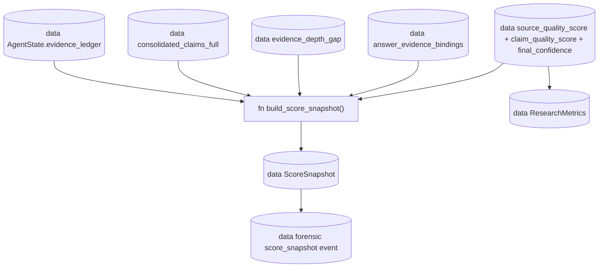

# Forensic cookbook

> Files: `src/inqtrix/runtime_logging.py`, `src/inqtrix/nodes.py`, `src/inqtrix/state.py`

## Scope

How to reconstruct an answer end-to-end from the protected forensic run audit: which events are emitted, which fields each event carries, and how to follow IDs from `query_record` through `query_summary`, `claim_merge`, answer prompt inputs, generated sections, and finally to `answer_claim_binding`. Use this page when you need to explain "where did sentence X come from" or "why did the run stop in round N". Ordinary container/file logs expose only the content-minimized operational projection of these events.

This page is operator-facing. Public architectural rationale lives in the
[Architecture overview](../architecture/overview.md).

## Enabling forensic mode

Forensic events are recorded on the run's trace, not mirrored into the file log, so four switches matter: file logging on and the logger threshold at `DEBUG` for the operational file log, `OBSERVABILITY_PROFILE=forensic` for how deep the recording goes, and `INQTRIX_TRACING` for where the events land:

```bash
export INQTRIX_LOG_ENABLED=true
export INQTRIX_LOG_LEVEL=DEBUG
export OBSERVABILITY_PROFILE=forensic
export INQTRIX_TRACING=file          # or otlp, see below
```

Forensic lineage events are attached to the trace (set `INQTRIX_TRACING=file` or `otlp`), not written as `ITERATION ...` log lines. The complete redacted events are placed into `state["iteration_logs"]` (`AgentState` key, `list[dict[str, Any]]`) whenever testing mode is active (`TESTING_MODE=true` env, `AgentSettings(testing_mode=True)`, or HTTP `/v1/test/run`). Audit payloads first pass through `runtime_logging.sanitize_event_payload`; a separate fail-closed console projection then omits exact queries, provider answers, snippets, claim/evidence text, prompt views and every URL from ordinary logs. See [Logging](logging.md) for the boundary.

The file log is not the audit trail and cannot reconstruct private evidence by design. Authorized durable run artifacts (including the `web_search_ledger` carried by the evidence artifact) are the production audit source; testing/parity runs expose the same redacted event detail through `iteration_logs`. Compact `TRACE ...` and `RUN start:` / `RUN end:` file lines are content-minimized operational signposts joined through stable IDs; the structured events themselves live on the trace.

## Optional conversation titles

A short title is a separate request, not an Agent step or a second answer.
Find its `inqtrix.session_title` span and the generation with purpose
`session_title`. Inspect the protected prompt/response for the first question,
language directive, schema and returned label; compare the effective model with
the configured Fast tier. Generation usage and the response usage refer to that
same call. Quota booking occurs at actual provider completion, including after
the HTTP waiter stopped waiting.

No generation is expected when the feature is disabled, Fast is unconfigured,
admission declines the work, or the target already has a manual/newer title.
The API returns a reason while the browser retains its provisional label. A
model response does not prove the label was applied: the revision/source check
can preserve a concurrent manual rename. Tracing is optional; neither generation
nor persistence depends on a Langfuse sink.

## Event catalog

Every protected forensic event carries a common envelope: `event`, `event_seq`, `node`, `run_id`, `timestamp`. The fields documented below describe the authorized audit payload, not the narrower file-log projection.

This catalog covers the lineage backbone; a forensic run additionally emits `node_model_resolution`, `node_model_resolution_warning`, `query_invocation_started`, `query_invocation_finished`, `query_synthesis`, `evidence_record`, `evidence_verification_projection`, `evidence_selection`, `score_snapshot`, `algorithm_failure` and `answer_sentence_audit`, whose authoritative field sets are the per-event allowlists in `src/inqtrix/runtime_logging.py`.

### `run_start`

```json
{
  "event": "run_start",
  "run_mode": "run",
  "run_id": "run_2026-05-09T08-12-44Z_a1b2c3",
  "question_length": 87,
  "history_length": 0,
  "llm": {"provider": "AzureOpenAILLM", "reasoning_model": "gpt-5.1", "claim_extract_model": "gpt-5.1-mini"},
  "search": {"provider": "AzureFoundryWebSearch", "engine": "foundry-web:search-agent@latest"},
  "settings": {"observability_profile": "forensic", "max_rounds": 4, "confidence_stop": 9, "max_total_seconds": 300, "testing_mode": false}
}
```

### `query_record`

```json
{
  "event": "query_record",
  "query_id": "qry_round-0_idx-1_b7e2",
  "round": 0,
  "query_index": 1,
  "query": "Wirkstoff X Phase III Studie 2025",
  "domain_filter": ["site:nih.gov"],
  "provider": "AzureFoundryWebSearch",
  "source_ids": ["src_1c4f", "src_92aa"],
  "citation_ids": ["cit_q-b7e2_s-1c4f", "cit_q-b7e2_s-92aa"]
}
```

### `source_record`

```json
{
  "event": "source_record",
  "source_id": "src_1c4f",
  "url": "https://www.nih.gov/news-events/news-releases/wirkstoff-x-phase-iii",
  "canonical_url": "https://www.nih.gov/news-events/news-releases/wirkstoff-x-phase-iii",
  "domain": "nih.gov",
  "provider": "AzureFoundryWebSearch",
  "first_seen_query_id": "qry_round-0_idx-1_b7e2",
  "first_seen_rank": 1,
  "origin": "url_citation",
  "tier": "primary",
  "tier_reason": "structural:official_primary",
  "role_reason": "",
  "access_status": "answer"
}
```

`source_record` is emitted **once per unique source ID**. Subsequent queries that hit the same canonical URL produce only `provider_citation_record` events; the dedup happens in the search node (see `src/inqtrix/nodes.py`). `runtime_logging.normalize_source_provenance` reads the typed source fields and drops everything else before logging. See [Writing a custom provider](../extending/provider.md) for the full contract.

### `provider_citation_record`

```json
{
  "event": "provider_citation_record",
  "citation_id": "cit_q-b7e2_s-1c4f",
  "query_id": "qry_round-0_idx-1_b7e2",
  "source_id": "src_1c4f",
  "url": "https://www.nih.gov/news-events/news-releases/wirkstoff-x-phase-iii",
  "canonical_url": "https://www.nih.gov/news-events/news-releases/wirkstoff-x-phase-iii",
  "rank": 1,
  "origin": "url_citation",
  "provider": "AzureFoundryWebSearch",
  "title": "Wirkstoff X Phase III Studie",
  "snippet": "Die Studie zeigte..."
}
```

### `query_summary`

`query_summary` restores the per-query information that operators need to understand what the algorithm actually processed before claim extraction and final answer composition.

```json
{
  "event": "query_summary",
  "query_id": "qry_round-0_idx-1_b7e2",
  "round": 0,
  "query_index": 1,
  "query": "Wirkstoff X Phase III Studie 2025",
  "answer_length": 1180,
  "claims_extracted": 4,
  "claims_kept": 3,
  "claim_extraction_mode": "structured_output",
  "claim_extraction_schema": "inqtrix_claim_extraction_v2",
  "claim_extraction_structured_supported": true,
  "claim_extraction_valid_empty": false,
  "claim_extraction_raw_claim_count": 4,
  "claim_extraction_normalized_claim_count": 4,
  "claim_extraction_filtered_claim_count": 0,
  "evidence_record_count": 3,
  "evidence_context_source_count": 2,
  "claims_sample": ["Die Studie erreichte den primaeren Endpunkt."],
  "source_ids": ["src_1c4f"],
  "citation_ids": ["cit_q-b7e2_s-1c4f"],
  "urls": ["https://www.nih.gov/news-events/news-releases/wirkstoff-x-phase-iii"],
  "prompt_tokens": 8420,
  "completion_tokens": 611,
  "provider_notice": ""
}
```

Use this event to inspect the context-level information that later enters
`state["evidence_ledger"]`. Claims are the verification layer; the rendered
EvidenceRecord source context is the richer information layer used for the
report body. The event itself carries only `answer_length` -- the size of
the provider answer, never its text. `claim_extraction_valid_empty=true`
means the extractor returned a valid empty `claims` array while source
context still existed; parse/API or token-limit failures appear separately
through `claim_notice`, `claim_fallbacks`, the `_claim_extraction_fallback`
marker, and `algorithm_failure` events. In forensic/deep runs, a run-wide
claim-extraction failure blocks normal report synthesis.
`claim_extraction_mode` shows whether the query used provider-native
schema enforcement (`structured_output`) or the legacy text-JSON prompt
(`legacy_text_json`). The raw/normalized/filtered claim counters separate a
model-valid empty response (`raw=0`) from a response that did return claim
objects. Read `claim_extraction_filtered_claim_count` with care: it is the
difference between the raw claims the extractor actually inspected (up to twice
`claim_max_items`) and the claims finally returned, so it counts both objects
dropped during local normalization and surplus claims trimmed back to the
`claim_max_items` cap. After a provider migration, use these fields together
with `scripts/debug_research_log.py` to confirm that the intended adapter path
is active before comparing failure counts.

### `claim_record`

```json
{
  "event": "claim_record",
  "raw_claim_id": "rcl_b7e2_001",
  "query_id": "qry_round-0_idx-1_b7e2",
  "signature": "wirkstoff x phase iii primaerendpunkt",
  "claim_text": "Die Phase-III-Studie zu Wirkstoff X erreichte den primaeren Endpunkt im Mai 2025.",
  "evidence_snippet": "Die Studie zu Wirkstoff X erreichte im Mai 2025 ihren primaeren Endpunkt.",
  "claim_type": "fact",
  "polarity": "affirmed",
  "needs_primary": true,
  "source_ids": ["src_1c4f"],
  "citation_ids": ["cit_q-b7e2_s-1c4f"],
  "source_urls": ["https://www.nih.gov/news-events/news-releases/wirkstoff-x-phase-iii"],
  "published_date": "2025-05-09",
  "round": 0
}
```

`claim_text` stays atomic on purpose. A paragraph can contain several statements with different evidence status; the claim ledger needs one checkable statement per row. `evidence_snippet` is the short supporting text span that makes the audit trail readable without turning claims into paragraph-sized bundles.

### `claim_merge`

```json
{
  "event": "claim_merge",
  "claim_id": "clm_wirkstoff-x-phase-iii_a3b1",
  "signature": "wirkstoff x phase iii primaerendpunkt",
  "member_claim_ids": ["rcl_b7e2_001", "rcl_d92e_004"],
  "status": "attributed",
  "status_reason": "primary evidence present; attributed by the search provider",
  "evidence_snippets": ["Die Studie ... erreichte den primaeren Endpunkt.", "Die FDA bestaetigte ..."],
  "support_count": 2,
  "contradict_count": 0,
  "source_ids": ["src_1c4f", "src_92aa"],
  "citation_ids": ["cit_q-b7e2_s-1c4f", "cit_q-b7e2_s-92aa"],
  "source_urls": ["https://www.nih.gov/news-events/news-releases/wirkstoff-x-phase-iii", "https://www.fda.gov/news-events/press-announcements/wirkstoff-x"],
  "round_first_seen": 0,
  "round_last_updated": 0
}
```

### `stop_cascade`

```json
{
  "event": "stop_cascade",
  "round": 1,
  "max_rounds": 4,
  "min_rounds": 1,
  "confidence": 9,
  "confidence_stop_target": 9,
  "utility_score": 0.62,
  "utility_stop": false,
  "plateau_stop": false,
  "stagnation_detected": false,
  "falsification_triggered": false,
  "done_after_utility": false,
  "done_after_plateau": false,
  "confidence_stop": true,
  "round_limit": false,
  "evidence_depth_gap": {"active": false, "reason": "", "gap": "", "supported_count": 5, "cross_checked_count": 2, "single_source_count": 2, "single_source_ratio": 0.4, "quality_source_single_count": 1, "central_single_quality_source_count": 0},
  "report_eligible_evidence_count": 6,
  "min_report_eligible_evidence": 3,
  "evidence_depth_gap_active": false,
  "suppressed_by_min_rounds": false,
  "suppressed_by_report_evidence": false,
  "suppressed_stop_reason": "",
  "final_stop_reason": "confidence_stop",
  "final_done": true
}
```

### `citation_selection`

```json
{
  "event": "citation_selection",
  "allowed_citations": ["https://www.nih.gov/...", "https://www.fda.gov/..."],
  "allowed_citation_count": 2,
  "allowed_link_count": 2,
  "removed_non_allowed_links": 0,
  "answer_claim_binding_count": 3,
  "answer_evidence_binding_count": 4,
  "matched_evidence_binding_count": 3,
  "unknown_citation_count": 0,
  "expanded_evidence_label_links": 1
}
```

### `answer_prompt_inputs`

```json
{
  "event": "answer_prompt_inputs",
  "report_profile": "deep",
  "model": "gpt-5.1",
  "evidence_record_count": 28,
  "rendered_evidence_record_count": 6,
  "omitted_evidence_record_count": 0,
  "evidence_overview_chars": 14620,
  "visible_evidence_label_count": 6,
  "allowed_citation_count": 2,
  "consolidated_claim_count": 7,
  "algorithm_failure_count": 0,
  "blocking_algorithm_failure_count": 0,
  "evidence_overview": "### E1 -- nih.gov ...",
  "section_plan": [{"key": "executive_summary", "heading": "Executive Summary", "required": true}]
}
```

This is the answer-side checkpoint: it records the sanitized context previews,
prompt evidence density, claim view, citation set, profile, model, and section
plan that the final report composer actually received. The full prompt evidence
text is capped by the runtime logging allowlist; use the counters here and
`answer_prompt_diagnostics` to understand evidence density without relying on
raw provider payloads.

### `answer_prompt_diagnostics`

```json
{
  "event": "answer_prompt_diagnostics",
  "evidence_record_count": 28,
  "report_eligible_evidence_count": 8,
  "claimless_evidence_count": 14,
  "rendered_evidence_record_count": 6,
  "omitted_evidence_record_count": 0,
  "evidence_overview_chars": 14620,
  "visible_evidence_label_count": 6,
  "allowed_citation_count": 2,
  "all_citation_count": 42,
  "consolidated_claim_count": 7
}
```

This event is emitted in testing mode or forensic observability. It is the
fastest way to see whether a thin report came from claim extraction, bundle
materialisation, source-context promotion, citation selection, or prompt
rendering budget.

### `answer_section`

```json
{
  "event": "answer_section",
  "key": "analysis",
  "heading": "Analyse",
  "position": 3,
  "model": "gpt-5.1",
  "content_length": 4210,
  "content_preview": "Die wichtigsten Befunde ...",
  "finish_reason": "stop",
  "limit_hit": false,
  "incomplete": false,
  "prompt_tokens": 12400,
  "completion_tokens": 1100,
  "section_focus_record_count": 6,
  "section_focus_labels": ["E1", "E4"],
  "section_allowed_citation_count": 2,
  "used_evidence_labels": ["E1", "E4"]
}
```

Section events make the final composition step auditable without storing raw provider request/response payloads.

### `answer_claim_binding`

```json
{
  "event": "answer_claim_binding",
  "binding_id": "bind_seg-2_src-1c4f_clm-a3b1",
  "answer_segment_id": "segment_2",
  "answer_segment_preview": "Die Studie erreichte den primaeren Endpunkt im Mai 2025 [1](https://www.nih.gov/...).",
  "citation_url": "https://www.nih.gov/news-events/news-releases/wirkstoff-x-phase-iii",
  "source_id": "src_1c4f",
  "citation_id": "cit_q-b7e2_s-1c4f",
  "claim_id": "clm_wirkstoff-x-phase-iii_a3b1",
  "claim_status": "verified",
  "binding_status": "matched"
}
```

`binding_status` values:

- `matched` -- claim signature or three+ content tokens overlap the answer segment text. Claims at this status drive `claim["used_in_answer"]`.
- `source_only_binding` -- the URL is cited in this segment, but no claim that shares the URL plausibly carries the segment text. Lineage is preserved without false-positive matches.
- `citation_without_claim` -- the URL is cited in this segment and no consolidated claim references the URL at all (legacy, manually injected, or post-claim-extraction citation).

The binding is computed against the **answer body only**, captured before the appendix sections (references / further reading) are appended. Reference-link URLs in the appendix do not produce bindings.

### `run_end`

```json
{
  "event": "run_end",
  "run_id": "run_2026-05-09T08-12-44Z_a1b2c3",
  "run_mode": "run",
  "status": "ok",
  "reason": "confidence_stop",
  "elapsed_s": 47.812,
  "round": 1,
  "done": true,
  "cancelled": false,
  "final_confidence": 9,
  "total_citations": 8,
  "evidence_record_count": 14,
  "algorithm_failure_count": 0,
  "blocking_algorithm_failure_count": 0,
  "consolidated_claims_count": 7,
  "total_prompt_tokens": 12530,
  "total_completion_tokens": 4180
}
```

## Source -> claim -> answer walkthrough

A minimal run: one question, two queries hitting one shared NIH URL plus one new FDA URL, two consolidated claims (one of which ends up in the answer).

| Step | Event | Key IDs |
|------|-------|---------|
| 1 | `query_record` round=0 | `query_id=qry...b7e2` -> `source_ids=[src_1c4f]`, `citation_ids=[cit_q-b7e2_s-1c4f]` |
| 2 | `source_record` (NIH) | `source_id=src_1c4f` (emitted once) |
| 3 | `provider_citation_record` | `citation_id=cit_q-b7e2_s-1c4f` linking `query_id` to `source_id` |
| 4 | `query_summary` | `query_id=qry...b7e2`, `answer_length=...`, `claims_extracted=...` |
| 5 | `claim_record` | `raw_claim_id=rcl_b7e2_001` -> `source_ids=[src_1c4f]`, `citation_ids=[cit_q-b7e2_s-1c4f]`, `evidence_snippet=...` |
| 6 | `query_record` round=1 | `source_ids=[src_1c4f, src_92aa]`. The NIH URL is reused. |
| 7 | `source_record` (FDA) | `source_id=src_92aa` (NIH is **not** re-emitted; check the dedup contract). |
| 8 | `provider_citation_record` | `citation_id=cit_q-d92e_s-1c4f` (per-query) |
| 9 | `claim_record` | `raw_claim_id=rcl_d92e_004` -> `source_ids=[src_1c4f, src_92aa]` |
| 10 | `claim_merge` | `claim_id=clm...a3b1`, `member_claim_ids=[rcl_b7e2_001, rcl_d92e_004]`, `status=attributed` |
| 11 | `stop_cascade` | `final_stop_reason=confidence_stop`, `final_done=true` |
| 12 | `citation_selection` | The NIH and FDA URLs are kept for the answer body. |
| 13 | `answer_prompt_inputs` | Context previews, claim prompt view, citations, and section plan sent to the composer. |
| 14 | `answer_section` | Generated section metadata and preview. |
| 15 | `answer_claim_binding` | `claim_id=clm...a3b1`, `citation_id=cit_q-b7e2_s-1c4f`, `binding_status=matched` |
| 16 | `run_end` | `total_citations=2`, `consolidated_claims_count=1` |

To trace an answer sentence backwards, start with `answer_claim_binding`: the segment ID locates the sentence in the body, `claim_id` joins to `claim_merge`, `member_claim_ids` join to `claim_record` rows, and each `claim_record` carries `query_id` plus `source_ids`/`citation_ids` to recover the originating `provider_citation_record` and `source_record`. To trace a stop decision, start with `stop_cascade` and read `final_stop_reason` plus the per-rule booleans.

## Querying logs

### `jq` recipes

These recipes read a flat JSON-lines export with one forensic event per line; produce it from a testing-mode run with `jq -c '.iteration_logs[]' run-result.json > run-events.jsonl`, because the trace spool written by `INQTRIX_TRACING=file` (`trace-spool-*.otlp.jsonl`) holds one OTLP `ExportTraceServiceRequest` per line, with the events nested under `resourceSpans[].scopeSpans[].spans[].events[]`.

Bindings (matched vs source-only) by claim:

```bash
jq -r 'select(.event=="answer_claim_binding") | "\(.binding_status)\t\(.citation_id)\t\(.claim_id)\t\(.citation_url)"' run-events.jsonl
```

Trace a single source through the lineage:

```bash
SRC=src_1c4f
jq --arg sid "$SRC" '
  select(
    (.event=="source_record" and .source_id==$sid)
    or ((.event=="provider_citation_record" or .event=="claim_record" or .event=="claim_merge")
        and ((.source_ids // [])[]? == $sid))
    or (.event=="answer_claim_binding" and .source_id==$sid)
  )
' run-events.jsonl
```

Verify single-`source_record` invariant (one row per unique URL):

```bash
jq -r 'select(.event=="source_record") | .canonical_url' run-events.jsonl | sort | uniq -c | sort -nr | head
```

Quick stop reason histogram:

```bash
jq -r 'select(.event=="stop_cascade") | .final_stop_reason' run-events.jsonl | sort | uniq -c | sort -nr
```

### Python recipe

Forensic events never reach the `inqtrix` file log: `runtime_logging.emit_runtime_event` attaches each one to the active span, so they exist only as span events -- in the OTLP-JSON spool under `INQTRIX_TRACING=file`, at the OTLP endpoint under `otlp`, and additionally in the top-level `iteration_logs` list of a testing-mode run. Parse `iteration_logs` instead of `logs/inqtrix_*.log`:

```python
import json
from collections import defaultdict
from pathlib import Path

run_result = json.loads(Path("run-result.json").read_text())

bindings_by_claim: dict[str, list[dict]] = defaultdict(list)

for payload in run_result["iteration_logs"]:
    if payload.get("event") != "answer_claim_binding":
        continue
    bindings_by_claim[payload.get("claim_id", "")].append(payload)

for claim_id, rows in bindings_by_claim.items():
    matched = sum(1 for r in rows if r["binding_status"] == "matched")
    source_only = sum(1 for r in rows if r["binding_status"] == "source_only_binding")
    print(f"{claim_id}\tmatched={matched}\tsource_only={source_only}")
```

For runs captured via `/v1/test/run` or parity tooling, the structured events are already deserialised under the top-level `iteration_logs` key; iterate the list directly.

## Score ledger

### Why it exists

Earlier versions kept scoring values as independent state fields. That made a run hard to reason about: `source_quality_score` could look healthy because many URLs were found, while only one verified report bundle existed. The score ledger keeps those views together in one chronological structure.

`state["score_ledger"]` (`AgentState` key, `list[dict[str, Any]]`) is not a second truth source. It is a chronological diagnostic history built from the latest state fields. Compatibility fields such as `source_quality_score`, `claim_quality_score`, and `final_confidence` remain the values consumed by result projection and stop gates; the ledger records them together with evidence and answer-audit context.

### Flow



The graph shows one direction of authority: evidence, claims, bundles, answer audit, and compatibility score fields feed a `ScoreSnapshot`. Public `ResearchMetrics` reads the compatibility fields directly from `result_state`; it does not read back from `score_ledger`. Stop criteria should not infer answer readiness from raw URL counts.

### `ScoreSnapshot`

Claim quality, evidence depth and `consolidated_claim_count` describe the
complete assessment, independently of compact-list caps. The `claims` group
also records `materialized_claim_count` for the selected list. Use the
`evidence_selection` event to compare the two sizes. More displayed or assessed
claims alone do not establish better semantic support for the final answer.

One snapshot is appended at the end of every `search` and every `evaluate` node run -- once per research round each -- and one more at the end of `answer`, so a three-round run writes seven snapshots. A phase writes its snapshot regardless of how much data exists: values it does not supply fall back to defaults, which is why the `search` snapshot always shows `stop.utility_score` `0.0`, `answer.answer_bound_claims_count` `0`, and `answer.evidence_contract_status` `"unknown"`. Only the early-exit paths (no queries, deadline exceeded, evaluate on an already finished run) skip the snapshot.

```python
ScoreSnapshot = {
    "round": 2,
    "phase": "search|evaluate|answer",
    "source": {
        "total_citations": 68,
        "tier_counts_all": {"primary": 12, "mainstream": 13, "unknown": 43, "low": 0, "stakeholder": 0},
        "quality_score_all": 0.551,
    },
    "evidence": {
        "evidence_record_count": 68,
        "report_eligible_evidence_count": 8,
        "verified_claim_count": 0,
        "attributed_claim_count": 1,
        "contested_claim_count": 0,
        "primary_supported_claim_count": 0,
        "cross_checked_claim_count": 1,
        "unverified_claim_count": 5,
        "rendered_evidence_record_count": 0,
        "omitted_evidence_record_count": 0,
        "evidence_depth_gap": {...},  # the _evidence_depth_gap() dict, embedded unchanged -- fields and triggers: ../architecture/websearch/stopping.md#evidence-depth-gap
    },
    "claims": {
        "consolidated_claim_count": 6,
        "verified": 0,
        "attributed": 1,
        "contested": 0,
        "unverified": 5,
        "quality_score": 0.167,
        "needs_primary_total": 2,
        "needs_primary_supported": 1,
    },
    "coverage": {
        "aspect_coverage_context": 0.667,
    },
    "evaluate": {
        "llm_confidence": 4,
        "final_confidence": 4,
        "evidence_consistency": 8,
        "evidence_sufficiency": 4,
        "confidence_unjustified_drop": False,
    },
    "stop": {
        "utility_score": 0.43,
        "stop_reason": "strategy_done",
        "done": True,
    },
    "answer": {
        "answer_bound_claims_count": 3,
        "unbound_answer_citations_count": 3,
        "matched_evidence_binding_count": 5,
        "evidence_contract_status": "needs_review",
    },
}
```

### Which scores drive decisions

These fields are diagnostic and should not by themselves decide whether a report can make hard factual claims:

- `source.quality_score_all`: all found citations, not selected report evidence.
- `source.tier_counts_all`: useful for source mix, but still URL inventory.
- `coverage.aspect_coverage_context`: the evaluator's judgement of which classify sub-questions the evidence answers (`COVERED_ASPECTS`), not verified report coverage. On a search-phase record it is the judgement of the evaluation *before* that search (the search node does not judge coverage), so it lags the round it is attached to by one evaluation.

These fields are the high-signal fields to inspect when reviewing stop and answer readiness. They are recorded together in snapshots, but most decisions still read the current `AgentState` fields directly:

- `evidence.report_eligible_evidence_count` -- gates the report-evidence floor stop suppression.
- `evidence.rendered_evidence_record_count` / `evidence.omitted_evidence_record_count` -- always `0` in a score snapshot. `build_score_snapshot()` reads both only from the phase-local `extra` dict, and no phase passes them, so the ledger copy is a placeholder even though the answer node writes the real values onto state first. Read the actual counts from the trace: the `evaluate` and `answer` node spans always carry `inqtrix.evidence.rendered_count`, `inqtrix.evidence.omitted_count`, `inqtrix.evidence.omitted_query_count` and `inqtrix.evidence.budget_chars`; a cut raises the observation level to WARNING and adds the span event `inqtrix.evidence.omitted` naming the dropped labels, evidence ids and query ids (URLs only under content capture). The same counts appear in the `answer_prompt_inputs` / `answer_prompt_diagnostics` forensic events and in the answer row of the iteration log. A non-zero omitted count means evidence was lost to budget; it is also visible to the LLM as a "HINWEIS: …" footer in the overview.
- `evidence.evidence_depth_gap` -- the full dict, see [Stop criteria](../architecture/websearch/stopping.md#evidence-depth-gap) for fields and triggers.
- `claims.quality_score`, `evidence.cross_checked_claim_count`, `evidence.evidence_depth_gap.single_source_count` -- claim-quality view.
- `evaluate.evidence_sufficiency`
- `answer.evidence_contract_status` -- one of `clean` / `needs_review` / `source_context_only` / `algorithm_failed` / `unknown` (see [AnswerEvidenceBinding](../architecture/websearch/evidence.md#answerevidencebinding)).

For where each of these signals is produced, updated and consumed, see the
[signal map](../architecture/websearch/stopping.md#signal-map-where-metrics-are-produced-and-consumed).
[Research loop](../architecture/websearch/loop.md#the-confidence-value-and-what-can-lower-it)
separates the confidence inputs that come from the LLM from the deterministic
guardrails.

### Progress and footer

The user-facing progress stream reports found references separately from the
evidence records built out of them. The report-eligible subset is not part of
the three summary lines `search` emits -- read it from
`evidence.report_eligible_evidence_count` in the snapshot. It does reach the
stream in one case: when the report-evidence floor suppresses an early stop,
`evaluate` emits `Evidenzlage noch zu duenn (N/M report-faehige Records);
weitere Recherche.` After folding in a round's results, `search` emits these
three summary lines, in this order:

```text
5 search answers processed, 31 references collected, 12 evidence records created
Source mix: 5 primary, 3 mainstream, 4 stakeholder, 18 unknown, 1 low; quality 0.50
Claim status: 1 verified, 1 cross-checked, 5 unverified, aspect coverage 67%
```

## Debugging runs

### Provider receipts, usage details and run scores

With content capture enabled, inspect `inqtrix.response.raw` on each generation
alongside its normalized input/output. Native text completions retain the
metadata response before returning text; structured completions and tool-calling
chat retain the same provider receipt. Hosted search responses include the
available model, usage details and internal tool calls. A custom text-only
provider may have no receipt: `inqtrix.raw_unavailable` states that explicitly.
Content always passes the shared redaction and byte backstop; inspect truncation
events before claiming a response is complete. A serialized SDK response does
not contain material the provider never returned.

Input/output totals are inclusive. In Langfuse, add the disjoint `input`,
`input_cached_tokens`, `input_cache_creation`, `output` and
`output_reasoning_tokens` buckets once; their sum equals `total`. An unavailable
detail is absent, while a reported zero is preserved. The usage ledger and quota
continue to book totals, without a tokenizer or additional model call.

`INQTRIX_TRACE_SCORES` publishes existing run judgements through the background
tracing lifecycle. Use Langfuse's Scores view or trace-score filters for
`final_confidence`, `claim_quality_score`, `source_quality_score`,
`aspect_coverage`, `evidence_contract_status`, `stop_reason`,
`omitted_evidence_records`, `answer_contract`, `critic_verdict` and the
`deep_review_*` fields. Missing values are not zero. Parent scores belong to the
trace; child scores belong to the child's execution observation. These signals
are not an independent evaluation of content accuracy.

Search costs can additionally include web-tool transactions. A returned
`web_search_call` proves reported tool activity, not an invoice or a monetary
amount. Name missing prices and tool fees when comparing runs, and compare the
same cost coverage. The offline cases under `tests/eval/test_agent_desk_score_contracts.py`
protect publication and score wiring; semantic quality still requires reading
real outputs and their supporting material.

### Step zero: enable the file log

All debugging flows below assume logs are on disk. The minimum setup:

```bash
export INQTRIX_LOG_ENABLED=true
export INQTRIX_LOG_LEVEL=INFO
```

Without the file sink, `grep`-based post-mortem is not possible. For the HTTP server, uvicorn output can be mirrored into the same file — see [Logging](logging.md).

For full source-to-claim-to-answer reconstruction, enable forensic depth:

```bash
export INQTRIX_LOG_ENABLED=true
export INQTRIX_LOG_LEVEL=DEBUG
export OBSERVABILITY_PROFILE=forensic
export INQTRIX_TRACING=file          # or otlp, see below
```

`OBSERVABILITY_PROFILE` decides HOW DEEP the recording goes;
`INQTRIX_TRACING` decides WHERE it goes. Forensic depth with tracing `off` or
`local`, or with a sample rate below `1.0`, records only part of what you
asked for — the process warns about both combinations at startup.

### Step zero (alternative): follow one run in a trace

With `INQTRIX_TRACING=file` every run spools as OTLP-JSON under `logs/traces/`
and can be replayed into a trace backend later
(`python -m inqtrix.observability.replay <dir> --endpoint <url>`). With
`INQTRIX_TRACING=otlp` runs appear live in Langfuse.

Either way the drill-down path is the same:

1. Find the run in **Settings → Admin → Audit**: filter by actor, the date
   range and the action group *Service starts (runs)* — the action dropdown
   filters by prefix (`run.`), not by a single action. To separate the
   outcomes, use the outcome filter: `run.completed` is recorded as
   `success`, `run.failed` and `run.cancelled` as `failure`. The row carries
   the mode, duration, token sums, `run_id` and `trace_id`.
2. Open the row's drawer for the durable step list — this works with NO trace
   backend at all, because it reads the run's own persisted events.
3. **Export trace JSON** for the full waterfall (source: Langfuse when
   connected, otherwise the file spool), or **Open in Langfuse** for the
   interactive view. Both need only the trace id the row already shows.
4. `grep` the JSON logs for the same `run_id` or `trace_id` — every log line
   inside a run carries both, so the log and the trace join without guessing.

What the waterfall answers that the log cannot: which prompt produced which
response, where a cap truncated an answer section (`limit_hit`), which sources
a claim came from, how long each provider call took, and where a retry chain
started.

What every call span carries, independent of the engine: `inqtrix.purpose`
(the call site — `agent_plan`, `agent_synthesis`, `agent_deep_review`,
`agent_deep_review`, `agent_kernel`, `direct_chat` (the web-free chat answer),
`classify`, `plan`, `claim_extract`, `evaluate`, `answer`, and the Knowledge
calls `knowledge_gate`, `knowledge_decompose`, `knowledge_contextualize` (ingestion
and follow-up rewrite), `knowledge_rerank`, `knowledge_answer`, …), `inqtrix.run_id`, and for mission tasks
`inqtrix.task_id` / `inqtrix.task_kind`; the purpose is mirrored into the
filterable Langfuse metadata (`metadata.purpose`), so "which step burned the
tokens" is a filter, not a dump. Mission tasks open one `agent.task` span
each, research runs one span per graph node (`inqtrix.node`,
`inqtrix.round`). The node spans export the node's decision as attributes:
the numeric snapshot keys, the count dicts flattened
(`inqtrix.claim_status_counts.attributed`, `inqtrix.source_tier_counts.unknown`),
`inqtrix.stop_reason`, `inqtrix.answer_contract`,
`inqtrix.evidence_contract_status` and `inqtrix.<node>.done`. A grounded web
search is exported as a Langfuse *generation* (engine as model, provider
usage in `gen_ai.usage.*`), so the trace total includes the search agent's
tokens; the run's own token count is on the trace metadata
(`usage_prompt_tokens` / `usage_completion_tokens`) together with `mode`,
`depth`, `tier`, `profile`, `stack` and `usage_scope` — Langfuse drops usage
on agent root spans, so the total lives there, not on the root as usage.

Read `usage_scope` before the two numbers. `run` means the engine keeps a
cumulative count and the metadata carries it; `segment` means it does not,
and the number is the LAST segment's delta. A run that parks has several
segments — every deep run does, because a role parks its parent — so on a
`segment` trace the metadata is a part of the spend, not the whole. The
quota is a third number again: it books the segment delta after every
segment, which is why it is correct while a cumulative value in the same
field would be charged twice. The same pair travels on the exported run
payload (`usage.scope`), so a Markdown export says what it counts too.

Every kernel tool call the tool node executes has one tool observation,
`execute_tool <name>`, per execution segment. To find the observation of a
desk row, take the row's `invocation_id` from
`/v1/runs/{run_id}/events?format=json` and look for the same
`gen_ai.tool.call.id`; compare identity only — the desk shows every status
other than `error` as completed, and a gated row starts before its approval
while its observation sits under a later segment. `inqtrix.outcome` says how
the call ended (`completed`, `failed` at WARNING for a visible failure,
`parked`, `cancelled`, `budget_exceeded`, or `error` with ERROR status); a
call that interrupted has a `parked` span per waiting segment and its
terminal span in the resumed one, and a `parked` span with no later span
means the run ended while it waited. A row without any observation was
answered before dispatch (see the [legend](tracing-legend.md#tool-spans)).
Tool arguments and the reply text are user content and fill the
observation's input and output only with content capture on, redacted and
byte-capped; without it the span carries identity and outcome only.

A capability call inside the tool observation is a plain child span named
after the capability (`inqtrix.tool.capability`, `inqtrix.tool.failure_code`
on a typed failure). The searched knowledge boundary is not content and
always rides the `knowledge.search` capability span: `inqtrix.knowledge.scope`
is `pinned`, with `inqtrix.knowledge.collection_ids` and
`inqtrix.knowledge.collection_count`, or `unbounded` for an unscoped principal
searching its whole tenant, without ids or count. So "which collections did
this run search" is answered from the trace even when queries are not
captured.

For a grounded search, the observation's standard input and output display
the actual query and provider answer. Their JSON string encoding preserves
literal text such as `null`; the existing `inqtrix.search.query/answer`
attributes contain the same redacted and bounded text. These display fields
do not add a model call or change usage accounting.

Tool arguments are captured in full up to the trace byte backstop. Short
audit previews (for example a bounded `query` field) do not trim captured
messages before that policy runs. Credential keys and secret URL values
are still redacted. Direct search calls carry purpose `web_instant`, with
the enclosing task identity retained when available.

`inqtrix.search.sources` retains provider `origin`, `spans` (every place of
the provider answer that cites the source, each with `start` and `end`) and
`last_updated` alongside URL, title, snippet, date and rank. Each span is one
citation in the web-search ledger, so a source the answer cites three times
has three ledger citations. Compare the same query and source rank/URL with
the web-search ledger.
Research results expose that ledger directly. The kernel persists it in the
`web_search_ledger` payload of its protected `evidence_bundle` artifact;
absence from the public agent-result envelope is not evidence of data loss.
The instant-search capability preserves source origin and update metadata
on its way to that artifact.
The offsets describe the original provider answer before trace redaction
or truncation, not a webpage or an altered displayed string. A provider
that supplies citations without page bodies has empty source snippets;
its complete synthesized answer is a different kind of evidence from an
original page excerpt. See the [tracing legend](tracing-legend.md).

Source placements are counted on the search and evaluate node spans as
`inqtrix.source_roles.strategy`, `.model`, `.unjudged`, and `.conflicts`.
`strategy` includes both the structural registry-suffix floor and custom
strategy placements; it is distinct from the per-source `structural:<role>`
reason. The other placement counts are recounted over the run's source
registry, while conflicts accumulate rejected later judgements. Under
forensic capture, `source_record` events carry the placement accepted for
the discovery round. The current evidence ledger refreshes retained records
before deriving claim tiers and their reasons. Compare the same source ID
across these surfaces, accounting for a role assigned in a later round.

For a role judgement, inspect the `claim_extract` generation's source card
and `source_roles` output. Rows marked `role_fixed` already have a placement;
`strategy:<tier>` preserves a custom tier without inventing a source role.
Missing-role counts cover only unfixed rows shown on that card. Overlong
role reasons produce a warning and `source_role_reason_truncated_count` in
the extractor's metadata. An issuer match appears in the claim's
`primary_basis` and `status_reason`; a deliberate `unknown` placement is
not an unjudged source eligible for this fallback.

### Symptom: "The report is wrong and I need to see what actually happened"

Reach for the trace, not the log: the log records decisions, the trace records
the conversation with the provider. Follow the four steps in *Step zero
(alternative)* above. Typical findings and where they show:

- an answer section cut short → `limit_hit` plus the truncation event on the
  `answer` step
- a search that returned nothing usable → the `web_search` span carries the
  query and, under forensic, the raw per-source records
- an unexpected model or parameter → the `gen_ai.request.*` attributes on the
  call span
- a step that failed while the run still "succeeded" → the span carries status
  ERROR with the stable failure code

If the trace is missing entirely, check that a recording sink is configured
(see *Step zero*) — forensic depth without a sink is the usual cause.

### Symptom: "My run finds no sources"

1. Check the `search` summary entry: `queries`, `sources_found`, `total_citations` and `search_fallbacks` (how many queries came back with a provider notice instead of a usable result). In forensic mode, follow `query_record_ids` to `source_record` and `provider_citation_record` events.
2. Read the `queries` field on each `search` entry. If the queries look off-topic, the plan node likely mis-parsed the classification output. Look for `_classify_fallback`.
3. Inspect the provider log lines for 4xx/5xx. `AnthropicAPIError`, `BedrockAPIError` and `AzureOpenAIAPIError` lines indicate the backend rejected the call — credentials or model-name issues. `PerplexitySearch` raises no error type of its own: it logs `Perplexity-WebSearch fehlgeschlagen (status=…, type=…)`, records a non-fatal provider notice and returns an empty result.
4. If `all_citations` is empty but no error was raised, the provider returned an empty body. In forensic mode, `source_record.access_status` and provider notices show whether the provider returned no answer or only legacy citations.

### Symptom: "Confidence stays capped, run will not stop"

1. Read `_confidence_parsed` on each evaluate entry. It is a boolean marker, not a number: `false` means the `CONFIDENCE: N` field was missing from the model reply or the evaluate call fell back after an error, so the score is a default rather than a model judgement. The numeric score is `final_confidence`, and the cap that lowered it is named in `guardrail_reasons`, where each entry records the transition as `<reason>:conf <before>-><after>`.
2. Check `guardrail_reasons` and `stop_cascade` on the evaluate entry. `stop_cascade.final_stop_reason` is the canonical stop outcome.
3. `uncovered_aspects` (the sub-questions the evaluator did not mark as answered) is the most common "invisible" cap. Check `required_aspects` vs `uncovered_aspects` and `coverage_source` (`llm` / `missing`) and add evidence targeted at the remaining aspects. In the trace, filter the `evaluate` node spans on `inqtrix.stop_reason` and `inqtrix.aspect_coverage`: a run that ends by `max_rounds` with coverage below 1.0 in every round is this cap.
4. If the trajectory is flat low, falsification and stagnation should eventually trigger. See [Falsification mode](../architecture/websearch/stopping.md#falsification-mode); if neither fires, verify `round >= 2` and that `prev_conf` is actually being threaded — the evaluate iteration-log entry now records it as a top-level field alongside `stop_cascade`.

### Symptom: "I cannot trace final answer sentences to sources"

1. Enable forensic mode and follow the chain backwards from the answer sentence through `answer_claim_binding`, `claim_merge`, `claim_record` and `source_record`: the sections below carry the switches, the event-by-event table and the `binding_status` values.
2. If bindings are missing entirely, check whether the answer contains allowed Markdown links after `_answer_links_sanitized`; no links means there is no answer-level citation anchor to bind.

### Symptom: "Claim extraction fallback warnings"

The marker `_claim_extraction_fallback` is a plain boolean on the `search` entry: `true` means claim extraction failed for at least one source, and `claim_fallbacks` holds the count. The model name is not on the marker — it appears in the extractor's own `ALGO-FAIL claim_extraction …` warning lines, which carry `(model=<name>, error_type=<type>)`. Two common root causes:

- **Model name leakage from `ModelSettings()` defaults.** A strategy that reads `settings.models.effective_claim_extract_model` gets the LiteLLM defaults, which fail on Anthropic/Bedrock/Azure stacks. The built-in strategies use `resolve_claim_extract_model(llm, fallback=...)`; a custom strategy should use the same helper.
- **Deployment misconfiguration on Azure.** Check that the deployment name in `AzureOpenAILLM(default_model=...)` or `claim_extract_model=...` exists in the target resource.

### Symptom: "Cancel does not stop the run"

Cancellation is cooperative and lands at node boundaries, so a provider call
already in flight may run to its effective operation deadline (600 seconds by
default). For the cancel surfaces and the checkpoints in between see
[Web server mode](../deployment/webserver-mode.md) and [Timeouts and errors](#timeouts-and-errors).
If you need guaranteed sub-second cancellation:

- Use a provider transport that exposes cooperative request cancellation.
- Enforce a shorter upstream deadline at the reverse proxy if that operational
  trade-off is intentional.
- In-flight HTTP cancellation through the agent is out of scope today (open follow-up).

### Symptom: "HTTP 429 from the server with slots free"

Check which HTTP surface returned 429:

- `/v1/chat/completions`: compare `MAX_CONCURRENT` (default 100) to active research requests in the access log. If active requests equal the cap, increase the setting. If not, the semaphore may have leaked — the normal cause would be an exception escaping outside the `stream_response` context manager.
- `/v1/runs`: inspect `GET /v1/runs`. If active runs equal `RUN_MAX_CONCURRENT` (default 100) and queued runs equal `RUN_QUEUE_MAX_SIZE` (default 100), the queue is full. Increase `RUN_QUEUE_MAX_SIZE`, increase the active native run cap, or add front-door rate limiting. If the list looks empty but 429 persists, check whether terminal records are still inside `RUN_COMPLETED_TTL_SECONDS` with open event subscribers.

Run the cancel-on-disconnect and run-store tests, then inspect the unified uvicorn/Inqtrix log.

## Timeouts and errors

> Files: `providers/base.py`, `providers/*`, `exceptions.py`, `constants.py`

### Deadline model

```text
Run:       deadline = time.monotonic() + MAX_TOTAL_SECONDS (default 3600s)
Operation: deadline = min(now + configured_timeout, run_deadline)
```

The four research nodes — `classify`, `plan`, `search` and `evaluate` — call `_check_deadline(state["deadline"])` on entry; the `AgentTimeout` it raises is caught inside the node itself, so `classify` and `plan` continue with their deterministic fallbacks while `search` and `evaluate` mark the run done and hand over to `answer`. The `answer` node has no entry check, which is what guarantees that a partial report is still synthesised from the accumulated context. Every provider call receives the active run deadline and clamps its configured operation timeout to it, so a late-round call cannot silently burn the remaining budget; LLM reasoning calls pass that timeout per call, while `SEARCH_TIMEOUT` and `CLAIM_EXTRACT_TIMEOUT` are bound when the search provider and the claim-extraction strategy are constructed, so changing them per run does not reach an already-built instance.

| Layer | Env variable | Default | Purpose |
|-------|--------------|---------|---------|
| Active research run | `MAX_TOTAL_SECONDS` | 3600s | Outer wall-clock budget checked at graph boundaries and passed into provider calls. Time parked for Agent Desk approval/input is not active research time. |
| LLM reasoning | `REASONING_TIMEOUT` | 600s | Logical-operation budget for every non-editor reasoning call, including retries and backoff: classify/plan/evaluate/answer, direct chat, the Knowledge gate/decomposition/contextualisation/answer calls, and Agent Desk mission and Kernel calls. The same value is also handed to the embedding client, the reranker, and the ingestion contextualiser as their configured client timeout. |
| Editor assistant | `EDITOR_ASSISTANT_TIMEOUT` | 600s | Logical-operation budget for editor suggest/instruct calls. |
| Perplexity / other search | `SEARCH_TIMEOUT` | 600s | Logical-operation budget for one `search()`, including retries and backoff. |
| Claim extraction | `CLAIM_EXTRACT_TIMEOUT` | 600s | Logical-operation budget for one extraction, including retries and backoff. |

All five are configurable via environment variables (see [Settings and env](../configuration/settings-and-env.md)) or via `AgentConfig`.

### Exception hierarchy

| Exception | Parent | Trigger | Behaviour |
|-----------|--------|---------|-----------|
| `AgentTimeout` | `Exception` | `time.monotonic() > deadline` at a node boundary or inside a provider | Graceful: `answer` is called with accumulated context even when downstream nodes have not completed. |
| `AgentProviderTimeout` | `AgentTimeout` | One logical provider operation exhausts its own timeout before the outer run deadline | Visible provider-operation failure; retry metadata records the operation, configured/effective budget, and attempt. |
| `AgentRateLimited` | `Exception` | HTTP 429 remains after the shared three-attempt budget, or the provider reports a hard daily/token cap | Visible terminal provider failure. Partial token counts are preserved on the result. |
| `AgentCancelled` | `Exception` | `_cancel_event` set (explicit cancel or disconnect watcher) | Abort at the next cancellation checkpoint and return a cancelled result state. Residual latency: the remainder of one in-flight provider HTTP attempt. Full checkpoint list: [Runs API](../extending/runs-api.md#event-types). |
| `AnthropicAPIError`, `AzureOpenAIAPIError`, `AzureFoundryWebSearchAPIError`, `BedrockAPIError` | `RuntimeError` | Per-provider HTTP error (400s, 500s, schema mismatches) | Graceful degradation per node (see below). |

Each provider raises its own dedicated error type. `AzureOpenAIAPIError`, `AzureFoundryWebSearchAPIError`, and `BedrockAPIError` are re-exported from the top-level package; `AnthropicAPIError` and the `Agent*` types (`AgentTimeout`, `AgentProviderTimeout`, `AgentRateLimited`, `AgentCancelled`) are imported from `inqtrix.exceptions`.

### Graceful-degradation rules per node

- **classify fails** — heuristic type inference; single sub-question = question verbatim.
- **plan fails** — fallback to `[question]` as single query.
- **search fails for a query** — skip that query, continue with others.
- **claim extraction fails for a source** — keep the search result and summary, but mark the source-level extraction as `ALGO-FAIL claim_extraction` via progress, warning, and iteration-log fields.
- **claim extraction fails for the whole run** — in forensic/deep runs, block normal report synthesis and return a short diagnostic report instead of a normal hard-fact report.
- **evaluate fails** — the confidence is clamped into a conservative band (`min(max(previous_confidence, 5), confidence_stop - 2)`, which is a fixed 5 under `compact`, 4 under `schnell` and 5 or 6 under `deep`), and the conservative gap note is written only when no gaps have been recorded yet; iteration-log marker `_evaluate_fallback`.
- **answer fails** — return raw context without synthesis; the fallback answer is a German notice.

The invariant across all of them: a partial result is always returned to the caller. The agent never terminates without producing either an answer string or a typed exception.

### Provider retry behaviour

The built-in providers implement one visible retry authority on top of the
deadline model. A logical operation has at most three attempts in total; a
mixed sequence of transport, 5xx, and 429 failures cannot reset that counter:

- `AnthropicLLM` and `BedrockLLM` retry up to 3 total attempts with exponential backoff and jitter, and Bedrock throttling after the final attempt becomes `AgentRateLimited`; `AzureOpenAILLM` and `LiteLLM` disable the OpenAI SDK retries and retry transient errors themselves. Per-provider trigger lists: [Providers overview](../configuration/providers.md).
- `AzureFoundryWebSearch` — OpenAI SDK retries are disabled and Inqtrix retries transient Responses API 408/409/5xx plus SDK timeout/connection errors itself.

Every retry emits a warning log and a live progress/activity event. Research
search retries include the parallel query position (for example
`Websuche 2/6`); Agent Desk instant-search retries carry the task/query,
attempt `n/3`, delay, error code, and configured/effective timeout in the
existing `inqtrix.agent.activity` stream. Mission phase calls and Kernel model
calls use that same stream with a human-readable phase purpose; no separate
model-progress channel is created.

### Deadline interaction with retries

All attempts and backoff sleeps share the operation deadline computed before attempt one, so no retry gets a fresh
budget; whichever deadline expires first, the operation's or the outer run's, determines whether `AgentProviderTimeout` or `AgentTimeout` is surfaced.

## Related docs

- [Logging](logging.md)
- [Iteration log](iteration-log.md)
- [Writing a custom provider](../extending/provider.md)
