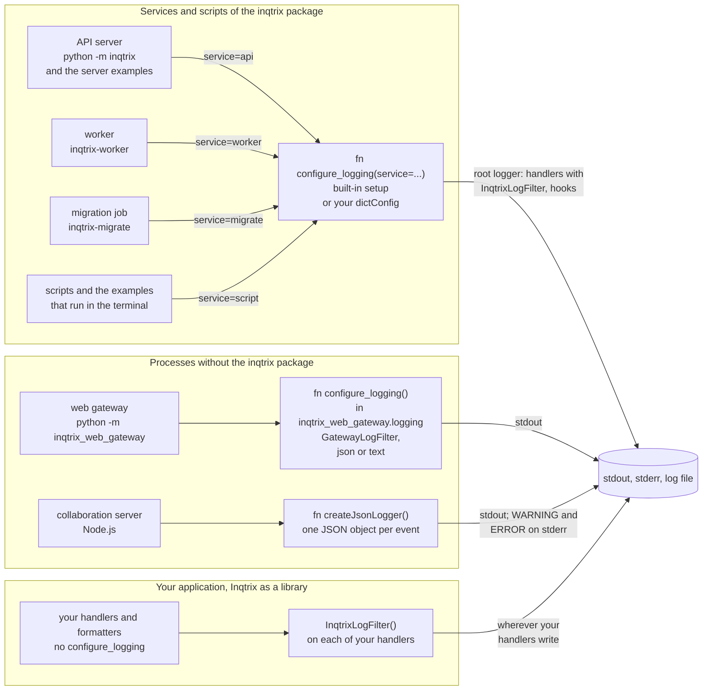
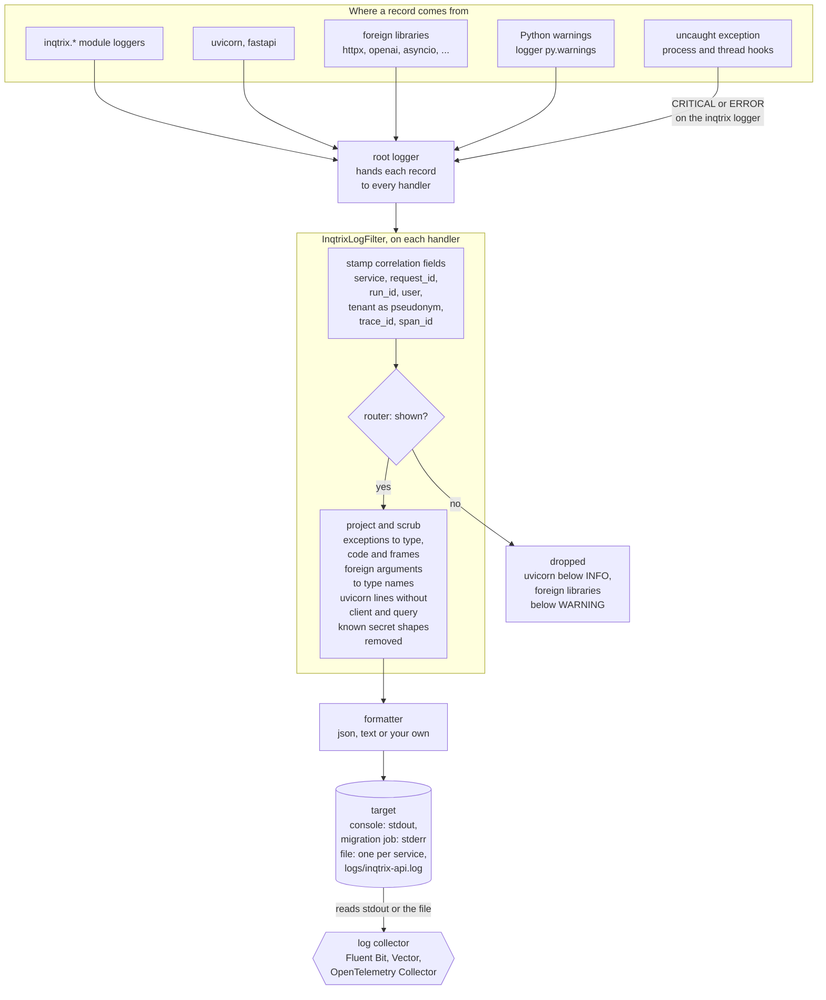

# Logging

> Files: `src/inqtrix/logging_config.py`, `src/inqtrix/observability/json_formatter.py`, `src/inqtrix/settings.py` (`RETIRED_SETTINGS`), `src/inqtrix/runtime_logging.py`, `src/inqtrix_web_gateway/logging.py`, `apps/collaboration-server/src/logger.ts`; for `gateway` mode `src/inqtrix/auth/gateway.py`, `src/inqtrix/auth/jwks.py`, `src/inqtrix/auth/scim.py`, `src/inqtrix/server/routers/scim.py`, `src/inqtrix_web_gateway/identity_edge.py`

## Scope

How an Inqtrix service process configures logging, which environment variables control it, what a log line contains and never contains, how the web gateway and the collaboration server follow the same rules, how an organization plugs in its own log format, and how an embedding application keeps its own logging, with runnable examples for the standard library, OpenTelemetry, structlog and loguru.

## Architecture

The Python services log through Python's standard `logging` module and add no logging system of their own. A line of code creates a *record* (a `logging.LogRecord`: level, logger name, message template, arguments, exception) on a named *logger*; the record travels up the logger tree to the *root logger*; every *handler* of the root logger runs its *filters* on the record, renders it with its *formatter* and writes it to its target. Inqtrix sets up the root logger of its own processes and provides one filter, `InqtrixLogFilter`, that decides what each record may carry.

### Which process configures logging how

This diagram answers: "Which process sets up its logging with which code, and which of them share `configure_logging`?"



The services and scripts of the `inqtrix` package pass their service name to `configure_logging`, which configures the root logger once: the built-in setup from the `INQTRIX_LOG_*` variables or your own `dictConfig` file or mapping, either way with `InqtrixLogFilter` on every handler that writes, plus the warning and crash hooks. The server examples under `examples/webserver_stacks/` log as `api`, the examples that run in the terminal as `script`. The status line `Logging: service=...` that the API server, the worker, the migration job and the server examples write tells which of the two they took ([One configuration per process](#one-configuration-per-process)). The web gateway and the collaboration server do not contain the `inqtrix` package; each carries a small copy of the same contract and writes only to the console ([Web gateway and collaboration server](#web-gateway-and-collaboration-server)). An application that embeds Inqtrix keeps its own logging: importing Inqtrix attaches no handler, and the application adds the filter to its own handlers ([Logging when Inqtrix is embedded](#logging-when-inqtrix-is-embedded)). In the diagram the rectangles are code (`fn` marks a function); the cylinder is where the lines end up.

### Path of one log record

This diagram answers: "What happens to one log record between the line of code that logs it and the log collector, and where is the content rule enforced?" The content rule says which values a log line may carry ([Content rule and foreign libraries](#content-rule-and-foreign-libraries)). The diagram shows a process configured by `configure_logging`.



The important transitions:

- **Logger to root.** A logger creates a record only at or above its level. In the built-in setup `inqtrix` follows `INQTRIX_LOG_LEVEL`, `uvicorn` and `fastapi` follow the web level, every other logger inherits `WARNING` from the root unless a library sets its own level. The `inqtrix`, `uvicorn` and `fastapi` loggers have no handlers of their own, so their records reach the handlers of the root logger. The API server starts uvicorn with `log_config=None` for this reason.
- **Root to filter.** Each handler that writes (`console` and `file`, or the handlers of your own configuration) carries one `InqtrixLogFilter`. The first handler that sees a record decides whether it is shown; a shown record is projected, that is, its exceptions and the arguments of foreign libraries are reduced to what the content rule allows, and it is stamped. The stamps stay on the record, so with the target `both` the second handler passes it on and the record is projected exactly once; a dropped record stays unstamped, and the second handler drops it as well. With the target `none`, the root logger holds only a `NullHandler`, which writes nothing; a crash then still reaches stderr through the hook ([Why a process stopped](#why-a-process-stopped)).
- **Filter to formatter.** After the filter, the correlation fields are attributes of the record and an exception is present only as its projection, so a formatter needs nothing but the record: neither the context of the thread that logged it nor the exception object. What exactly is projected is in [Content rule and foreign libraries](#content-rule-and-foreign-libraries).
- **Target to collector.** The built-in setup writes only to the console or to the file and sends no log record over the network; a collector reads stdout or the file and maps the lines to your schema ([Use your organization's log format](#use-your-organizations-log-format)).

In an application that embeds Inqtrix, the filter has no `service`. It still stamps every record and projects the records of `inqtrix`, `uvicorn` and `fastapi`, and it drops `uvicorn` records below `INFO`; the application's other loggers keep their levels and messages, apart from scrubbed secret shapes.

In the diagram the rectangles are code, the diamond is the filter's decision (`router` in the notation of [the architecture overview](../architecture/overview.md#how-to-read-the-diagrams)), the cylinder is the target and the hexagon an external system.

## One configuration per process

Every Python service of the `inqtrix` package calls `configure_logging(service=...)` once, as the first statement of its `main()`: the API server (`python -m inqtrix`), the worker (`inqtrix-worker`), the migration job (`inqtrix-migrate`) and the example scripts. The web gateway and the collaboration server run without that package; they follow the same contract with their own small implementations (see [Web gateway and collaboration server](#web-gateway-and-collaboration-server)). The call configures the **root** logger of the process through `logging.config.dictConfig`:

- one output target (`console`, `file`, `both` or `none`) and one format (`json` or `text`) for every record of the process, application and libraries alike;
- one `InqtrixLogFilter` on every handler (see [Content rule](#content-rule-and-foreign-libraries));
- levels: the root logger stays at `WARNING`, the `inqtrix` loggers follow `INQTRIX_LOG_LEVEL`, `uvicorn` and `fastapi` follow the web level, and in the migration job `alembic` reports its progress at `INFO`;
- `logging.captureWarnings(True)` and exception hooks: an unhandled exception in the main thread becomes a `CRITICAL` line that says why the process stops (see [Why a process stopped](#why-a-process-stopped)), one in another thread an `ERROR` line; both carry the projected exception. With the target `none` nothing is logged, but a crash still writes the same reason and the projected exception (types and frames) to stderr.

The API server starts uvicorn with `log_config=None`, so uvicorn adds no handlers of its own: its startup lines and the access lines go through the same handlers, filter and format as every application record.

`configure_logging` returns what it applied (`ResolvedLogging`: service, target, level, format, file path, web level, custom configuration). Right after it, the API server, the worker and the migration job write one status line:

```text
Logging: service=api target=console level=INFO format=json file=- web_level=INFO config=- retired_settings=-
```

`create_app(...)` and `create_multi_stack_app(...)` do not touch logging. A test that builds an app therefore sees the process logging unchanged, and pytest's `caplog` captures Inqtrix records directly through propagation.

```python
from inqtrix import configure_logging

configure_logging(service="script")                  # values from the environment
configure_logging(service="script", target="file", level="DEBUG", format="text")
```

Keyword arguments carry the same names and meaning as the variables below (`target`, `level`, `format`, `log_dir`, `max_bytes`, `backup_count`, `web_level`, `config`). Precedence: value in code, then process environment, then `.env`, then the default. `service` is required: `api`, `worker`, `migrate`, `gateway`, `collaboration` or `script`.

## Environment variables

| Variable | Default | Purpose |
|----------|---------|---------|
| `INQTRIX_LOG_TARGET` | `console` | `console` (stdout; stderr in the migration job, whose stdout carries its JSON report), `file`, `both` or `none`. |
| `INQTRIX_LOG_LEVEL` | `INFO` | Threshold for the `inqtrix` loggers: `DEBUG`, `INFO`, `WARNING`, `ERROR` or `CRITICAL`. |
| `INQTRIX_LOG_FORMAT` | `json` | `json` (one object per line) or `text` (one readable line per record). Changes the shape only, never the threshold. |
| `INQTRIX_LOG_DIR` | `logs` | Directory of the file target. Each service writes `inqtrix-<service>.log`. |
| `INQTRIX_LOG_MAX_BYTES` | `20971520` | Rotation threshold per file. |
| `INQTRIX_LOG_BACKUP_COUNT` | `5` | Rotated files kept per service; one service uses at most `MAX_BYTES × (BACKUP_COUNT + 1)`. |
| `INQTRIX_LOG_WEB_LEVEL` | empty | `INFO`, `WARNING` or `ERROR` for `uvicorn` and `fastapi`. Empty follows `INQTRIX_LOG_LEVEL`, but never below `INFO`. `DEBUG` is not accepted: at `DEBUG` the WebSocket library writes every frame, that is document content. |
| `INQTRIX_LOG_CONFIG` | empty | Path to your own `dictConfig` file (`.json`, `.yaml` or `.yml`). Replaces the built-in setup completely; see [Use your organization's log format](#use-your-organizations-log-format). |
| `OBSERVABILITY_PROFILE` | `summary` | `summary`, `debug` or `forensic`. `forensic` keeps source, citation, claim and answer lineage in the protected run audit and on the trace; it never adds content to log lines. `debug` is reserved for future mid-level detail. |

In a container, stdout is the durable sink; a file under `/app/logs` is lost with the container unless you mount a volume.

**Retired variables.** `INQTRIX_LOG_ENABLED`, `INQTRIX_LOG_CONSOLE` and `INQTRIX_LOG_INCLUDE_WEB` no longer exist. Silently ignoring them would change what an operator chose (for example, turn logging back on), so a service refuses to start while one of them is set in the environment or in `.env`, even to an empty value. The process ends with exit code 1, and the `CRITICAL` line it stops with (on stderr with the target `none`) names the variable and its replacement (`INQTRIX_LOG_TARGET` or `INQTRIX_LOG_WEB_LEVEL`), never its value:

```text
Unhandled exception; the process stops: RuntimeError: Retired setting INQTRIX_LOG_ENABLED is set; use INQTRIX_LOG_TARGET (console, file, both or none) instead. The service does not start until it is removed.
```

uvicorn's `FORWARDED_ALLOW_IPS` is retired as well, because the API server and the web gateway start uvicorn with `proxy_headers=False` and read `X-Forwarded-For` themselves. In the API server, the worker and the migration job a set value, even an empty one, only writes a `WARNING` and appears in the status line as `retired_settings=FORWARDED_ALLOW_IPS`:

```text
Retired setting FORWARDED_ALLOW_IPS is set and has no effect; use INQTRIX_TRUSTED_PROXY_HOPS (Inqtrix reads X-Forwarded-For itself) instead.
```

With `INQTRIX_AUTH_MODE=gateway` in the environment or in `.env`, it stops the start like the variables above. The web gateway writes its own `WARNING` (`Retired setting FORWARDED_ALLOW_IPS is set and has no effect; the gateway reads X-Forwarded-For itself.`) and, in `gateway` mode, stays unready; see [Settings: web gateway variables](../configuration/settings-and-env.md#gateway-mode-web-gateway-variables).

## Log lines and correlation fields

With the default `json` format every record is one JSON object:

| Field | Content |
|---|---|
| `ts` | RFC 3339 UTC with milliseconds and `Z`, for example `2026-10-23T14:13:51.533Z` |
| `level` | `DEBUG`, `INFO`, `WARNING`, `ERROR`, `CRITICAL` |
| `service` | `api`, `worker`, `migrate`, ... |
| `logger`, `module`, `function`, `line` | where the record was logged; `logger` names the module, for example `inqtrix.providers.bedrock`, while the status line, the crash lines and the configuration notices use `inqtrix` and the web gateway uses `inqtrix.web_gateway` and `inqtrix.web_gateway.access`; a collector selects Inqtrix lines by `inqtrix` and the prefix `inqtrix.` |
| `message` | a fixed English template with its arguments |
| `event` | only when the call passed `extra={"event": ...}` |
| `request_id` | accepted from a valid incoming `X-Request-ID` or generated, and echoed on every response |
| `run_id` | the run the record belongs to |
| `trace_id`, `span_id` | the active span, once tracing is enabled |
| `user` | the stable pseudonym `usr_<hex16>` (see `INQTRIX_PSEUDONYM_PEPPER`) |
| `tenant` | the tenant as a pseudonym `ten_<hex16>` |
| `thread` | the thread name |
| `exc` | the projected exception: types, codes and frame locations, never the message |

Fields that are not bound are left out. The filter stamps the correlation fields onto the record in the thread that logged it, so a line keeps its `request_id` wherever it is formatted. The `text` format renders `ts | level | service | logger | message` and the projected exception on the following lines.

The `trace_id` of a request's log lines, the access log's included, is the
trace of its request span, and that trace holds the whole call: work the API
hands to an executor thread (editor assist, chat, text improvement, session
titles) carries the request's trace context across the hop and runs as a
child of the request span, with its own trace name kept through
`langfuse.trace.name`. The request span carries the same pseudonym as the
`user` field, as `langfuse.user.id`, once the principal is resolved; an
unscoped principal (anonymous or static key) carries none. Two consequences
follow from one trace per request: below a sample rate of `1.0`, the editor,
chat and title spans are sampled together with their request instead of on
their own, and a client that sends a `traceparent` places them under its own
trace id and sampling decision, as it already does for runs.

Follow one user across the api and worker containers with:

```bash
docker compose logs api worker | jq -c 'select(.user == "usr_ab12cd34ef56aa77")'
```

## Content rule and foreign libraries

Logs never carry prompts, answers, document or source text, free URLs or queries, tokens, passwords or raw identities, on any level. Allowed are fixed English messages, ids, numbers, type names, configured model names and pseudonyms. Two kinds of values stand in for content where a line needs to name something:

- A line that names the errors of a failed validation names each as `type@field`, for example `int_parsing@MAX_ROUNDS` for a setting read from the environment, never with the rejected value.
- A plan task appears by its id only in the form the planner assigns (`t1`, `t2`, …, `s`); an id in any other form appears as `<task>`, because a model can write any text into it.

`InqtrixLogFilter` enforces the parts of that rule that do not depend on the call site:

- Exceptions, in arguments, as the message or as `exc_info`, appear only as type, an optional stable code (`code`, `error_code`, `status_code`, `sqlstate`, `errno`) and frame locations, for every logger. The same holds for a traceback that a library formatted into the message text, such as the one uvicorn logs for a failed application startup. The line that ends a process is the one place where an exception's message can appear; see [Why a process stopped](#why-a-process-stopped).
- Records of foreign libraries never appear below `WARNING`, whatever level a configuration sets for them; their arguments appear as type names (`<str>`, `<dict>`), only numbers and booleans stay. So a library's `DEBUG` request dump never reaches the log, even with `OPENAI_LOG=debug`.
- `uvicorn` records below `INFO` are always dropped. Access lines and WebSocket lines show `-` instead of the client address and the path without its query string.
- `asyncio` keeps only the first line of its message; Python warnings keep their category and `file:line`.
- Known secret shapes (credentials in URLs, passwords in keyword connection strings, `NAME_SECRET=…`-style assignments of secrets, bearer values, `sk-`/`pplx-` keys, AWS keys, guest-link tokens) are scrubbed from every rendered message.
- A malformed log call (`"%d"` with a string) never raises into the caller; the line then says that the message could not be formatted.

**Limit.** Text that a foreign library has already formatted into its own `WARNING` or `ERROR` message (an f-string, `%` or `.format` before the call) does not reach the argument projection. It stays in the log with known secret shapes scrubbed and can carry values of that library, such as ids, paths or the text of an exception. "No content in logs" therefore holds for such messages only on the paths that were checked, incognito runs included.

**Identity values in `gateway` mode.** With `INQTRIX_AUTH_MODE=gateway` ([Auth modes](../deployment/auth-modes.md#mode-gateway)) the values that identify a person never appear in a log line, on any level, `DEBUG` included, and also not when a request is rejected: no value of an identity, proof or assertion header (subject, email, display name, groups, the shared secret, the user token), no claim of a token, and no value of a SCIM request body (`userName`, `externalId`, `name`, `emails`, `displayName`). The filter does not recognise such values, so the rule holds at the source. The API server and the web gateway log only:

- names and values from the configuration that are no secrets, such as header names (in the web gateway's start line and in its report of removed headers) and the issuer key in the API server's start line;
- a fixed outcome class (see [Gateway sign-in lines](#gateway-sign-in-lines)), counts, HTTP status codes and SCIM error types;
- the account as the pseudonym `usr_<hex16>`, and only once the request is matched to an account; before that a line has no user value at all. A personal access token appears only as its reference `res_<hex16>` (see [Secret redaction](#secret-redaction)).

One exception is named. When a token names a signing key that the key set does not hold, the `WARNING` `JWKS: unknown kid '<kid>'; refreshing the key set once (possible key rotation).` quotes the key id from the token's header, truncated to 64 characters, so that a key rotation can be diagnosed. It appears at most once per five-minute refresh cooldown of the key cache, in `oidc` mode as well. Start errors of this mode name the variables involved, never a secret value.

## Why a process stopped

When a service process ends at an unhandled exception, its `CRITICAL` line reads `Unhandled exception; the process stops: <reason>`. The reason lists the exception and then, after `; caused by`, each exception that led to it. For each one it shows:

- its type and message when Inqtrix code raised it with its own `raise` statement, with known secret shapes scrubbed;
- for any other exception, from a library or from Python itself (`int()`, a dictionary lookup, a driver), its type and stable code only, because such a message can quote the value that failed;
- for a validation error, such as an invalid setting, `type@field` per failed field, followed by the schema's message and never the rejected value; a validator's own message is kept only when an Inqtrix validator raised it.

```text
Unhandled exception; the process stops: RuntimeError: INQTRIX_SERVER_TLS_KEYFILE and INQTRIX_SERVER_TLS_CERTFILE must be set together (both or neither).
Unhandled exception; the process stops: ValidationError: int_parsing@MAX_ROUNDS: Input should be a valid integer, unable to parse string as an integer
Unhandled exception; the process stops: ConnectionRefusedError[errno=111]
```

The third line is the migration job against a database that refuses the connection: the driver's own message would carry the address, so only the type and its `errno` appear.

The `exc` field of the same line stays projected as on every other line: types, codes and frame locations, no message. A thread that dies does not stop the process; its `ERROR` line names only the thread, because job threads handle user content.

**Limits.** An Inqtrix message can quote text it took from a caught exception. The worker's database contract messages do so on purpose, so that the operator sees which part of the contract failed; that text appears scrubbed of known secret shapes. Such messages can also name configuration values, such as a database role or a file path. A few schema messages of a validation error quote part of the input, such as the tag of a tagged union; the settings use none of them. An exception group counts as one link of the chain. A startup failure inside the API server's lifespan is reported by uvicorn, which then ends the process itself: it appears as uvicorn's projected error (type and frames), without this reason.

## Web gateway and collaboration server

The web image (`inqtrix-web`) and the collaboration server do not contain the `inqtrix` package. Each carries a small implementation of the same log contract, reads only the variables below and writes only to the console; the file target, `INQTRIX_LOG_WEB_LEVEL` and `INQTRIX_LOG_CONFIG` do not apply to them. To map their lines to your own schema, use a collector (see [Use your organization's log format](#use-your-organizations-log-format)).

| | Web gateway | Collaboration server |
|---|---|---|
| Variables | `INQTRIX_LOG_LEVEL`, `INQTRIX_LOG_FORMAT` | `INQTRIX_LOG_LEVEL` |
| Output | stdout, `json` (default) or `text` | JSON only; `DEBUG` and `INFO` on stdout, `WARNING` and `ERROR` on stderr |
| `service` | `gateway` | `collaboration` |
| Fields | as in [the field table](#log-lines-and-correlation-fields), without the correlation fields | `ts`, `level`, `service`, `event` and the fields of the event |

An empty value counts as unset, as for the Python services. An unknown value stops the start with a message that names the variable and the allowed values, never the value.

`service=gateway` always names the web gateway process, whatever the auth mode. The auth mode `INQTRIX_AUTH_MODE=gateway` appears only as a field value of its own, `auth_mode=gateway`, in the API server's start line (`Inqtrix server starting | ... | auth_mode=gateway | ...`).

**Web gateway.** The gateway applies the rules of [Content rule and foreign libraries](#content-rule-and-foreign-libraries) to every record of its process: exceptions appear as type, stable code and frame locations; foreign libraries appear from `WARNING` on with their arguments as type names, so the DEBUG request and frame lines of `httpx`, `httpcore` and the WebSocket client never reach the log; `uvicorn` never appears below `INFO`, and its WebSocket line shows `-` instead of the client address and the path without its query string; `asyncio` keeps only its own words; Python warnings keep their category and `file:line`; guest-link tokens and known secret shapes are scrubbed. `INQTRIX_LOG_LEVEL` is the threshold of the gateway's own loggers; `uvicorn` and `fastapi` follow it, but never below `INFO`.

uvicorn's own access log is off. Instead the gateway writes one access line per HTTP request: method, path without query string, status and duration, with guest-link tokens redacted. The path is percent-encoded as uvicorn writes it, so a line break in a path cannot start a log line of its own:

```text
GET /s/[REDACTED] 200 2.7ms
```

A request whose backend cannot be reached writes a `WARNING` such as `Configured backend is unreachable for GET /v1/things (ConnectError).` A client that disconnects while the gateway still waits for the backend writes an `INFO` line, `Client disconnected while awaiting the upstream response for <method> <path> — upstream request aborted.`, because the interface aborts outdated requests on its own. An unhandled exception that ends the gateway process writes the `CRITICAL` line described in [Why a process stopped](#why-a-process-stopped); a message appears in it only for an exception that gateway code raised itself.

A request whose header block is still incomplete after 16 KiB never reaches the gateway's code: uvicorn answers it with 400 and writes the `WARNING` `Invalid HTTP request received.`, without path or client. In `gateway` mode this line is the place to look when a large assertion token together with the cookies breaks every request of one person.

**Identity edge.** At start the gateway writes one `INFO` line with its policy for the identity headers of `gateway` mode, the configured header names (`-` for none) and the number of trusted peers: `Identity edge: identity_header_policy=strip_untrusted headers=x-inqtrix-proof,x-inqtrix-subject trusted_proxies=1.` The policy is `strip_untrusted` with header names and a peer list, `keep_all` with names but no list, and `none` without names. When it removes identity headers from a peer outside its `INQTRIX_GATEWAY_TRUSTED_PROXIES`, it writes a `WARNING` with the header names, never their values, at most once a minute; the number counts the reports it held back since its previous line:

```text
Identity headers from a peer outside INQTRIX_GATEWAY_TRUSTED_PROXIES were removed (outcome=untrusted_source headers=x-inqtrix-subject; 0 more since the last report).
```

When the API server runs `gateway` mode and the gateway cannot protect it, one `ERROR` line names every reason and ends with `The web gateway stays unready.`; the readiness rules are in [Settings: web gateway variables](../configuration/settings-and-env.md#gateway-mode-web-gateway-variables).

When the gateway stops while browsers still hold event streams, uvicorn cancels the requests that are still open after the 8-second shutdown deadline. Each gateway process writes one `ERROR` line, `Cancel 1 running task(s), timeout graceful shutdown exceeded` (the number counts its open requests), and for each cancelled request an `ERROR` line `Exception in ASGI application` whose exception is the `CancelledError` of the cancellation, shown as type and frames like every exception. Both are expected at a stop with the user interface open; see [Stopping](../deployment/react-ui.md#gateway-environment-variables).

**Limit with more than one gateway worker.** With `RESEARCH_DESK_WORKERS` above `1`, uvicorn applies the log configuration in every worker process, but the crash hook and the capture of Python warnings exist only in the supervising process. A worker process that dies at an unhandled exception prints Python's own traceback, message included, to stderr, and a Python warning raised in a worker reaches stderr as Python prints it.

**Collaboration server.** Every line is one JSON object, for example the refusal of a broken update:

```json
{"ts":"2026-10-23T21:27:20.493Z","level":"INFO","service":"collaboration","event":"hook_refused","close_code":4409,"close_reason":"invalid_schema","hook":"beforeSync","reason":"invalid_schema"}
```

A field whose name contains `body`, `comment`, `content`, `markdown`, `secret`, `token` or `update` is written as `[redacted]`. `INQTRIX_LOG_LEVEL` sets the threshold; the server writes no `CRITICAL` lines and has no text format. A hook that ends with one of the server's own refusals writes `hook_refused` at `INFO` with the hook, the reason, and the close code and close reason the connection closes with; refusals are, for example, an invalid or revoked lease, an update that breaks the document schema, or a store the internal API refuses because the instance lost its lease. A failed start writes `collaboration_sidecar_start_failed` as an `ERROR`, with the message of a configuration error as `reason` (for example `INQTRIX_LOG_LEVEL must be one of DEBUG, INFO, WARNING, ERROR, CRITICAL`). Any other error appears only by its type as `error_type` and, when it has one, its stable code as `error_code` (a taken port is `EADDRINUSE`); its direct cause appears the same way as `cause_type` and `cause_code` (a refused connection behind `fetch failed` is `ECONNREFUSED`). The text of an error never appears. An internal API that cannot be reached does not end the start: the server writes `internal_api_unreachable` and `instance_lease_unavailable` as `WARNING` and keeps trying, and it stays not ready until it holds its lease.

**Limit of the collaboration server.** Hocuspocus, the WebSocket library of the server, prints some lines of its own as plain text with `console.error` and `console.warn`, outside the JSON log and its threshold. When handling a message fails, including a message the server refuses (the refusal then also appears as `hook_refused`), it prints `closing connection <id> (while handling <room>) because of exception` with the type, code, reason and stack of the error. Further lines appear when a store fails, an `afterHandleMessage` hook fails, a token renewal is refused, the first frame of a connection cannot be read, a message has an unknown type, or a connection that is not yet authenticated exceeds its queue limits. These lines name the connection id and the room, which is the document id and its generation; the lines for the queue limits quote the document name the client sent before it was checked. They carry no document content as long as the error comes from the server's own checks; the text of an error the server did not expect appears in them as the library prints it.

## Use your organization's log format

Inqtrix does not need another logger to fit an organization's log schema: the logger names (`inqtrix` and the module names below it) are only the address of the records, handlers and formatters decide the shape and destination. Three ways, all with standard means:

| Way | When | What you do |
|---|---|---|
| Collector | containers, central log collection | nothing in code: Fluent Bit, Vector or an OpenTelemetry Collector maps the Inqtrix JSON lines to your schema |
| Configuration file | a finished service (`python -m inqtrix`, worker, container) without code changes | point `INQTRIX_LOG_CONFIG` at a `dictConfig` file with your formatters and handlers, as uvicorn (`--log-config`) and Gunicorn do |
| In code | your own Python entry point | `configure_logging(service=..., config={...})` with the same mapping as the file, or your own logging with `InqtrixLogFilter()` on your handlers |

Rules for your own configuration (file or `config=`):

- It replaces the built-in setup completely: handlers, formatters and levels come only from it.
- It is exclusive. If another `INQTRIX_LOG_*` value or keyword is set at the same time, the start fails with a message that names both sources.
- Inqtrix attaches `InqtrixLogFilter` (with the service of the call) to every handler that does not have it yet, so the content rule holds with your formatter too. A filter your configuration declares itself runs with that service as well.
- If your configuration gives the root logger no handler, Inqtrix adds a `NullHandler` there. Handlers that a library attached to the root logger earlier (for example through `logging.basicConfig`) are removed, and no record reaches Python's unfiltered last-resort handler.
- If the key `disable_existing_loggers` is missing, Inqtrix sets it to `false`, so loggers created before the configuration keep working.
- The hooks are installed as usual. The status line reports `format=custom` and the file name, or `config=code` for a mapping passed in code.
- The field table above applies only to the built-in formatters. Your formatter decides its fields; the correlation fields are available as record attributes: `%(service)s`, `%(request_id)s`, `%(run_id)s`, `%(user)s`, `%(tenant)s`, `%(trace_id)s`, `%(span_id)s` (`None` when not bound).
- Foreign libraries stay at `WARNING` and above here too. A foreign logger that your configuration sets below `WARNING` stays silent below it, and `configure_logging` says so once per name with a `WARNING` (the name only).
- The Inqtrix modules log under their own import paths below `inqtrix` (the logging setup itself under `inqtrix`), so a level can be set per area: `inqtrix.providers` at `DEBUG` shows the detail of the provider adapters while `inqtrix` stays at `INFO`. The built-in setup has one level for the whole family (`INQTRIX_LOG_LEVEL`); a level per area belongs in your configuration, because `configure_logging` resets the levels that code gave the module loggers before the call whenever the configuration names `inqtrix`, as the built-in setup always does.
- A configured name `inqtrix.<x>` that matches no Inqtrix module (a typo such as `inqtrix.agnets`) is reported once with a `WARNING`.
- JSON files always work; YAML needs PyYAML, which Inqtrix depends on directly.

Example file (`examples/logging/organization_format.yaml`):

```yaml
version: 1
formatters:
  org:
    format: "%(asctime)s %(levelname)s service=%(service)s request_id=%(request_id)s logger=%(name)s %(message)s"
handlers:
  stdout:
    class: logging.StreamHandler
    stream: ext://sys.stdout
    formatter: org
root:
  level: WARNING
  handlers: [stdout]
loggers:
  inqtrix:
    level: INFO
```

The same mapping in code:

```python
from inqtrix import configure_logging

configure_logging(service="api", config={
    "version": 1,
    "formatters": {"org": {"()": "acme_logging.OrgJsonFormatter"}},
    "handlers": {"out": {
        "class": "logging.StreamHandler",
        "stream": "ext://sys.stdout",
        "formatter": "org",
    }},
    "root": {"level": "WARNING", "handlers": ["out"]},
    "loggers": {"inqtrix": {"level": "INFO"}},
})
```

Your own logging stack: each pattern below is a complete script under `examples/logging/`. A research run needs provider credentials, so each script stands in for one: it binds the correlation fields the way Inqtrix does at a request or run boundary and logs on an `inqtrix.*` logger the way an Inqtrix module does.

- **Standard library:** your own handler and formatter, with `InqtrixLogFilter()` on the handler. [`examples/logging/stdlib_json_lines.py`](../../examples/logging/stdlib_json_lines.py) writes one JSON object per line in the field names of the application and reads the correlation fields as record attributes.
- **OpenTelemetry logs:** attach `InqtrixLogFilter()` to the `LoggingHandler` that exports to your collector, as [`examples/logging/opentelemetry_logs.py`](../../examples/logging/opentelemetry_logs.py) does with a console exporter instead of a collector. The handler of `opentelemetry-sdk` 1.44 exports every record attribute that is not a standard `LogRecord` field, so the correlation fields arrive as log attributes (empty when not bound), and it takes trace and span from the active span. It builds its `exception.*` attributes only from `exc_info`, which the filter has replaced by the projected exception in `exc_text`; the example therefore adds a second filter after `InqtrixLogFilter` that copies `exc_text` into the attribute `exception.stacktrace`. Add the handler with `addHandler`, not through `logging.basicConfig`, which would give it a formatter whose text then becomes the body. The same SDK version marks this `LoggingHandler` as deprecated in favour of the handler of `opentelemetry-instrumentation-logging`; the filter belongs on whichever handler exports the records.
- **structlog:** structlog writes the application's own events itself; the records of the standard library, those of Inqtrix among them, go to a standard handler that renders them through `structlog.stdlib.ProcessorFormatter` and carries `InqtrixLogFilter()`. A processor in its `foreign_pre_chain` copies the correlation fields and the projected exception from the record into the event: [`examples/logging/structlog_processor_formatter.py`](../../examples/logging/structlog_processor_formatter.py). Keep structlog's own events away from that handler (no `structlog.stdlib.LoggerFactory` with `ProcessorFormatter.wrap_for_formatter`): the filter replaces the message of every record it sees with the rendered text, and such an event carries its event dictionary in exactly that message.
- **loguru:** route standard logging into loguru with the intercept handler from loguru's documentation and add `InqtrixLogFilter()` to that intercept handler, so records are projected before loguru sees them. The filter has replaced `exc_info` by `exc_text`, so the handler passes `exc_text` and the correlation fields on as extra fields: [`examples/logging/loguru_intercept.py`](../../examples/logging/loguru_intercept.py).

The standard-library and OpenTelemetry scripts run as they are; the OpenTelemetry SDK comes with the `observability` extra. structlog and loguru are not dependencies of Inqtrix; install them in your application to run their scripts.

```python
from inqtrix import InqtrixLogFilter

org_handler.addFilter(InqtrixLogFilter())
```

To check that your formatter shows no user content, run one request with a distinctive marker word in the question and in an uploaded document and search your log output for it; the marker must not appear.

## Logging when Inqtrix is embedded

An application that uses Inqtrix as a library owns its logging, as the Python logging HOWTO recommends: Inqtrix attaches nothing when it is imported, and `create_app(...)` configures nothing. Calling `configure_logging(...)` would configure the root logger of the whole process. Instead, attach `InqtrixLogFilter()` to your handlers, not to the `inqtrix` logger, whose filters never see the records of the module loggers below it; the parts of the content rule that the filter enforces hold only with it. Without a `service` the filter treats only `inqtrix`, `uvicorn` and `fastapi` records (projection, uvicorn rules) and leaves your other loggers as you log them, apart from scrubbing known secret shapes. [`examples/logging/stdlib_json_lines.py`](../../examples/logging/stdlib_json_lines.py) is such an application in one file; [Use your organization's log format](#use-your-organizations-log-format) has the same for OpenTelemetry, structlog and loguru. See [Library mode](../deployment/library-mode.md#logging-when-inqtrix-is-embedded).

## Structured runtime events and the trace

Structured runtime events are emitted by `inqtrix.runtime_logging.emit_runtime_event(...)`. It is not a second logging system and it writes no log lines. Iteration events first enter the protected run audit; the fail-closed operational projection, only identifiers, lifecycle and status fields, models, counters, usage and timings, is then attached to the active span, never to a logger, so it needs a recording span and a trace sink (`INQTRIX_TRACING=file` or `otlp`); the log keeps the `RUN start:` and `RUN end:` lifecycle lines. Independent of the profile, the node and task spans always carry the step's *decision* as plain attributes (stop reason, confidence, coverage, claim and source counts, contract status, evidence-budget cut counts); the forensic events remain the content-bearing detail behind `OBSERVABILITY_PROFILE=forensic`.

## Lifecycle and timeout lines

Runs and chat turns write one `INFO` line when they start and one when they end, so the log alone shows what ran, how it ended and how long it took:

| Work | Lines |
|---|---|
| Run, per execution segment | `Run <run_id> segment started (mode=<mode>).` and `Run <run_id> segment ended (<status>, mode=<mode>, seconds=<s>).` |
| Chat turn, streamed or not | `Chat started (mode=<mode>).` and `Chat ended (<status>, mode=<mode>, seconds=<s>).` |

`<status>` is one of `status=completed`, `status=parked` (the run waits to be resumed, which starts a new segment), `status=cancelled` or `status=failed, failure_code=<code>`, followed by `, error_type=<type>` when an exception ended the work. The failure code is the one the run records, for example `token_budget_exceeded`. The research loop's own `RUN start:` and `RUN end:` lines stay as they are.

A chat that runs out of time writes a `WARNING`:

- `Chat request timed out after <n>s (mode=<mode>); the client gets 504.`
- `Streamed chat reached its request deadline (mode=<mode>); the stream ends with a timeout notice.`
- `Streamed chat timed out waiting for the result (mode=<mode>).` With quota metering active, the line adds that the turn's token spend is not booked toward the quota.

An upload operation that fails and is tried again later writes `Upload operation <id> deferred for a retry (attempt <n> of <max>, failure_code=<code>).` as a `WARNING`. Every line of an upload or deletion job carries the operation id as `run_id` and the tenant pseudonym as `tenant`, as the lines of run and indexing jobs do.

## How the switches interact

There are three separate concerns:

- `INQTRIX_LOG_TARGET` and `INQTRIX_LOG_FORMAT` decide where log lines go and how they look.
- `INQTRIX_LOG_LEVEL` decides which application records are written. `DEBUG` adds very little, on purpose: a log line carries no content on any level, foreign libraries stay at `WARNING` and `uvicorn` and `fastapi` at `INFO`, and the Inqtrix code itself has only a few `DEBUG` lines, all fixed messages with ids, numbers or type names, such as an adapter raising `max_tokens`, a stream's disconnect watcher ending or a worker loop that stops claiming jobs. A research or knowledge run can therefore pass without a single `DEBUG` line. What a run did is on its trace, not in the log (see [Structured runtime events and the trace](#structured-runtime-events-and-the-trace)).
- `OBSERVABILITY_PROFILE` decides whether detailed forensic lineage events are produced at all. Only `forensic` enables `query_record`, `query_summary`, `source_record`, `provider_citation_record`, `evidence_record`, `claim_record`, `claim_merge`, `evidence_verification_projection`, `evidence_selection`, `answer_prompt_inputs`, `answer_section`, `answer_claim_binding`, `answer_sentence_audit`, and related events.

**Lineage events live on the trace, not in the log.** They are attached to the
span of the step that produced them, so the waterfall shows them in place
instead of in a separate stream that has to be joined by hand. Recording them
therefore needs a trace sink:

```bash
OBSERVABILITY_PROFILE=forensic       # how deep
INQTRIX_TRACING=file                 # where to  (or otlp)
```

`forensic` with `INQTRIX_TRACING=off` or `local`, or with a sample rate below
`1.0`, records only part of what was asked for; the process warns about both
combinations at startup. See [Forensic cookbook](forensic-cookbook.md#debugging-runs) for the
drill-down path.

The log keeps what it has always been good at: lifecycle lines, warnings,
fallback markers and the operational per-round trace, each carrying the
correlation fields so a log line and its trace join on `trace_id`.

Do not treat the container or file log as the durable evidence audit. It is intentionally insufficient to reconstruct private content. Authorized run artifacts (including `web_search_ledger`, result and artifact records, or `iteration_logs` in testing/parity mode) carry the reconstructable, redacted chain; compact log lines are only operational signposts that can be joined through stable ids.

`TESTING_MODE=true` is separate from logging. It exposes the HTTP `/v1/test/run` endpoint and attaches the sanitized `iteration_logs` list to test/parity results. With `OBSERVABILITY_PROFILE=forensic`, those exported iteration logs include the same forensic events; never enable testing mode in production.

Common recipes:

```bash
# Default: INFO as JSON on stdout. Nothing to set.
```

```bash
# Readable lines on the console plus a rotating file per service.
INQTRIX_LOG_TARGET=both
INQTRIX_LOG_FORMAT=text
```

```bash
# Adds the few DEBUG lines of the Inqtrix code (for example max_tokens auto-raise,
# stream disconnect watcher), never content. The per-round `TRACE ...` lines of
# the research loop are already INFO.
INQTRIX_LOG_LEVEL=DEBUG
```

```bash
# Forensic lineage on the trace.
OBSERVABILITY_PROFILE=forensic
INQTRIX_TRACING=file
```

```bash
# Export sanitized iteration_logs for parity/testing tools.
TESTING_MODE=true
OBSERVABILITY_PROFILE=forensic
```

## Secret redaction

Every handler that `configure_logging(...)` builds carries `InqtrixLogFilter` from `logging_config.py`. Structured events also pass through an allowlist-style serializer before they reach a span. Together they provide two layers of protection:

- Do not emit blocked structured fields such as `headers`, `authorization`, `request_kwargs`, `request_body`, `raw_response`, `api_key`, `client_secret`, `password`, `secret`, or credential objects.
- Redact credential-bearing URL query parameters such as `api_key`, `token`, `sig`, `signature`, `client_secret`, and `password`. Iteration-event console projections omit every URL, including benign and private URLs.
- Redact bearer tokens, `sk-*`/`pplx-*` API-key-like strings, and AWS access/session tokens in nested dict/list payloads.
- Keep raw provider request bodies, headers, SDK responses, and client configuration out of the standard and forensic logs.
- Authorization-denial warnings never contain raw user, tenant, recipient, or
  resource identifiers. They expose only bounded categorical fields and
  domain-separated HMAC references (`actor_ref`, `tenant_ref`,
  `resource_ref`). With `INQTRIX_PSEUDONYM_PEPPER` configured, references are
  stable across processes and restarts; without it they deliberately fall
  back to a process-local key and startup warns once.
- Authentication warnings that need to correlate one browser session use the
  same helper with the `ses` namespace. A full session identifier, or any
  prefix sliced from it, is still bearer-derived credential material and must
  never be logged.
- Personal-access-token rejection warnings use the existing `res` namespace
  for the token identifier. Unknown identifiers, incorrect secrets, and
  revoked or expired credentials retain distinct diagnostics without printing
  the raw token id or secret. Their public response remains a uniform 401.
- In `gateway` mode the same warning, `PAT rejected: token reference
  res_<hex16> is <reason>.`, also names `ttl_cap` (the token is older than
  `INQTRIX_GATEWAY_PAT_MAX_TTL_DAYS`), `owner_inactive` (its owner started no
  gateway session within `INQTRIX_GATEWAY_PAT_INACTIVE_DAYS`) and
  `foreign_issuer` (the owner's account belongs to another identity source).
- Orphan-object cleanup diagnostics use `ten` references for tenant ids and
  `res` references for object keys. A key embeds its tenant and must not expose
  that identity through a formatted log message. The registry lookup and
  physical deletion still use the original identifiers.
- Durable `auth.logout` audit rows use the same `ses_<hex16>` namespace at
  their domain writer. The revoked browser credential itself belongs in
  neither `audit_log` nor its admin list and CSV/NDJSON exports. Historical
  rows are sanitized set-wise inside PostgreSQL with a domain-separated
  SHA-256 derivation; migration output and errors expose only counts.

uvicorn's access lines pass the same filter, so they do not leak tokens either.

**Secrets of `gateway` mode.** Beside the session secret and the two peppers, which `oidc` requires as well, `gateway` mode has two secrets of its own: `INQTRIX_GATEWAY_SHARED_SECRET`, the proof the API gateway sends with identity headers, and `INQTRIX_SCIM_TOKEN`, the bearer token of the SCIM client. Their names end in `_SECRET` and `_TOKEN`, which the existing patterns already cover:

- the filter scrubs an assignment such as `INQTRIX_SCIM_TOKEN=…` from every rendered message, as it does for every upper-case name ending in `_SECRET`, `_PASSWORD`, `_PASSWD`, `_TOKEN`, `_PEPPER` or `_KEY`;
- the deploy CLI's `config --redact` output hides their values, and its preflight refuses both names in the non-secret stack config, so they belong in the secrets file;
- the web gateway never receives the shared secret: Compose and Helm pass it only the header names.

`INQTRIX_GATEWAY_PROOF_HEADER` names a header and is no secret, so its value stays visible. Neither the shared secret nor the SCIM token appears in a start error; the error names the variable only.

Path segments that are bearer credentials (the token of a guest link in
`/s/<token>` and `/v1/editor/share-links/<token>`) are replaced by
`[REDACTED]` in every log line, the access log's request line included. The
request span follows the same rule: it is named after the matched route
template (`GET /v1/editor/share-links/{token}`), or after the method alone
when no route matched, never after the raw path, and its `url.path` attribute
passes the same sanitizer. An exception the request span records, like one
on any other span, keeps what an application log line keeps of it: its type,
a stable code and the frame locations, never its text, which can carry the
path, a failed statement's parameters (document text, e-mail addresses) or a
provider's answer. The metric label is the route template as well.

## Evidence lineage events

Forensic mode persists the following evidence-specific events in the protected audit. Their projection on the trace contains only non-content operational fields:

- `query_summary`: per-query summary with extracted/kept claim counts,
  `claim_extraction_valid_empty`, and rendered evidence-context size. This is
  the fastest way to distinguish valid empty claims from parse/API `ALGO-FAIL`.
- `algorithm_failure`: visible core-path failure record. In forensic or deep
  report runs, blocking failures prevent normal final-report synthesis and
  produce a diagnostic answer instead.
- `evidence_selection`: carries the `evidence_depth_gap` diagnostic in its
  payload — it does NOT travel with `answer_prompt_inputs`.

This is a selection, not the catalogue: the complete event lists with their payload
fields live in [Iteration log](iteration-log.md) and [Forensic cookbook](forensic-cookbook.md).

For live provider triage after a run, capture a debug artifact directory with `scripts/live_prompt_flow_debug.py` (default `/private/tmp/inqtrix-live-debug-<timestamp>`, override with `--out-dir`) and point the reader at that directory:

```bash
# uv
uv run python scripts/debug_research_log.py /private/tmp/inqtrix-live-debug-<timestamp>

# standard Python/pip
python -m pip install -e .
python scripts/debug_research_log.py /private/tmp/inqtrix-live-debug-<timestamp>
```

The script prints run, search-call, EvidenceRecord, evidence-overview, LLM-call and answer statistics without echoing raw URLs or secrets.

## Fallback markers visibility

The no-silent-fallbacks rule requires every fallback path to emit all three of: a `log.warning(...)` line, a progress event on the user-visible queue, and a structured iteration-log marker. The following markers are the ones operators rely on to reconstruct a run:

- `_classify_fallback`, `_plan_fallback`, `_evaluate_fallback`
- `_confidence_parsed`, `_evidence_consistency_parsed`, `_evidence_sufficiency_parsed`
- `_claim_extraction_fallback` — claim extraction failed for at least one source. A full-round failure also emits an `algorithm_failure` event with `phase=claim_extraction`.
- `algorithm_report_blocked` — answer synthesis was blocked because a core evidence-path failure would otherwise produce a normal-looking report from unaudited source context.
- `_answer_fallback` plus `_answer_fallback_kind` / `_answer_fallback_reason` — answer synthesis took a fallback path (`timeout`, `no_fallback_model`, or `fallback_model_failed`). The answer body starts with a visible `> [!WARNING] Antwort-Synthese-Fallback aktiv` block so the degradation is also surfaced in the rendered output, not only in operator logs.
- `_stop_reason`
- `Run cancelled by client disconnect`

See [Iteration log](iteration-log.md) for the structured marker view and the [Forensic cookbook](forensic-cookbook.md#debugging-runs) for the typical recovery flows.

## Worker claim safety markers

The worker's durable-claim path emits two operator-relevant line families:

- `Claim contract probe: N runs, mean X ms, total Y s since process
  start.` — cumulative cost of the full database-contract probe
  (schema revision, role shape, RLS policy function). The probe runs at
  worker start and periodically (coalesced, one shared guard across all
  loops). It does NOT run per claimed job: the per-job protection is the
  in-transaction schema fence below, so under a healthy process this
  counter grows slowly regardless of job throughput. A rapidly growing
  count or a rising mean indicates probe contention and is worth a look.
- `Worker <worker id>: schema head changed under this process; no further
  claims (installed=<revision>, expected=<revision>).` (log level ERROR; the
  upload reconciler writes `Upload reconciler: schema head changed under this
  process; the reconciler is stopping … (installed=<revision>,
  expected=<revision>).`): the in-transaction fence (`assert_schema_head`,
  first statement of every durable-claim transaction across the run,
  indexing, deletion and upload stores) found the installed Alembic
  revision differing from the packaged head. The line names both revisions;
  `installed=missing` means `alembic_version` holds no row. The claim rolled
  back, the triggering queue entry stays unacked for an upgraded worker, and the
  shared claim guard latches shut: every loop of the process stops
  claiming. Recovery is deploying a worker image matching the installed
  schema (or completing the migration); the process does not resume
  claims on its own. This fence detects a COMPLETED cutover; a migration
  still in flight carries the old revision and is governed by the
  canonical migration workflow, which stops clients first.

## API product-gate markers (`/readyz`)

The API side of the same taxonomy: the readiness probe distinguishes a
confirmed contract violation from a merely unreachable database and logs
the product gate's decisions as three line families:

- `readyz: confirmed database contract violation; closing the business-route gate.`
  (log level ERROR, per probe poll while the violation persists) — the
  contract probe REACHED the database and found it violating the packaged
  schema contract. Product routes gate closed immediately; integrity over
  availability.
- `readyz: database probe unreachable for Ns; business-route gate
  retains its state (open|closed).` (log level WARNING) — the probe
  could not reach the database, which proves nothing about the contract.
  The gate keeps its last verdict instead of turning a transient blip
  into a full-healthcheck-interval outage.
- `readyz: database continuously unreachable for Ns; closing the
  business-route gate (integrity before availability).` (log level ERROR, once at
  the transition) — the keep-state window is bounded (120 s): after
  sustained unreachability the gate fails closed until a probe confirms
  a healthy contract again.

The gate's current verdict is also visible without log access: the
`/readyz` payload carries a `database_contract` field
(`ok | unavailable | violation | skipped`).

## Gateway sign-in lines

In `gateway` mode the API server reports every sign-in decision with one
fixed outcome class. The same value is the `type` of the error response
(`{"error": {"message": ..., "type": ...}}` at the session start, the same
object under `detail` on every other route, a SCIM client gets the SCIM error
schema instead) and the class in the log, and the class fixes the HTTP
status; no request value appears in either.

Every request without a valid assertion is rejected, for example each
direct request to the API port, so the rejection lines are throttled: the
`WARNING`

```text
Gateway sign-in rejected (outcome=<class>; <n> more since the last report).
```

appears at most once a minute per class in each API process, and `<n>`
counts the rejections of that class it held back since its previous line.
With metrics enabled, the counter `inqtrix_gateway_rejections_total` (label
`outcome`) counts every rejection.

A resolver of its own that fails adds one `WARNING`, at most once a minute
per exception type in each API process:

```text
A resolver of its own failed (outcome=resolver_failed error_type=<type>; <n> more since the last report).
```

It names only the type of the exception, for example `RecursionError`,
never its text or traceback: both can carry the header values the resolver
was reading.

| Class | HTTP status | Meaning |
|---|---|---|
| `assertion_missing` | 401; 200 with `"authenticated": false` at `GET /api/auth/session` | The request carries no assertion. |
| `malformed` | 400 | The assertion or an identity header cannot be read, or a value breaks its bounds. |
| `duplicate_header` | 400 | An assertion or identity header arrived more than once. |
| `untrusted_source` | 401 | Identity headers that did not come from a peer in `INQTRIX_GATEWAY_TRUSTED_PROXIES` with the shared secret in the proof header exactly once. |
| `signature_invalid` | 401 | No valid signature from a configured key with an allowed algorithm. |
| `expired` | 401 | The token has no valid `exp` or is outside its lifetime (`exp`, `nbf`, `iat`, with the leeway). |
| `claims_invalid` | 401 | Issuer, audience, user scope or subject do not prove a signed-in person. |
| `subject_is_email` | 403 | The subject has the form of an email address or equals the email. |
| `keys_unavailable` | 503 | No usable signing keys. |
| `resolver_failed` | 503 | A resolver of its own raised another exception than `GatewayAssertionError`. |
| `principal_mismatch` | 401 | The session cookie belongs to another person than the assertion; the session is deleted. |
| `registration_denied` | 403 | `INQTRIX_REGISTRATION=invite` and no open invitation matches. |
| `admission_denied` | 403 | The group or the domain gate refuses the person. |
| `email_unverified` | 403 | A gate needs a confirmed email that the assertion does not prove. |
| `not_provisioned` | 403 | SCIM is enabled and has not provisioned this account. |
| `account_disabled` | 403 | The account is disabled (by an administrator or by the identity provider), deleted by the identity provider, or being erased. |
| `scim_unauthorized` | 401 | The SCIM token is missing or wrong. |

The classes `provisioned`, `deprovisioned`, `scim_erase_limited`,
`scim_erase_not_started`, `scim_erase_start_failed` and `erasure_refused` name
lines of the account lifecycle below, never an HTTP answer.

The other lines of the mode name an account only by its pseudonym
(`user_ref=usr_<hex16>`):

| Line | Level |
|---|---|
| `Gateway sign-in created an account (outcome=provisioned user_ref=...).` | `INFO` |
| `SCIM POST created an account (outcome=provisioned user_ref=...).`, with `adopted` instead of `created` when SCIM binds an existing account of the identity source it had not bound yet | `INFO` |
| `SCIM DELETE deactivated an account (outcome=deprovisioned user_ref=...).` | `INFO` |
| `SCIM DELETE started no erasure: the hourly limit is reached (outcome=scim_erase_limited user_ref=...); ...` | `WARNING` |
| `SCIM DELETE started no erasure: the account still holds what blocks it (outcome=erasure_refused user_ref=... reasons=<n>); ...` | `WARNING` |
| `SCIM DELETE could not start the erasure (outcome=scim_erase_start_failed user_ref=... error=<type>); ...` | `WARNING` |
| `SCIM DELETE started no erasure (outcome=scim_erase_not_started status=<status> user_ref=...).` for any other result of the account lifecycle | `WARNING` |
| `SCIM <method> answered with an error (status=<code> scim_type=<type>).` for every SCIM error except a refused token | `INFO` |
| `Gateway authentication: assertion=<assertion> issuer_key='<issuer>' trusted_proxies=<n> logout_url=<set or unset> first_user_owner=<switch> scim=<on or off>.`, plus ` resolver=<module:Class>` for a resolver loaded from the setting or ` resolver=<module>.<Class>` for one passed on the library path | `INFO`, at start |
| `INQTRIX_GATEWAY_LOGOUT_URL is not set: ...`, `No gateway sign-in can become the first instance admin: ...` and `INQTRIX_OIDC_SKIP_EMAIL_VERIFIED has no effect in gateway mode: ...`, `INQTRIX_TRUSTED_PROXY_HOPS=<n> in gateway mode: ...` and `INQTRIX_GATEWAY_JWKS_URL does not use https: ...` (mode `oidc`: `INQTRIX_OIDC_ISSUER does not use https: ...`, `INQTRIX_OIDC_DISCOVERY_URL does not use https: ...`) | `WARNING`, at start |
| `JWKS refresh failed (<type>); known keys stay in use until they are 86400 s old.`, also counted in `inqtrix_jwks_refresh_failures_total` (label `cache`) | `WARNING` |
| `JWKS: unknown kid '<kid>'; refreshing the key set once (possible key rotation).` (the one named exception above) | `WARNING` |
| `Claim '<path>' is a distributed claim and was not resolved; ...; <n> more since the last line.`, at most once a minute per claim | `WARNING` |

The `erase` lines appear only with `INQTRIX_SCIM_DELETE_ACTION=erase`. The
web gateway's own lines are described in
[Web gateway and collaboration server](#web-gateway-and-collaboration-server).

## Related docs

- [Iteration log](iteration-log.md)
- [Evidence pipeline](../architecture/websearch/evidence.md)
- [Forensic cookbook](forensic-cookbook.md)
- [Web server mode](../deployment/webserver-mode.md)
- [Library mode](../deployment/library-mode.md)
- [Settings and environment variables](../configuration/settings-and-env.md)
