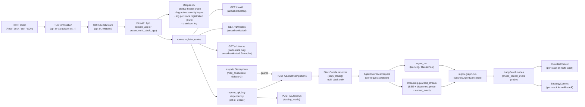

# Webserver Stacks

Production-shaped FastAPI examples that mount the OpenAI-compatible
Inqtrix HTTP server on top of explicit Baukasten provider stacks.
Every script in this folder mirrors a sibling under
[`examples/provider_stacks/`](../provider_stacks/) — same providers,
same defaults, same model names — but exposes the agent over HTTP
instead of running it once in-process.

> Every environment variable these scripts read — with defaults and allowed
> values — is documented in
> [`docs/configuration/settings-and-env.md`](../../docs/configuration/settings-and-env.md),
> the single source of truth for env vars.
>
> See also [`docs/deployment/webserver-mode.md`](../../docs/deployment/webserver-mode.md)
> for the conceptual overview (endpoints, lifespan, concurrency,
> cancel-on-disconnect, per-request overrides). This README
> remains the authoritative reference for operational details and per-stack
> run commands.

> Inqtrix remains explicitly experimental. These examples ship
> minimum-viable hardening options (TLS, Bearer API key, CORS) as
> opt-in features, but they are not a substitute for a production-
> hardened deployment with reverse proxy, auditing, rate limiting and
> secrets management. See the repo `README.md` header for the full
> disclaimer.

## Python installation and command parity

Choose one installation path from the repository root:

```bash
# uv
uv sync --extra dev

# or standard Python/pip
python -m venv .venv
source .venv/bin/activate
python -m pip install -e ".[dev]"
```

Operational recipes below use plain `python` so they remain portable. In the uv
path, the equivalent command is `uv run python ...`; in the activated
pip-installed environment it is `python ...`. Both execute the same entry
point with the same environment variables.

## Relationship to `provider_stacks/`

| Aspect | `provider_stacks/` | `webserver_stacks/` |
|---|---|---|
| Mode | Library — `agent.research(...)` | Server — OpenAI-compatible HTTP API |
| Lifetime | Per script run | Long-running daemon |
| Provider construction | identical | identical (1:1, single source of truth) |
| Settings / tuning values | inside the `AgentConfig` block | inside `AgentSettings(...)` (same defaults) |
| Output | `print(result.answer)` | SSE stream / JSON response |
| Multi-client capable | no (one question per run) | yes (see Concurrency section below) |
| Multiple provider stacks per process | no | yes via `multi_stack.py` (see [Multi-stack server](#multi-stack-server)) |
| Per-request tuning | no | yes, via `agent_overrides` (see below) |
| Per-request provider switch | no | yes, via `body["stack"]` in `multi_stack.py` |
| Implicit cancel on client disconnect | n/a | yes (see [Cancel on disconnect](#cancel-on-disconnect)) |

Whenever `provider_stacks/` is refactored the matching
`webserver_stacks/` script must be updated in lockstep (and vice
versa) — the diff between the two families is intentionally limited
to the run block.

## Available stacks

| Script | LLM | Search |
|---|---|---|
| [`litellm_perplexity.py`](litellm_perplexity.py) | LiteLLM | PerplexitySearch |
| [`anthropic_perplexity.py`](anthropic_perplexity.py) | AnthropicLLM | PerplexitySearch |
| [`bedrock_perplexity.py`](bedrock_perplexity.py) | BedrockLLM | PerplexitySearch |
| [`azure_openai_perplexity.py`](azure_openai_perplexity.py) | AzureOpenAILLM | PerplexitySearch |
| [`azure_foundry_web_search.py`](azure_foundry_web_search.py) | AzureOpenAILLM | AzureFoundryWebSearch |
| [`azure_knowledge_quickstart.py`](azure_knowledge_quickstart.py) | AzureOpenAILLM | PerplexitySearch |
| [`multi_stack.py`](multi_stack.py) | mix of all above | mix of all above |

`azure_knowledge_quickstart.py` additionally enables the knowledge
engine (in-memory vector store, Azure deployment-based embeddings via
`INQTRIX_EMBEDDING_*` env vars): it registers the `/v1/knowledge/*`
routes and the `mode=knowledge` run algorithm, and its module
docstring walks the full curl sequence (create collection, ingest
text, knowledge run with a retrieval profile, SSE events, result).
Retrieval profiles are documented in
[`docs/configuration/knowledge-profiles.md`](../../docs/configuration/knowledge-profiles.md).

For browser SSO (`INQTRIX_AUTH_MODE=oidc` with the Dex reference IdP
from the dev compose stack) see the walkthrough
[`oidc_stack.md`](oidc_stack.md). It applies to every script in this
folder, since the auth provider is wired through `create_app(...)`.

The `multi_stack.py` example mounts every stack from the table above
into a single FastAPI process. Each stack is opt-in: only stacks
whose env vars are present at startup are registered. Clients pick
the stack per request via a new `body["stack"]` field; a
`GET /v1/stacks` discovery endpoint exposes the active list. See the
[Multi-stack server](#multi-stack-server) section below.

## Server topology

Two app factories share the same routes, lifespan, and security helpers.
Single-stack apps (the provider-specific scripts) use `create_app(...)`;
the `multi_stack.py` example uses
`create_multi_stack_app(...)` and additionally exposes the
`GET /v1/stacks` discovery endpoint plus per-request stack
resolution. The dotted box highlights the multi-stack-only branch.



## Environment variables

General rule: only the variables listed below are read; everything
else is hard-coded inside the script. That narrow surface is what makes
these examples deterministic — they are not a subset of the product's
configuration, they are a fixed list.

The canonical definition of every variable, with defaults and effects, is
[Settings and environment](../../docs/configuration/settings-and-env.md).
What follows is how these scripts use them.

### Per stack

The `multi_stack` script reads every variable in this table — each
stack is registered only when its required vars are present, so
`multi_stack.py` can run with a partial subset and skip the others.

| Variable | Stacks | Required | Default |
|---|---|---|---|
| `LITELLM_API_KEY` | litellm_perplexity, multi_stack | yes (for litellm) | – |
| `LITELLM_BASE_URL` | litellm_perplexity, multi_stack | no | `http://localhost:4000/v1` |
| `ANTHROPIC_API_KEY` | anthropic_perplexity, multi_stack | yes (for anthropic) | – |
| `PERPLEXITY_API_KEY` | anthropic_/bedrock_/azure_openai_perplexity, multi_stack | yes (for any perplexity stack) | – |
| `AWS_PROFILE` | bedrock_perplexity, multi_stack | no | AWS default |
| `AWS_REGION` | bedrock_perplexity, multi_stack | no | `eu-central-1` |
| `AZURE_OPENAI_API_KEY` | every azure_* script, multi_stack | yes (Option A, for any azure stack) | – |
| `AZURE_OPENAI_ENDPOINT` | every azure_* script, multi_stack | yes (for any azure stack) | – |
| `AZURE_OPENAI_DEPLOYMENT_NAME` | every azure_* script, multi_stack | yes (for any azure stack) | – |
| `AZURE_OPENAI_CLAIM_EXTRACT_DEPLOYMENT_NAME` | every azure_* script, multi_stack | no | `""` (falls back to default deployment) |
| `AZURE_AI_PROJECT_ENDPOINT` | azure_foundry_web_search, multi_stack | yes (for foundry stack) | – |
| `AZURE_AI_PROJECT_API_KEY` | azure_foundry_web_search, multi_stack | no | – |
| `WEB_SEARCH_AGENT_NAME` | azure_foundry_web_search, multi_stack | yes (for foundry stack) | – |
| `WEB_SEARCH_AGENT_VERSION` | azure_foundry_web_search, multi_stack | no | latest/default |
| `AZURE_TENANT_ID` / `AZURE_CLIENT_ID` / `AZURE_CLIENT_SECRET` | every azure_* script (Option B/C), multi_stack | no | – |

### Cross-cutting (all stacks)

| Variable | Required | Default | Effect |
|---|---|---|---|
| `INQTRIX_LOG_ENABLED` | no | `false` | Activates file logging with secret redaction in `logs/inqtrix_<timestamp>.log`. One file per server process. When `false`, the inqtrix logger stays silent (only `INQTRIX_LOG_CONSOLE` may surface output). |
| `INQTRIX_LOG_LEVEL` | no | `INFO` | Level for the **inqtrix** logger (`DEBUG` / `INFO` / `WARNING`). Controls how verbose the agent algorithm trace (`RUN start`, `TRACE plan: round=N`, `_classify_fallback`, ...) is. |
| `INQTRIX_LOG_CONSOLE` | no | `false` | Independently mirrors WARNING+ records of the inqtrix logger to stderr. Useful for live monitoring during tests; orthogonal to `INQTRIX_LOG_ENABLED`. |
| `INQTRIX_LOG_INCLUDE_WEB` | no | `true` | When file logging is enabled, also routes uvicorn (`Started server process`, `Application startup complete`, access lines `127.0.0.1 - "GET /health" 200`) and FastAPI logs into the same file via uvicorn's `log_config` parameter. Set to `false` when uvicorn already streams to a structured-logging sink and the duplication would be noise. |
| `INQTRIX_LOG_WEB_LEVEL` | no | `INFO` | Level for the uvicorn / FastAPI loggers in the generated `log_config` (`DEBUG` / `INFO` / `WARNING`). Independent from `INQTRIX_LOG_LEVEL` because uvicorn-DEBUG is network-verbose (HTTP frames, ASGI receive events) while inqtrix-DEBUG is algorithm-oriented — different debugging scenarios. |
| `OBSERVABILITY_PROFILE` | no | `summary` | `summary`, `debug`, or `forensic`. When set to `forensic`, the agent emits structured lineage events (`query_record`, `source_record`, `claim_merge`, `answer_claim_binding`, …) through the same `inqtrix` logger. Those lines are emitted at **DEBUG** level, so pair `forensic` with `INQTRIX_LOG_LEVEL=DEBUG` (and `INQTRIX_LOG_ENABLED=true`) to see them in `logs/inqtrix_<timestamp>.log`. Operator recipes: [`docs/observability/forensic-cookbook.md`](../../docs/observability/forensic-cookbook.md). |
| `INQTRIX_SERVER_HOST` | no | `0.0.0.0` | uvicorn bind address |
| `INQTRIX_SERVER_PORT` | no | `5100` | uvicorn port |
| `MAX_CONCURRENT` | no | `100` | Maximum active `/v1/chat/completions` requests. Native runs reuse this value only when `RUN_MAX_CONCURRENT` is unset. |
| `RUN_MAX_CONCURRENT` | no | `100` | Active-worker cap for native `/v1/runs`. Omitting it yields `100`, not a fallback to `MAX_CONCURRENT`; an empty value fails startup validation. |
| `RUN_QUEUE_MAX_SIZE` | no | `100` | Maximum native `/v1/runs` jobs waiting in memory. Active jobs do not count against this limit. |
| `RUN_COMPLETED_TTL_SECONDS` | no | `300` | Seconds terminal native run records and event buffers remain queryable in memory. |
| `RUN_EVENT_BUFFER_SIZE` | no | `200` | Recent structured events retained per native run for late SSE subscribers. |
| `INQTRIX_SERVER_TLS_KEYFILE` | no | `""` | PEM private key; mandatory pair with `_TLS_CERTFILE` |
| `INQTRIX_SERVER_TLS_CERTFILE` | no | `""` | PEM certificate; mandatory pair with `_TLS_KEYFILE` |
| `INQTRIX_SERVER_API_KEY` | no | `""` | Bearer protection on `/v1/chat/completions`, `/v1/runs*`, and `/v1/test/run` |
| `INQTRIX_SERVER_CORS_ORIGINS` | no | `""` | Comma-separated origin whitelist; activates `CORSMiddleware` |
| `INQTRIX_DEFAULT_STACK` | no (multi-stack only) | first registered stack | Picks which stack `multi_stack.py` uses when a request omits the `"stack"` body field. Must match a registered stack name. |

### Logging behaviour matrix

The four logging variables are intentionally orthogonal so that
"file vs. terminal" and "inqtrix vs. uvicorn" can be steered
independently. The matrix below covers the relevant combinations:

| `INQTRIX_LOG_ENABLED` | `INQTRIX_LOG_CONSOLE` | `INQTRIX_LOG_INCLUDE_WEB` | inqtrix records | uvicorn / FastAPI records |
|---|---|---|---|---|
| `false` | `false` | any | silent (NullHandler) | terminal only (uvicorn defaults — stderr/stdout) |
| `false` | `true`  | any | stderr WARNING+ only | terminal only |
| `true`  | `false` | `true` (default) | file (`logs/inqtrix_<ts>.log`) | file + terminal (single file, unified format) |
| `true`  | `false` | `false` | file only | terminal only |
| `true`  | `true`  | `true` (default) | file + stderr WARNING+ | file + terminal |

A few practical consequences:

- One server process produces exactly one `logs/inqtrix_<timestamp>.log`.
  Multiple chat-completion calls during the same process lifetime all
  append to that file — that is by design and makes per-run
  correlation trivial.
- When `INQTRIX_LOG_ENABLED=false`, `INQTRIX_LOG_INCLUDE_WEB` becomes
  effectively a no-op (there is no file to mirror into) — uvicorn
  keeps its own stderr/stdout defaults.
- `INQTRIX_LOG_LEVEL=DEBUG` floods the file with the agent's
  iteration trace (per-round plan/search/evaluate JSON dumps). Use
  for algorithm debugging, not for routine operation. With
  `OBSERVABILITY_PROFILE=forensic`, the same file also receives
  structured `EVENT <name>: {…}` JSON lines for source/claim/answer
  lineage (see the forensic cookbook linked in the table above).
- `INQTRIX_LOG_WEB_LEVEL=DEBUG` adds uvicorn HTTP-level diagnostics
  (frame parsing, connection-pool decisions, ASGI receive events)
  — useful when investigating SSE-disconnect oddities or reverse-proxy
  buffering, less useful for steady-state operation.
- File records use a unified format
  (`asctime | levelname | thread | logger | message`) regardless of
  origin (inqtrix / uvicorn.error / uvicorn.access / fastapi), so a
  single `grep` / `tail -f` over the file reads cleanly.

Recipe — debug a sticky algorithmic run with full trace:

```bash
INQTRIX_LOG_ENABLED=true \
INQTRIX_LOG_LEVEL=DEBUG \
INQTRIX_LOG_WEB_LEVEL=INFO \
python examples/webserver_stacks/anthropic_perplexity.py
```

Recipe — forensic lineage (query/source/claim/answer IDs in the same log file):

```bash
INQTRIX_LOG_ENABLED=true \
INQTRIX_LOG_LEVEL=DEBUG \
INQTRIX_LOG_WEB_LEVEL=INFO \
OBSERVABILITY_PROFILE=forensic \
python examples/webserver_stacks/anthropic_perplexity.py
```

Recipe — investigate a reverse-proxy / disconnect issue:

```bash
INQTRIX_LOG_ENABLED=true \
INQTRIX_LOG_LEVEL=INFO \
INQTRIX_LOG_WEB_LEVEL=DEBUG \
python examples/webserver_stacks/anthropic_perplexity.py
```

Recipe — silent mode (only WARNING+ to terminal, no file):

```bash
INQTRIX_LOG_CONSOLE=true \
python examples/webserver_stacks/anthropic_perplexity.py
```

## Run instructions

Pick a single-stack script when you want one provider combination per
process, or `multi_stack.py` when one server should host every
provider combination available in your environment.

```bash
# uv: single-stack, then multi-stack
uv run python examples/webserver_stacks/litellm_perplexity.py
uv run python examples/webserver_stacks/multi_stack.py

# standard Python/pip: the same entry points
python examples/webserver_stacks/litellm_perplexity.py
python examples/webserver_stacks/multi_stack.py
```

By default the server listens on `http://0.0.0.0:5100` (HTTP).
Example calls:

```bash
# Health probe (always unauthenticated)
curl http://localhost:5100/health

# Plain chat-completion call (blocking)
curl -X POST http://localhost:5100/v1/chat/completions \
  -H 'Content-Type: application/json' \
  -d '{"messages":[{"role":"user","content":"Was ist der Stand der GKV-Reform?"}]}'

# With per-request override (browser UI pattern)
curl -X POST http://localhost:5100/v1/chat/completions \
  -H 'Content-Type: application/json' \
  -d '{"messages":[{"role":"user","content":"..."}],
       "agent_overrides":{"report_profile":"deep","max_rounds":5}}'

# Multi-stack only — list available stacks
curl http://localhost:5100/v1/stacks

# Multi-stack only — pick a stack per request
curl -X POST http://localhost:5100/v1/chat/completions \
  -H 'Content-Type: application/json' \
  -d '{"messages":[{"role":"user","content":"..."}],
       "stack":"bedrock_perplexity",
       "agent_overrides":{"report_profile":"deep"}}'

# With the API-key gate enabled (set INQTRIX_SERVER_API_KEY=secret-token)
curl -X POST http://localhost:5100/v1/chat/completions \
  -H 'Authorization: Bearer secret-token' \
  -H 'Content-Type: application/json' \
  -d '{"messages":[{"role":"user","content":"..."}]}'

# With TLS (HTTPS) enabled
curl https://localhost:5100/health --cacert /path/to/cert.pem
```

### Enabling API-key auth and TLS — no code change required

Every script in this folder is already wired for both layers. To switch
either of them on, set the env vars below and restart — the script
itself stays untouched:

```dotenv
# Bearer-token gate — protects /v1/chat/completions and /v1/test/run
INQTRIX_SERVER_API_KEY=dev-secret-xxxxx

# TLS pair — both required, partial config raises RuntimeError
INQTRIX_SERVER_TLS_KEYFILE=./key.pem
INQTRIX_SERVER_TLS_CERTFILE=./cert.pem
```

`create_app()` activates the gate automatically through
`build_auth_provider(settings)`, honouring `INQTRIX_AUTH_MODE`
(unset infers the mode from `INQTRIX_SERVER_API_KEY`; the legacy
`make_api_key_dependency` helper remains for direct `register_routes`
injection); each script forwards
`resolve_tls_paths(settings.server)` to `uvicorn.run(...)` for HTTPS.
The startup log records the active layers (`api_key_gate=on/off`,
`auth_mode=...`, `cors=...`); use it as the smoke test.

> The `python -m inqtrix` entry point activates the API key gate the
> same way, but it does **not** wire TLS into uvicorn. Use one of the
> scripts in this folder when you need built-in HTTPS, or terminate TLS
> at a reverse proxy.

See
[`docs/deployment/webserver-mode.md`](../../docs/deployment/webserver-mode.md#authentication-and-tls)
for the end-to-end walkthrough including bash, Python `httpx`, and
`requests` client examples.

### Per-request overrides

The JSON body of `/v1/chat/completions` accepts an optional
`agent_overrides` object. Whitelist (any other key triggers
`400 invalid_request_error`):

| Field | Range | Effect |
|---|---|---|
| `max_rounds` | 1–10 | Maximum number of research rounds |
| `min_rounds` | 1–10 | Minimum number of research rounds |
| `confidence_stop` | 1–10 | Confidence threshold for early stop |
| `report_profile` | `compact` / `deep` | Switch between compact and deep answers. Profile defaults are mirrored onto non-explicit fields; explicit operator/user values win. |
| `max_total_seconds` | 30–3600 | Wall-clock deadline per run |
| `first_round_queries` | 1–20 | Round-0 query breadth |
| `skip_search` | boolean | Direct-chat mode: bypass plan/search/evaluate, return an uncited LLM answer with `round=0`. |

Adding a new field is a one-line change to `AgentOverridesRequest`
(`src/inqtrix/server/overrides.py`) plus a single test. The full
recipe — including the deliberate forbidden list — lives in the
module docstring of that same file.

## Parallel requests (concurrency)

The server serves multiple clients (e.g. several browser UIs) in
parallel through an `asyncio.Semaphore`. The default cap is
`MAX_CONCURRENT=100`. The OpenAI-compatible `/v1/chat/completions`
endpoint keeps the historical behaviour: once the cap is reached the next
concurrent request receives an immediate `429 rate_limit_error` (no
queueing).

The native `/v1/runs` endpoint uses `RUN_MAX_CONCURRENT` for active
workers when set; otherwise it falls back to `MAX_CONCURRENT`. It also
keeps an in-memory FIFO queue (`RUN_QUEUE_MAX_SIZE`, default 100).
Queued/running state and completed reports are intentionally
process-local; terminal records expire after `RUN_COMPLETED_TTL_SECONDS`
(default 300).

Reproducible with bash and four background calls:

```bash
# Setup: start the server in one terminal
python examples/webserver_stacks/litellm_perplexity.py

# In a second terminal, fire four calls in parallel
for i in 1 2 3 4; do
  curl -s -X POST http://localhost:5100/v1/chat/completions \
    -H 'Content-Type: application/json' \
    -d "{\"messages\":[{\"role\":\"user\",\"content\":\"Frage $i\"}]}" \
    -o "/tmp/resp_$i.json" \
    -w "%{http_code}\n" &
done
wait
```

Expected: three `200`, one `429`. Bump the cap when you need more
parallelism:

```bash
MAX_CONCURRENT=10 python examples/webserver_stacks/litellm_perplexity.py
```

Scaling notes:

- Example scripts run with one `uvicorn` worker. Horizontal scaling is a deployment concern: place container replicas behind a load balancer and keep provider quotas in mind.
- The LLM/search providers are I/O-bound; even with `MAX_CONCURRENT=10` a single worker does not block the event loop.

## Lifecycle

- **Provider singleton**: `_build_providers()` runs exactly once per server process (inside `build_app()`); the LLM/search providers are then reused process-wide. This matches the caching behaviour of the OpenAI / boto3 / Azure SDKs. In `multi_stack.py` the same applies per stack — every registered stack constructs its providers once and keeps them for the process lifetime.
- **Lazy SDK init**: Some providers (notably `BedrockLLM`) materialise their boto3 session only on the first call. The `/health` probe does not necessarily trigger that path.
- **Foundry token caveat**: `AzureFoundryWebSearch` mints its bearer in the constructor (~60–75 min lifetime, auto-refresh through `azure.identity`). Edge case: within the last 10 s before expiry the cache may hand out a stale token and the next call sees a transient 401 — restart the process to mitigate. Multi-key rotation and a refresh endpoint are explicitly out of scope.
- **Graceful shutdown**: The ASGI `lifespan` handler emits an `Inqtrix server stopping` log line on stop. Uvicorn drains in-flight streams on `SIGTERM`; `--timeout-graceful-shutdown` controls how long uvicorn waits for in-flight responses.
- **Health probe**: `GET /health` calls `is_available()` on both providers and returns `200` (all ready) or `503` (degraded). Suitable for a Kubernetes liveness probe; splitting liveness from readiness is a follow-up task.
- **Multi-stack discovery cache**: `GET /v1/stacks` caches its rendered payload for ~5 seconds before re-probing each stack's `is_available()`. A polling client calling the endpoint every second therefore triggers at most one provider-readiness probe per 5 s.
- **Per-stack strategy defaults**: When a `StackBundle` is registered without an explicit `strategies=...`, `create_multi_stack_app` derives them from `bundle.providers.llm` via `create_default_strategies(...)`. Per-stack `agent_settings` (when supplied) override the global `settings.agent` for requests routed to that stack, but per-request `agent_overrides` always win on top.
- **Cancel on disconnect**: Both factories install the SSE-disconnect probe described in [Cancel on disconnect](#cancel-on-disconnect). Token spend is bounded by the in-flight provider call when the client goes away.

## What you see when you start the server

`uv run python examples/webserver_stacks/<script>.py` and, after the pip
installation, `python examples/webserver_stacks/<script>.py` both reach the
same plain `uvicorn.run(app, ...)` invocation. The terminal output looks
exactly like a regular FastAPI/uvicorn boot, with one extra Inqtrix-specific
log line up front from the lifespan handler.

Single-stack scripts emit one provider line:

```
Inqtrix server starting | llm=LiteLLM ready=True | search=PerplexitySearch ready=True
| report_profile=deep | max_concurrent=3 | run_completed_ttl_seconds=300
| api_key_gate=off | cors=off
INFO:     Started server process [12345]
INFO:     Waiting for application startup.
INFO:     Application startup complete.
INFO:     Uvicorn running on http://0.0.0.0:5100 (Press CTRL+C to quit)
```

`multi_stack.py` emits one summary line plus one entry per
registered stack:

```
Inqtrix multi-stack server starting | stacks=3 | default=anthropic_perplexity
| max_concurrent=3 | api_key_gate=off | cors=off
  stack=anthropic_perplexity | llm=AnthropicLLM | search=PerplexitySearch
    | description=Direct Anthropic Opus 4.6 (adaptive thinking) + Perplexity Sonar Pro
  stack=bedrock_perplexity | llm=BedrockLLM | search=PerplexitySearch
    | description=AWS Bedrock Opus 4.6 (eu region) + Perplexity Sonar Pro
INFO:     Started server process [12345]
INFO:     Uvicorn running on http://0.0.0.0:5100 (Press CTRL+C to quit)
```

Stacks whose env vars are missing get an INFO line up front
(`Multi-stack: skipped _build_<name> (env vars missing)`) and are
omitted from the registered list.

Press `Ctrl+C` once to trigger uvicorn's graceful shutdown sequence;
the lifespan handler then emits the matching shutdown log line. A
second `Ctrl+C` forces immediate termination.

### Outbound connections and telemetry

By design the server only opens connections to the providers you
configured:

- **FastAPI / Starlette**: do not phone home; the OpenAPI docs UI is
  disabled by setting `docs_url=None`, `redoc_url=None` and
  `openapi_url=None`.
- **uvicorn**: emits the standard `Server: uvicorn` response header
  but contacts no external services.
- **Pydantic / Pydantic-Settings**: do not phone home.
- **openai SDK**: only contacts the `base_url` you set (e.g. the
  Azure endpoint or the Perplexity API). Optional usage data
  uploads to `api.openai.com` are off unless you opt in.
- **Anthropic / Bedrock / Azure Identity**: only the documented
  service endpoints, no telemetry.
- **LangGraph**: stays local. The optional **LangSmith** trace
  uploader is only active when `LANGCHAIN_TRACING_V2=true` and
  `LANGCHAIN_API_KEY` are set in the environment — leave both
  unset to keep traces local.

If you need a hard guarantee, run the server inside a network
namespace that only allows outbound connections to your
LLM/search endpoints.

## Multi-stack server

`multi_stack.py` boots a single FastAPI process that hosts every
provider combination that has its env vars set. It exposes the same
`/v1/chat/completions` surface as the single-stack scripts plus one
new endpoint:

```bash
GET /v1/stacks
```

Response shape:

```json
{
  "default": "anthropic_perplexity",
  "stacks": [
    {
      "name": "anthropic_perplexity",
      "llm": "AnthropicLLM",
      "search": "PerplexitySearch",
      "ready": true,
      "description": "Direct Anthropic Opus 4.6 (adaptive thinking) + Perplexity Sonar Pro"
    },
    ...
  ]
}
```

Discovery is **unauthenticated** even when `INQTRIX_SERVER_API_KEY` is
set, so a UI can render its stack-selection box before prompting for
credentials. The endpoint is cached in-memory for ~5 seconds so a
polling client does not turn into a provider-call storm.

### Picking a stack per request

Add a top-level `"stack"` field to the JSON body. OpenAI-SDK clients
use `extra_body={"stack": "..."}`:

```bash
curl -X POST http://localhost:5100/v1/chat/completions \
  -H 'Content-Type: application/json' \
  -d '{
        "messages": [{"role":"user","content":"Was ist der Stand der GKV-Reform?"}],
        "stack": "bedrock_perplexity",
        "agent_overrides": {"report_profile": "deep"}
      }'
```

If the field is omitted, the request goes to the configured default
stack (first registered, or `INQTRIX_DEFAULT_STACK`). Unknown stack
names return `400` with an `available_stacks` hint:

```json
{
  "error": {
    "message": "Unknown stack 'does_not_exist'",
    "type": "invalid_request_error",
    "available_stacks": ["anthropic_perplexity", "bedrock_perplexity", ...]
  }
}
```

### Stack switching

Every request resolves its stack independently from the `stack` field.
Switching the stack mid-conversation changes the active provider bundle;
previous research evidence is not reused server-side.
Surface that to your users when you build the selection box.

## Cancel on disconnect

Both the single-stack and multi-stack servers implicitly cancel a
streaming run when the client disconnects (browser tab closed,
"Stop" pressed and SSE connection torn down). Detection
runs in a dedicated background watcher task that blocks on
`await request.receive()` and acts on the first `http.disconnect`
ASGI message. Polling `request.is_disconnected()` was insufficient:
a live test in 2026-04 showed a deep run completing despite a short
`curl --max-time` abort under the polling implementation.

The cancel takes effect at LangGraph node boundaries — a probe at
the entry of `classify`, `plan`, `search`, `evaluate` and `answer`
raises `AgentCancelled`, the graph returns a result marked
`cancelled=True` and the streaming generator stops emitting chunks.

What this means in practice:

- **No client signal needed** beyond closing the SSE stream — there
  is no separate `/cancel` endpoint for `/v1/chat/completions`.
  Native `/v1/runs` clients should use `POST /v1/runs/{run_id}/cancel`
  when they need explicit cancellation without closing an event stream.
- **Token budget is bounded** by the in-flight provider call when
  the disconnect happens. Latency from the disconnect to the actual
  agent stop equals the remaining duration of that call; in-flight
  LLM/search HTTP calls are not interrupted and remain bounded by the
  configured operation timeout.
- **Server log** emits `INFO  Run cancelled by client disconnect` so
  operators can correlate dropped UI connections with backend cost.

True sub-second cancellation would require provider-specific support to
interrupt calls mid-flight; that remains a separate follow-up task.

## Search engine identifier in /health and /v1/stacks

Both endpoints surface a `search_model` field that mirrors the
constructor-supplied identifier of the active search backend so
operators (and UIs rendering stack chips) can verify which engine a
request actually routes through. Examples:

| Stack | `search_model` value |
|---|---|
| `litellm_perplexity`, `anthropic_perplexity`, `bedrock_perplexity`, `azure_openai_perplexity` | `fast-search` |
| `azure_foundry_web_search` | `foundry-web:<agent_name>@<version_or_latest>` |
| Any custom `SearchProvider` subclass without override | `<ClassName>(unknown)` (intentional loud default) |

The standardized [`SearchProvider.search_model`](../../src/inqtrix/providers/base.py)
property makes this identifier provider-controlled instead of
heuristic-guessed, so the multi-stack discovery does not show the
global `Settings.models.search_model` LiteLLM default
(`perplexity-sonar-pro-agent`) on Azure-only stacks, which would
mislead operators.

## Test coverage

The tests that cover this family, and what each one holds:

- [`tests/test_webserver_examples.py`](../../tests/test_webserver_examples.py)
  — one parametrised set per stack, plus `multi_stack.py`.
- [`tests/test_server_overrides.py`](../../tests/test_server_overrides.py)
  — the per-request override logic.
- [`tests/test_server_security.py`](../../tests/test_server_security.py)
  — the TLS resolver, the API-key dependency and the CORS middleware.
- [`tests/test_server_multi_stack.py`](../../tests/test_server_multi_stack.py)
  — `StackBundle`, `create_multi_stack_app`, discovery and per-stack routing.
- [`tests/test_server_cancel_on_disconnect.py`](../../tests/test_server_cancel_on_disconnect.py)
  — `AgentCancelled`, node-boundary probes, and the SSE disconnect watcher.
- [`tests/test_search_provider_metadata.py`](../../tests/test_search_provider_metadata.py)
  — pins `SearchProvider.search_model` for every in-tree provider.
- [`tests/test_routes.py`](../../tests/test_routes.py)
  — provider injection and lifespan logging.

Counts are deliberately not listed: the command below reports them, and a
number written here is only ever right on the day it is written.

Run the webserver-related slice locally:

```bash
# uv
uv run pytest \
  tests/test_webserver_examples.py \
  tests/test_server_overrides.py \
  tests/test_server_security.py \
  tests/test_server_multi_stack.py \
  tests/test_server_cancel_on_disconnect.py \
  tests/test_routes.py \
  -v

# standard Python/pip
python -m pytest \
  tests/test_webserver_examples.py \
  tests/test_server_overrides.py \
  tests/test_server_security.py \
  tests/test_server_multi_stack.py \
  tests/test_server_cancel_on_disconnect.py \
  tests/test_routes.py \
  -v
```
